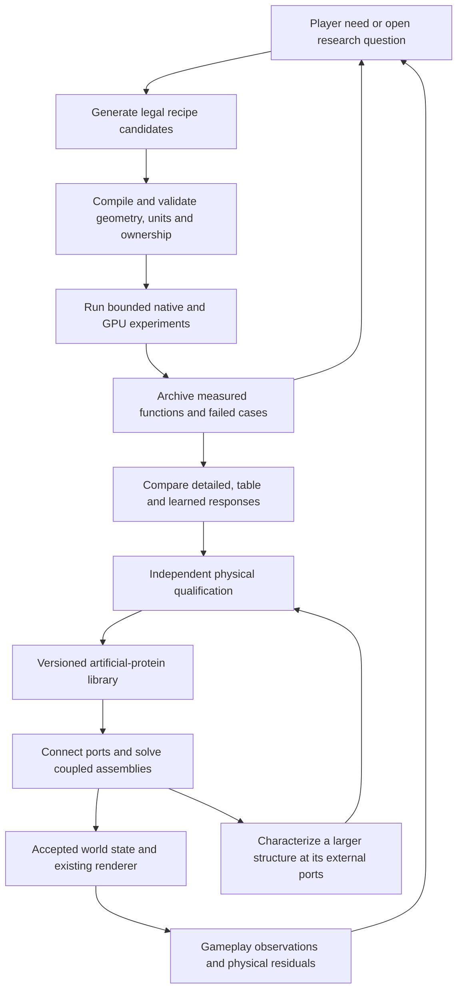
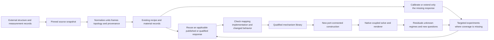

# SEALED — a game built from simulated matter

Working title: **SEALED** (alternates: *Tension*, *The Sump*, *Vivarium*).
Original concept: Qwen, 2026-10-11. Design, engineering, genre and matter-construction
revision: Codex, 2026-10-11. Keep this plan in `GAME_PLAN_ACTION_RPG.md`.

**Confirmed direction:** grow ChimeraEngine itself. The user chose Option B on
2026-10-11; no Godot or Unreal host. **This document proposes a game and the
simulated-matter technology that supports it**, with an implementation sequence;
it does not claim that its proposed systems work today.
The selected project graph still governs scientific requirements and release gates.

**Product goal, clarified by the operator on 2026-10-18:** create a compelling game
that uses simulated matter. Exploration, construction, combat, companionship and
meaningful choices are the experience; physical behavior makes those interactions
coherent and opens new possibilities. Judge progress by what players can do and
enjoy. The matter workshop is the first playable milestone within the larger game.

**Current delivery focus, operator clarification 2026-10-19:** Chimera is now
being delivered through a Blender plugin/application template, supported by the
isolated Blender fork. Make the user's existing editor a working interface to
Chimera's actual membrane building blocks and native render kernel: construct,
assign supported materials, connect, inspect, save and resume. Human and AI work
should meet in the same visible construction and commands. The larger game remains
the destination; the immediate Blender assignment does not start another game
loop, editor or physics implementation. Use the interface to discover concrete
missing engine capabilities. Water stays deferred. Preserve the local agents'
ongoing engine work and completed evidence; §12.2 and §13.1 define the integration
boundary, current verified capabilities and next priorities.

**Supporting technology direction, 2026-10-13:** build a composable multiscale
matter simulator for a holodeck-like world. A LEGO piece
is a reusable physical mechanism: geometry, material/state, boundary exchanges,
scale relationships and measured response. Mechanisms recur in nature and can
be composed into larger mechanisms. GPU experiments do the expensive mathematical
work of characterizing them piece by piece; validated representations make their
reuse practical. An assembly recipe is one expression of this architecture.

The system must carry a mechanism across the scales and physical regimes where
its model applies, recognize regime changes, and preserve exchanges when pieces
are connected. Geometric resemblance alone does not establish physical similarity.
Broader physical coverage should expand useful player interactions; one trained
table cannot establish universal simulation. SEALED's encounters and player choices
direct which capabilities matter next. The rescue slice is an early game experience;
the longer-term engine ambition supports a richer game without making exhaustive
physical coverage a prerequisite for play.

**Production measuring stick, clarified by the operator on 2026-10-16:** deliver
more useful, independently checked physical behavior and meaningful player choices
within measured frame-time and memory budgets. Reduce the work required per
simulated second by reusing qualified matter responses, while preserving the
behavior that makes construction and play meaningful. Arithmetic count alone is
not performance; include memory traffic, synchronization, contact, state transfer,
and rendering. Compare alternatives on the same workload and hardware. This is a
continuous design criterion, not a claim that one scalar score measures physics
or fun. Apply §11.24 to simulation and §12.1 to game development at every milestone.

**Playable-first direction, clarified by the operator on 2026-10-18:** make a
valuable game that uses simulated matter for exploration, construction, combat
and care. Build, test, repair and reuse are the immediate workshop verbs.
Every agent must understand why its assignment matters to that goal. Research
removes a specific obstacle or explores a named possibility for the game; more
experiments, smaller residuals and longer reports are not themselves product
progress. Lead every handoff and report with the effect on the game, the remaining
obstacle and the decision enabled. Put detailed measurements in linked evidence.
Preserve independent physical checks and explain which behavior they protect.
Creative freedom includes proposing a better route to the goal.

**Reading route for the worker:** start with §12.2's current Blender delivery
focus and §13.1's ownership-aware assignment, then §11.22's purpose-bearing peer
workflow. Use §5.1 for the workshop's eventual player purpose. Apply §11.24 and
§12.1 to physical cost and player value. Consult §3 and §5.1 before creating tools;
§11.20.12 records newer implementation evidence beyond the original AP01/AP02
sequence. Use §11.23 for nested/repeating geometry, §11.21 for database sources,
§11.20 for artificial proteins, §11.19 for bounded creative research and §11.18
for qualification when the chosen increment needs them. §11.25 ranks research by
its next workshop decision; §11.21.3 prioritizes UnitcellDB and FEBio and §11.21.8
explains how to reuse established results without repeating their original work.
§§11.16–11.17 retain multiscale architecture and optional Noether fitting. These are available methods,
not a mandatory tour through every research section before improving the game.
**Building-block direction, 2026-10-14:** artificial proteins are the reusable
matter mechanisms described in §11.20: generated physical arrangements whose
functions are discovered and independently qualified, composed through their ports,
and reused recursively as larger pieces. Their immutable recipes and validated
representations serve many game objects; native instances retain physical state.

Reuse §§11.1–11.15 for construction, CA, membranes, rendering and experiments.
Preserve B0–B8's scoped evidence; they are a construction foundation, not proof
that the multiscale simulator is complete. §§1–10 retain game applications.
This revision changes the planned engineering direction; it does not silently
change graph admission, a released interface, or an existing result's validity.

## 1. The game we are making

**Operator design clarification, 2026-10-18:** player invention should be enabled
by a material-aware CAD/3D-printing workshop. Choose an editable assembly or import
a design, assign materials to its parts and layers, fabricate the resulting matter,
then use and modify it in the game. Spaceships, cars, houses and machinery are
important target creations. A space RPG built around those inventions is part of
the product ambition; the current Warden/Sump rescue setting is the working early
experience, not a restriction to biological parts or a closed prefab catalog.
Engineering understanding should emerge through play, with accessible templates
for newcomers and deeper geometry/material control for experienced makers.

You are a Warden bonded to a creature in the Sump, a world of living shelters,
strained bridges and animals whose bodies bear the history of their lives.
You explore, fight, rescue and build by redirecting force and resources through
those bodies. Your companion is also your climbing partner, load bearer and
collaborator in improvised machines.

The distinguishing feature is **transferable understanding**. Learning how to brace
an injured limb teaches you how to support a broken bridge. Learning how to isolate
a leaking chamber teaches you how to protect the lair. A tendon spool can become a
splint, a climbing aid, a winch or a trap because its attachments and loading change.

This is a construction-centered third-person action RPG and systems sandbox.
The player designs useful assemblies, learns why they work, and adapts them to
new situations. A layered rescue frame can become a hoist, a bridge support or
a vehicle component through its actual parts and connections. Each reuse should
preserve the material behavior learned earlier.

Experimentation must feel immediate and understandable. Combat must
be responsive, exploration must reward curiosity, and care must change what happens
on the next expedition. Physical consistency gives choices consequences; presentation,
encounters and pacing make those choices enjoyable.

**The first promise is small:** construct and load-test one asymmetric rescue
assembly, then use it with one companion at one damaged crossing. Several
arrangements should offer physically distinct ways to bring everyone home.

## 2. What the new concepts unlock

The opportunity is in combinations, not in making 42 unrelated features from
[THE_MEMBRANE_INVENTORY.md](THE_MEMBRANE_INVENTORY.md). Each row below is a proposed
gameplay application. Its prerequisites remain work unless evidence in §3 says otherwise.

| Physical idea | What the player can do with it | A memorable situation | Engineering prerequisite |
|---|---|---|---|
| Independent compartments and shared walls | Isolate a damaged region; divide a store; build redundancy | Sacrifice one bridge chamber to keep the route behind you intact | Closed region graph, one physical owner per shared wall, separate inventories |
| Tendons, insertion strength and slack | Brace, pull, suspend, tension, release; reroute a load | Turn your climbing line into a temporary leg brace, then recover it | Finite attachment patches, tensile failure, reactions on both endpoints |
| Capsules, contact and friction | Wedge, lever, pin, trip and stabilize | Beat a stronger predator by denying its footing rather than exhausting a bar | Coupled body dynamics, finite restraints, contact and traction |
| Punctures, valves and transport | Vent, transfer pressure, isolate leaks, control a passage | Open a pressure door by equalizing it instead of breaking it | Gas/liquid inventories, flow law and transported energy; rupture alone is insufficient |
| Adhesives, patches and cure | Make temporary repairs, reinforce seams, construct reusable joints | Hold a patch in compression while a companion braces the wall | Material supply, adhesion/cure state, strength and failure under renewed loading |
| Material differences and geometry | Trade stiffness against weight, flexibility against protection | A stiff splint restores carrying but makes a narrow squeeze harder | Versioned material profiles, section geometry, mass and inertia updates |
| Touch, proprioception, delays and reflexes | Read strain through the companion; exploit an enemy's limited information | A loaded foothold warns through posture and sound before it fails | Signals caused by contact/load, bounded propagation, interruption controls |
| Yielding, damage and repaired topology | Track history through function, not just a cosmetic scar | The repaired side of a bridge changes which route is safe next time | Persistent rest state, connectivity, residual strength and serialization |
| Thermal transfer and phase change | Store heat, soften a seal, release a frozen mechanism, cool a load | Spend scarce charge to thaw a valve, or take the long mechanical route | Temperature, heat capacity, transfer, latent heat and a tested material range |
| Growth and resource transport | Grow a load path, relocate a room, specialize a companion | Build a light shelter now or retain the material for tomorrow's climbing organ | Matter input, construction work, feasible geometry and stable topology insertion |
| Environmental and ecological feedback | Change access, food routes and shelter conditions | A repaired water route brings grazing animals back, attracting predators later | Explicit resource sources/sinks and scoped agents; a whole ecosystem is not required |

Prioritize the first six rows for a reusable construction vocabulary. Sensing makes
their consequences readable. Thermal systems, growth and ecology expand that vocabulary
after the basic interactions can be played, saved and recovered.

### Three scenes to build toward

**The broken crossing.** Your companion cannot carry the rescued animal across a
sagging bridge. You can unload supplies, tension a second support, lead both animals
through separately, or lower the load and haul it up the other side. Each solution
changes loads and geometry. There is no mission flag requiring one specific solution.

**The injured rival.** A predator returns with a damaged forelimb and favors a different
stance. You can drive it away, repair it to gain safe passage, or lure it onto ground
where that stance is a disadvantage. This needs persistent functional damage and an
AI that observes its own capabilities; it does not need a general social simulation.

**The living workshop.** A lair tendon normally closes a gate. You disconnect it,
attach it to a hauling frame and use stored tension to raise a chamber for repairs.
Doing so leaves the gate unsecured. Construction becomes rearranging a useful system,
with visible consequences, rather than selecting a larger structure from a menu.

These are encounter proposals and acceptance scenarios, not current engine features.

## 3. Starting point: evidence and limits

Reviewed checkout: `E:/PythonChimera`, branch `WK-ENGINE-PATHS-20260929-PR`,
HEAD `16097866b22d160d69ef2cf6f67802067164d507` at the start of this revision.
The working tree contains unrelated changes and untracked experiments. This review
reads their existence without adopting them as finished features. No controller
session was provisioned for this edit; it is repository-only planning.

| Capability | What the inspected source/evidence supports | What it does not establish |
|---|---|---|
| Energy-based tendon drive | `tendon_drive.hpp` and the round-11 report describe one default-off knee drive; unit checks cover ledger, sever, stall, rest and monotonic behavior | Whole-body locomotion, measured biological parameters, healing or a complete combat system |
| Tendon accounting | Round 11 reports 759 armed frames, maximum residual about `1.055e-12 J`, and zero violations against its `1e-6 J` guard | A universal world-energy tolerance or a proof of every other solver |
| Creature appearance and binding | The existing rigged mesh and sealed-cell demo provide a visible body and interaction surface | Correct inertias, independent physical degrees of freedom or stable movement of every limb |
| Local sever/rupture demonstrations | Existing demo paths provide a starting point for interrupting a force path and changing containment | Spatial weapon contact, arbitrary cracks, conserved leak flow, choking or repair |
| Follow camera and first lighting pass | Commits `6107d763` and `813c8c76`, with round-11 evidence, add optional follow view, lit materials and ledger feedback | A completed camera for fast combat, shadows, game art or horizontal locomotion; that report explicitly describes single-Y root motion |
| Lessons and shell | The existing lesson progression, restart and interaction loop are reusable onboarding material | A complete rescue encounter, RPG progression or a finished commercial release |
| Graph and source/evidence pins | Provenance and versioned descriptions of scientific/content inputs | A runtime save format, rollback, cross-hardware deterministic replay or anti-cheat |
| Gait and other experiments | Candidate files and earlier receipts exist | Current integration qualification; inspect the relevant graph contract and exact build before relying on them |

Evidence entry points:

- [Round-11 camera, lighting and ledger report](../tools/game_shell/evidence/round-11/11_camera_light_report.md).
- [Round-10 playable report](../tools/game_shell/evidence/round-10/10_playable_report.md).
- [Tendon implementation](../ChimeraEngine/engine/tendon_drive.hpp) and
  [MembraneTick interface](../ChimeraEngine/engine/membrane_tick.hpp).
- [Membrane inventory](THE_MEMBRANE_INVENTORY.md), especially its final five-step build order.
- Graph contracts `req.current_product_focus`, `req.teddy_gpu_matter_kernel`,
  `req.creature_assembly`, `req.body_environment_interface`, `req.embodied_senses`,
  `req.engine_game_release` and `req.documentation_admission`.

These are source and historical-evidence references. No fresh physics run or
playtest was performed merely to revise this document. The first camera/lighting
slice is already reported complete and should not be reassigned as new work.

### Construction audit: how matter currently reaches the screen

The construction revision inspected the current working source on 2026-10-11.
The checkout HEAD is still the revision above, but `main.cpp`, `membrane_tick.cpp`
and `membrane_tick.hpp` contain other ongoing changes. This is a source audit,
not a claim about which executable is running. Existing measurements remain scoped
to their original builds. The game plan is the only project file changed here.

CA means **cellular automata / local material rules** in this project's vocabulary.
`THE_WOLFRAM_FRAME.md` and `THE_CA_BRIDGE.md` explain the intention: separate triangle
systems carry material-dependent state and interact through their boundaries. The
active graph further defines bulk cells, paired interface exchanges, owned physical
state and GPU residency. Those requirements are more complete than the current
creature demo. A surface-triangle CA cell and a sealed volume cell are different
entities in the present code; the construction design must explicitly relate them.

| Inspected path | What exists in this source | What construction still needs |
|---|---|---|
| Creature import and tick | `/mesh_bin` queues nine-float vertices (position, normal, RGB) and indices. The render thread loads them, initializes `MembraneTick`, then runs its CPU `step` over the host vertex mirror. `main.cpp`:1047–1085, 4230–4261, 4520–4534 | A collection of independently owned assemblies; one resident physical state and a simulation clock independent of display cadence |
| Surface CA | `MembraneTick::init/step` builds triangle-edge neighbors and carries load, damage and failure state. Pose/binding travel and local indentation change the mesh. The inspected damage redistribution is in-place and not scaled by dt. `membrane_tick.cpp`:200–266, 422–665 | Material-qualified stress/shear/bending/contact response, explicit update ordering and timestep behavior; a failed triangle must cause the declared physical transition rather than only a tint |
| Compartment geometry | Horizontal and oblique cuts, connected-component split, shared cut slots and opposite boundary winding exist. New cut vertices retain blends of original vertices. `membrane_tick.hpp`:113–145, 247–285; `membrane_tick.cpp`:1725–1933 | General concave/holey caps, independent daughter motion, shared-wall material mechanics and conservative live edits. The current fan triangulation and eight-ancestor blend limit are bounded mechanisms |
| Pressure/inventory | Signed volume and linear compressibility pressure are computed from the posed boundary; `w` is explicit but Phase 1 holds it invariant. The inspected pressure block does not apply reciprocal boundary traction. `membrane_tick.cpp`:706–760; `membrane_tick.hpp`:437–451 | Inventory-dependent closure, pressure-force coupling, openings and paired transport. Authoring two sealed daughters does not implement a wound, valve or leak |
| Material-volume compiler | `tools/material_volume.py` accepts an already conforming tetrahedral complex, checks ownership/topology/overlap, integrates mass/COM/full inertia and emits oriented interfaces | Connect it to geometry creation and the live runtime. It is a CPU reference compiler, not a tetrahedral mesher, elastic solver or existing game editor |
| Attachment mechanics | `tools/finite_area_attachment/finite_area_attachment.py` contains energy-derived patch attachments with balanced forces and moments; its native coupon explores coupled bodies and a membrane | Integrate qualified formulations into the shared runtime. The standalone coupon's declared energy/stability envelope is not a whole-game qualification |
| Alternate GPU paths | `joints.comp` has hierarchical skinning and an optional edge-relaxation/ground-clamp pass. `membrane_demo.comp` has trial/accepted surface-tension state and a presentation stage. `GraphSurface` is a separate quasistatic height-field fixture | Reuse applicable buffer/synchronization and law work without treating these different demonstrations as one completed general matter solver |
| Default mesh presentation | `Engine::update_mesh` uploads the full same-layout vertex stream. The main loop submits `frame()` before this tick/update, so the update supplies a later draw. `engine.cpp`:2160–2177; `main.cpp`:4469–4476, 4520–4534 | Versioned simulation/render snapshots, bounded dirty updates and resident GPU derivation; arbitrary live topology cannot use the same-layout update alone |
| Visible layers and selection | The triangle pipeline is depth-tested, back-face-culled and opaque. Its vertex stream lacks stable material/layer IDs. Current picking returns a nearest point. `/topology` and `/verts` expose the original outer surface, not every internal seal cap | Multiple assembly surfaces, real boundary extraction, stable face/port picking, cutaway/isolation and an explicit future transparency path |

Two source details are decisive. First, `Engine::load_mesh` can discard/collapse
render triangles unless `preserve_mesh_topology_` is enabled, while tick initialization
uses the original index stream (`engine.cpp`:1889–2099). A render triangle number
therefore cannot be assumed to identify a physical cell. Second, an active shared
body already refuses competing pose/matter/skin writers (`main.cpp`:739–746).
Construction should extend that ownership rule, not add another position writer.

The historical breathing displacement is applied after several physical measurements
in the legacy tick (`membrane_tick.cpp`:905–917). It must retain that limited label
until replaced by a coupled mechanism. Likewise, recent default-off locomotion-spike
code is experimental; its presence does not qualify whole-body motion.

The design below follows `req.creature_assembly`, `req.layered_anatomy`,
`concept.reduced_cell_state`, `req.matter_variables_lod` and
`req.teddy_gpu_matter_kernel`. It also preserves the material-owned physical-port
semantics in `PHYSICAL_PORTS.md`: the matter owns a potential interaction field;
contact activates a compatible law; an active interaction is a separate record.
This gives automatic physical interaction without requiring players to wire triangle
pairs manually. Contact still does not invent a bond or its material parameters.

Reference source paths above identify local inspected implementations, including
reference tools that may not be included on the published document branch. They are
not a claim that publishing this plan also publishes or deploys those source changes.

## 4. Design rules that let the systems combine

1. **Function follows the physical path.** An attachment, wall, valve or actuator
   must do the work attributed to it. Severing the path removes its contribution;
   a hidden hinge or animation must not silently replace it.
2. **Energy constrains action; it is not the only resource.** Track usable energy,
   matter, contained fluid/gas, heat and load-bearing structure separately. Food
   can provide material and chemical energy through a declared reduced process.
   Money is a social representation; it is not literally joules. A charged but
   punctured body and an intact exhausted body should create different problems.
3. **Change a capability, not an invisible score.** Damage affects a load path,
   seal, sensor or actuator. A health summary may communicate those conditions,
   but it must not secretly determine physical outcomes.
4. **Give the player a usable interface.** Attachment previews, strain indicators,
   material recipes, maps and short tutorials are allowed. “No menus” and “no UI”
   are not product requirements. Construction must be understandable without
   knowing the engine's terminology.
5. **Make experimentation recoverable.** Show a warning before irreversible
   failure when the character could perceive one. Offer a quick release, a
   temporary brace and a route home. Permanent injury must not trap a player in
   a campaign they can no longer play.
6. **Keep a small vocabulary useful everywhere.** Adding a material or part should
   create new combinations of existing verbs before it adds another bespoke rule.
7. **Borrow the decision that makes a genre work.** Preparation, inference,
   timing, expression and stewardship can share one world. Each proposed mode
   must identify the choice it adds and the existing parts it reuses.
8. **Teach, vary, combine, then transfer.** Introduce a relation in a readable
   situation, change one constraint, and later let the player recognize it
   elsewhere. Knowledge should keep working beyond its introductory encounter.
9. **Make room for several kinds of satisfaction.** Support curiosity, care,
   mastery, improvisation and quiet restoration. Rewards and pacing should
   acknowledge those motives without requiring every activity to become combat.
10. **A piece carries reusable function.** Geometry, material, interface laws
    and state determine what an assembly can do. Packaging a machine as a part
    preserves those internals and exposes useful physical interfaces.
11. **Layers meet through physical interfaces.** Contact, adhesion, sealing,
    sliding, nesting and rigid attachment are distinct relationships. Render
    order, coincident coordinates and scene-parent links cannot substitute for them.
12. **What the player sees and touches has one physical identity.** A cut,
    join or repair must agree across material state, contact, selection,
    rendered boundaries and saved topology.

Content has authored parameters and progression rules. Keep measured physical
inputs, declared synthetic material profiles and game-design choices distinguishable.
The existing drive's parameters are explicitly synthetic; do not relabel them as
biologically measured to strengthen the fiction.

## 5. The playable vocabulary and control contract

The first prototype needs **inspect, touch, attach, pull, brace, cut, patch and
release**, plus locomotion and a finite energy refill. Later verbs include vent,
transfer, cure and grow, after their physical prerequisites pass.

The first repair may be a mechanically secured patch or an admitted brace.
Chemical curing and restored fluid containment are required only if the selected
repair depends on them; a structural repair must be described and tested as such.

| Player intention | Engine action | Player feedback | Meaningful limit |
|---|---|---|---|
| Move toward a point | A controller requests bounded joint effort and support changes | Foot contact, lean, pace and exertion | Load, balance, traction, available work |
| Pull or carry | Establish an attachment and a force-limited drive | Visible line tension, posture, slip | Both bodies receive reactions; anchor strength matters |
| Brace | Add an admitted support or tension path | Deflection changes and load redistributes | Brace weight, fit, buckling/slack and attachment strength |
| Cut | A tool contact satisfies the admitted failure rule | The specific load path opens; motion changes | Reach, alignment, material and work; a click alone is not cutting |
| Patch | Consume a compatible patch and attach it across a defect | Containment/stiffness recovery with a visible seam | Fit, remaining damage, cure and renewed loading |
| Inspect | Reveal information available to the Warden or companion | Shape, pulse, strain, leak direction; optional instrument overlay | Sensor range and access; no unexplained knowledge through walls |

Use intent-level controls: walk here, hold this, brace there, release now. The
player should not manually operate every muscle. A grasp preview snaps to valid
attachment regions while the resulting attachment still has finite strength.
Input buffering, camera assistance and readable silhouettes improve control without
injecting unaccounted forces or teleporting bodies.

Keep a **quick release** available during pulls and grapples. It releases the
constraint; stored energy and momentum continue to evolve. It is not a freeze key.

### The construction loop is the central game loop

**Find or make a useful piece → fit it into an assembly → test the assembly → use
it in the world → observe wear or failure → recover, improve and reuse it.** The
same authoring vocabulary serves players and developers. A developer-authored gate
and a player-built gate must obey the same material and connection rules.

Begin with coarse, useful pieces: an asymmetric beam, an angled plate, a compliant
pad, a tensile strap and a finite-area fastener. A saved assembly can expose selected
interaction regions and become another reusable piece. Its internal construction
remains inspectable; packaging it must not replace its physics with a special-case
mission script.

| Builder action | What the player sees and chooses | Physical meaning |
|---|---|---|
| Shape | Draw/edit an outline, taper an extrusion, or adapt an admitted template | A rest-geometry proposal with units, thickness and material cost; arbitrary invalid geometry is refused with a location and reason |
| Add a layer | Choose the target side, material, coverage, thickness and grain/fiber direction | A distinct spatial material region or qualified shell, with a declared interface to its neighbor |
| Place and stack | Translate/rotate freely, align useful faces, optionally use a grid or connector preview | Temporary placement assistance; after release, contact, friction and support decide whether it stays |
| Connect | Apply a fastener, strap, adhesive or mating connector, with a preview of the affected patch | Compatible material-owned ports activate the declared joint/bond law; attachment area and allowed motion remain visible |
| Inspect inside | Isolate a layer, show a cross-section or temporarily explode the view | A presentation mode linked to real IDs; it does not separate the physical object or remove its collision |
| Test | Apply a bounded pull, place a known load, tilt a support or release a restraint | A recoverable local experiment that reveals capacity, motion, weak connections and unknowns |
| Cut or disassemble | Select a seam, path or component and see the affected connections | A work- and inventory-accounted edit; breaking a bond, opening a cavity and partitioning material are different outcomes |
| Repair or replace | Fit a compatible patch/part and retest | Restore a declared function with supplied material and work; a repaired assembly keeps its history |
| Save as a part | Name the recipe and expose useful interfaces | A reusable definition with material requirements, parameter limits and tested conditions; copying it does not duplicate matter |

A snap preview is a convenience, not an invisible weld. Show contact-only placement,
persistent attachment and containment differently. A rigid panel resting on a soft
pad may slide, tip or press into it; bonding changes that behavior. A loose object
inside a container keeps its own motion and pushes back on the walls.

For the later rescue construction, develop a **rescue cradle**: two unequal rails,
an oblique cross-brace, a compliant contact pad and two straps, as their physical
paths become available. §5.1's smaller admitted salvage kit comes first. Let the
player alter rail spacing, strap positions and layer coverage within a qualified range. One arrangement fits
the narrow passage; another carries the load more stably. The cradle can later become
a hauling frame, a bridge support or part of a small cart. That transfer of useful
functionality is the LEGO-like reward.

A supported workshop test comes before carrying the cradle with the creature.
Use a declared external fixture and finite test load to qualify its construction
without pretending that locomotion is solved. Once the body can carry/react to it,
the same assembly enters the rescue encounter. A fluid cushion, powered winch or
working valve can be added later through the same interfaces after its law qualifies.

Separate **design preview** from **live fabrication**. Preview can move proposed
parts freely and undo uncommitted edits. In the live world, the tool supplies its
declared forces/work and the player supplies material; releasing a loaded connector
can recoil. Sandbox resource settings are explicit scenario settings. Neither an
undo nor a blueprint is an unlimited source of matter or stored energy.

### Design, assign materials, fabricate, use

The player's main creative instrument is a **virtual fabrication workshop**.
Ready-made ships, vehicles, buildings and machines should be editable assemblies
of reusable parts. Players can start from one, mix components from several, or
bring their own geometry. Preserve a simple template route alongside deeper CAD
control; neither hand-authoring every triangle nor solving equations is required.

1. **Choose the design.** Load a template, an assembly or a supported imported
   shape; show its size, separate parts, cavities and what can be edited.
2. **Assign the matter.** Select a part, enclosed region or thickness-bearing
   layer; choose wood, a specified steel, stone, cloth, skin or a fictional material
   profile. Offer region fill, layer assignment and a brush with an explicit depth.
3. **Inspect the inside.** A slice slider, cutaway and material legend reveal wall
   thickness, infill, seams and voids. Material colors are a useful authoring view;
   normal appearance remains available. Labels/patterns make the view usable without
   relying on color alone.
4. **Connect its function.** Keep or edit the template's joints, supports and
   functional ports. Geometry provides shape; materials and connections determine
   response. A moving or powered module also needs its supported drive and supply.
5. **Fabricate and try it.** Preview required material quantities and supported
   behavior, instantiate through the existing construction owners, then test/use it.
6. **Keep the invention.** Save geometry, material layout, interfaces and exposed
   parameters as a reusable recipe; instances retain their own physical history.

For example, retain the same hull-panel shape and change its material or layer
layout. Recompute mass and the applicable mechanical response; compare carrying
cost, deformation and any supported failure behavior under the same load. Steel,
wood and stone should differ through their declared properties, orientation and
interfaces. Hull capacity also depends on geometry and loading, so a material's
single "strength" number cannot stand in for the assembly response. A fictional
alloy can have explicitly authored properties and consistent tradeoffs within the
same laws. It need not pretend to be a measured terrestrial substance.

This turns the artificial-protein library into the internal implementation of
player-designed matter. Its qualified mechanisms and reduced responses supply
behavior for cells, layers and interfaces; the player works with recognizable
parts and materials. §11.2.1 specifies the import-to-function connection.

### Make the workshop a game of hypotheses

The interesting building question is **what must remain free, and what must be
prevented from moving?** A useful machine is often a deliberate mixture of loose,
elastic and fixed relationships. Make that question playable before presenting a
large catalog of components.

Give the player a bench with three adjacent spaces: a supply rack, an assembly
area and a test fixture. Moving between them should be an ordinary action in one
scene. The fixture can hold one end, pull gently, hang a known load or release a
support. It makes a claim testable without sending the player through a mission.
Once mastered, the same methods work in the field with available anchors and a
companion's bounded assistance.

A first lesson could use the **same three unequal strips** five times. Lay them
loose: they shift. Join them across a wide patch: they carry a different load.
Join selected edges with a qualified hinge or compliant seam: they fold.
Separate them with spacers and connect the edges:
they form a section whose response depends on shear transfer. Release one seam:
the structure changes shape. The player is learning a grammar of arrangements,
not collecting five item definitions. Each response needs its corresponding
mechanical model; the lesson waits for those models to qualify.

Use a two-scale interaction. A quick placement gesture selects a useful exposed
patch and suggests a feasible alignment. Holding inspect reveals the actual two
sides, contact extent, alignment, available motion and preparation. Rotate a
part around the selected patch without losing the anchor. Cycle through a small
set of meaningful alignments instead of snapping through every triangle normal.
Keep unsnapped positioning available. A suggested placement is a preview until
the physical grasp, fixture or fabrication action completes.

For surface work, use a consistent gesture sequence: choose the physical surface
and side, mark a region/path, set its width or extent, preview the affected material,
then fabricate. A brush follows the selected connected surface rather than painting
through a thin wall. A seam can continue around an edge only by an explicit choice.
A cut selects its depth scope: one layer, named layers or everything intercepted
by the declared tool path. Hidden affected layers appear in inspection before the
operation commits. These actions require richer picking than today's nearest-point
interface; §11 specifies the needed physical bindings.

The essential feedback is a sentence the player can act on: “this end can still
rotate,” “the outer layer is peeling,” or “the strip is bearing against the rim.”
An optional inspection view then reveals the evidence. Avoid a universal green
“safe” stamp. A bench pull only establishes what happened under that load and
boundary condition; a different load direction may reveal a different weakness.

Let the player ask “what holds this corner?” by highlighting its actual active
interfaces and measured reactions. Avoid drawing one supposedly unique force path
through an indeterminate structure. A second query, “what changes if I release
this?”, can offer a clearly labeled bounded test or preview; it must not present
an unperformed simulation as a guaranteed future outcome.

Reward experiments that isolate a cause. Players can duplicate a **recipe** into
two paid-for test pieces, alter one variable, then compare the outcomes side by
side. Save the recipe, test conditions and observations as a workshop note. Record
failed specimens too: a torn interface can teach more than a successful assembly.
The game can suggest “change the seam width” after repeated failure without
silently replacing the player's construction with a solved prefab.

Build failure should usually leave a useful next move. Catch a falling part with
a tether, shore up a sagging span, bypass one failed chamber or convert a rigid
joint into a supported hinge. Provide accessible scraps, temporary restraints and
a recovery route in early encounters. Progression gradually asks the player to
carry their own recovery options. Failure becomes a change in the design problem,
with material consequences, instead of an automatic restart.

An especially valuable teaching test is to ask the player to **predict a failure
before loading**. Afterward, let them point to what actually moved first. Success
is transferable understanding: they widen a support or reroute a pull on a new
object without being told which recipe to use. Faster menu use is a separate
usability result, not proof that the matter system is understandable.

### 5.1 Matter workshop: the next playable increment

**Purpose:** let a player discover that changing an arrangement changes what it
can do, then reuse that knowledge and construction. This is the immediate small
step toward the game that uses simulated matter and the “Bring Them Home” rescue
slice. The workshop develops transferable player skills for the larger adventure.
The richer workshop gestures above remain a design library; implement the useful
subset supported by current physics first.

#### Reuse what is already built

This audit records code and retained evidence inspected on 2026-10-18, not fresh
runtime qualification or proof that an unfamiliar player can complete the loop.

| Existing owner | Reuse in the workshop | Remaining connection or limit |
|---|---|---|
| [Construction packet](../tools/construction_packet/) and [cradle recipe](../tools/construction_packet/cradle_recipe.py) | Existing place/connect/load/release/patch/save/restore transactions and small rigid assembly kit | Present understandable player actions, objective and recovery. Preserve part caps/contact limits; connector extension is not membrane strain. |
| [Objective-loop battery](../tools/construction_packet/test_objective_loop.py) and [retained evidence](evidence/construction_packet_20261012/OBJECTIVE_LOOP_EVIDENCE.md) | Existing payload-clearance objective, successful build, deliberate topple, recovery and operation through frozen routes without an agent | Engineering behavior is already recorded; connect player controls and feedback rather than recreate the objective harness. Human operation and a second structurally different solution remain separate work. |
| [Bridge control](../tools/construction_packet/test_b5_bridge.py) | Candidate second arrangement using the same part generator and connector | Test it against the selected challenge. Its historical contact model does not establish realistic off-center load sharing. |
| [Workshop challenge 1](../tools/construction_packet/workshop_challenge1.py), concurrent work observed 2026-10-18 | Scripted welded-span/contact-tower alternatives, objective feedback, recovery and recipe save/restore through existing B2 routes | Source is present; inspect the worker's latest receipts before accepting results. Reuse this owner rather than commission another challenge runner. A scripted walkthrough does not establish player-operated building. |
| Native B2 routes, Studio inspector, reel, A/B selector and recorder | One physical state, selection, observation and comparison | Connect existing controls and feedback; implement only missing interactions through their current owners. |
| [Recipe comparisons](../tools/recipe_experiments/README.md) | Baseline restore, soft/stiff comparisons, input identities and receipts | Bounded equilibrium fixture, not a general transient runner; do not create another comparison service. |
| [Artificial proteins](../tools/artificial_proteins/README.md) and [mechanism factory](../tools/mechanism_factory/README.md) | Research pieces, port composition, detailed references, bounded tables/fits and GPU batches | Reuse supported behavior within current evidence; arbitrary edited meshes and universal material laws are separate claims. |
| [Native deformation](../tools/artificial_proteins/native_binding_deform.py) and [game-loop driver](../tools/artificial_proteins/native_binding_gameloop.py) | Visible membrane deformation, membrane-state save/restore, objective, failure/recovery, reset and replay | Reuse the S3 prediction/readout and cross-session persistence already demonstrated. Retained position-check failure and reviewed amendment are distinguished in §11.20.12; scripted operation is not human playability. |

B2 construction and the membrane demo have distinct state owners. Their save
documents/admission rules are not interchangeable. Reuse each existing interface;
add a narrow adapter only for a demonstrated gap. Do not replace the native
renderer, create another solver/trainer, or repeat completed construction/AP01/AP02
work to assemble the workshop.

#### One challenge, a small kit, several constructions

Start with **“keep the salvage load above the marked hazard area.”** Reuse the
existing objective-loop's payload-clearance challenge: its retained rc.1 evidence
already covers a 0.6 kg payload, a centered pillar/weld success, an off-center
topple and reconstruction through existing verbs. Preserve that fixture's measured
settling/contact assumptions and physical-time predicate when adapting it; its
calibrated height is not a universal collision-clearance guarantee. The immediate
gap is presenting and controlling this behavior, not inventing another numerical
objective. A marked region supplies a visible goal, never a supporting force.
The known feasible build is a recovery/example aid, not the only accepted answer.
Demonstrate a second structurally different arrangement under the same objective;
the cradle and bridge are candidates to adapt, not already proven alternatives.

Implement one connected sequence:

1. **Understand and build.** Show load, target, parts and usable attachments in one
   scene. Let the player place, rotate, stack, attach and revise through existing
   transactions. Distinguish a valid preview from an unsupported operation without
   making the player read a scientific receipt.
2. **Test and understand.** Apply the declared load and show actual supported
   movement, deformation or loss of support. Highlight the relevant part/interface
   with one actionable explanation. Detailed reactions stay in the inspector.
   Never invent stress, tearing or fracture feedback for an unsupported law.
3. **Fail and recover.** Expose clear success/failure, reset/restore and a cheap
   retry. Rejected edits preserve accepted state. The player should know what to
   try next without an agent explaining terminal logs.
4. **Keep and reuse the invention.** Save its recipe through existing owners and
   place a fresh instance in a changed support/clearance layout. Initially this
   can expand into the same bounded parts/connections; it needs no new composite
   solver. Preserve internal geometry, ports, inventory and applicable evidence.
   A saved label cannot bypass qualification or duplicate live state.
5. **Transfer the lesson.** Vary one supported constraint while retaining the
   objective. Observe whether the player can adapt the construction, explain a
   failure and wants to try another solution.

The challenge now has an in-progress scripted owner listed above; its current
receipts determine which constructions have actually passed. Before declaring it
playable, a human must be able to choose an arrangement, place/rotate/attach and
revise the admitted parts, test it, recover and save/reuse without a script making
those choices. Use the two staged builds as examples and repeatable checks, not
the entire player interaction. Audit existing native controls and add only their
missing connection to this scene. The membrane loop can supply compliant behavior
after its checks pass; selecting a load alone does not fulfill the building-and-reuse objective. Keep
rigid construction interaction work moving within its qualified scope.

#### Close the gaps between a walkthrough and player-directed construction

**Read-only source audit, 2026-10-18; proposed changes, not new test results.**
The current `workshop_challenge1.py` exposes `run` and `compare`; its walkthrough
chooses and places the parts. Native `/tick_b2_pick` already returns a part ID
and world hit point from the camera ray. Reuse that picking, the native view,
existing transactions and save/restore. Do not commission a second workshop UI
or evaluator without first checking the worker's latest changes.

| Next connection | Smallest useful change through existing owners | Player-visible result and focused check |
|---|---|---|
| Select and revise a construction | Bind native picking to the selected part, placement/rotation preview, attachment and cancel. The existing hit response does not yet identify a finite surface patch; use admitted template anchors until that richer binding exists. | A player can make a different arrangement without typing coordinates; preview, accepted attachment and mere contact look different. Cancel/refusal preserves the last accepted state. |
| Make the objective match elapsed physical time | `measure()` currently polls after wall-time sleeps and judges the last eight observations. Use the existing native clock/state owner for the declared stability interval; pause does not accrue success. If continuous clearance is promised, accumulate its violation state at physical updates rather than infer continuity between sparse polls. | A slow or paused engine cannot award success from repeated snapshots. One short replay checks pause, resumed advancement and a failure between display samples; a wall-time deadline reports an incomplete test, not a physics verdict. |
| Make clearance match the visible construction | `check()` currently uses COM height minus half the original crate height, then rejects tilt beyond about 10 degrees. This is an upright-fixture approximation. For the admitted box, evaluate transformed corners against the declared target geometry, or expose the upright restriction explicitly until that path exists. | A tilted corner touching the target cannot count as clear. The objective names any upright requirement; a valid unconventional arrangement is not refused merely because it differs from the example. |
| Explain what can support what | The source's `hazard_pad` is a colliding granite part and the contact-tower example rests on it. Distinguish that physical platform from its objective marking. State whether only cargo must avoid it or supports must also avoid it. | The player knows whether standing a support on the marked platform is legal. A decorative goal outline supplies no force, and the scene does not imply unimplemented heat or damage. |

These are connections and narrowly scoped corrections to existing work, not new
construction gates. Retain historical receipts with their original predicates;
label any revised objective and its fresh result explicitly. Qwen can defer a
correction irrelevant to the chosen playable scope, but the on-screen promise
must match the implemented rule. Step reviews consequential discrepancies; Maya
receives only the accepted changes and their player purpose.

**Make attaching feel dependable.** Nintendo's [construction design account](https://www.nintendo.com/sg/interview/totk/04.html)
explains its conspicuous attachment visual and consistent attachment sound.
Apply that principle here with distinct ready, committed and refused cues driven
by the actual transaction outcome. A preview never plays the success cue. Keep
an equally clear visual/text alternative and let numerical details stay optional.
Nintendo's [account of readable interaction rules](https://www.nintendo.com/sg/interview/totk/05.html)
also supports consistent visual treatment of movable and unavailable objects.
Our application is to make eligible anchors, movable kit parts and fixed fixtures
recognizable, while accepting every construction that meets the declared outcome.
These are external design precedents; their effectiveness here needs player use.

**Repair, repurpose, then see a consequence.** Use the existing challenge as a
small rehearsal for E01/E05 rather than add another disconnected experiment:
repair an optional incomplete example, save the player's construction, then offer
one changed layout where its old arrangement needs adaptation. For example,
change available support space while keeping the kit, laws and cargo fixed; offer
a compact contact support and a spanning attachment arrangement only after the
current owner confirms both are viable in their stated layouts. Let the player
keep a useful structure in place or reclaim its finite parts for the next job.
Leaving it preserves a visible supported load; reclaiming it removes that support.
The player can shore up the load, move it or accept the physical consequence. This is an authored resource choice using
existing physical state, not a new economy or companion simulation. Later rescue
content can give that choice personal stakes. The immediate deliverable remains
one challenge plus one useful transfer, with a free-build option and no mandatory
three-stage tutorial. [Teardown's official description](https://teardowngame.com/)
offers a relevant precedent: physical alterations become preparation for an
objective. Our proposal tests whether building creates a reason to care about
the next action, rather than merely producing a successful laboratory readout.

#### Deliver and observe

**Make the first useful action small.** Nintendo's [developer account of building
in Tears of the Kingdom](https://www.nintendo.com/sg/interview/totk/04.html) describes
prototyping combinations from existing parts and serving both elaborate builders
and players who want a minimal solution. Proposed application here: offer a clearly
identified incomplete example from the existing staged builds, so one supported
placement or attachment can produce an understandable success; retain an empty-kit
start for independent construction. The player chooses and performs the repair.
A starter is optional assistance, not a hidden solved replacement. Record which
assistance was used, then observe transfer to a changed layout. Judge success by
the player's useful action and understanding, not the complexity of their machine.

Deliver one launchable native scene with the small kit, objective, readable
feedback, two demonstrated solutions, recovery and saved-recipe transfer. It must
be operable without terminal commands or an LLM advancing it. Record a repeatable
walkthrough, relevant physical checks and measured frame-time/memory behavior.
Fresh human observation separately records control confusion, time to useful
action, recovery, transfer and willingness to replay; screenshots cannot prove
those outcomes.

Fix the largest obstacle to that sequence. Picking, camera framing, feedback or
reset can be more valuable than another reduction or component. Use existing
comparison/GPU tools when a missing or expensive response blocks a selected action;
compare the simplest adequate reference, table or learned candidate on that
workload, keep independent checks, then bring the result back into the scene.
Stop a research branch when its decision is answered. Interesting unrelated
findings belong in §11.19's bounded exploration, not an unannounced replacement
for the workshop milestone.

## 6. The first vertical slice: “Bring Them Home”

**Target session:** 10–15 minutes, a design target to validate with players.
One compact ravine, one companion, one stranded creature or salvage load, one
damaged crossing, and one repair alcove. Use the selected monkey appearance.
The repair alcove also supplies a compact assembly bench and an admitted kit;
the player makes one useful construction choice before the crossing.
Start with the graph's terrestrial reference conditions; the moon setting is
fiction until a different environment profile is deliberately admitted.

### The sequence

1. **Build and bond.** Fit an asymmetric cradle from the admitted rails, pad
   and strap/brace kit; choose one attachment position and test a small load.
   Touch a supported limb and command a short pull. The companion's response
   establishes that it senses loading and can stall. Use a prepared starter
   assembly when it helps onboarding; the player still makes a real modification.
2. **Discover.** Find the crossing and the stranded target. See a strained
   attachment and a leaking or structurally open chamber, according to the
   currently qualified damage model. The objective is clear before inspection.
3. **Choose.** Cross light, brace the bridge, or rig a haul. Provide enough
   material for two viable approaches, but not effortless completion of all three.
4. **Commit.** Move the target. Its weight changes the problem. A poor attachment
   slips or fails with enough warning to permit release and recovery.
5. **Care.** Repair a damaged component and retest it under a small load.
   The repair changes a measured capability and remains after save/reload.
6. **Return.** Reach the alcove with the target and companion. The new resource
   buys a useful choice: restore a brace, reinforce storage, or retain expedition stock.

**Success:** target and companion reach the safe area with a stable support path.
**Recoverable failure:** lose a support, spill a bounded resource, or drop the load
onto a recoverable ledge. **Terminal failure:** all viable recovery paths are lost;
offer a checkpoint restart with the reason visible. The first slice does not require
permadeath, biological regrowth, autonomous predators or an entire settlement.

### The gate

- An unfamiliar player starts without an agent or developer operating the engine.
- The player places or modifies a physical part and observes a useful consequence.
- At least two solutions produce different measured load/attachment histories.
- One saved part/assembly also works in a second workshop setup using the same laws.
- A damaged path changes behavior; a patch/brace restores only its stated function.
- The player can explain the failure and recover using an offered physical action.
- Saved damage, inventory, attachments and mission state survive reload.
- Turning off the engineering HUD leaves enough visual/audio feedback to play.
- Record control confusion, time to first useful action, recoveries and whether
  the player tries a second solution. A “whoop” is useful feedback, not the sole gate.

Initial playtest proposal: five fresh players, at least four complete the objective
without a developer rescue, and each can identify one physical cause of failure or
success. These counts are a product hypothesis, not scientific validation or evidence
that the game is commercially ready. Preserve failures and revise the encounter.

## 7. Combat, companionship and progression

### Combat is a contest over support and access

Begin with a single opponent built from the same bounded components. Its decisions
can differ from the player's; its physical limits cannot be replaced by a difficulty
multiplier hidden inside the solver.

An encounter has readable stages: observe posture, provoke a commitment, contest
support, exploit an opening, then choose escape, capture or a disabling injury.
Reward correct timing and positioning before permanent cutting. Temporary loss of
balance, trapped reach, a loaded tendon or a blocked route can all win an encounter.

Do not advertise choking from pressure alone. Respiration requires gas transport
and resource accounting. Likewise, a generic impulse does not imply a spatially
correct fracture; the contact and failure model must establish where damage occurs.

Enemies should retreat, protect a compromised side, seek support and avoid obviously
unsafe loads. Their perception is bounded: contact, line of sight and admitted
sensors feed a compact local state machine or utility policy. Online language-model
calls are not part of combat timing, navigation, save validity or the physics loop.

### The companion becomes personal through useful history

Care changes behavior that the player can recognize: a trusted brace placement,
a remembered route, a preferred resting posture or a repaired region requiring
different loading. Begin with explicit, saved preferences and capability estimates.
Do not promise an unsolved general learning system.

Never make a permanent scar a mandatory downward spiral. Offer rehabilitation,
replaceable supports and alternative body configurations. A visible scar can remain
while lost function is restored through a different load path. Care must involve
diagnosis and choice, not repeated waiting timers.

### Progression creates tradeoffs and new combinations

| Progression choice | New opportunity | Cost or disadvantage |
|---|---|---|
| Reinforced carrying frame | Haul larger finds; protect a damaged limb | More mass, wider turning clearance |
| Longer elastic tendon | Reach distant anchors; store a launch impulse | Slack management and a more dangerous recoil |
| Additional compartment/valve | Survive one leak; redistribute a resource | Extra walls, connections and maintenance |
| Softer contact surface | Grip and cushion on a particular substrate | Wear, compliance or reduced cutting resistance |
| Better sensing attachment | Earlier load warning; more precise manipulation | Material/energy cost and exposure to damage |
| Grown structural branch, later | A new route or support geometry | Matter supply, construction work, time and changed inertia |

These are build directions, not rigid character classes. Unlock knowledge through
successful inspection, recovered patterns and experiments; unlock construction through
materials, suitable geometry and available work. Energy accumulation alone must not
create matter, anatomical information or an instant new room.

The campaign is a chain of places whose constraints invite different assemblies.
The Fringe teaches support and care; the Ribs rewards rigging and access; the Deep
Sump adds connected infrastructure and larger consequences. Build one chapter before
committing to three zones or a 10–20-hour content promise.

## 8. The lair, economy and world memory

The lair is the system the player gradually learns to maintain. Start with a store,
a repair surface and attachment points. Later add a nursery, a hauling frame,
pressure storage and a growing shelter. A new room requires an admissible structure,
material input and energy expenditure; thresholds authorize a construction process
rather than materializing an unsupported mesh.

The economy has several shortages: useful matter, usable energy, access, time and
safe transport. This supports rescue, salvage, construction and negotiation alongside
hunting. Predators should not be the only fuel source, and the only viable route
through the game should not be increasing destructive power.

Use a small number of authored ecological relationships first. Repairing one water
route or opening one passage changes where a few creatures can feed or shelter.
Show the causal chain before building a free-running ecology. Identify external
energy input and resource regeneration so a closed valley is not secretly creating
food or doomed to unavoidable depletion.

**Persistence is explicit engineering work.** Save the runtime state required for
continuation: stable object/component IDs, transforms and velocities, material and
fluid inventories, stored energy and temperature, damaged topology/rest state,
attachments, actuator state, AI memory, mission state, clock/RNG state, content and
solver versions. Include every constitutive internal state actually used by the
selected model, not just fields displayed in the UI.

Use a versioned checkpoint plus an ordered command/topology-event journal, written
atomically with one previous known-good checkpoint. Define journal compaction and
bounded disk use. Graph provenance identifies inputs; it does not substitute for
runtime serialization. Test an interrupted save, corrupted latest checkpoint, a save
during a loaded attachment, and reload after a cut and patch.

Replay needs a declared determinism scope and compatibility policy. Multiplayer,
anti-cheat and speedrun verification each need additional protocols and validation;
checksums alone establish none of them. Single-player is the initial release target.

## 9. What the rest of gaming can teach this game

The following library draws from **60 overlapping genre families and play styles**.
It is a design resource: each entry extracts a player experience, gives it a place
in SEALED, and identifies the work that would make it credible. Genre boundaries
are fluid; this is a broad collection of transferable ideas, not an exhaustive taxonomy.

The constant is the Warden, the companion and the physical world. A bridge can be
a platforming route, a stealth route, a delivery bottleneck, a defensive position
or a record of a previous accident. Those experiences become especially valuable
when a change made for one purpose affects the others.

**Stage labels refer to §13.** M2 ideas can inform the rescue's layout and feedback;
they do not enlarge its required feature list. M3 means a candidate for combinations,
M4 means a candidate for chapter polish, and M5 means optional expansion. Every
entry still requires its named prerequisites. **Beyond M5** means research only.

### Movement, contact and commitment

| Genre or play style | Lesson and SEALED application | Prerequisite and earliest candidate stage |
|---|---|---|
| G01 — Character action / beat 'em up | Expressive combinations should arise from situation: pull an arm, step outside its support, brace against a wall, then release. Reward varied useful control with presentation and optional mastery records. | Bounded effort, contact, interruption and recovery; M3. A combo rating must not multiply physical work. |
| G02 — Fighting games | Spacing, commitment, readable openings and counterplay make a small move set deep. A long reach loses leverage close in; a heavy brace resists a pull but turns slowly. | Reach and support envelopes, perceivable startup/recovery, clear collision; M3. Learnable timing can span a physical range. |
| G03 — Precision platformers | A demanding route feels fair when the player can read and repeat it. Make anchor spacing, line slack and safe recovery ledges legible before asking for a loaded crossing. | Qualified locomotion, grasp/release and camera; M2 layout lesson, M5 demanding traversal. Do not silently teleport a missed grasp. |
| G04 — Collectathons / open-world exploration | Curiosity needs visible destinations and a useful return. A glinting recovered bracket invites a detour; reaching it also reveals a shorter route home. | Landmarks, bounded navigation and meaningful salvage; M3. Avoid scattering identical collectibles solely to fill a map. |
| G05 — Metroidvanias | New capabilities reinterpret familiar places. A longer tendon opens a vertical route, while a compact carrying frame fits a passage that the reinforced frame cannot. | Capability-based route checks and persistent world changes; M3. Accept an unexpected physically valid early solution. |
| G06 — Soulslike action | Observation, consequential commitment and satisfying return paths make danger memorable. Let the player prepare a safe support, attempt a difficult crossing, then open a recovery shortcut. | Readable hazards, reliable controls and checkpoint recovery; M3. Difficulty comes from decisions, not hidden solver multipliers. |
| G07 — Giant-boss / climbing encounters | A large adversary can also be terrain. Support points, moving limbs and damaged attachments form routes that change as it moves. | Moving-surface contact, scale/inertia qualification, camera and safe detach; M5. Begin with a small moving structure before a giant creature. |

### Perception, threat and escape

| Genre or play style | Lesson and SEALED application | Prerequisite and earliest candidate stage |
|---|---|---|
| G08 — Tactical shooters | Angles, exposure and preparation can matter more than reaction speed. Fire a tether to create a hauling path while a shielded position protects the companion. | Projectile/contact law, finite launch energy, cover and line of sight; M5. New ranged tools must interact with existing materials. |
| G09 — Arena shooters / bullet hell | Clear trajectories turn danger into route planning. Read a sequence of falling debris or vent pulses, then cross through a gap or place a shield. | Visible telegraphs, qualified hazards and bounded event count; M5. Evading a hazard must remain distinct from camera visibility errors. |
| G10 — Artillery / trajectory games | A visible arc makes prediction and adjustment satisfying. Throw a line across a gap, estimate where it will land, then use the successful attachment to haul a load. | Finite launch work, projectile/contact rules and honest trajectory estimates; M5. Practice should improve judgment without randomizing an otherwise identical launch. |
| G11 — Stealth | Avoidance becomes interesting when sensing has causes. Move a load across a firm surface to reduce noise, or brace a creaking gate before opening it. | First use line of sight and declared contact-noise events; M3. Acoustic propagation, scent and fluid-carried traces need separate models. |
| G12 — Immersive simulations | A system should recognize a solution it was not scripted to expect. Enter a shelter by repairing its door, hauling its counterweight, making another opening or negotiating access. | Shared affordances and outcome-based objectives; M3. Content may constrain safety and resources without prescribing an exact action sequence. |
| G13 — Survival horror | Vulnerability and uncertain information give familiar actions new meaning. Inspect a dark chamber while the companion holds a failing support; the exit remains understandable. | Reliable low-light cues, bounded threat perception and escape options; M4. Suspense should not depend on unreadable controls. |
| G14 — Hunting / tracking | Evidence should guide hypotheses. Bent vegetation, displaced material and a distinctive contact pattern suggest a route and an injured side. | Scoped persistent traces linked to actual events, plus uncertainty; M5. A clue must not reveal more than its generating mechanism supports. |
| G15 — Extraction games | Choosing when to leave creates a compelling second half. Extra salvage increases load and may close the route used to enter. | Load-dependent traversal, an exit route and fair loss/recovery rules; M3. Valuable material should tempt, not force, another excursion. |
| G16 — Battle royale | Converging routes and scarce safe positions force changing priorities. A warned environmental event brings a few travelers toward the same shelter; cooperate, reroute or improve its capacity. | Qualified hazard and clear evacuation paths; M5. Borrow convergence before considering online elimination, large populations or a shrinking arena. |

### Puzzles, inference and timing

| Genre or play style | Lesson and SEALED application | Prerequisite and earliest candidate stage |
|---|---|---|
| G17 — Physics puzzles | Teach one relation, vary it, then let the player combine it. Brace a static load before meeting the same problem on a flexible crossing. | Inspectable load paths, multiple solutions and reset/recovery; M2. Test broad success regions, not a single exact placement. |
| G18 — Logic / programming puzzles | A readable chain of causes makes a mechanism understandable. Connect a sensor, finite drive and release so a hauling frame stops at a safe load. | Typed signals, explicit thresholds, bounded controller execution and manual override; M5. A command signal does not itself supply energy. |
| G19 — Detective / mystery games | Let the player infer what happened from the changed world. Compare a stretched attachment, an empty store and a broken support to reconstruct an accident. | Saved event-derived evidence, competing explanations and an evidence notebook; M3. An authored truth exists independently of the player's guess. |
| G20 — Adventure games / escape rooms | Environmental storytelling can teach a useful operation. An abandoned repair jig demonstrates how to support a door without a spoken tutorial. | Consistent affordances, inspectable demonstrations and escalating optional hints; M2. Avoid one arbitrary inventory-item pairing as the only answer. |
| G21 — Dungeon crawlers | Interconnected rooms make navigation, supplies and retreat one problem. Mark a chamber, secure a return line and decide whether a shortcut can carry the recovered load. | Small authored room graph, discoverable loops and explicit retreat resources; M3. Map knowledge is a reward even without a new enemy in every room. |
| G22 — Educational / scientific simulations | Prediction, intervention and observation make knowledge rewarding. Guess which support carries the load, test gently, then use the result in a rescue. | Optional instruments, visible uncertainty and reproducible local setups; M3. Reward a revised explanation as well as a correct first guess. |
| G23 — Rhythm games | Anticipation and synchrony can make cooperation tactile. Time a pull with a companion's effort or a swinging load's motion, using sound and visual cues. | Measured phase/load feedback and bounded actuation; M5. Timing changes the mechanical opportunity, not a magical damage bonus. |

### Planning, territory and logistics

| Genre or play style | Lesson and SEALED application | Prerequisite and earliest candidate stage |
|---|---|---|
| G24 — Turn-based tactics | Give the player time to compare consequences. Pause to mark a brace, a pull and a fallback, then execute those intentions in the physical world. | A declared single-player planning pause, queued intents and invalidation checks; M3. Preview uncertainty rather than promising an exact future trajectory. |
| G25 — Real-time strategy | Coordination creates choices about attention. Ask one capable helper to hold a support while the Warden routes material around it. | Per-agent task state, interruption, navigation and population budgets; M5. Start with one helper beyond the companion. |
| G26 — Tower defense | Defense can be construction under anticipated pressure. Reinforce a route, place a diversion and leave a controlled retreat path before a migration arrives. | Predictable arrivals, physically tested barriers and several viable routes; M5. Traps consume resources and may also endanger friendly bodies. |
| G27 — 4X / grand strategy | Local choices can change access and influence over a region. Repairing a crossing opens trade and shifts which settlement can maintain a water route. | A small explicit route/faction graph and slow strategic updates; M5. Represent distant consequences at an honest aggregate scale. |
| G28 — Wargames / logistics | Supply and evacuation can be the actual objective. Keep a convoy supplied, decide which span to reinforce, and rescue a disabled carrier. | Route capacities, travel costs, cargo ownership and bounded agents; M5. An off-screen route must account for transported stock. |
| G29 — MOBA / lane-control games | Objectives, pressure and distinct roles can focus a busy space. Two approaches to a shared pump create a choice between protecting access and repairing output. | Small objective graph and readable actor roles; M5. Borrow objective structure before considering teams, matchmaking or repeated waves. |
| G30 — Auto-battlers | Preparation and observation can reveal whether a configuration works. Compare two companion loadouts in a safe obstacle course, then inspect why one stalled. | Saved configurations, repeatable starts and understandable controllers; M3. Feedback must explain load and support rather than only rank a winner. |
| G31 — God games / ecosystem stewardship | Indirect intervention can be powerful. Restore water access or a nesting support, then observe how a few creatures change their choices. | Explicit needs, resource flows and bounded ecological policies; M5. The Warden acts through local construction rather than unexplained global influence. |

### Building, producing and caring

| Genre or play style | Lesson and SEALED application | Prerequisite and earliest candidate stage |
|---|---|---|
| G32 — Survival crafting | Preparation should express a forecast of trouble. Choose patches, tendon length and carrying space for a route whose risks can be observed. | Material accounting, repair usability and clear environmental needs; M3. Avoid mandatory upkeep that consumes attention without a decision. |
| G33 — Sandbox / voxel construction | The player values ownership of a working invention. Build a hoist from admitted parts, then discover it can also act as a rescue frame. | Typed attachments, stability validation, undo in planning and safe teardown; M3. Free-form topology is a later capability, not implied by modular parts. |
| G34 — Factory automation | Bottlenecks and useful feedback make a small system engaging. A lair winch, storage rack and stop sensor reduce repeated hauling. | Qualified transport/actuation, finite work, queue limits and diagnostics; M5. Automate an understood task before adding production chains. |
| G35 — City builders / colony sims | Arrangement should change function. Put a store close to a repair surface, but leave clearance for injured arrivals and the companion's turning envelope. | Occupancy, access, task allocation and bounded inhabitants; M5. One functional workshop is the first test. |
| G36 — Tycoon / economic games | Value comes from scarcity, quality and delivery cost. A sound brace may be worth more intact than recycled; a remote settlement pays for access restored. | Explicit stock, offers, condition and finite demand; M5. Economic prices remain social rules distinct from physical inventories. |
| G37 — Farming / life simulations | Familiar routines become meaningful when they reflect care and change. Tend a useful growing material and decide between today's harvest and a stronger support later. | Admitted growth/resource transport and an explicit schedule; M5. Start with one meaningful species/process, not many interchangeable crops. |
| G38 — Creature collection / breeding | Different capabilities encourage attachment and experimentation. Rescue creatures suited to grip, carry or sense, each with needs that change an expedition. | Qualified body templates and a strict active population limit; M5. Heredity and biological breeding require their own model; collection does not establish them. |

### Builds, repeated runs and escalation

| Genre or play style | Lesson and SEALED application | Prerequisite and earliest candidate stage |
|---|---|---|
| G39 — Traditional roguelikes | Limited information and consumable tools make small choices consequential. Offer a separate expedition challenge with a known loss contract and recoverable campaign state. | Verified encounter variants, checkpoint policy and explicit information limits; M5. Permanent loss is opt-in. |
| G40 — Roguelites | Repeated attempts can teach and vary a useful skill. Revisit a trial with altered anchors or material availability while retaining discovered construction knowledge. | Parameterized templates, valid seeds and a bounded reward schedule; M5. Repeat runs should not be required to grind basic control competence. |
| G41 — Deckbuilders / card games | A limited set of options makes synergies legible. Present expedition plans as a small hand of known techniques, then equip the physical parts they require. | A planning interface with costs and compatibility; M3. Cards are representations; drawing one never conjures a tool or forces combat into random inputs. |
| G42 — Loot-focused action RPGs | Discoveries should suggest a new build. A recovered tendon has a useful length and elastic range that changes hauling possibilities. | Inspectable properties, compatible mounts and storage limits; M3. Prefer a few distinct functional finds over endless percentage upgrades. |
| G43 — Horde / survivor games | Escalating pressure tests whether a simple setup remains useful. An optional defense trial increases arrivals while the player manages barriers and exits. | Measured crowd/contact budget and readable failure cascades; M5. Crowd spectacle cannot precede the actor-count performance gate. |
| G44 — Idle / incremental games | Delegation feels good when a mastered chore becomes dependable. A bounded workshop job can process a declared batch while the player explores. | Conservative aggregate jobs, capacity bounds and resumable accounting; M5. No unbounded offline rewards, timers or simulated population growth. |

### Story, relationships and shared play

| Genre or play style | Lesson and SEALED application | Prerequisite and earliest candidate stage |
|---|---|---|
| G45 — Computer RPGs | Different approaches should express a character. Negotiate access, repair a route, take a risk or trade valuable supplies, with consequences the world remembers. | Authored dialogue conditions, saved commitments and outcome-based quests; M3. Dialogue may establish permission, never silently override broken physics. |
| G46 — Party-based / Japanese RPGs | Complementary roles and contrasting personalities make a journey memorable. A cautious carrier and curious scout can disagree through concise, authored behavior. | Bounded party, authored reactions and distinct useful capabilities; M5. Keep the first chapter centered on the existing companion. |
| G47 — Visual novels / relationship games | Small remembered choices create emotional continuity. A companion reacts differently to a place where it was rescued or to a familiar repair ritual. | A compact event-to-reaction system, authored variations and skip/replay controls; M4. Emotion needs coherent context rather than unlimited dialogue. |
| G48 — Emergent story / life sims | Players remember connected events better than arbitrary lore. An old brace enables a later rescue, and the journal names the shared history. | Stable identities, bounded consequential-event memory and causal links; M4. Record salient changes rather than every simulation tick. |
| G49 — Cozy / care games | Safety and stewardship can be satisfying ends. Offer restoration expeditions, gentle trials and a lair where useful care is free from attack. | Adjustable threat/pacing, predictable care outcomes and a welcoming feedback language; M4. Gentle mode retains the same declared material behavior. |
| G50 — Walking simulators / contemplative exploration | Place, sound and small discoveries can carry an expedition without combat. Follow a repaired route, notice who now uses it and revisit a companion's resting place. | Strong environmental composition and a few persistent authored details; M4. Every peaceful interval need not hide a collectible or impending attack. |
| G51 — Cooperative puzzle games | Complementary information and responsibility create cooperation. One player or capable NPC monitors strain while another positions a support. | First prove the interaction with the companion; M3. Networked roles, disconnect recovery and state authority are beyond M5 until separately qualified. |
| G52 — Party games / local challenges | Short, readable constraints invite playful experimentation. Run a cargo relay or build a support from a small shared kit, then compare approaches. | Scenario reset, accessible controls and a local result record; M5. A same-machine pass-the-controller trial is sufficient to test appeal. |
| G53 — Social deduction | Uncertainty about intent makes evidence valuable. A damaged shared store may reflect an accident, an unreliable witness or deliberate interference. | Authored suspects, evidence and fair alternative explanations; M5. Start as a single-player investigation, not an unbounded deception AI. |
| G54 — MMOs / shared worlds | Shared places gain meaning through visible contributions. Let repaired routes bear a local record of who or which faction maintained them. | Persistent attribution is M4; an online shared world is beyond M5. Server ownership, grief recovery, moderation and live operations are separate projects. |

### Mastery, vehicles and player expression

| Genre or play style | Lesson and SEALED application | Prerequisite and earliest candidate stage |
|---|---|---|
| G55 — Racing / rally | Reading a route and managing momentum can make the same course replayable. Deliver a fragile load quickly while choosing safe lines and braking points. | Qualified movement and cargo dynamics, clear checkpoints and a safe reset; M5. Score delivery condition as well as elapsed time. |
| G56 — Sports / team sports | A compact arena and comprehensible rules make physical mastery social. Move a weighted object through a gate while opponents contest support and space. | Contact/control qualification, referee predicates and bounded actors; M5. A cooperative hauling trial comes before competitive balance. |
| G57 — Vehicle / flight simulators | Instruments and failure management can make operation engaging. Build a terrestrial cart and manage its load before attempting gliding or powered flight. | Wheel/contact and drive qualification for a cart; aerodynamics/propulsion for flight; M5 or later. Ground physics alone does not establish lift. |
| G58 — Sailing / diving games | An unfamiliar medium changes familiar decisions. Trim a small salvage raft or isolate a flooded compartment during an underwater recovery. | Buoyancy, drag, fluid transport and any modeled respiration; M5 or later. Begin with a contained test basin. |
| G59 — Score attack / speedrunning | Clear conditions and immediate retries let players define mastery. Complete the rescue with intact cargo, minimal material use or an elegant support arrangement. | Independent success/score predicates and stable scenario versions; M4. Public competitive verification needs additional determinism and integrity work. |
| G60 — Creative / asynchronous community play | A good invention deserves reuse. Save a load-tested assembly, annotate its limits and challenge another player to improve it. | Local versioned blueprints and validation; M4. Sharing, content moderation and executable-code isolation need a later distribution design. |

### The combinations with the most promise

**Investigation + repair + role-playing:** discover why a crossing failed, choose
whom to believe, and repair the actual cause. The result changes a route and a
relationship. This makes scientific understanding useful to the story.

**Traversal + extraction + creature care:** the path inward is easy with an empty
frame; rescuing someone makes the return a different problem. The companion's
condition and the player's earlier supports determine what is possible.

**Stealth + construction + tactics:** prepare a quiet way through a threatened
space. A brace suppresses a contact-noise source, a counterweight holds a door,
and a release creates a retreat. The same kit also has obvious rescue uses.

**Management + automation + adventure:** discover a difficult route, build a
reliable hauling solution, then leave one bounded job running. Returning shows
what that investment produced and what still needs personal attention.

**Rhythm + sports + physical mastery:** synchronize two bounded pulls to move a
load cleanly. An optional timed challenge measures coordination after ordinary
play has taught the mechanism. A timing aid can make the same challenge accessible.

**Horror + companionship + recovery:** danger narrows perception; care restores
confidence. A companion's trustworthy warning, a prepared line and a familiar
safe alcove carry emotional weight because the player has used them before.

The same activity may support several moods. Let the player enjoy a quiet rescue,
an efficient delivery or a risky improvisation without requiring every activity
to award combat experience or feed a universal score.

## 10. Turn the library into encounters and a campaign

### A reusable encounter grammar

Author each problem-solving encounter as **an intention, a physical constraint, two viable
approaches, a readable commitment, a consequence and a recovery route**. Add an
optional complication only after the base problem works. An approach is viable
only when its geometry, resources and control demands have been checked. Quiet
observations and relationship callbacks can simply offer a meaningful moment;
they do not each need an engineered obstacle.

Mission success is a predicate on world state and an explicit social agreement
when one applies. “The target is safely supported inside the shelter” is useful;
“the player clicked the intended anchor” usually is not. Check sustained stability
for a declared interval where a single lucky frame could falsely complete the task.

| Encounter | Player experience and combined genres | Several approaches / consequences | First dependency and scope |
|---|---|---|---|
| E01 — Bring Them Home | Care, physics puzzle, extraction | Reinforce the crossing, travel in stages, or rig a haul; the return includes the rescued load | Existing M2 slice; retain its small required scope |
| E02 — The Quiet Crossing | Stealth, engineering, traversal | Brace a noisy joint, take a longer route, or time passage around observation; prepared supports remain useful on escape | Bounded sight/noise events; optional M3 variant |
| E03 — Who Broke the Span? | Investigation, RPG choices, repair | Compare traces, gently load-test an attachment, and ask witnesses; repair changes with the inferred cause | Stored condition evidence and authored explanations; M3 |
| E04 — The Rival's Reach | Fighting, hunting, creature care | Contest footing, lure the rival to wider ground, retreat, or help its damaged side; each ends the encounter differently | One qualified opponent with limited perception; M3 |
| E05 — The Borrowed Tendon | Construction, management, adventure | Repurpose the lair gate's tendon for a rescue, build another haul, or trade for supplies; an unsecured gate creates an explicit cost | Existing modular parts and authored consequences; M3 |
| E06 — Before the Counterweight Falls | Tactics, puzzle, suspense | Catch and brace a visible descending load, redirect it, or evacuate the threatened area; use its measured motion to communicate urgency | Qualified moving load, safe retreat and planning controls; M3 |
| E07 — Market Across the Ribs | Delivery, racing, economy | Carry a small valuable item quickly, move bulk stock carefully, or improve the route first; damaged cargo changes its value | Route and stock accounting; optional M5 expansion |
| E08 — The Breathing Shelter | Escape room, horror, cooperative repair | Diagnose a failed valve, isolate one chamber or restore a flow route while preserving an exit | Qualified gas/flow model before breath-related stakes; M5 |
| E09 — Hold the Nursery Route | Defense, tactics, stewardship | Divert arrivals, reinforce a barrier or relocate the vulnerable occupants; destroyed habitat is a persistent cost | Small bounded population and measured defense geometry; M5 |
| E10 — The Warden's Trial | Sports, auto-battler preparation, score attack | Compare two loadouts on the same route; improve time, resource use or cargo condition without a single mandatory scoring optimum | Versioned local scenario and independent metrics; M4 |
| E11 — A Workshop That Waits | Automation, crafting, cozy care | Leave a finite hauling batch, return to diagnose a jam or enjoy a cleared work area; manual operation remains available | Bounded job queues, sensors and work accounting; M5 |
| E12 — A Place Worth Returning To | Life sim, exploration, emergent story | Revisit a repaired route with new capability; see a remembered repair enable a different rescue or peaceful encounter | Persistent identities, authored callbacks and capped world changes; M4 |

These are an encounter bank. Choose a small coherent subset for the first chapter.
E01 is the only required first slice; developing a table row is not authorization
to implement the entire bank.

### Six build directions, all assembled from useful parts

| Build direction | What it makes easier | What it gives up | A reason to reconfigure |
|---|---|---|---|
| Rigger | Reach, remote hauling and improvised bridges | Bulky lines, anchor dependence and recoil risk | A narrow interior rewards a shorter, simpler kit |
| Carrier | Protecting cargo and supporting injured bodies | Mass, turning space and speed under load | A fragile crossing rewards splitting one load into trips |
| Scout | Route reading, early warnings and low encumbrance | Storage, sustained pull and heavy protection | A discovery must be carried home or a support must be built |
| Restorer | Diagnosis, compatible patches and temporary support | Material stock occupies carrying space | Emergency escape may require sacrificing supplies |
| Defender | Stable footing, shielding and controlled access | Reduced reach or agility; support depends on terrain | A vertical route makes static strength less useful |
| Mechanist | Reusable hoists, triggers and workshop jobs | Setup time, complexity and additional failure points | An urgent rescue rewards direct handling |

These are equipment and practice profiles, not classes that prohibit actions.
Early versions of the Rigger, Carrier and Restorer are enough for M3. Scout sensors,
Defender hardware and Mechanist controllers enter only when their dependencies do.
A novice can use a recommended assembly; an expert can alter it and inspect the
tradeoff. Keep useful simple assemblies competitive through reliability and ease.

Evaluate a promising component by **the new situation it lets a player solve**.
An upgrade that merely repeats the same answer at a larger number needs a stronger
reason to exist. Different materials may trade mass, compliance, durability and
repairability; no material should become best at every relevant property by fiat.

### First-chapter pacing: learn, commit, return, reinterpret

After the M2 slice succeeds, use the following as a proposed **45–60-minute chapter
test**, not a content-duration promise. Timing starts after launch and character setup.

| Approximate beat | What the player experiences | What the designer learns |
|---|---|---|
| First 3 minutes | A useful touch/pull and an immediately readable goal | Can the player act before understanding the full theory? |
| Minutes 3–15 | Bring Them Home, including a recoverable mistake | Are two approaches discoverable and the load consequences legible? |
| Minutes 15–25 | Return, repair, select one modification and notice a lasting change | Does care produce a felt improvement rather than a maintenance chore? |
| Minutes 25–40 | One new encounter using the same kit, such as E03 or E05 | Does the player transfer knowledge instead of waiting for another tutorial? |
| Minutes 40–50 | A return route becomes newly useful or newly difficult | Do earlier physical choices have understandable consequences? |
| Remaining time | Optional trial, peaceful exploration or an experiment | Is there voluntary curiosity after the objective is complete? |

Keep tension in a readable wave: curiosity, preparation, commitment, recovery,
reflection. Avoid overlapping a difficult manipulation, new camera behavior,
new opponent and unexplained material in the same first encounter. Later encounters
can combine familiar demands. Rest spaces should provide time to inspect a companion
without an invisible timer continuing to punish the player.

### Story and quests recognize physical outcomes

Use a small cast with distinct needs: a keeper needs a safe route, a salvager needs
intact stock, and the companion needs manageable loading. Their requests can conflict
without making one side cartoonishly wrong. Restoring a bridge may help both while
using material the lair also needs. Write consequences around that concrete choice.

Record commitments separately from facts. A Warden can promise delivery and fail;
the world can contain a working repair whose owner has not yet learned about it.
Give NPCs bounded knowledge and a way to update it. Reputation follows known events
and authored interpretation, not omniscient judgment of every player action.

Use a compact quest state machine: offered, accepted, in progress, resolved, abandoned
or changed by events. A destroyed route may change the request into an evacuation.
An unanticipated valid rescue still resolves it. Record why an outcome counted so
the player and developer can inspect it. Authored dialogue and local state are enough
for the first chapter; cloud or resident language models are optional authoring aids.

### Variation that preserves solvability

Begin with authored layouts, then vary a few meaningful parameters: load, anchor
availability, visible damage, material kit and an optional observer. Each template
declares ranges that have been exercised, a deterministic generation seed, a known
feasible baseline solution and recovery capacity. Reject a generated instance if its
baseline no longer meets support, reach, inventory or route constraints.

That baseline is a validation witness, not a prescribed player path. Allow stronger
solutions. Validate geometry clearance and control tolerance as well as abstract
connectivity; a mathematically connected route may still be unplayable. Preserve
failed seeds and the exact parameter set instead of silently rerolling during play.

For M4 replayability, prefer two authored variations and an optional mastery goal
over a general world generator. M5 can combine qualified templates with a declared
active-area budget. A pacing controller may offer a later complication or choose
an unvisited encounter; it must not secretly retune loaded materials, create
unaccounted resources or move a visible threat to correct the player's success.

### Rewards for several kinds of player

Support curiosity with an explanation and a new route; mastery with a cleaner
solution and optional records; creativity with a reusable assembly; attachment with
a remembered companion response; stewardship with a place that works better.
Use mission rewards where they are useful, but allow the improved world itself to
be a reward. Keep essential equipment obtainable through more than destructive play.

Offer separate optional goals for speed, intact cargo, resource economy and elegant
construction. Show their tradeoffs without collapsing them into one required grade.
A relaxed player can complete a rescue; an expert can revisit the same scenario to
master it. Player-selected challenge settings should be saved with any scored result.

### Four constructions that grow into different kinds of play

These are proposed mechanism studies, not four new required launch features.
Start with the folding carrier after the basic construction gates; keep the later
pressure and instability mechanisms behind their own qualifications. Each study
should produce a reusable construction lesson, a small test scene and an expedition
that changes the conditions in which the lesson is applied.

**Study A — the folding carrier: design where motion belongs.** Give the player
three unequal panels, two admitted hinges, several finite-area mounting patches,
two tension restraints and a few spacers. The cargo fits on the assembled carrier,
but the unloaded carrier cannot pass through a narrow turning passage.

The first design uses a rigid perimeter. The second replaces selected connections
with hinges, then uses restraints to prevent the unwanted motion under load.
Fold it unloaded, carry the pieces through, unfold, take up the restraints and
transfer the cargo. The player must leave room for hinge travel and for the folded
panel thickness. An irregular panel can nest into another's recess; making every
panel symmetrical may waste space. Verify the entire motion, not only the two
endpoint shapes. Rigid panels with qualified joints are the initial variant;
compliant folds come later.

The main puzzle becomes a rescue when one restraint is damaged on the return.
Possible responses include changing the load position, fitting a replacement
restraint at a different lever arm, supporting the carrier while replacing its
connection, or moving the load in smaller portions. Every solution changes the
actual boundary conditions. A quest script should observe delivery and acceptable
handling rather than recognize a particular blueprint.

Afterward the player can stand the empty carrier as a partition, use one panel as
a sled, or reuse the frame in a hoist. Each conversion is permitted only where
contact, support, geometry and the relevant model make it work. The memorable
reward is recognizing that a tool designed for one problem has become a small
library of possible solutions.

**Study B — the storm shelter: choose what gives way first.** Build an asymmetric
roof over an occupied space using stiff panels, supported flexible connections and
replaceable load-limiting elements. Begin with an explicit measured pulling fixture
to stand in for the eventual external load. A physically modeled wind load is a
later input, not an excuse to apply arbitrary forces to make the scene dramatic.

The player compares three arrangements: every edge fully restrained, one edge
allowed to rotate with a bounded restraint, and a small replaceable panel designed
to release before the main frame fails. A released panel needs a qualified tether
if the design is meant to retain it. The objective includes the space below,
nearby structures and repairability, so shedding a dangerous piece is not
automatically success.

Failure order becomes a form of authorship. Put an accessible wear strip where it
can be replaced; preserve a secondary support when the primary restraint releases;
route a pull away from the occupant's compartment. A good design makes a severe
load expensive but recoverable. These are topology and material choices, not an
item perk called “resilience.” Test the intended sequence under several directions
and retain cases where another element fails first.

This can support a cooperative repair encounter with a companion: one participant
holds a temporary support while the other replaces a part. It can also support a
defensive encounter, a logistics problem about spare parts, or a mystery in which
the pattern of damage reveals how the shelter was loaded. The same physical record
supplies those experiences; each needs its own pacing and objectives.

**Study C — the chamber pack: shape becomes a transport network.** After pressure,
flow and boundary work qualify, construct a pack from three unequal chambers, a
flexible cover, partitions, accessible valves and a separately powered pump.
The cover's shape, chamber adjacency and connection graph are all editable.
Do not treat a drawn dividing line as a sealed wall or a connected tube as a
functioning valve without its admitted laws.

Ask the player to move an inventory through a route where the pack must change
shape. One large chamber is simple but shares one failure domain. Several chambers
can isolate a puncture and redistribute inventory through their actual paths,
at the cost of partitions, hardware, unused corners and servicing complexity.
The fluid's selected compressibility, the wall response and the current geometry
determine what redistribution accomplishes. Merely changing a chamber label
cannot change the pack's external shape.

Introduce a pinch point that obstructs one conduit when a strap is tightened.
The player can reroute the conduit, protect its clearance or change the tightening
sequence. Later, a broken valve forces a choice about which useful volume to
isolate. A pump consumes power; gravity or another physical pressure source may
offer a slower alternative. A finite accumulator can store work, not create it.

Reuse the same assemblies as a controlled lifting cushion, part of a drainage
system, or a fluid-transfer apparatus only after those specific operations qualify.
A respiratory device, buoyant vehicle or medical organ requires additional
substantial physics and safety-of-gameplay assumptions; it is not unlocked simply
because the pack holds a fluid. The expansion path should expose those differences.

**Study D — the walking room: a place assembled from tools.** This is a long-range
design horizon. Build a shelter around a reusable load-bearing frame, service
panels, storage, deployable supports and replaceable movement modules. Test each
movement module under finite power, ground reaction and balance requirements before
using it to move the shelter. Begin with a hand-moved or qualified wheeled version;
a walking version waits for actual locomotion qualification.

Now the interesting constraint is that the room has an interior. Stored equipment
shifts or needs restraint. A folded leg occupies space. A support foot needs a
clear deployment path. Power and transport lines crossing moving joints need
qualified routing, slack and protection. The player must choose what remains
usable during movement and what must be packed away.

Arrival is a transformation process: stop, deploy supports, transfer the load,
unlock panels and open the workshop. Departure reverses the process without
forgetting loose contents or leaving an essential brace behind. The shelter can
become a bridge support, expedition base or mobile rescue station by exposing
real load-bearing ports. It cannot gain strength by being classified as a building
instead of a vehicle.

This links base construction, traversal, care, logistics and exploration through
one persistent object. The player's history lives in the object: an off-center
repair changes access, an added storage layer changes handling, and an old module
can be removed to help a settlement. Maintain a viable small version so the idea
does not depend on city-scale simulation.

### A world that teaches its construction language

Give regions different **available geometries and fabrication capabilities**, not
only larger enemy numbers. One community works with flat panels and excellent
fasteners; another has forming jigs for curved shells but limited repair stock.
A locally practical design may need adaptation elsewhere. Supplies, access,
manufacturing tools and tested material ranges explain those differences.

Let ruined structures remain partly understandable. A failed brace, an unused
mounting patch or a sealed access opening can reveal the builder's intention.
Players salvage functional arrangements as well as matter: a pulley layout,
a fold sequence or a serviceable valve mount becomes a recipe after inspection
and the required tests. Avoid making every discovery an instant complete blueprint;
unknown interiors or material profiles should remain unknown until examined.

Construction can also carry identity. A companion may recognize a familiar grip
and prefer a harness that permits its tested range of movement. A settlement might
adopt the player's repair standard because its joints are accessible with local
tools. Repeated use changes the particular instance, while the recipe captures
what others can reproduce. Narrative can acknowledge those choices without
pretending the engine has simulated an entire culture.

The most valuable late-game reward may be **a new way to connect existing things**:
a serviceable rotating seal, a better forming fixture, a qualified compliant joint
or a compact finite actuator. Each expands the combinations available from old
stock. Unlock these only with working mechanisms and a clear new decision. A
growing list of stronger materials alone would miss the purpose of the matter kit.

For encounter design, change one boundary condition before adding a new subsystem:
the pull comes from the side, access is narrow, a tool cannot reach the rear seam,
the load must stay level, or a component must later be recoverable. Those variations
turn the same pieces into different problems and let designers evaluate how much
play the construction foundation actually produces.

## 11. The reusable matter system and its renderer

The following is a proposed extension of the inspected native system, not a
description of a completed implementation. It connects the builder to the
project’s existing CA, material, geometry and GPU-rendering direction.

### 11.1 Reusable functionality is the unit of construction

The LEGO analogy describes **composable function**. A useful piece combines geometry,
material response and places where other matter can interact with it. A beam carries
load; a strap transmits tension; a hinge allows selected motion while transferring
reactions; a container retains a particular inventory; a valve changes a transport
path. These functions should remain useful when rotated, resized within a qualified
range or put into an assembly that its original author did not anticipate.

The system must support asymmetric pieces and independently shaped layers. Regular
bricks and grids are convenient authoring templates, not the world's underlying
restriction. Player construction, creature anatomy and environmental structures use
the same assembly foundation, with different material profiles and fidelity limits.

| Entity | Owns or describes | Reuse/ownership rule |
|---|---|---|
| Material definition | Constitutive/transport/failure laws, units, sources, valid regimes and required state | Immutable versioned description; a material name or display color cannot supply missing coefficients |
| Part definition | Shape recipe or source geometry, material layout, rest state, permitted parameters and exposed ports | Reusable recipe; different instances have independent state and resource costs |
| Part instance | Stable ID, local frame and references to its physical owners | Grouping does not duplicate its contents or imply that every child is rigidly attached |
| Material region/cell | Exclusive material inventory and the history required by its selected law | Bulk cells own matter; any nodal mass assignment is derived from that inventory |
| Boundary patch | Oriented geometry and the region/material on each side | A surface identifies an interface; triangle count does not determine physical mass |
| Physical port | A material-owned support region, local frame, applicable laws and relevant conditions | Exists before contact; may cover a whole surface or a localized socket, seam or attachment patch |
| Active interaction | The participating port/region IDs, affected patch, paired exchanges and persistent interface history | Created/updated by compatible contact, declared embedding or fabrication; processed once |
| Assembly | Parts, containment, interactions, controllers and exposed descendant ports | Packaging preserves internal ownership and behavior; it can become a reusable part definition |
| Render binding | Correspondence from drawable vertices/primitives to accepted physical state | Derived view with topology generation; owns no additional mass or hidden physical motion |

Keep the present `Cell`/`SealCell` distinction visible during migration. A named
cell in a file format must declare whether it is a surface update site, a volumetric
material element or a compartment inventory. Do not silently reinterpret legacy
triangle classification as a filled physical solid.

### 11.2 How asymmetric polygon layers become physical matter

Use a **region-and-interface complex** as the canonical assembly description.
It relates three resolutions: authored shape, mechanical discretization and render
tessellation. Their mappings are explicit; their vertex counts need not be equal.

An authored layer has a coverage domain, reference surface/volume, thickness field,
material frame, edge treatment and interfaces. It may taper, curve, branch, terminate
partway across another layer, surround a cavity or wrap around a corner. Its “up” is
a local normal/frame, not the world's Y axis. Layer order means spatial adjacency
on a specified side, not a draw-order integer.

The proposed compiler proceeds as follows:

1. **Establish identity and scale.** Retain the source/recipe, units, handedness,
   rest frame and material coordinates. Imported appearance may be an authoring
   guide until it has a valid physical representation. Do not silently resize a
   creature or solid to make another system's assumptions fit.
2. **Construct the intended shape.** Start with closed polyhedral templates and
   planar polygon extrusion; extend to taper, sweep, loft and validated curved
   patches. A nonplanar polygon needs an explicit surface/tessellation, not an
   arbitrary hidden choice of diagonal. Holes and disconnected outlines stay explicit.
3. **Construct real layer thickness.** Offset or loft inner/outer boundaries and
   close their rims where a finite solid is intended. Detect collisions of offset
   surfaces at sharp corners and narrow concavities. Use local reconstruction or
   refuse the requested thickness; moving every vertex along its normal is not a
   general layer-building algorithm.
4. **Resolve regions and interfaces.** Classify material, void, fluid and exterior
   domains. Each material volume has one owner. Identify shared boundaries and
   triple-junction curves; split intersecting patches into compatible pieces.
   Spatial overlap is an error or an explicit fabrication operation, never an
   implicit extra layer of material.
5. **Triangulate boundaries without changing the intended topology.** Track contour
   nesting, winding and holes; use a constrained triangulation appropriate to each
   patch. A concave section or annular cut must not become overlapping fan triangles
   or a filled hole. Preserve authored creases, layer terminations and port boundaries.
6. **Fill solid regions where their mechanical model requires it.** Generate a
   conforming tetrahedral complex for the initial volume-backed path, preserving
   region and interface labels. `tools/material_volume.py` can validate/integrate
   such an input; it does not create that mesh for us. A mesh-generation adapter
   and tests are explicit missing work.
7. **Validate geometry and material ownership.** Check finite coordinates, scale-aware
   degeneracy, positive cell volumes, orientation, boundary closure where required,
   manifold incidence, vertex links, intersections and unintended overlaps/gaps.
   Validate each region boundary, not merely the union's visible outer surface.
   A material triple junction can have several incident interface sheets while each
   individual region still has a valid oriented boundary.
8. **Integrate inventory and mechanics.** Compute mass, COM and full inertia from
   the exclusive material layout, then compile the selected nodal/rigid/reduced
   DOFs, local laws, adjacency, interface patches and required histories. Adding a
   density is not the same as supplying a constitutive response.
9. **Build surface and selection bindings.** Extract exposed boundaries, internal
   inspectable interfaces and their material IDs. Create render and collision
   representations with lineage back to physical entities. Normals and decorative
   colors are derived; the layer still exists when it is hidden from view.
10. **Publish one accepted assembly generation.** Validate resource budgets and
    command preconditions before installing it into simulation, contact, rendering
    and persistence together. A refused proposal leaves the previous world intact.

Robust geometry tools are candidates for the offline/compiler step, not a decision
to replace the engine. CGAL documents polygon-mesh predicates and distinct repair,
Boolean and meshing packages; its Mesh_3 package addresses labeled volumetric mesh
generation. Evaluate these algorithms against Chimera's cases, licensing/build
constraints and reproducibility before choosing an adapter. No dependency is installed
by this plan. [Polygon mesh processing](https://doc.cgal.org/latest/Polygon_mesh_processing/index.html),
[3D mesh generation](https://doc.cgal.org/latest/Mesh_3/index.html).

**Three different meanings of a wall must stay distinct:**

- An ideal/reduced shared septum can have one interface ID with opposite incidence
  in the two compartments. Its physical storage, response and any assigned mass are
  counted once under the selected model.
- A finite-thickness wall is its own exclusive material region. Two fluid chambers
  then meet opposite boundaries of that wall; they do not share the same zero-thickness
  face. A logical separator can group those two boundaries without creating a second wall.
- Two laminated sheets are separate material regions joined over a declared interface.
  They can have different rest shapes, material axes and tessellation. They are not
  made into one material merely because they are drawn next to each other.

The current material-volume compiler rejects adding independent thin-sheet or
effective skeletal mass on top of its reconstructed volume mass. Respect that:
**the first volume-backed implementation gives thickness-bearing layers exclusive
volume cells.** A later mixed shell/bulk reduction must state which volume it replaces
and prove its mass/inertia/response mapping. Never add `area × thickness × density`
to a region that already contains that same layer's material.

Compile independent contacting/sliding parts in separate node/DOF namespaces. The
reference compiler rejects duplicate positions within its conforming input; it must
not be used to weld every coincident point from independent parts. Conforming shared
nodes can represent a qualified continuous/perfectly bonded region. A sliding or
separable interface needs distinct sides and an explicit coupling. Nonmatching
meshes require conservative patch interpolation/integration rather than equal vertex
counts. The weights must reproduce the declared force and moment transfer.

### 11.2.1 Bring CAD and 3D-printing designs into functional matter

**Planned adapter over existing owners; no importer installed by this revision.**
The imported document supplies authored geometry and available assembly/material
metadata. Translate it into §11.2's region-and-interface description and existing
part/piece records, then into the native state and render bindings. Preserve
source part identity, units, transforms and the user's edits. Keep separate parts
separate until the player or recipe specifies their physical connection.

**Format research and intended subset:** [3MF Core](https://github.com/3MFConsortium/spec_core/blob/master/3MF%20Core%20Specification.md)
represents units, mesh objects, component transforms and base-material labels.
Its base-material assignments describe surfaces; the interior distribution is
left to the consumer. Its overlapping-component manufacturing semantics can unite
shapes, so importing an assembly must not silently weld moving parts. Start with
separate closed, nonoverlapping parts with explicit region mappings.
[Materials and Properties](https://github.com/3MFConsortium/spec_materials/blob/master/3MF%20Materials%20Extension.md)
adds color and multi-material properties. Pin a compatible specification/extension
set and report unsupported required features. [lib3mf](https://github.com/3MFConsortium/lib3mf)
is the candidate reader/validator to evaluate before writing a parser.
For a later STEP/CAD path, [Open CASCADE XDE](https://occt3d.com/dev/doc/overview/html/occt_user_guides__xde.html)
preserves assembly structure by separating shape definitions from placed instances.
Neither exchange format supplies Chimera's complete mechanical behavior automatically.
A geometry-only import can remain editable while its missing functional bindings
are completed; it does not need to be thrown away.

**Color selects a material ID; it is not the material law.** An import palette can
map named colors/groups to selected profiles with an explicit preview. Store that
mapping independently of RGB, lighting, texture and display theme. Filling an
interior or painting a coating needs an explicit region/depth rule; a differently
colored exterior face does not establish the composition of the whole solid.
Distinguish physical laminations from printer deposition slices and simulation
cells. Preserve the layers the player intends, while choosing mechanical/render
resolution independently. Simulating every microscopic printer layer is unnecessary
when a qualified equivalent response preserves the relevant behavior.

Extend existing definitions only for missing fields:

| Authored information | Reuse and functional mapping |
|---|---|
| Solid, hollow or layered shape; thickness; infill; material orientation | §11.2 geometry compiler; `tools/material_volume.py` for validated volume ownership, mass, COM and inertia. This module consumes a supplied tetrahedral complex and is not a general mesher or constitutive solver. |
| Grade/species or fictional profile; units and conditions; supported response laws | `tools/material_contract.py` and the existing material catalog. Current provenance types are researched/parent/derived; fictional parameters need an explicit authored-scenario provenance path, not forged research sources. |
| Part boundaries, bonded/sliding/contact interfaces, ports and powered functions | Existing recipes, assembly contracts and mechanism-factory piece records. Preserve voids and moving clearances; naming a mesh "engine" does not create thrust, power or fuel flow. |
| Reusable response for a region or subassembly | Existing mechanism factory, recipe comparisons and GPU batches. Retrieve applicable measured/tabulated behavior before generating new labels; compose through supported ports. |
| Visible surface, interior slice and selectable layer | Existing native renderer/inspector with persistent physical region IDs. A decorative repaint changes appearance; replacing material changes the physical definition and resource account. |

A material replacement keeps the design but selects/recomputes the necessary
response and inventory. Reuse cached results only within their geometry, material,
scale, interface and operating-domain conditions. Train missing reusable response
families offline; ordinary instantiation and color selection should not launch a
new training campaign. UnitcellDB can supply candidate infill geometries and
applicable effective elastic data; FEBio references can inform relevant compliant
layers/interfaces under §11.21's mapping rules. Evaluate changed assemblies and
new mappings without repeating the unchanged source measurement campaign.

**First material-aware increment:** an editable panel or bracket from the current
construction kit, plus one small supported external design, with material-region
selection, a slice view, required quantities and saved-recipe reuse. Demonstrate
one useful change in mass and one supported mechanical response between two
profiles at the same geometry/load. The current rigid kit's density/friction
settings alone do not establish material-specific bending or fracture; select the
small missing response binding if needed and state the behavior actually shown.
Keep current workshop controls/recovery progressing. A complete spaceship,
propulsion, heat protection and pressure vessel are later combinations of admitted
functions, not prerequisites to this first visible import/material/use loop.
The educational outcome is a player's successful prediction or revision based on
material, geometry or layering, observed in the game rather than inferred from
the number of properties in a catalog.

### 11.3 How pieces stack, join and separate

“Put these together” must resolve to a visible physical relationship. The system
discovers compatible contact between material-owned ports; the player selects the
piece, preparation and fabrication process that makes a lasting connection possible.
There is no manual task to connect every pair of triangles.

| Relationship | Geometry and state | What should happen in play |
|---|---|---|
| Resting contact | Two distinct surfaces, gap/normal, relative motion and friction state | Loose layers support compression, can slide or lift apart, and transfer no unexplained tensile force |
| Fastened / bonded patch | Finite support area on both parts, local frames, a declared interface law and strength/history | Area and placement affect stiffness and failure; an off-center pull produces reciprocal torque |
| Adhesive layer | Supplied third material, its thickness/coverage and any qualified cure law | A prepared joint develops only its declared capability; peeling or debonding can expose the layer again |
| Hinge / slider / bearing | Compatible support geometry and allowed/constrained relative DOFs | The assembly moves in the intended directions while reactions enter both sides; limit stops have a qualified mechanism |
| Strap / tendon | Two attachment patches, routed length, slack, tension and any contact with guides | It pulls when taut, goes slack appropriately and can be rerouted into another useful mechanism |
| Sealed connection | Closed oriented boundary plus a qualified seal/interface condition | It can retain an inventory while remaining flexible; sealing does not automatically imply rigid welding |
| Conduit / valve | Port opening, two inventories, transport law, aperture and control state | Opening the path exchanges the accounted quantity; closing it changes that path rather than a global pressure flag |
| Nested enclosure | An outer boundary, an interior domain and independently owned contents | Contents collide, move and push back; organizational parentage does not copy a rigid transform onto them |
| Embedded / fused construction | Explicitly admitted overlapping/reconstructed region with ownership and state transfer | The fabrication operation resolves the previous material layout; accidental penetration never creates adhesion |

For a patch force, use its real application points and frame. A point connection
does not automatically resist every rotation; a line or non-collinear area has
different constraint rank. The finite-area attachment reference is a useful basis
for this distinction. A connector recipe may contain real small geometry, a qualified
reduced attachment model, or both without double-counting its physical contribution.

Stacking needs six-degree-of-freedom motion for independent parts, inertia, broad and
narrow contact detection, friction and coupled reaction forces. The current one-Y
creature root and lowest-vertex floor support cannot qualify a pile of irregular
blocks. Start with two bodies and a support, then increase contact complexity only
after the small cases behave correctly.

Thin layers also need a declared swept-contact/continuous-collision policy or a
qualified timestep bound with substepping. A fast part must not tunnel through a
wall between discrete checks. Measure this at the smallest admitted thickness and
largest admitted relative motion. Numerical contact margins are declared approximations,
not invisible thick walls that contradict the rendered clearance.

### 11.4 CA rules advance the material; they do not merely decorate it

Keep local rules over an irregular adjacency graph. Surface patches, volume cells,
bonds and active contacts have different neighborhoods and owned state; proximity
does not collapse them into one undifferentiated neighbor list. The same material
and interface rules should operate in a creature, a door and a player-made machine.

A selected state includes material identity, reference/current geometry, inventory,
momentum/required DOFs, energy, material axes, damage/internal history and physical
time. Store optional channels only for laws that use them. Node masses may be
assembled from cell contributions; those masses are not another inventory ledger.

For a selected continuum representation, traction is `t = stress_tensor · normal`
and patch force is `F = integral_patch(t dA)`, evaluated by the qualified quadrature.
Constant traction reduces to `F = area * t`. Paired interface contributions and
their moments enter the same coupled update. Conservative forces can be derived
from stored energy. Damping,
friction, active work, heat and matter transfer need their own typed accounts;
neither temperature nor current is a number to add to a force vector.

An initial production update should have an explicit order:

1. Admit commands/topology transactions at a simulation boundary.
2. Evaluate accepted geometry, local neighborhoods and broad/narrow contacts.
3. Evaluate material, interface, actuator and transport contributions from a
   consistent state; one owner computes each paired exchange.
4. Gather forces/fluxes or perform the selected coupled constraint solve. Define
   any internal iterations/substeps and their state-read/write rules.
5. Advance motion, inventory and constitutive history; check the declared conservation,
   positivity, validity and model-range conditions.
6. Commit the accepted state and its geometry generation; derive render/contact
   consumers and bounded diagnostic observations from that same state.

Use deterministic gathers or another explicitly qualified schedule rather than
order-dependent in-place damage spreading. Local ownership does not mean each cell
can independently choose its future: pressure, stiff bonds, contact and waves may
require synchronization or a coupled solve. Fixed 300 Hz is the existing target;
the chosen stiffnesses and cell sizes may require smaller coupled substeps. Do not
change material stiffness to hide instability without declaring a different profile.

Dirty-region scheduling must still advance time-dependent physics: a moving object,
loaded viscoelastic layer, warm body, pressure difference or in-flight signal can
change without a new player event. Sleep only under a declared valid equilibrium
or lazy-advance contract, and wake coupled neighbors when their boundary conditions
change. A settled world can be cheap without freezing ongoing processes.

For compartment transport, inventory and current geometry jointly determine the
selected pressure/temperature closure. An internal transfer debits one side and
credits the other once, with transported momentum and energy where the model requires
them. Supply and exterior loss are explicit boundaries. The legacy fixed-inventory
pressure diagnostic is not that implementation. A seal, a hole and a valve each
change a particular interface, not every compartment in a body.

Use a pressure-force discretization consistent with the same boundary geometry and
volume/energy closure: boundary motion performs pressure-volume work. For a conservative
compartment potential, nodal pressure forces follow its derivative through volume;
thermal reservoirs and dissipative terms remain explicit when the selected model
needs them. Qualify a closed pressure-volume cycle so returned work, stored energy,
heat and losses balance under that model. Conserving mass alone does not establish
energetically correct pressure coupling.

Reuse the existing multi-kernel/DSL and spatial-hierarchy direction. Local bonds,
contact, shell strain and pressure remain local/coupled passes; eligible far-field
interactions may use the existing hierarchy strategy. A Barnes–Hut aggregate cannot
replace a contact patch or constitutive history. The accepted runtime remains the
native engine with GPU-resident working state, not a separate character simulator.

### 11.5 Construction is a conservative topology transaction

The tool's intention must name what it changes. **Partition a closed volume** makes
regions with an internal boundary. **Open a wall** makes a transport/contact opening.
**Sever a bond** removes an interaction. **Cut a solid** changes connected material
and exposes surfaces. **Detach a module** may release selected connectors while
leaving its own internal structure intact. **Patch** adds material and interfaces.
These cannot all be aliases for the current `seal()` operation.

Use an atomic edit transaction with expected object/topology generations:

1. Capture selected physical IDs and the operation's material/work inputs.
2. Construct candidate geometry/connectivity and the resulting old-to-new lineage.
3. Validate shape, orientation, ownership, interface compatibility and supported
   laws; estimate the old-plus-new memory peak before allocating the live replacement.
4. Transfer material, rest state, damage, momentum and stored energy under the
   operation's declared model. Account for fracture/surface work, removed material,
   recoil, supplied work and any resolved dissipation. A geometric split cannot
   reset a half-empty compartment to full or erase a pre-existing strain history.
5. Rebuild affected adjacency, contacts, compartment boundaries, port references,
   render bindings and spatial bounds. Invalidate stale picks and queued commands.
6. Publish simulation and consumer metadata as one accepted generation at a tick
   boundary. Retire old GPU buffers only after their consumers complete.
7. Journal the committed operation with a bounded recovery checkpoint; report a
   named refusal without partially installing an invalid candidate.

When a connected solid becomes independently moving fragments, their mass, momentum,
angular momentum and internal state must be transferred consistently with the chosen
DOF layout. Old cut-vertex blend references are useful authoring lineage, but cannot
remain a hidden mechanical tether to the original body's skin. Duplicate interface
DOFs only where the new physical separation requires them and repartition mass once.

Joining loaded parts also needs a policy: align/fabricate with tools, or solve the
declared constraint capture with accounted impulse and work. Instantly snapping two
moving bodies into a pose and discarding their relative energy is not a valid live join.
Preview undo can discard an uncommitted candidate. Live recovery restores a complete
checkpoint or performs a real compensating operation, never just refunds a recipe
while retaining its physical outputs.

### 11.6 Render the same accepted matter that the player touches

The intended production connection is:

```text
shape/material recipe + player fabrication intent
                 |
validated region/interface assembly + conservative edit transaction
                 |
resident physical IDs, geometry, inventories, histories, ports and contacts
                 |
fixed physical clock: local laws / paired exchanges / coupled solve
                 |
accepted state + topology generation
       /                  |                    \
contact and queries   boundary extraction    bounded snapshot/journal
                          |
          render primitive -> boundary patch -> material/region/port IDs
                          |
       GPU vertex/material/indirect-draw buffers -> Vulkan presentation
```

Several meshes can therefore coexist without several competing truths. A skin mesh,
muscle region, rigid support and decorative render refinement refer to shared physical
owners and their declared interfaces. They can have independent geometry where the
physics requires it. “One physical state” means coherent ownership and coupling,
not one flattened, welded surface for every layer.

Extend the renderer/scene interface in the following concrete ways:

- **Many assembly surfaces.** Replace reliance on a single primary mesh plus one
  overlay with a registry of stable object/boundary ranges and draw records. Share
  immutable recipe data where useful; mutable geometry/history belong to instances.
  Bound draw/dispatch counts and update only the affected allocations/ranges.
- **Material and side identity.** Add a material/layer lookup keyed by physical
  boundary ID; keep debug tint separate. Specify which material appears on each
  side, how exposed interiors are shaded, and whether a thin surface is rendered
  two-sided. Back-face culling must not decide physical sidedness.
- **Exact correspondence.** Map render triangles/vertices to physical boundary
  patches or element coordinates, with a topology generation. Render tessellation
  can refine a curved appearance but cannot silently close a physical opening,
  erase a seam or create a selectable load-bearing surface that does not exist.
- **Physical contact correspondence.** Collision queries must use the accepted
  physical surface or a declared approximation within its contact/error envelope.
  Author-visible high-detail geometry cannot conceal a materially different collision
  obstacle. Display and physical LOD are separately measured.
- **Real internal faces.** Emit visible faces after a cut and inspectable internal
  boundaries from the region complex. The current original-index `/topology` export
  is insufficient for seal-tree caps. A wall seen from opposite compartments resolves
  to the same physical owner, or to the two boundaries of one finite wall region.
- **Selection that survives editing.** Return object, boundary, layer/port, local or
  barycentric coordinates and hit normal. Stamp topology generation, displayed state
  revision and camera/inspection transform. Resolve the hit in that displayed snapshot,
  map it into physical local coordinates, then revalidate against the current state
  before committing. A moving or interpolated part can retain the same topology while
  its visible world-space hit becomes stale. Hidden-layer selection requires an explicit
  inspection mode; ordinary selection must agree with the visible camera/depth result.
- **Layer inspection.** First deliver isolate, cutaway and exploded views using the
  stable mapping. A visual clipping cap is marked diagnostic and owns no invented
  material. Exploding the view changes display transforms only; editing through it
  transforms selections back to the real part. Transparency is a separate renderer
  feature, not already supplied by the opaque triangle path or the splat pipeline.
- **Synchronization and completion.** Commit topology/state together, synchronize
  compute writes with vertex/index/storage/indirect consumers as used, and preserve
  old resources until in-flight work is complete. Distinguish accepted simulation
  generation, submitted render generation and completed presentation. Never mix new
  indices with old positions or interpolate across incompatible topology generations.

Vulkan requires explicit coordination of execution and memory access; the existing
membrane-demo compute-to-vertex barrier is a useful local precedent, not a blanket
solution for every new buffer or queue. Design barriers/fences around actual producer
and consumer accesses. [Vulkan synchronization guide](https://docs.vulkan.org/guide/latest/synchronization.html).

First preserve the current triangle representation and existing native renderer.
Do not introduce a replacement engine, voxel renderer or independent visual skin
to hide the integration gap. The same solved positions/frames must drive mechanical
boundaries and their visual bindings. Cosmetic detail may be derived afterward only
when its nonphysical status and contact-error limits are clear.

### 11.7 A worked layered assembly: the asymmetric rescue cradle

Start with two unequal stiff rails and one diagonal brace. Fit a softer shaped pad
over part of the rails, leaving an exposed rim. Attach a compliant sling at two
non-collinear finite-area patches, with different spacing on the two sides. The
shape is intentionally asymmetric so a symmetric toy case cannot hide incorrect
frames or torque transfer.

The rails own their solid material volumes; the pad owns a different exclusive
volume or later qualified shell representation. The sling is a separately supported
membrane under its selected law. Its connection patches, rather than every nearby
vertex, transmit load into the rails. Loose pad contact allows slip; a bonded variant
changes the interface law. A load placed off-center should twist the assembly and
produce different connection reactions. The rendered deformation and the tool's
picked surface must follow those same DOFs.

Test three edits: move one attachment within its valid support region; replace the
pad with a different admitted material; release one loaded strap. Explain the changed
clearance, compliance or failure through observed mechanics. Save/reload, then reuse
the same assembled frame as a hoist support. A later chamber module can be added
below the pad, but its pressure, puncture and valve behavior wait for transport and
boundary-force qualification.

This is the near-term proof of reusable functionality: **one kit, different
arrangements, different mechanical results, and a part useful in another genre's
encounter without a new special-case solver.**

### 11.8 Matter capabilities behind the genre library

The goal is a foundation that can support the library as it grows. Some genres
need a new physical capability; others need content, sensing, goals or presentation
over existing matter. Giving every genre its own material simulator would defeat
the construction idea. The following grouped coverage includes every G01–G60 entry.

| Genre coverage | Reusable foundation to extend | Representative construction | Additional game-layer work |
|---|---|---|---|
| G01–G07: action, fighting and traversal | Coupled inertia, support/contact, articulated limits, tensile and compliant attachments, damage | A brace becomes a climbing aid, counterweight or weapon restraint | Intent controls, camera, readable commitment and encounters |
| G08–G16: ranged pressure, stealth, tracking and escape | Projectile/contact, barrier response, geometry-based sensing/occlusion, optional qualified transport hazards | A tether launcher, quiet supported gate or modular shelter | Bounded perception, threat timing, evidence and extraction objectives |
| G17–G23: puzzles, inference, instruction and rhythm | Inspectable states, repeatable load paths, finite drives, sensor/controller interfaces and time-consistent response | A balance mechanism, test rig or phased hauling device | Hints, deductions, constrained plans and accessible timing cues |
| G24–G31: tactics, strategy, defense and stewardship | Composable barriers, routes, capacities and resource-carrying mechanisms | A configurable crossing, defensive diversion or water-access structure | Small actor policies, logistics graphs, objectives and ecology rules |
| G32–G38: survival, construction, factories and life systems | Layering, fabrication, repair, finite stock/work, transport and later qualified growth | A workshop, container, replaceable tool or habitat module | Recipes, jobs, trade, care and population limits |
| G39–G44: repeated runs, loadouts, loot and automation | Parameterized qualified parts, property-based interchange, stable save and bounded batch processes | Rebuild a known machine from a constrained kit | Scenario variation, reward policy and understandable build comparison |
| G45–G54: story, care and shared experiences | Persistent physical identities, salient events, repair history and reliable interaction | A restored place or borrowed assembly with visible history | Authored relationships, quests, social rules; separate future networking/operations |
| G55–G60: racing, sport, vehicles and creative mastery | Qualified cargo/contact first; wheels, buoyancy, drag or lift only when separately implemented | A cart chassis, load trial, salvage raft or shared blueprint | Course rules, controls, versioned results and later sharing infrastructure |

Physical signals deserve the same discipline as forces. A strain sensor observes
the local state; a wire or nerve has a declared signal path/delay if modeled; an
actuator consumes its own power. A signal is information, not a free source of work.
For logic and automation, begin with a small bounded set of sensors, gates and drives.
Expand thermal, electrical, hydraulic and growth capabilities only when a concrete
construction needs them and their physical tests pass.

### 11.9 A shape grammar that preserves what the material remembers

The building system needs more than arbitrary mesh editing. It needs a small
language whose operations have predictable physical meanings. A shape recipe
describes the material in its reference configuration; a fabrication process
determines how that material enters the world; the solver determines its current
deformation. Keep those three records separate.

| Authoring operation | Geometric meaning | The physical decision it must expose |
|---|---|---|
| Outline and fill | A planar domain with explicit outer boundary and holes | Is the result a solid plate, a qualified shell, or only an appearance guide? |
| Extrude or taper | Sweep a domain through a specified thickness/height field | Where does the extra material come from, and which side stays registered? |
| Sweep | Move a section along a path with an explicit frame/twist rule | Does the material direction rotate along the path; are sharp bends admissible? |
| Loft | Connect compatible cross-sections through a defined interpolation | Are narrowing necks, branches and changing hole counts supported or refused? |
| Wrap and drape | Fit a sheet around a target through deformation/contact | Is the supplied flat pattern stretchable, cut into gores, or formed with a qualified process? |
| Pleat, corrugate or fold | Introduce repeated shape or a formed crease | Is the crease a physical compliant region, a joint, or merely a tessellation edge? |
| Laminate or separate | Add/remove an interface relationship between distinct layers | Can they slip, open or peel; what remains connected at their edges? |
| Rib, hollow or perforate | Reallocate material and create boundaries/cavities | What changes in load path, access, sealing and removed-material inventory? |
| Cut, stitch or branch | Change material connectivity or add a declared connector | Which surfaces become exposed and which persistent histories survive? |

Begin with editable polygons, thickness and a few sweep templates. More elaborate
operations enter only when their refusal cases work. A compact grammar can produce
many constructions while every operation remains understandable and testable.

Make recipes a dependency graph of geometric intentions. Refer to the “outer
rim,” “left strap support” or a named material region rather than triangle 437.
Regeneration resolves these references through their construction and lineage.
Shortening a rail may remove its end patch: mark the dependent strap attachment
invalid and offer reassignment. Silently choosing the nearest remaining face
would change the function while pretending to preserve it.

**A layer has material coordinates, not just world-space vertices.** Store its
reference positions, local tangent directions, thickness field and relevant
history against stable material entities. A surface chart can identify where a
seam or fiber path lies; chart coordinates are not an assumption that every curved
sheet can be flattened without strain. A flat inextensible sheet cannot simply
be painted onto an arbitrary doubly curved body. The player must accept stretch,
use several shaped panels, create darts/overlaps, or choose a supported forming
process. Those alternatives should change costs and failure locations.

For an asymmetric collar, author several patches around the opening, deliberately
place their physical seams away from the strongest expected pull, and leave a
removable access panel. Preserve the distinction between a **chart seam** used to
describe coordinates, a **render seam** used for normals/material presentation,
and a **physical seam** where material is actually joined or divided. Only the last
changes connectivity. A texture unwrap must never create a leak.

Similarly, a butt seam, lap seam and tapered seam are geometric recipes over
admitted laws. The lap consumes overlapping material and extra thickness; the
taper changes real interface geometry. A drawn line has no attachment area unless
a declared reduced line model supplies one. Author a patch's width and coverage
in physical units, so adding render vertices cannot add invisible fasteners.

Material direction is another construction tool. A strip with a qualified
directional response can be rotated within a layer while retaining the same outer
shape. Adjacent layers can carry different directions. Preserve those directions
in the reference material frame through remeshing and update their physical
orientation through the selected deformation model. Do not redefine fibers from
the newest triangle edges: changing the triangulation would then change the part.

Layer layout should be editable as **coverage plus relationships**, not a global
ordered stack. A reinforcement can cover one corner, split around a hole and stop
before a flexible joint. Record where its edge transfers load into the layer below.
A terminating layer can concentrate demand at its attachment; hiding that edge
beneath a smooth render surface does not remove its mechanical significance.
At branch junctions, inspect every incident material region and interface. There
may be no single meaningful “top layer” across the entire object.

This enables a useful construction family: one asymmetrical panel can become a
stiff tray, a foldable shield or a curved enclosure by changing coverage, edge
connections and forming sequence. Their shared ancestry makes knowledge reusable;
their actual geometry and constitutive response determine which functions survive.

Keep physical clearance separate from numerical tolerance. A designed vent or
sliding gap must not disappear when a mesh-weld threshold or contact margin changes.
The player specifies the intended gap and motion range; engineering chooses and
qualifies numerical parameters that resolve them. Mirroring an asymmetric part
also requires an explicit handedness transformation. A mirrored connector may
need a matching counterpart rather than fit the original socket.

### 11.10 Contact discovers connections; history makes them meaningful

The player should prepare surfaces and bring them together. The engine should
discover the compatible interactions described in `docs/PHYSICAL_PORTS.md`.
Authoring a named socket is a convenience; ordinary material-owned surfaces can
also expose applicable interaction laws. A UI compatibility hint does not create
a physical bond.

Give each discovered surface relationship a deliberate lifecycle:

```text
candidate pair
    -> resolved contact patch
    -> eligible preparation/fabrication process, if one was requested
    -> persistent bonded/fastened/sealed interface, if that process succeeds
    -> slipping, damaged or partly detached interface under its selected law
    -> separate surviving patches / ordinary contact / open gap
```

This is an explanatory lifecycle, not a single enum governing every channel.
A joint may remain mechanically attached after losing its seal, or slide while a
qualified gasket maintains a seal. Mechanical, transport and other admitted channels
own their relevant state and couple only through explicit laws. The interface
record needs owner/port IDs, material-coordinate supports, law/version, persistent
history and current generation; solver-cache references stay separate.

Broad-phase bounds find possible pairs. Narrow-phase geometry resolves the two
sides and a usable patch description. Evaluate material compatibility, orientation,
gap and the requested preparation against that geometry. Sliding contact updates
its geometry as material points enter and leave; a bonded patch tracks the paired
material locations established during fabrication. It must not migrate along a
surface merely because another triangle is now closest.

Persistent identity belongs to the physical region pair and its supported material
patch, with explicit lineage when it splits or merges. Triangle IDs alone are too
fragile. A patch can be re-tessellated without becoming fresh adhesive. A split
must partition relevant history and material inventory; re-contact must not reset
damage or instantly cure the surface. Numerical warm-start data is a cache with
an invalidation rule, distinct from physical state that belongs in a save.

One interface owner emits paired contributions. Store application locations on
both sides and distribute forces through their actual mechanical bindings. Equal
and opposite net forces are insufficient if their application points introduce
an unexplained moment. Qualify both resultant force and torque, including couples
that a finite patch can carry. If a reduced interface cannot represent a demanded
mode, expose that limitation rather than synthesizing a hidden rotational lock.

Maintain a distinction between **connection compatibility** and **working range**.
Two ports may mate geometrically while the assembled joint is weak in peel, cannot
seal that fluid, or requires a fixture during cure. A universal strength score
conceals exactly the decisions that make construction interesting. Show relevant
directions, failure modes and the conditions under which a test was performed.

Contact discovery also creates play: sand or a scrap trapped between panels can
prevent seating; a shifted washer can redirect a pull; a removable spacer can
preserve a motion gap. These require explicit resolved objects or a qualified
surface-condition model. Do not invent microscopic contamination during a failure
unless the player had an observable way to detect or prevent it.

### 11.11 Mechanisms are patterns of permitted motion

Build an assembly's mechanical explanation from its parts, constraints and force
laws. A hinge recipe should describe which relative motions are permitted, where
the reactions act and what provides its stops. “Door” is a useful gameplay label;
it supplies no additional constraint. A flap on a creature and a hatch on a shelter
can therefore reuse the same qualified connector family.

For supported reduced rigid-body mechanisms, use the local constraint Jacobian to
diagnose remaining motion around the current configuration. A simple count of
hinges is inadequate: constraints can be redundant, geometry can approach a
singularity, and unilateral contact can engage or disengage. Treat this diagnostic
as a local explanation, not proof of finite-motion feasibility. The motion still
needs collision checking and physical simulation.

This gives the editor useful language: “this brace removes the intended fold,”
“both bearings fight the same alignment error,” or “this linkage is close to its
straightened limit.” Permit a deliberately flexible joint to absorb tolerance
instead of forcing every assembly into exact rigid geometry. Flexible joints must
use admitted material response; a silent softening of all constraints would make
the explanation unreliable.

**Preload is construction history.** Stretching a strap before attaching it stores
energy and applies reactions to the fixture. Joining already deformed panels can
create residual stress. Record the installed material correspondence and rest
configuration under the fabrication model. Releasing the fixture must reveal the
resulting motion. “Snap into place” is a preview or a powered physical operation,
not permission to discard penetration, velocity or strain energy.

Several mechanisms then follow from the same vocabulary:

| Mechanism | Where the behavior comes from | The important counterexample |
|---|---|---|
| Ratchet | Tooth/pawl contact, permitted motion and a loaded restraint | Removing the pawl removes its hold; changing its orientation changes or prevents engagement according to geometry |
| Clutch | Controlled normal load and qualified friction/interface behavior | It slips when available torque transfer is exceeded; a control signal supplies no drive energy |
| Latch | Geometry blocks release until another part moves | Cutting its release cord does not necessarily open a latch already held by load |
| Spring return | Stored elastic energy in an admitted element | A severed or relaxed element cannot return a mechanism for free |
| Counterweight | Gravity and changing potential energy | It runs out of travel and needs work to reset |
| Force limiter | A qualified yielding/slipping/sacrificial element | Its release threshold has direction, rate and history limits; it is not a universal damage cap |
| Mechanical memory | A stable configuration or explicit hysteretic material state | Saving/loading or remeshing preserves that state instead of returning to a default pose |

More ambitious compliant, buckling or snap-through constructions need formulations
that represent bending, large deformation and the relevant instability. Constant
surface tension or a simple hinge icon does not provide them. Scope those as
later mechanism families with their own energy and recovery tests.

Mechanical logic can begin with a load-sensitive latch: a tray's motion releases
a gate only when the load overcomes a restrained mechanism. Its threshold emerges
from the admitted parts and geometry. Another mechanism can remember the event by
remaining latched. This creates traps, alarms, sorting and timing puzzles without
giving every block an invisible computer. A powered sensor/controller remains a
different option with explicit information delay, actuator work and failure behavior.

A later **mechanical delay** can reject a brief bump but respond to a sustained
pull. In a qualified overdamped spring/damper reduction,
`c dx/dt + kx = F(t)`. From rest under constant `F0`,
`x(t) = (F0/k)(1 - exp(-kt/c))`. With illustrative inputs
`F0 = 100 N`, `k = 10,000 N/m`, `c = 10,000 N s/m`, a contact at `x = 5 mm`
is reached after `ln(2) s`, approximately `0.693 s`. Its motion transfers force
to the next part; adding that load changes the prediction. The approximation
needs an inertial validity range, elastic storage and damping losses. This is a
specific future constitutive mechanism, not permission to reuse the current
frame-dependent damage rule as a timer.

Combined with a physical latch, that gives a device which detects a sustained
load and remembers the event after the input disappears. Reorient it, alter its
spring or obstruct its travel and its behavior should change through the same
laws. That makes automation understandable as construction. A small overload
indicator can become a cargo sorter, a trap trigger or a diagnostic tool without
separate quest-specific motion scripts.

### 11.12 Fabrication sequence is part of the design

A finished mesh can be geometrically valid and impossible to assemble using the
available actions. Store an optional process graph with the recipe: acquire parts,
prepare surfaces, position fixtures, insert parts, tension, join, wait for a
qualified process, release fixtures and inspect. Dependencies express which
operations require access or temporary support. This graph describes a proposed
build process, not a proof that arbitrary assembly planning is solved.

Start by verifying player-authored sequences for admitted templates. Check swept
insertion clearance, tool reach, room for fastening and whether a part becomes
trapped when an enclosure closes. Offer alternatives such as a split collar,
removable rim or access panel. A sealed one-piece shell cannot accept an oversized
rigid component through a smaller opening merely because its final position fits.

Temporary fixtures are real reusable tools. A jig maintains alignment while an
adhesive process advances; a prop supports a load until its new brace is connected;
a winding fixture tensions a spring. Removing the jig is an informative test.
Its reactions and power limits belong in the simulation. A field companion can
perform the same holding job only within its qualified grasp/support capabilities.

Make the installation order matter for a few readable reasons. Tightening one
side first can shift alignment. Closing an inspection panel can hide a future
repair. Bonding a flexible layer while stretched can produce a curved result after
release, if the selected constitutive model supports it. Do not introduce random
crafting penalties to simulate expertise. Expertise is choosing a better sequence,
fixture, measurement or accessible seam.

Distinguish laboratory fabrication from expedition fabrication. The workshop can
have stable supports, measured stock and controlled processes. Field work uses
available geometry, limited access and carried supplies. The same connector can
be dependable on the bench and awkward on a swaying ledge for observable reasons.
This creates a natural value for compact repair tools and modular assemblies.

Manufacturing can eventually become its own creative loop: make a jig, use it to
produce a family of panels, discover their tolerance limitations, then improve
the jig. A factory transports actual material and spends actual work. A blueprint
queues a process and reserves inputs; it does not instantiate a fully powered
machine at zero cost. Keep initial automation to one bounded process, such as
cutting and fitting replacement straps, after its constituent laws exist.

### 11.13 A reusable part promises a range of behavior

Save reusable functionality with a **recipe and a declared operating envelope**.
Expose parameters in physical terms: opening size, useful stroke, panel span,
attachment area, stiffness direction or allowable assembly procedure. Keep source
material versions and dependency recipes pinned. Instances share immutable
definitions but own their deformation, inventory, damage and interface state.

An envelope records test conditions and outcomes, not an absolute guarantee.
A lifting module might have evidence for a given load direction, speed, fixture
and travel range. Rotating it can change gravity loading or contact; scaling it
can change mass, slenderness and torque. Recheck the affected conditions when a
recipe is adapted. Do not keep the old capacity just because the new object shares
its name or appears similar.

When resizing a component, let the author choose what to preserve. Keeping wall
thickness fixed, scaling every dimension, preserving an opening, and preserving
total supplied material are different operations. They cannot all be satisfied
automatically. A uniform geometric scale factor `s` gives volume/mass factor `s^3`
for unchanged density, and mass-inertia factor `s^5` about corresponding frames.
Neither relation establishes a load rating or dynamic similarity. Preview the
changed quantities and refuse an unsupported adaptation.

An assembly can expose selected descendant ports without hiding its physical
interior from the engine. The player may use a certified module as one item, then
open it for repair. Packaging is a cognitive convenience. Replacing its interior
with a cheaper simulation needs a separate qualified reduction with the appropriate
boundary behavior, state/history mapping and promotion conditions.

This supports a meaningful design economy. Trade a proven recipe, a measured part,
or a maintenance service as different goods. An inexpensive module may be easy
to repair but bulky; a compact one may require an uncommon replacement layer.
World characters can prefer quiet motion, easy inspection or repairability rather
than always paying for maximum strength. Player knowledge becomes valuable without
requiring a conventional rarity ladder.

### 11.13.1 Connect the existing recipes to measured experiment comparisons

Implementation path in the current project: reuse `tools/material_volume.py`,
`tools/construction_packet/packet.py`, the existing shape builders and
`b2_scene_gen.py`. The native `B2Scene` already owns admitted rigid parts,
finite-area spring connectors, stable-ID inspection, transactional assembly
edits, save/restore and process telemetry. The Studio already has an evidence
reel, an A/B capture viewer and a recorder. Extend this chain; do not create a
second compiler, inspector, renderer or recipe collection for the same purpose.

The first executable example is `tools/recipe_experiments/cradle.json`, run by
`python -B -m tools.recipe_experiments.runner --output NEW_DIRECTORY`.
`tools/construction_packet/cradle_recipe.py` contains the existing B4 fixture
extracted from its acceptance test; the acceptance test and experiment share
that definition. Only connector stiffness varies in the default soft/stiff
comparison. The runner restores one paused baseline for each trial, verifies
its native state hash, runs reversed-order repeats and requires a sustained
settling window. Native force, equivalent connector extension, analytical
reference errors and repeat differences are saved with recipe, source, shader
and executable hashes. The existing A/B viewer selects the verified capture
sequences; numerical results go to the existing recorder and receipt. The
viewer retains its native capture captions. No new comparison renderer is needed.

The scoped 2026-10-13 native check passed four reversed-order trials and six
comparison-contract tests; the existing 23 compiler tests also passed. Soft
1,000 N/m and stiff 20,000 N/m connectors carried 0.368730 N and 0.398294 N,
respectively, under the same 0.4 N lift. Equivalent extensions were 368.730 µm
and 19.915 µm (about 18.5 times lower). Each variant reproduced to the native
telemetry precision. The receipt is
`docs/evidence/recipe_comparison_20261013/receipt.json`; native baseline restores,
analytical reference checks and A/B capture selection all passed. These results
qualify this equilibrium fixture, not fracture strength or the proposed GPU tables.
No provisioned controller session was used; this is operator-authorized repository
work and a private engine experiment, not a live graph admission or deployment.

Give the player a concrete sequence: select a reusable piece, declare what it
must do, compare supported variants under the same fixture/load, inspect the
tradeoffs, and save the chosen recipe with its tested conditions. Building a
second instance preserves the recipe definition but allocates independent
physical state and material inventory. Results belong to a recipe revision and
trial conditions, not just a display name. Mark them stale when relevant
recipe/material/solver inputs change; keep failed trials and unknown outcomes.

Current scoped limits are explicit: this native assembly path has a six-part
cap and rigid-body/connector laws. `F/k` describes equivalent connector
extension, not a complete material stress/strain field or a fracture rating.
It can compare load sharing, displacement and supported process accounts.
General membrane deformation, fracture, scalable assembly catalogs and tested
operating envelopes require their respective physical implementations and proof.
The assembly clock advances from elapsed time in bounded native substeps;
equilibrium convergence is suitable for this first example. Exact transient
comparisons need controlled native advancement and synchronized observation,
not equal wall-time sleeps or discarded steps.

### 11.13.2 GPU recombination experiments and response tables: characterization stage

The multiscale engineering path in §11.16 uses a GPU experiment runner to evaluate bounded combinations of admitted
geometry, material state, load and boundary conditions through the existing
qualified physics kernels. Its purpose is to generate measured response data
for reusable pieces: force/displacement, pressure/flow, heat exchange and other
quantities the selected law actually computes. Enumerating combinations is not
itself a constitutive law or proof of physical accuracy. Do not infer fracture,
phase changes or biological behavior from a kernel that does not implement them.

Build on the same experiment identities and receipts. Each table records units,
axes, fixed conditions, recipe and kernel versions, initialization, convergence
status, tested domain and numerical error. Keep material response separate from
fixture-dependent assembly response. Include conservation checks and independent
analytical/reference cases; measure discretization error where applicable.
A repeated state must reproduce within declared tolerance before adding more
combinations. Budget GPU memory, resident cases, readback and saved artifacts;
process bounded batches and reduce measurements on the GPU when the existing
kernel permits it. This is a proposed extension, not implemented by the cradle
runner or qualified by its CPU-driven native assembly tests.

If a reduced table is used at runtime, test it against withheld full-solver
cases, including interpolation boundaries, discontinuities and changed load
paths. Publish explicit validity/error limits. Refuse an unsupported lookup or
fall back to its qualified solver; never extrapolate a strength rating silently.
History-dependent behavior needs the necessary state/history variables, not a
single force value keyed only by geometry. Keep symmetry reduction only when
materials, boundaries and loads genuinely have that symmetry. Tables qualify
specific responses within tested conditions; they do not replace the material
system's ownership, conservation or state evolution.

### 11.14 From a player gesture to one accepted physical result

The broader runtime needs an explicit integration seam between authoring and the
existing native renderer. The current bounded B2 construction scene already has
transactional assembly APIs; reuse them within their measured scope. Extend
incrementally around the owners identified in §3. Full-mesh import/update remains
a separate path and must not masquerade as an incremental physical assembly edit.

```text
gesture + displayed snapshot + selected material/port IDs
    -> intent command, expected generations, resource reservation
    -> bounded preparation job for the affected region
    -> candidate geometry, interfaces, state transfer and consumer bindings
    -> validation + current-state revalidation
    -> atomic admission at a physical tick boundary
    -> accepted state consumed by contact, rendering, picking and persistence
    -> retire old caches/buffers after their final consumer finishes
```

Keep preparation asynchronous when expensive, but never install a candidate based
on stale physical conditions. A moving attachment may require recomputation at
admission; a changed topology may require refusal and a new preview. Reserve
material and cap outstanding jobs so rapidly dragging a control cannot allocate
an unbounded sequence of full mesh candidates. Coalesce superseded previews and
release their resources. The physical world continues from the last accepted state.

Use stable identity handles for public references and dense indices for resident
computation. Tables map handles to the current generation and location. Separate
immutable recipes/material laws from mutable body/cell/interface state and from
rebuildable caches. A topology transaction produces explicit mappings between old
and new physical entities; it does not ask the renderer to guess correspondence
from proximity or triangle order.

Useful resident groups include mechanical DOFs; region/cell state; boundary/port
records; active interaction state; and derived draw/pick data. Optional law channels
belong only to instances that need them. Choose actual layouts after measuring the
qualified kernels and update patterns; this plan does not prescribe a giant
all-purpose per-cell struct. Passes declare which accepted state they read and
which candidate quantities they write so synchronization is reviewable.

Memory lifetime is part of the feature. A removed assembly can still have a pick
readback, contact candidate, pending command or in-flight draw referring to it.
Invalidate logical references by generation, then reclaim storage when the last
consumer is finished. Bound retained snapshots and recovery journals separately.
GPU allocator reuse can keep committed memory reserved while logical live bytes
drop; measure both and require a stable repeated-use plateau. Do not equate a
driver allocation counter with proof that the removed object's state is reachable.

For the first integration, make a native vertical slice: two qualified rigid/reduced
parts derived from admitted material geometry, gravity/support, one contact and one
finite-area interface, rendered and picked from the accepted state. Then add the
qualified deformable representation needed by the three-layer experiment. Bind
newly exposed boundaries to drawing and selection before expanding authoring tools.
This sequence extends the existing engine without claiming the standalone Python
compiler or attachment coupon already supplies a complete resident runtime.
### 11.15 A small numerical design example

Use simple reference calculations to make asymmetry tangible before presenting a
complex creature. The following values are **illustrative idealized inputs**,
not measurements of Chimera or a material certification.

Take a rigid tray on two ideal vertical supports at `x = 0` and `x = 0.60 m`.
Apply a downward `120 N` load at `x = 0.45 m`, ignoring tray weight in this first
static example. Force and moment balance give:

```text
R_left + R_right = 120 N
R_right * 0.60 m = 120 N * 0.45 m
R_right = 90 N; R_left = 30 N
```

The visible load lies within the tray, but it uses the right support three times
as much as the left. Move the same load to `x = 0.70 m`: the equations demand
`R_left = -20 N`, which an ordinary loose vertical support cannot provide.
The assumed static two-contact state is infeasible. The system must lose contact,
move, or obtain an actual restraint. Do not keep the tray level with an invisible
negative contact force.

Next consider the moment component of another loading example. A `120 N` transverse
force acting `0.30 m` from an attachment demands `36 N m` of moment. An ideal
pair of opposite forces separated by `0.04 m` needs magnitude `900 N` on each
side to carry that moment alone; `0.12 m` separation needs `300 N`. A real patch
has a distributed stress field and must also carry any net force. This arithmetic
does not rate its strength, but it explains why attachment placement and orientation
can matter more than adding another identical fastener at the same location.

Finally, a flat `0.40 m × 0.20 m` three-layer specimen with exclusive thicknesses
`0.006, 0.003, 0.002 m` and illustrative densities `500, 100, 1200 kg/m³` has
layer masses `0.240, 0.024, 0.192 kg`, totaling `0.456 kg`, before adding separate
connector material. Re-tessellating it cannot change those masses. Doubling every
dimension at the same densities produces `3.648 kg`, not twice the original mass.

These become three small workshop experiments: shift a load, widen a moment-carrying
attachment, and change a specimen's scale. Compare the qualified runtime against
the relevant reference assumptions, then deliberately leave those assumptions by
introducing flexibility, friction or damage. Show where the simple prediction
stops applying. That transition teaches engineering judgment instead of asking
the player to memorize a universal formula.

### 11.16 The multiscale physical-mechanism library

#### A component is a mechanism, a representation and an instance

Artificial proteins (§11.20) are the design and gameplay expression of this
mechanism library; they reuse its identities and contracts.

Keep three identities distinct. The mechanism defines the physical relationships
and boundary exchanges. A representation implements that mechanism at a declared
resolution, scale/regime and error budget. An instance owns its current state,
inventory, geometry and history. Recipes compose instances; they must not alias
mutable state or count the same material twice. A larger assembly can become a
reusable component only after its boundary behavior and retained internal state
have been checked against its detailed assembly.

| Component field | Required meaning |
|---|---|
| Mechanism identity | Versioned governing law, assumptions, source and supported phenomena |
| Geometry | Topology, dimensions, asymmetry, orientations, layers and stable interface IDs |
| Material/state | Units, provenance, inventories, deformation/temperature and any necessary history |
| Boundary ports | Geometry/frame, exchanged quantities, sign convention and coupling conditions |
| Scale description | Characteristic length/time/force scales, dimensionless parameters, valid regimes |
| Representation | Detailed solver, analytical reduction, response table or learned approximation |
| Evidence | Reference cases, numerical error, held-out cases, composition checks, input identities |
| Runtime policy | Validity query, cost/error estimate, state transfer, refinement/fallback or named refusal |

Use recurring mechanism families to organize the library: compliant load paths;
pressure-bearing boundaries and chambers; transport passages and branches;
contact/sliding/separation; thermal storage and exchange. These are candidate
families, not new implementation claims. A tendon and a suspension member may
share a tensile mechanism within an appropriate regime, while retaining their
different material laws, geometry, active behavior and failure histories.

#### Scaling is a physical mapping

Derive nondimensional inputs and outputs from the selected governing equations.
Record which quantities are held fixed when size changes: material properties,
wall thickness, aspect ratio, load, speed, pressure or temperature. Similar shapes
can occupy different regimes. Reuse a normalized response only where the relevant
similarity conditions hold; otherwise select another qualified representation or
perform a new detailed calculation.

For example, geometrically similar constant-density solids have mass proportional
to length cubed and inertia proportional to length to the fifth power. Those
relations do not determine stiffness, contact stability or a safe timestep.
A force response needs its own constitutive and boundary scaling. Distinguish
surface tension (N/m), bulk elastic modulus (Pa), and assembled spring stiffness
(N/m); matching units for two quantities does not make their mechanisms identical.

Track spatial resolution and physical size separately. Mesh refinement must not
create material or strength; rescaling physical geometry must update its physical
inventory and dimensions. CA cell size, local interaction neighborhood and time
increment belong to the model contract. A fitted local rule must be checked for
resolution dependence and conserved exchanges before reuse at another cell size.

The scaling discipline is informed by NASA's
[similarity-parameter explanation](https://www1.grc.nasa.gov/beginners-guide-to-aeronautics/similarity-parameters/):
matching geometry alone is insufficient when force ratios differ. Each mechanism
here must derive its own relevant ratios; aerodynamic ratios are not a universal
list for matter.

#### GPU characterization: make useful calculations reusable

1. Select one existing mechanism and pin a detailed reference law, inputs and
   sources. Audit the current GPU implementation against that reference.
2. Define a small physical domain and its normalized coordinates. Preregister
   measurements, tolerances, failure conditions and held-out geometries/scales.
3. Run independent cases in bounded GPU batches. Retain all native physical
   advancement; request batching is not timestep skipping. Dynamic cases require
   controlled steps and synchronized samples. Begin with equilibrium cases when
   that is the only qualified path.
4. Record response, convergence, conservation residuals, discretization error,
   runtime and memory. Retain failed cases and classify unsupported regimes.
5. Use analytical scaling where it is available. Add tables or a fitted model
   only for the remaining response that benefits from approximation. Training is
   optional; exhaustive tabulation of every combination is not the goal.
6. Refine sampling where held-out error or a regime boundary warrants it. Keep
   loading/unloading paths distinct when history matters. Never interpolate
   blindly across contact onset, buckling, damage or phase transitions.
7. Qualify the representation, then compare it with the detailed solver when
   coupled to another component. A good isolated fit does not prove a stable
   assembly.

Numerical agreement with a solver verifies reproduction of that model. Accuracy
about nature requires suitable experimental/reference evidence and uncertainty;
simulated training data alone cannot establish it. NIST's
[verification, validation and uncertainty report](https://www.nist.gov/publications/summary-industrial-verification-validation-and-uncertainty-quantification-procedures)
informs that distinction. Track numerical approximation error separately from
material-data uncertainty and missing physical phenomena.

Prefer small normalized response domains and shared immutable data over one table
per physical size. Report table bytes and runtime lookup cost alongside errors.
Avoid state-space explosion: select a useful mechanism and factor only genuinely
independent effects. New coupled effects require evidence, not assumed separability.

#### Compose through physical exchanges

Mechanical ports exchange force/torque and motion with explicit frames; pressure
ports exchange volume or mass flow with the appropriate energy transport;
thermal ports exchange heat with defined temperatures and inventories. Derive
actual conserved balances for the selected law, including boundary work and
stored/dissipated energy. Coupling must apply both sides of an exchange once.
Do not prescribe incompatible boundary values to both pieces or give two solvers
ownership of the same degree of freedom.

A component's response generally depends on neighboring constraints. Preserve the
necessary boundary variables in a reduced representation. Test feedback loops,
loading direction, stiffness contrast and timestep sensitivity. Components from
different physical scales may need different resolution or subcycling; any such
scheme needs its own synchronization and conservation tests.

When replacing detail with a reduced component, transfer mass, momentum, stored
energy and required history. Verify the inverse transfer or state clearly when
reconstruction cannot recover discarded information. Do not reset strain, damage,
heat or inventory during a representation switch. Unsupported topology changes
invalidate the old response mapping until recharacterized or handled by a
qualified detailed solver. A fallback must exist and fit the resource budget;
otherwise return a named unsupported state, not a fabricated answer.

#### The visible world consumes accepted physical state

The existing renderer draws the geometry reconstructed from the accepted state.
Display LOD changes presentation only. Physical reduction changes computation and
requires a separate qualified state/boundary mapping. Selection and attachments
must retain stable physical IDs across both. The inspector should expose the
active mechanism, representation, scale/regime, validity and relevant observables
through its existing channels.

The measurable payoff is a component learned or characterized once being reused
at several supported sizes and in a second assembly with less computation, while
its declared response error and conservation budgets remain satisfied. Faster
world construction and richer game interactions must be demonstrated separately;
a faster lookup alone does not prove either.

### 11.17 Learn reusable membrane responses from qualified experiments

**Methodology update, 2026-10-13:** use the installed Emmi AI Noether framework
as an isolated research tool for the mechanism library in §11.16. The learning
unit is a bounded membrane mechanism with physical ports and state, rather than
a finished object or a visually plausible deformation. The native simulator
provides qualified examples; a learned representation proposes responses; the
existing acceptance, state and rendering contracts govern their use. This is a
proposed extension of S2–S4, not a new solver already admitted to the engine.

#### What is installed, and what the evidence actually establishes

The separate environment is `D:/Chimera-Maintenance/Runtime/physics-ai/`, running
Noether 2026.4.0 and PyTorch 2.11.0+cu128 in Ubuntu/WSL on the RTX 4090. Its
`README.md`, `packages.freeze.txt`, scripts and JSON receipts identify the local
setup. `Noether.ps1 -Action GpuTests` uses the existing GPU handoff and holds the
reservation across the tests; the requested local model reloads on next inference.
Noether is a training/inference framework, not a pretrained universal material.

The installation check exercised the actual Universal Physics Transformer with
finite GPU predictions and gradients. A separate manufactured uniaxial elastic
field used 128 training points, 256 withheld spatial points and 200 updates:
2.529% relative L2 displacement error, 0.04394 maximum absolute dimensionless
component error, and 4.204 seconds for the measured training/evaluation interval.
Imports and model setup were outside that interval. See
`elasticity-cuda-receipt.json` and `smoke-cuda-receipt.json` in that environment.
These measurements concern one analytic field at fixed geometry and Poisson ratio;
they establish neither membrane accuracy nor material/geometry/scale generalization,
solver acceleration, conservation or a gameplay acceptance tolerance. Preserve
this result as an installation baseline, not an S3 pass.

Upstream: [Noether](https://github.com/Emmi-AI/noether) and its
[license](https://github.com/Emmi-AI/noether/blob/main/LICENSE.txt). The installed
release is for non-production research/evaluation under those terms. Before any
production adoption, resolve the license for the framework, derived artifacts
and outputs; retain provenance so research assets are not silently shipped.

#### The membrane LEGO: one contract, several representations

Reuse the existing recipe/material/assembly identities. Attach the following
characterization record to a mechanism family; do not create a parallel material
catalog or a new inspector:

| Contract part | Required content |
|---|---|
| Geometry | Rest and current vertex coordinates, faces and adjacency, orientation, boundary loops, physical size, independent mesh resolution and material axes where applicable |
| Material and state | Sourced law/parameters and units; rest metric or prestress only when supported; required history, inventories and their owner; explicit unsupported properties |
| Ports | Attachment patches with stable IDs and frames; prescribed/free DOFs, imposed loads or displacements, reactions and work; pressure/flow/thermal ports only after their laws are qualified |
| Representation | Detailed reference, analytical reduction, response table or learned model; versioned input/output schema, normalization and state mapping |
| Qualification | Geometry/load/scale/material/topology domain, error metrics and thresholds, coupled tests, reference/data/model hashes, freshness and a named fallback/refusal |

Point coordinates alone do not encode a membrane: two meshes with identical points
but different connectivity, seams or boundary conditions can behave differently.
The adapter must preserve those distinctions. Audit the selected Noether model's
actual inputs; a geometry-only example cannot learn responses to omitted loads,
material coefficients or history. Refuse an incomplete input contract instead of
fitting contradictory targets. Distinguish rigid motion, deformation and material
orientation; test translation/rotation covariance and permutation consistency.

#### Build the training curriculum from existing membrane machinery

1. **One supported patch law.** Start with
   `tools/membrane_scale_lab/surface_energy_reference.py`: its current-area,
   constant nonnegative gamma law is `U = sum(gamma_t * A_t)`, with forces from
   the geometric derivative. It differs from frozen-normal projected-area laws.
   Reuse its checks, named invalid-geometry refusals and GPU fixtures. A simple
   analytic triangle force may already be cheaper and more accurate than an AI
   call; the first useful approximation candidate is a costly bounded equilibrium
   response or solver initial guess, only if benchmarked benefit exists. Constant
   tension does not supply shear elasticity, bending stiffness, fracture or tissue.
2. **Vary the conditions that change the response.** Characterize supported
   asymmetric patches, clamped/free/attachment boundaries, imposed displacement
   or admissible loading, and gamma. Keep physical scale separate from mesh
   refinement. Derive the similarity mapping: for uniform length scaling by s
   and unchanged gamma, area energy scales as s squared and geometric forces as
   s; unchanged external loads generally break similarity. Add other effects
   only through their own qualified references, not guessed labels.
3. **Learn a bounded representation.** Compare an analytical baseline, a compact
   interpolated table and a small Noether model on identical cases. The dataset
   generator remains the existing experiment machinery. An offline adapter reads
   its receipts into training tensors; Python does not take over native ticks.
   Prefer a conservative energy representation with differentiated forces when
   suitable and verify its derivatives. A learned energy alone does not guarantee
   stability, conservation under integration, or correct physics. Initially use
   predictions in shadow comparisons or as admissible initial guesses followed
   by the existing converged solve; enforce boundary constraints before acceptance.
4. **Connect two patches.** Test a shared seam and a finite-area attachment using
   existing attachment references and topology transactions. Balance reactions,
   moments and work on both sides; give each DOF and inventory one owner. Compare
   full coupled solutions, including feedback and stiffness contrast. Two accurate
   isolated surrogates can still form an unstable assembly.
5. **Build asymmetric layers.** Progress from a sheet to a folded/seamed layer,
   then separated layers with explicit interfaces, then a supported closed shell.
   Rendering overlap never creates a bond. Contact, sliding, bending, sealing,
   pressure coupling, puncture and fracture each require their own admitted law,
   characterization and failure tests. Keep thin layers distinct; a learned field
   must not bridge unrelated surfaces because their vertices are nearby.
6. **Reuse across assemblies and scales.** Withhold complete geometries, physical
   scales, load families and combinations of neighbors. Qualify matched regimes
   and reject deliberately unmatched ones. A second assembly must reuse the same
   qualified mechanism artifact; retraining a separate model for each object
   does not demonstrate the intended LEGO reuse.

#### Dataset and comparison discipline

Extend the existing experiment receipts with case IDs, source/binary/shader hashes,
recipe and material revisions, normalization, units, boundary/port state, convergence
status, physical time/step and resolution. For learned artifacts, add split manifests,
training seed/configuration, package versions, checkpoint hash and license provenance.
Keep dataset/checkpoint artifacts outside Git; the plan and compact evidence index
point to them. Preserve failed, refused and unknown cases with their reasons, but
exclude them from successful-response regression targets. A changed relevant law,
solver, recipe or material invalidates dependent evidence; requalify the model or
retain it explicitly as stale. Do not rewrite historical measurements.

Split by case family before preprocessing or fitting normalization; related frames,
resolutions and scaled copies must not leak into an ostensibly independent test set.
Keep a final held-out suite untouched by adaptive sampling or model selection. Sample
new training/validation cases where residuals or regime boundaries warrant it; uncertainty
estimates must be calibrated against measured errors and cannot guarantee safe extrapolation.

Preregister observable-specific absolute and relative tolerances, including sensible
near-zero denominators. Measure displacement, port forces/moments, energy/work residuals,
constraint violation, worst-case errors and refusal behavior. For dynamics, separately
qualify synchronized native advancement, timestep sensitivity, history and long rollouts;
an equilibrium fit grants no transient capability. Distinguish approximation error,
reference discretization error and uncertainty in the physical/material model.

#### Runtime, rendering and resource acceptance

The initial integration is offline characterization plus shadow comparison in the
existing inspector/A-B/evidence channels. Show the measured native response alongside
the prediction, residual and qualification domain. Predictions do not write alternate
render vertices or silently replace accepted physics. Later admission must preserve
§§11.5–11.6: native accepted state drives mesh, picking and attachment identities together.

Before adopting a runtime approximation, measure the complete path: feature assembly,
normalization, transfer, inference, conservation/constraint checks, fallback and render
synchronization. Include cold start, steady-state cost, tail latency, RAM/VRAM and training
amortization at equal error tolerance. Small operators may favor CPU tables or analytical
laws; framework GPU timing alone is not a game speedup. Production inference format and
resident-kernel compatibility are separate qualification tasks, not implied by a WSL test.

Batch experiments through the existing GPU handoff; bound concurrent cases, reuse immutable
geometry, retain compact results and selected witness traces, and verify memory returns
after each process or declared pool lifetime. Keep Qwen/Maya quantization and context intact.
For invalid inputs, topology changes or an out-of-domain live state, choose the qualified
detailed fallback before accepting a mutation; if none is available within budget, return
a named unsupported result. Never conceal the failure with clipping or attractive animation.

### 11.18 Procedure-driven mechanism factory: the worker follows evidence

**Operator direction, 2026-10-14; peer workflow clarified 2026-10-15:** develop
with the retained local Qwen/Maya models, the peer workflow in §11.22,
and the installed GPU experiment/training system. Full GLM is retired on
this machine. Progress must depend on executable procedures and measured physics,
not on a language model improvising a correct mathematical explanation. The agent
selects a bounded task, prepares validated inputs, invokes existing tools and
reports their artifacts. Numerical solvers and independent checks establish the
answer. Training a response operator is distinct from training the chat model.

This section specifies the operating workflow for §§11.16–11.17 and §13.1.
It is repository-level proposed workflow, not a claim of deployed enforcement.
No controller session is provisioned for this plan edit. Before autonomous fleet
dispatch, admit its executable checklist through the selected graph authority.
A prose instruction cannot force a model to comply; the controller and verifier
must reject invalid transitions and missing evidence. This reduces dependence on
agent reasoning; it cannot guarantee correct science from an incorrect reference.

#### Reuse map: what the worker actually has

| Existing owner | Use in this workflow | Limit the worker must respect |
|---|---|---|
| `tools/membrane_scale_lab/surface_energy_reference.py`, `surface_energy_checks.py` | Constant-tension patch reference and falsifiers | Not an elastic tissue, bending or fracture model |
| `tools/membrane_scale_lab/` fixtures, correctness verifier, lab runner, GPU probes | Bounded geometry cases, native/GPU comparisons, costs and receipts | Inspect the executed backend; a lab report or CPU benchmark is not evidence of GPU execution |
| `tools/recipe_experiments/runner.py` | Baseline restoration, converged native cradle comparison and freshness checking | Equilibrium fixture only; no generic membrane dataset exporter is established |
| Existing assembly inspector, Studio A/B, recorder and native state | Inspect accepted geometry, measurements and comparisons | Images supplement numeric evidence; they do not approve physics |
| `D:/Chimera-Maintenance/Runtime/physics-ai/Noether.ps1` | Installed isolated Noether research environment and managed GPU setup checks | `GpuTests` proves setup; it does not train a qualified Chimera mechanism |
| `tools/agent_fleet/graph_workflow_runner.py` and graph workflow | Pinned checklist execution and independently governed attestation | Requires the proper assigned session; never borrow credentials or self-attest |

The missing seams are a versioned receipt-to-training adapter, a bounded fitting
and evaluation entrypoint, and an admitted checklist connecting those artifacts
to the existing verifier. Implement these seams in that order. Do not rebuild a
renderer, inspector, solver, material catalog, GPU scheduler or training framework
for these seams. New capabilities and evidence-backed replacements may be proposed
through §11.19 rather than silently duplicating existing owners.

#### One small work packet, one measurable physical function

Every qualification packet names one mechanism/recipe ID (existing or registered
as experimental under §11.19) and one response, for example
boundary displacement -> equilibrium port reactions for an asymmetric constant-
tension patch. Require the following fields before execution; unknown is an error,
not permission to invent a number:

- Task and candidate revision; source/build/shader hashes; law and recipe revisions;
  owner and allowed file scope; exact reference and verifier identities.
- Input/output schema, SI units and normalization; geometry/connectivity, material,
  boundary conditions, ports and history required by the chosen law.
- Admitted physical domain and exclusions; physical size and mesh resolution as
  separate axes; scale mapping and the assumptions that make it valid.
- Frozen case-family splits, seeds and negative controls; quantitative acceptance
  thresholds justified by reference error and the gameplay need, before fitting.
- Exact commands/arguments, expected output schemas, time/RAM/VRAM/disk budgets,
  maximum trials, checkpoint policy, fallback and stopping conditions.

Keep the packet compact: retrieve only the current contract, failed checks and
artifact index into agent context. Large tensors and full traces stay on disk.
Resume from a verified checkpoint with matching hashes, not a conversational
reconstruction. Record commands and return codes so another worker can repeat it.

#### Mandatory execution sequence

| Stage | Worker action | Required evidence / refusal |
|---|---|---|
| P0: prepare | Resolve existing owners and freeze the packet | Missing law, threshold, owner or command -> BLOCKED; implement/approve that prerequisite first |
| P1: reference | Run analytical cases, native correctness and GPU parity where supported | PASS at the pinned inputs; stale, unconverged or unsupported cases cannot become labels |
| P2: characterize | Sweep only approved geometry/load/material/scale ranges in bounded batches | Receipt per case, convergence, physical steps/time, units, failures and provenance retained |
| P3: fit | First evaluate analytical/table baselines; then fit a small Noether candidate if justified | Frozen training/validation splits, seed, normalization, checkpoint hash, resource cost; no final-test access during tuning |
| P4: verify | Independent verifier evaluates the frozen held-out families and negative controls | Numeric errors, worst cases, constraints, forces/moments/work and refusal results; candidate cannot edit verifier/tolerances |
| P5: compose | Join two pieces, then reuse the same artifact in a second assembly and supported scale | Balanced ports, ownership, seam behavior and coupled reference agreement; isolated accuracy alone is insufficient |
| P6: compare | Compare complete runtime paths at equal accepted error | Reference vs table vs learned response, total latency/memory and amortization; retain the simplest qualified useful representation |
| P7: admit | Submit artifact index and independent receipt through existing review | Only authorized integration promotes it; otherwise native reference remains authoritative |

These stages govern qualification and adoption; exploratory discovery follows
§11.19 and cannot bypass them when claiming a qualified result. No stage may be
skipped because the agent says the result is obvious. Failures
stay attached to their case IDs. A successful command exit or attractive render
is not a pass unless the verifier checks the declared measurements. Learn only
from qualified labels. A fit to a wrong solver merely reproduces its error.

#### Fixed response to failures: no free-form rescue tuning

- Missing input, unit mismatch or unsupported topology: refuse before simulation.
- Reference/GPU disagreement: stop fitting; reduce to the smallest failing fixture
  and repair/qualify the implementation. Never average conflicting labels.
- Convergence failure: retain UNKNOWN or FAILED and the trace. A longer run or
  changed solver setting is a new versioned trial, not a rewritten success.
- Validation error: use the packet's bounded refinement budget on training and
  validation cases only. Do not widen thresholds or inspect the final holdout.
- Final holdout failure: reject the candidate. Any revised selection process needs
  a new independently governed holdout; retain the old failure.
- Out-of-domain state or stale artifact: use a qualified detailed fallback, or
  return a named refusal before changing live state. No silent extrapolation.
- No useful cost/accuracy benefit: keep the qualified analytical law or table;
  record the learned candidate as rejected. Training is not an end in itself.

The first packet permits one baseline comparison and at most three preregistered
training configurations. Exhausting the budget produces a compact failure report
and a specific prerequisite, not an open-ended agent tuning loop. Changes to a
law, domain or acceptance threshold require a new reviewed packet.

#### GPU work as one reserved batch

Prepare schemas, fixture lists and CPU validation first. Use the existing GPU
handoff to release the local language model once, then run characterization,
fitting and evaluation under the same bounded reservation. The process executing
that batch must not call the unloaded language model to decide the next step;
its preregistered manifest determines the sequence. Release in a finally/cleanup
path on success, error or cancellation, then allow the retained local model to
reload through the existing router. Preserve its context and quantization.

Measure live/reserved RAM and VRAM before, during and after the declared pool or
process lifetime. Stop on the packet's memory/disk limits; do not solve an OOM by
silently changing precision, reducing physical steps or dropping cases. Keep
compact reductions plus selected witness traces; deduplicate immutable fixtures.
The existing Noether `GpuTests` action is a setup check only. The production-sized
batch manifest and adapter are implementation work, not an existing command.

#### First deliverable and enforcement acceptance

First build the smallest receipt adapter and executable checklist for one
supported asymmetric patch equilibrium response. Reuse the constant-gamma law;
qualify its boundary/load solve before producing targets. If that solve is absent,
implement and validate it first. Include multiple shapes, loads and physical
scales, with complete families withheld; keep resolution studies separate.
Compare the direct/reference solve, a bounded table and a small learned candidate.
Use shadow comparison or a solver initial guess before any runtime replacement.

Acceptance of the workflow itself requires fault-injection tests: missing receipt,
changed solver hash, mismatched units, split overlap, NaN output, unconverged label,
out-of-domain input, edited tolerance, forged worker PASS and interrupted GPU job.
Each must block promotion or cleanly resume from a matching checkpoint as
appropriate. Verify cleanup releases the reservation and the retained model can
serve again. A worker with access to implementation files must not thereby gain
permission to change the independent acceptance suite or promote its own result.

Deliver a schema-validated example packet, exact reproducible commands, raw
receipts, independent verdict, resource measurements and a short next action.
Until that adapter/checklist is implemented and admitted, report
WORKFLOW_NOT_IMPLEMENTED rather than claiming that this plan enforces compliance.
Noether's existing research/license boundary in §11.17 still applies; production
admission is a separate gate. The resulting LEGO library grows one measured,
reusable function at a time, with native physics and rendering ownership intact.

### 11.19 Recursive research: creative discovery with independent physics checks

**Operator direction, 2026-10-14:** the ambition is a matter-simulator game engine
whose reusable mechanisms and research methods improve through repeated discovery,
experiment and qualification. Agents have creative freedom to invent structures,
ask unexpected questions, challenge assumptions and propose new research directions.
The current game slice, task list and component catalog are starting points, not
permanent boundaries of discovery. Carry §11.22's goal and purpose through this
loop: name the possible player capability or development obstacle even when the
answer is unknown. Preserve explicitly allocated exploration, but do not let an
unassigned numerical curiosity displace the current playable deliverable. Report
discoveries as implications and next decisions for the game, with mathematics
in the evidence. A claim of being the world's first requires
separate historical evidence; it is not an engineering acceptance criterion.

#### Two connected loops: discover freely, qualify explicitly

The discovery loop is open-ended in ideas and bounded in each expenditure of
resources. Agents may explore new membrane geometries, asymmetric layers, physical
ports, scale relationships, laws, representations, assembly strategies, gameplay
and experimental methods. They may reframe or abandon an unproductive hypothesis
and propose a better question without having to manufacture success on the old one.
Reuse existing owners and tools when applicable; a genuinely new capability may
justify an extension or replacement backed by a measured comparison.

Exploratory work declares its question, resource budget, ownership and observables;
it need not know the answer or a runtime acceptance tolerance in advance. Keep its
measurements and surprises as exploratory evidence. They do not become qualified
training labels, physical laws or accepted runtime behavior merely because they
look useful. Unknown phenomena are valid research outputs. The qualification loop
then turns a promising discovery into a versioned packet under §11.18, with frozen
reference checks, independent evaluation and explicit adoption criteria.

An agent may propose a new mechanism identity when no admitted one fits. Register
it as experimental through the existing catalog/graph workflow before treating it
as an admitted component. The requirement to identify an existing owner prevents
duplication; it does not prohibit discovery of new classes of matter behavior.

#### The recursive research cycle

1. **Observe.** Read compact receipts, failures, unexplained residuals, costly
   solves, composition limits and player observations. Separate measured facts,
   inferred explanations and unanswered questions.
2. **Invent.** Propose alternative mechanisms or methods, including ideas outside
   the current game milestone. State what new behavior or knowledge each could
   unlock and what observation would distinguish the alternatives.
3. **Choose a bounded experiment.** Select for information gained, physical reuse,
   potential gameplay value and cost. Reserve an explicit exploration budget in
   the work assignment so immediate milestone work cannot consume it silently.
   The budget is finite; exceeding it requires a new allocation.
4. **Experiment.** Use the existing native/GPU tools, preserve failed cases and
   distinguish exploratory results from independently qualified evidence. New
   laws require a justified reference, not labels generated solely by themselves.
5. **Qualify or reject.** Promote promising candidates into §11.18's comparison
   process. Test held-out families, physical invariants and coupled assemblies;
   retain the old qualified path until the replacement is independently accepted.
6. **Compose and discover again.** Reuse accepted pieces in new combinations and
   supported scales. Feed unexpected interactions and remaining limitations back
   into the research queue rather than assuming isolated qualification transfers.
7. **Improve the method.** Propose better case selection, adapters, fitting,
   numerical methods, diagnostics or verification. Evaluate that proposed research
   process against the pinned incumbent before changing the default procedure.

Every cycle leaves a compact record: question, parent evidence IDs, alternatives,
experiment identity, result, independent status, cost, applicability and next
questions. Attach these to existing graph work and evidence; do not create a
second authority. Preserve rejected hypotheses so another agent can avoid repeating
an unchanged failure. Retrieve only relevant records into context.

#### Improving the research process without weakening its judge

Recursive improvement means versioned, tested changes to methods and artifacts.
It does not authorize a worker to rewrite its success conditions, silently change
the project goal, promote itself to verifier or modify its model weights. Agents
can propose revisions to goals or scientific checks; the existing authorized
review path decides adoption. Creative scope is broad, while source ownership,
resource reservations and independent admission remain explicit.

Compare a candidate research method against the incumbent on a frozen independent
suite with matched budgets and declared domains. Measure error, worst-case failures,
physical consistency, useful coverage, reproducibility and total resource cost.
More generated cases, lower training loss or a higher self-reported score alone
are not improvements. Keep raw outcomes, version the method, and retain a rollback
path. A useful tradeoff may be admitted only with its narrower scope made explicit.

Verification itself can improve: propose new adversarial fixtures or a corrected
reference when evidence warrants it. The candidate author cannot approve that
change. Independent review must establish why the correction is physically valid,
retain the old results, and rerun affected baselines under the new version. Never
weaken a check merely to admit the candidate it rejected. Final evaluation cases
exposed during research no longer count as unseen evidence for later selection.

#### Implementation and acceptance of the recursive loop

Extend the §11.18 adapter/checklist work with experimental proposal records,
evidence-linked follow-up questions, method-version comparisons and an explicit
exploration allocation. Use the existing graph's proposal and review mechanisms;
do not invent command names or claim deployed autonomy before this is implemented.

Demonstrate one full cycle: a retained failure generates a new hypothesis; a bounded
experiment distinguishes it; an independently qualified improvement is reused by
a second assembly; the result produces a follow-up question. Also demonstrate that
an unproductive idea can be stopped without marking it successful, an out-of-scope
idea can enter the proposal queue, and an attempted acceptance-test weakening is
rejected. Scope the claim to that demonstrated cycle; it does not prove unlimited
self-improvement or universal physical accuracy.

The guiding rule is **freedom to invent, evidence required to adopt**. The library
and the research process may both grow. Native accepted physics remains the source
of rendered state, and independently justified physical checks remain the basis
for trusting what the game world does.

### 11.20 Artificial proteins: from physical alphabet to playable matter

**Operator direction, 2026-10-14:** make artificial proteins the reusable building
blocks of this matter-simulator game engine. Here an artificial protein is a
versioned, physically qualified arrangement of matter with a reproducible recipe,
external ports, retained internal state and one or more measured functions. The
name describes a design strategy; these pieces are not assumed to be biological
proteins or an atomistic chemistry simulation. They implement the mechanism,
representation and instance distinctions in §11.16, using the existing catalog.

This is the complete proposed making-and-using workflow. §§11.18–11.19 govern
qualification and creative research; §13.1 supplies the immediate engineering
assignment. The following stages organize that work rather than add another set
of release gates. Existing S0–S5 evidence remains necessary. This document does
not claim that a generator, universal folding solver or learned assembly runtime
has already been implemented.

#### 11.20.1 What a piece contains and what makes it useful

A piece is useful because its physical structure does something measurable:
transmits a load, provides a response to displacement, constrains motion, stores
energy, or exchanges a supported quantity with neighboring pieces. A shape alone
is a candidate. A fitted response alone is a representation. Neither constitutes
a qualified artificial protein without the construction, state and port contract.

| Record | Contents and owner |
|---|---|
| Design recipe | Immutable versioned graph of existing matter regions/patches and explicit connections; parameters, seed and parent candidates; no executable user code |
| Physical definition | Law/material IDs and revisions, units, topology, geometry, reference configuration, valid loads/scales and excluded phenomena |
| Ports | Stable attachment IDs, patch geometry and local frame, compatible exchanges, sign conventions, prescribed/free variables and work accounting |
| Instance state | Unique native owner of DOFs, inventory, motion, stored energy and any qualified history; multiple instances share immutable recipes, not mutable state |
| Representations | Detailed reference and optional analytical/table/learned alternatives; validity queries, transfer/reconstruction maps, numerical error and fallback |
| Function card | Measured response curves and behavior descriptors, operating domain, costs, failures, independent evidence IDs and freshness |
| Fabrication and game binding | Required material/energy, permitted construction process, physical-to-render/pick mapping, saved-state compatibility and gameplay affordances |

Reuse existing recipe and material identities. A proposed catalog extension holds
these fields; it is not a new parallel database. A component can have several
measured functions without changing its identity for every game use. Conversely,
calling a piece a muscle, valve or shock absorber grants no corresponding law.

#### 11.20.2 The physical alphabet and construction grammar

Start with the smallest qualified alphabet: membrane patches under the supported
surface-energy law, defined boundaries and qualified attachment formulations.
Additional elastic, contact, bending, transport or active elements enter only
when their laws and runtime coupling are qualified. The generator edits legal
parameters and topology; it cannot add a desired force as an arbitrary animation.

The design genome is a recipe graph: nodes describe patches/regions and edges
describe seams, attachments or other explicit interfaces. Its permitted edits
include changing supported shape parameters, relocating ports, connecting motifs,
copying a motif with a new instance identity, and resizing within a qualified
physical mapping. Recombination preserves valid subgraphs and checks their new
boundaries. Begin with deterministic seeded enumeration and simple mutations;
a learned generator is optional after enough trustworthy examples exist.

For three-dimensional asymmetrical polygon layers, the construction path is:

1. Define each patch's topology, orientation, boundary loops, material axes and
   reference geometry. Validate degeneracy, unsupported self-intersections and
   the law's mesh/resolution assumptions before running physics.
2. Place layers in local frames with declared separation and thickness where the
   selected model supports thickness. Keep independent surfaces and DOFs distinct;
   proximity or visual overlap creates neither an attachment nor a shared wall.
3. Declare each interface: shared continuous material, a qualified seam or finite-
   area attachment, or separated surfaces. Contact, sliding and separation require
   their explicit laws. Nonmatching meshes need qualified conservative transfer.
4. For volume-backed material, supply a conforming volume discretization to the
   existing compiler and verify exclusive ownership, mass, COM and inertia.
   `tools/material_volume.py` validates a supplied complex; it is not a mesher.
   Geometry-to-volume meshing is a missing seam if no existing path supplies it.
5. For reduced shells, declare what material they replace and how inventory is
   assigned. Never count both shell mass and the same underlying volume. Constant-
   gamma surface-energy coupons do not acquire bulk elasticity by gaining a label.
6. Compile the candidate transactionally into the private native experiment.
   Rejected geometry leaves the accepted world unchanged. Stable region, face and
   port IDs survive compilation into renderer, picking and inspector bindings.

Folding is an optional physical experiment after the necessary energy, bending,
contact and boundary laws exist. An optimizer placing a finished shape is design
search; it does not demonstrate that the structure can physically fold or assemble
itself. Likewise, a stable final shape is not proof of an accessible construction
path. Record geometry generation, physical settling and fabrication separately.

#### 11.20.3 The connected factory workflow



The arrow from qualification to the library is conditional on a pass. A failure
returns evidence to research and cannot reach the accepted runtime by another
arrow. Discovery records and qualified runtime entries have distinct statuses.

| Stage | Concrete work and artifacts | Existing owner / missing connection | Gate mapping |
|---|---|---|---|
| 1. Ask | Desired response or open question; observables, resource budget and candidate domain | Graph work packet and §§11.18–11.19; final acceptance frozen before qualification | S0 |
| 2. Generate | Seeded recipe graphs and legal variants; parent IDs and parameter differences | Existing builders, recipe/material contracts; bounded mutation/search adapter still needed | S0–S1 |
| 3. Compile | Valid geometry, material inventory, ports and executable private fixture | Material-volume compiler, membrane fixtures and attachment references; adapt only missing seams | S1 |
| 4. Experiment | Detailed responses, converged equilibrium or qualified timed trajectories, negative controls and resource receipts | Existing native/scale-lab/GPU paths plus shared handoff; extend receipt coverage to the chosen piece | S1–S2 |
| 5. Discover functions | Response curves and behavior descriptors; retain unexpected functions and failures | Existing evidence index/recorder; candidate archive and descriptor extraction need implementation | S2 |
| 6. Represent | Direct baseline, interpolation table and optional Noether fit on family-separated data | Installed Noether; receipt-to-tensor adapter and bounded training/evaluation entrypoint needed | S3 |
| 7. Qualify | Independent held-out accuracy, invariance, constraints, domain refusals and cost comparison | Existing verifier/controller; admitted executable checklist needed | S3 |
| 8. Compose | Two-sided port solve, coupled checks, state ownership and second-context reuse | Existing attachment/native machinery; audit and implement missing general coupling/reduction adapters | S4 |
| 9. Build and play | Catalog selection, transactional fabrication, inspector measurements and real game task | Existing Studio, native save/restore, render and picking; qualified artifact selection/binding needs wiring | S5, M2 onward |
| 10. Recurse | Characterize a successful assembly as a larger piece; new question and method comparison | Same library, experiment path and independent review, with dependency tracking | Repeat applicable S gates |

A language-model agent chooses questions, prepares packets and explains receipts.
It does not supply trusted numerical labels or independently declare its results
correct. The GPU executes bounded numerical experiments and, where useful, fits
specialized functions. The native solver owns accepted world state. The renderer
shows that state. The independent verifier decides whether claimed scope is met.

#### 11.20.4 Find useful functions without forcing every candidate into one score

Use target-driven searches and open exploration together. For a target search,
compare the measured response with a preregistered curve or operating requirement.
For open exploration, archive diverse measured behaviors: response direction,
compliance, useful range, coupling between ports, material cost and solver cost,
restricted to quantities actually supported by the law. The first archive can be
a compact evidence index, not another agent service or large database.

Retain alternatives with different useful tradeoffs instead of discarding every
candidate except the current highest-scoring one. A failed target candidate may
become a new research hypothesis for a different function. It must undergo fresh
qualification for that function; renaming the target cannot erase the original
failure. Novelty, visual complexity and training loss are not physical validity.

Search can exploit flaws in a simulator. Recheck promising candidates against an
independent analytical/reference path where available, refined resolution and
solver tolerances, perturbed geometry/loading and unseen boundary conditions.
Separate fit error from discretization error and missing physics. Reject apparent
performance that comes from penetrations, duplicate material, energy creation,
invalid constraints or unqualified timestep behavior. Keep the counterexample as
a regression fixture under independently governed review.

#### 11.20.5 Learn a response, then connect pieces through an assembly solve

For the first quasistatic piece, a useful response maps external port displacements
and admissible conditions to reaction forces, stored energy and the information
needed to reconstruct the observed geometry. Pin what is prescribed and what is
solved; do not simultaneously prescribe incompatible forces and displacements.
Include orientation, scale, material and internal branch/history variables whenever
they affect the answer. A force-only table cannot by itself reconstruct deformation.

At a joined interface, enforce compatible motion and equal-and-opposite exchange
in consistent frames. The assembly solve must find a state satisfying all pieces
and imposed boundaries together; simply evaluating each piece once in isolation
is insufficient. Use qualified derivatives/tangents if the solve requires them.
Check balance, constraints, work and convergence for the full assembly. An active
piece must declare its energy source; passive pieces cannot create net energy.

A table or learned model first operates in shadow comparison or as a solver initial
guess. Later replacement requires the complete coupled-path accuracy and cost
checks. Out-of-domain inputs, branch changes, topology edits or failed convergence
select a qualified detailed fallback before acceptance, or produce a named refusal.
Learning accelerates a specified response; it does not remove the coupling problem.

Dynamic use requires separate tests of physical time, state/history, inertia,
dissipation and long rollouts. An equilibrium response grants no oscillation,
impact, locomotion or damage capability. CA/local-rule integration must preserve
paired exchanges, ownership and resolution behavior; a surface-response artifact
does not automatically become a general bulk-cell update rule.

#### 11.20.6 Recursion: turn a tested assembly into a larger artificial protein

After a coupled assembly passes, choose which of its ports remain externally
visible. Characterize the detailed assembly under varied surrounding constraints.
Build a proposed reduced representation of that external response, retaining the
internal variables needed to distinguish physically different states. Preserve
material inventory, necessary inertia, energy and qualified history through the
mapping. A lookup indexed only by external shape is invalid when hidden state
changes the response.

Qualify reduction against the unreduced assembly, then reuse the same frozen
artifact in two distinct surroundings. Hold out complete loading/boundary families;
record cumulative approximation error and coupled stability rather than merely
adding isolated accuracy claims. Increase detail where the declared error budget
or domain no longer holds. Keep a detailed recipe for inspection and fallback.

This enables patches -> motifs -> assemblies -> larger functional components.
It does not imply that a larger component can be shrunk arbitrarily or applied
at every scale. Derive the supported similarity map and retest unmatched regimes.
Dependencies form a versioned graph: changing a child law, recipe or representation
marks affected parent evidence stale, while historical artifacts remain intact.
Do not invalidate unrelated evidence without a dependency reason.

Each completed cycle should contribute a reusable physical function, a justified
refusal/domain boundary, or a better independently tested research method. All
three are useful knowledge. Unproductive lines can stop, and new questions can
enter under §11.19's creative exploration allocation.

#### 11.20.7 How the library becomes a building game

The player loop is observe a need -> inspect available functions -> assemble ->
load/test -> understand the failure or success -> adapt and reuse. Research grows
the available vocabulary; the player uses qualified pieces through the existing
assembly bench rather than waiting for a GPU training run on every placement.

- **Discover and inspect:** show function cards with geometry, ports, measured
  behavior, supported scale/load range and material cost. Allow cutaway/layer views
  and load-path measurements through the existing inspector. Experimental pieces
  belong to the research sandbox until qualified.
- **Build:** instantiate a recipe with new state ownership, connect compatible
  ports and commit through the existing topology/material transaction. Account
  for required resources once. Copying a blueprint creates instructions, not free
  physical material. Unsupported edits return an understandable reason.
- **Test:** apply an explicit load or boundary action and display the native result,
  observed response and relevant limits. Show actual broken connections or loss
  of support only where their physical transitions are implemented.
- **Reuse creatively:** the same load-carrying motif might support a carried object,
  a shelter element or a creature attachment once each use's operating domain and
  dynamics are qualified. Discover applications instead of assigning a separate
  scripted solution to each puzzle.
- **Persist:** save recipe/artifact versions plus actual instance state, topology
  and history. Save/restore does not recreate a pristine object or discard damage.
  Compatibility checks detect stale/missing representations and use only declared
  migrations/fallbacks; no silent reconstruction under a different law.
- **Feed research:** failed constructions, costly solves and unfamiliar-player
  observations produce reproducible cases and new questions. Human usability and
  fun remain measured in play sessions, separate from physical correctness.

The first visible demonstration is a construction-bench experiment: assemble and
load one asymmetric patch motif, compare it with its qualified response, then reuse
it in a second bench arrangement. Progress into the existing rescue slice after
the required live-load and time-dependent behavior is qualified. More advanced
chambers, pumps, valves, adaptive skins and powered movement are research directions
with explicit law dependencies, not automatic consequences of this first piece.

#### 11.20.8 Bounded execution and durable knowledge on this computer

Use the existing local agent service under §11.22: Qwen owns the playable
increment and integrates, Maya implements substantial changes, and Step reviews
consequential changes. All three may contribute design and physics reasoning.
Agents plan and interpret reports; native numerical tools execute the experiments.
Prepare the whole finite batch before reserving the GPU: candidate recipes, case
splits, seeds, references, commands, trial/resource limits and cleanup policy.
Release the local model once through the existing handoff; run numerical cases,
optional fitting and independent evaluation under that reservation; then release
it and permit model reload. No model change or context/quantization change is
required by this workflow.

Checkpoint completed candidate/case IDs and immutable input hashes. Resume only
matching unfinished cases; never overwrite failures or assume a partial file is a
completed measurement. Bound live candidates, batch sizes, RAM/VRAM and storage.
Share immutable geometry, keep compact measurements and selected witness states,
and record memory reclamation after the declared process/pool lifetime. GPU
parallelism means independent cases, not skipped physical integration steps.

The agent receives a small frontier summary: what is qualified, what failed, the
next discriminating experiment and links to artifacts. Large training data and
checkpoints remain outside Git and conversation context. Independent verification
receives the actual artifacts and pinned hashes, not just that agent summary.

#### 11.20.9 First implementation packet and definition of completion

Use the following order, preserving the original S gates and existing construction
release evidence. These are planned deliverables, not new executable commands:

1. **Pin the baseline and schema (S0).** Audit the current supported membrane law,
   attachment path and solver/build. Register one experimental asymmetric patch
   family with fixed support ports and a displaced test port. Define response
   outputs, domain, source provenance, units, resource budget and independent
   tolerances. Unknown numerical thresholds must be justified before qualification.
2. **Generate and solve (S1).** Extend existing fixture builders with a small seeded
   set of legal shapes and port positions. Prove the prescribed-boundary equilibrium
   solve or implement that missing seam first. Reject degenerate and unsupported
   cases. Do not introduce bending, elasticity or self-contact implicitly.
3. **Characterize (S2).** Run displacement/load cases from controlled baselines,
   with multiple physical scales and independently varied mesh resolution. Retain
   complete-case splits, convergence and energy/reaction measurements. Include a
   deliberately invalid similarity transfer and resource-cleanup evidence.
4. **Compare representations (S3).** Implement the receipt adapter and compare the
   detailed solve, bounded table and optional small Noether candidate. Keep the
   final holdout private to independent evaluation. Use the bounded trial budget
   from §11.18; a rejected fit leaves the detailed path available.
5. **Connect and reduce (S4).** Couple two qualified patches and compare the full
   assembly with its detailed reference. Characterize that assembly as a larger
   piece; reuse its frozen artifact in two different boundary arrangements. Keep
   the unreduced baseline if reduction has no useful error/cost tradeoff.
6. **Show the making-to-use chain (S5).** In the existing inspector, reproduce one
   recipe -> measured function -> qualified artifact -> assembly -> accepted render
   chain. Check port picking, material ownership and saved-state round trips, plus
   refusal/fallback outside the qualified domain. Then prepare the scoped gameplay
   integration packet and its human observation questions.

For this first family, completion means reproducible construction, independent
response accuracy, a valid coupled solution, demonstrated second-context reuse,
measured end-to-end cost and bounded resources. A failed reduction is an honest
research result, not completion of the reduced-component objective. A larger
library is earned by repeating and broadening this chain, not by counting generated
meshes or assigning biological names to untested structures.

Deliver the recipe/specimen IDs, schema and adapters, executable checklist, split
manifest, raw receipts, independent verdict, visual/state bindings, reuse evidence,
resource report and next research questions. The implementation backlog is the
missing connections in §11.20.3; do not rebuild the systems that already own them.
Noether remains subject to §11.17's existing research/production boundary. This
section changes the plan only; runtime integration, controller admission and
physical qualification require their own implementation and evidence.

#### 11.20.10 Implemented first increment: AP01, 2026-10-14

The first executable research chain is now in
[`tools/artificial_proteins/`](../tools/artificial_proteins/README.md), with its
frozen [preregistration](../tools/artificial_proteins/PREREGISTRATION.md), recipe
adapter, Vulkan batch adapter, response tables, coupled solver, independent
mathematical checks and resumable receipts. The retained small result is
[`AP01_RESULT.json`](evidence/artificial_proteins_20261014/AP01_RESULT.json);
it links the full local artifacts and their source/build identities.

Measured scope: three seeded asymmetric six-triangle membrane fans with fixed
rims and one central normal-rail port, using the existing current-area constant-
gamma law. The RTX 4090 evaluated 351 cases, including off-grid checks and three
physical scales. Worst normalized triangle/GPU mismatch was below 2.5e-7; worst
held-out response-table force error was below 7.8e-5 against a frozen 5e-4 limit.
The GPU-trained table here means numerical tabulation/interpolation, not a neural
model. No Noether fit or generalization to unseen geometry is claimed.

The same reduced two-piece artifact was used in two three-piece boundary/load
arrangements. Both equilibria agreed with a separate analytic-energy minimization
within 5e-6 m; this is numerical model agreement, not measured real-material
accuracy. Sixteen unit tests passed, including conservation/energy derivatives,
invalid units/laws, zero gamma, unsupported scaling, stale artifacts, excessive
loads, numerical forgery and resume checks. The GPU reservation was released;
GPU allocation was 770 MiB before and after the numerical batch on this run.

Existing native rendering displayed the measured patches, and uploaded accepted
position hashes plus native energy/force matched. **Full render binding remains
unqualified:** this native build leaves its rendered-byte hash at zero. Rendered
bytes and accepted positions also use different hash schemas, so equality of their
IDs is not a valid check. The failed synchronization attempt is preserved. No S5,
controller admission or engine-release gate is marked complete by these results.

This implementation closes the first local end-to-end research seam, not the
entire mechanism program. It has no inertia, free motion, material inventory,
contact, fracture, general multiport coupling or coupled live-game integration.
The new native code drives the existing membrane shader; it changes no shared
engine law or public world route. Native snapshots are observational evidence,
not a claim that the reduced assembly runs inside the world solver.

**AP01 next direction (numerically addressed by AP02 below):** introduce a second independent port using the existing
finite-area attachment references, measure cross-port forces and moments, and
repair/qualify render-state correspondence before live construction admission.
Compare a small Noether representation only when that response is expensive or
high-dimensional enough to justify it. Preserve the first scalar coupon as a
fast regression and avoid growing a catalog ahead of demonstrated composition.

The package README contains the exact build, CPU, managed GPU, native-capture,
freshness-check and resume commands. Completed-run resume rechecks evidence without
rerunning the GPU or overwriting the original receipt. Failed/interrupted trials
remain distinct. The current workflow is repository-local; authoritative checklist
admission and independent release review are still separate steps.

#### 11.20.11 AP02 numerical increment verified, 2026-10-14

AP02 is complete within its **CPU-only quasistatic research scope**. A fresh
run, independent-formulation `check` and completed-run `--resume` passed in
[the current local receipt](../.tmp/ap02-cpu-codex-20261014-reverify/receipt.json);
28 focused AP01/AP02 regression tests passed. The earlier `.tmp/ap02-cpu-2`
receipt is retained: it predates the added `test_workflow2.py` and now correctly
refuses as `stale_sources`. Existing physics/source hashes were unchanged; the
fresh run adds the test-file dependency without weakening any limit.

Two related fixtures now demonstrate the next composition seams:

- `core2.py` supplies an asymmetric eight-triangle piece with two independently
  prescribed normal-rail ports. Its sampled cross stiffness is 27–35% of direct
  stiffness. Separate Heron/edge-length energy and conjugate-gradient checks
  validate the numerical response and equilibrium. These remain constrained
  quasistatic ports, not freely moving material bodies.
- `faa_port.py` couples two rigid carriers with a finite-area attachment, with
  each carrier welded to an AP01 fan node. The existing attachment reference
  admits the patch with rank six and a measured couple stiffness near
  25 N*m/rad. Force/moment transfer, wrench balance and analytic-gradient
  equilibrium checks pass. The far carrier remains a bolted fixture; this is
  not yet two independently compliant pieces coupled through the full solver.

The reduced quadratic response has a **measured normalized domain of 0.02**.
The proposed 0.15 and 0.03 domains exceeded the frozen 5e-3 error budget and
remain recorded as rejected reductions. The detailed response remains available
and authoritative; smaller-domain admission neither raises the error tolerance
nor claims an error bound proved over every unsampled state. No two-dimensional
response table or Noether fit is claimed by AP02.

The worker reports a focused coworker review after an earlier 2.9-hour model
request failure. That report supplements the executable numerical evidence; it
does not substitute for independent engine-release/controller admission. This
plan update preserves all existing S-gate, GPU, native and rendered-state gaps.

**Next direction as of the AP02 receipt:** repair and qualify render-state
correspondence before live construction admission, and replace the bolted far
carrier with a second qualified compliant piece. Read §11.20.12 and §13.1 before
dispatch: audit later implementation rather than rebuilding from this historical
next-step description. Preserve the native state/port ownership and
verify coupled forces, moments, energy and reconstruction in that new arrangement.
Do not grow a library of finished objects to substitute for these seams. The
§11.21 database adapter can use AP01/AP02 as clearly labeled synthetic records
for provenance and reproducibility testing; they establish no real tissue or
construction-material measurements. GPU multiport characterization, runtime
save/pick/inspector integration, dynamics and gameplay admission remain open.

#### 11.20.12 Workshop integration audit, 2026-10-18

Newer code includes detailed patch/reference and receipt adapters, bounded fitting,
piece records and composition under `tools/mechanism_factory/`. Native drivers under
`tools/artificial_proteins/` extend the earlier snapshots with visible deformation,
membrane-demo save/restore and a scripted objective/recovery/replay loop. Inspect
those paths and current identities before calling AP01/AP02-era omissions missing.

The latest inspected [workshop increment 2 receipts and comparison](evidence/mechanism_factory/workshop_increment2_instant_reuse/comparison.json)
add S3-table prediction/readout reuse to the existing loop and retain successful
disk save/restore across engine boots. Both recorded runs report `instant_reuse`
and `persistence` passing. Table predictions at the 0.8 N and 1.6 N nodes are
compared with native deformation; the table and its function-source identities
are pinned. Reuse this implementation rather than assign another table integration.
Recorded median lookup time is 2.2–4.9 microseconds, versus 64.9–76.1 milliseconds
for the native deform request. These measure different scopes: a prediction query
and a request including a detailed solve. They do not establish a game-frame
speedup or replacement of the native state update/render path.

**Retained failure and reviewed interpretation:** `c2_success.pass` remains false
under the original position reading: about 6.63e-7 world units against 1e-7.
The [independent increment-5 review](evidence/mechanism_factory/reviews/step_review_gameloop_increment5.md)
and [evidence index](evidence/mechanism_factory/INDEX.md) also record a numbered
force/residual-units amendment and its acceptance. Preserve both the original
measurement/verdict and that scoped decision. The driver still uses the historical
position predicate for its exit code; a nonzero exit alone does not negate the
additive persistence/reuse results. Consult the applicable versioned contract and
current source pins before admission, rather than restart completed work from an
old boolean. This plan audit neither silently relaxes a check nor grants new gates.

**Distinct validity layers matter to the player path:** the table permits 0.9 N
where the record refuses it, while a 0.2 N table query is refused and the raw engine
still deforms. The latter is a demonstrated diagnostic fallback, not proof of a
qualified player fallback. A live action must satisfy its record, representation
and native contracts; choose an already admitted detailed path when available,
otherwise preserve the accepted state and explain the unsupported action. A
numerical domain refusal must not be presented as physical material breakage.

**Game implication:** useful components and an automated native loop exist.
Connect verified behavior to player-controlled construction, understandable
consequences and reuse (§5.1). Check current source/receipt freshness and fix
relevant missing seams. Do not restart the research chain, infer usability from
a scripted run, or assume general membrane/B2 composition from separate state
classes. This audit changes no gate status.

#### 11.20.13 Functional construction kit, layers and preparation cost

**Product target:** players import or assemble a shape, assign physical regions,
connect useful functions and try an invention in a game situation. A hull, cart,
house or companion is a composition of these functions. Material names and render
colors do not supply missing behavior. This catalog guides reuse and expansion;
it is not a requirement to implement every row before a playable release.

| Functional family | What a player can make or change | Required physical meaning and existing foothold |
|---|---|---|
| Load carrier: block, beam, frame, rib | Braces, chassis, walls, skeletons | Mass, inertia, contact and ports first; B2 rigid construction exists. Bending, buckling and fracture require their own admitted response. |
| Sheet, skin and tension membrane | Covers, sails, compliant skins, stretched panels | Surface metric, thickness where needed, orientation, pressure/traction and attachment. Reuse native membrane/AP paths and their scoped receipts; a rendered sheet alone has none of these responses. |
| Cellular infill and compliant core | Lightweight panels, padding, directional flexure | UnitcellDB can seed small-strain effective candidates within its conditions. Boundary effects, collapse and impact absorption need additional evidence; do not infer them from stiffness alone. |
| Bond, seam and finite-area mount | Laminates, joints, patches | Paired force/moment transfer and interface history. Reuse finite-area attachment references and native connectors. Rigid bonded-layer tests do not establish a general continuum laminate. |
| Hinge, slide, guide and limit | Doors, folding frames, steering | Declared permitted motion, reaction, friction and stops. Reuse existing constraint owners only within their qualified envelope; an animation hinge is not proof of a physical joint. |
| Cable, strap and tendon | Suspension, hauling, lashing, limbs | Tension-only response, slack, anchors and optional failure. Reuse existing tendon/connector paths after checking their actual semantics. |
| Spring, damper and isolator | Suspension, recoil control, vibration protection | Stored energy and dissipated work with response bounds; AP/connector references are footholds. Static stiffness alone does not supply damping or frequency response. |
| Contact surface and grip | Feet, wheels, clamps, footing | Existing native contact/friction and declared envelopes; rolling, grip controls and soft contact remain separate capabilities. |
| Barrier, gasket and seal | Airtight compartments, waterproof skins | Which inventory is blocked, allowed leakage and opening state; a mechanical weld is not automatically a fluid seal. |
| Chamber and reservoir | Tanks, pneumatic cavities, creature compartments | Volume, inventory, pressure/energy closure and wall coupling. B6 has a scoped linear volume-pressure component; it does not establish general gas thermodynamics. |
| Conduit, valve and filter | Pipes, circulation, vents, selective membranes | Conserved transport, conductance and pressure/chemical conditions. Reuse B6 passive valve scope; species separation and finite storage need their own accounts. |
| Actuator and contractile element | Winches, muscles, pistons, powered joints | Energy supply, reaction, command and force/speed limits. B6's grounded piston sends its reaction to the world; it cannot silently propel a free vehicle internally. |
| Transmission, wheel and propulsor | Carts, machinery, rockets | Actual input/output power, torque or expelled momentum. Shape import supplies geometry; gears, aerodynamic lift and exhaust reaction require admitted laws. |
| Heat store, conductor and exchanger | Insulation, cooling, thermal protection | Heat capacity, paired heat transfer, temperatures and boundary conditions. Reuse B6 lumped thermal scope; radiation, phase change and thermoelastic coupling are additional capabilities. |
| Power store, conductor and switch | Batteries, wiring, circuit-controlled machinery | Charge/energy ownership, losses and ratings. Begin with a declared circuit abstraction if needed; do not infer electromagnetism from mesh triangles. |
| Sensor, signal and controller | Instruments, interlocks, companion responses | Observe real owned state, declare delays/ranges, and command existing actuators. A controller cannot create energy or force an unsupported material result. |
| Damage, release and repair interface | Replaceable plates, breakaway joints, salvage | Persist irreversible history and removed/added inventory. Distinguish a modeled break from a numerical refusal; never label solver failure as damage. |
| Conversion, growth and remodeling | Manufacturing, healing, living structures | Conserved supplies, energy, time and admitted topology changes. These remain later functional targets until the selected game action needs them. |

A **minimum useful kit** can begin with prepared rigid carriers, two visibly
contrasting material profiles, a qualified connection and an existing compliant
piece where its own state/render path is supported. Let the player build a support,
protect or carry a load, fail readably, repair and reuse it. Adding an unfamiliar
shape or a new material profile should not require rebuilding the factory.

**Layer contract:** an authored stack records each region's geometry and thickness,
material/profile revision, local orientation, role, reference state, owned history
and exposed ports. Every neighboring pair has an explicit interface: loose contact,
bonded traction, permitted slip, thermal contact, seal or selected transport. A
shared face has one exchange owner. Coincident visible polygons must not silently
create duplicate mass, two independent force laws or an unintended gap. Preserve
asymmetric stacks and curved/nonuniform layers; an ordered flat list is only one
convenient authoring view of the region/interface graph.

Use material colors as selectable IDs, with names, patterns and an inspector for
accessibility; keep appearance independent. Printer slices are manufacturing or
inspection samples, not a requirement to allocate one dynamic solver layer per
slice. Similarly, a shader coat need not become a physical region, and a physical
barrier can be thinner than the display mesh if its reduced representation is
qualified. Adapt layer/model resolution to the interactions that can change play.

**Concrete recipes:** a spacecraft panel can combine an outer impact layer,
load-bearing cellular core, inner pressure barrier, mounts and a thermal path;
a cart combines a frame, axle/guide, contact surface, load restraint and power
source; a house combines foundation, frame, envelope and joints; a companion
combines carriers, compliant tissue, skin, tendons, actuators and sensors. Start
with the subset actually simulated and label missing channels. A decorative
rocket does not become a rocket from its file name. A fictional advanced alloy
may have an explicit designed property profile and provenance, without being
presented as measured science.

| Work stage | Expected cost driver | How it reaches the player |
|---|---|---|
| Authoring / import | Repair, solid classification, region/interface extraction, convex decomposition or meshing | Prepare once, cache by source/profile/topology identity; show missing semantics before admission. Existing supported meshes can bypass unnecessary preprocessing. |
| New response preparation | Detailed solves, parameter sweeps, fitting and independent transfer checks | Use the existing finite GPU batches and evidence owners only for missing responses. Reuse a known analytic law/table when adequate. Ship prepared starter parts; never force each player to train every ordinary object. |
| Interactive assembly | Placement, port compatibility, affected-region validation, mass/inertia updates | Recompute the changed region and relevant interfaces; preserve unchanged prepared data. Complex new imports may prepare in the background while the player uses the ready kit. |
| Runtime | Active DOFs, contacts, constraints, stiff/coupled transport, damage/topology changes and render synchronization | Measure the complete frame, not table lookup alone. Use admitted reduced responses, sleeping and bounded active detail; preserve impulses, inventories and history through transitions. |
| Playback / reuse | Checkpoint storage, restore, version checks and selective recomputation | Reuse native save/restore and recorder paths. Replay is physical state at a declared time; camera animation and video are views of it. |

These are workload classes, not measured promises of milliseconds or object
counts. Apply §11.24's cost/error record to the next useful construction, with
preparation cost separated from interactive latency and sustained play cost.

### 11.21 Database-grounded matter: structure snapshots become reusable responses

**Operator direction, 2026-10-14:** use databases as the foundation for learning
matter functions. Bone, muscle, skin, masonry and reinforced structures provide
examples of arrangements and measured behavior. Players and agents should be able
to invent new constructions from that physical vocabulary without asking a chat
model to derive every force law and assembly response again. The database supplies
evidence and starting structures; bounded numerical experiments characterize the
pieces; qualified representations supply repeatable computation during use.

**Research direction, 2026-10-18:** prioritize UnitcellDB for known relationships
between repeating geometry and response, and FEBio for independent reference
problems. Reuse applicable published results before generating new labels. Extend
the current adapters and workshop; a catalog import is useful only insofar as it
helps a selected player capability or answers a bounded development question.

This extends the artificial-protein factory in §11.20. A snapshot describes one
specimen or state. The reusable object is a parameterized mechanism family with
explicit interfaces, conditions, history and a measured domain. Copying a finished
bone or wall mesh alone does not create that family. The long-term aim is broad
construction freedom backed by progressively qualified physical coverage.

#### 11.21.1 Keep four kinds of knowledge connected and distinguish their meaning

| Knowledge | Useful content | What it cannot establish alone |
|---|---|---|
| Structure observations | CT or microscopy volumes, segmented surfaces, fiber directions, pore networks, material regions, layer thicknesses and assembly layouts | Stiffness, activation, contact, damage or failure thresholds from appearance alone |
| Physical measurements | Force/displacement or stress/strain curves, density, orientation, loading protocol, environment, uncertainty and specimen conditions | Universality across specimens, rates, scales or boundary conditions that were not measured |
| Detailed model experiments | Calibrated laws and explicit boundaries, converged native/reference responses, field and port histories, numerical error | Independent real-material truth merely because the simulation produced many samples |
| Qualified reusable representations | Analytical laws, tables or learned response operators with operating domain, state, ports, error and cost receipts | Arbitrary behavior outside that domain or acceptance of a new assembly without interface checks |

Appearance evidence remains a separate linked channel. Existing
`tools/train_material.py` fits distributions of appearance/relief features; it
must not be relabeled as training elasticity or strength. Likewise, an attractive
render, a segmented scan, a literature summary or an agent-generated parameter
is not a mechanical measurement. Numerical agreement with a detailed model and
agreement with independent real measurements are separate verdicts.

#### 11.21.2 Reuse the data owners; add adapters and a queryable evidence index

The selected project graph owns admitted identities and requirements. Extend
existing material/recipe records and the evidence index rather than create a
competing master catalog. Use `tools/material_contract.py` for sourced values,
units, validity conditions and named refusals; use the acquisition/hash pattern
in `tools/science_funnel/force_catalog.py` and its source lock for pinned inputs.
The implemented artificial-protein receipts and recipe experiments already supply
local numerical examples and dependency identities. Audit the current AP01/AP02
artifacts before adding overlapping schemas or runners.

Proposed data linkage:



Qualification arrows require an actual pass. Unknown or failed candidates remain
searchable research records and cannot enter the live library through a shortcut.

A small local indexed store may accelerate queries when the current index becomes
insufficient. Choose its format after auditing existing graph/evidence storage;
SQLite is an option, not a requirement for another service. Keep large volumes,
meshes, training arrays and checkpoints in deduplicated immutable artifact files.
The index stores IDs, provenance, summaries and artifact references, not repeated
copies of every dataset or model in each agent conversation.

Each proposed specimen record links:

- Source URI, release/specimen IDs, retrieved time, exact content hash and permitted
  uses; retain the raw source and the extraction/segmentation adapter version.
- Geometry/topology and dimensional scale; coordinate frame, material axes,
  segmentation confidence and reference configuration. A length unit cannot be
  guessed from the mesh's coordinate magnitudes.
- Material fields with units, conditions, uncertainty, source locators and
  relationships to the geometry. Borrowed measurements from another specimen are
  marked as transferred assumptions, never presented as paired observations.
- Load/activation history, supports, contact/interface assumptions, observations,
  missing quantities and the physical law revision used to interpret them.
- Recipe family/instance IDs, source-family split assignment, numerical receipts,
  fitted artifact, qualified domain, independent verdict and dependencies.

The adapters are deterministic data conversions, not executable instructions
received from a dataset. Refuse missing units, malformed topology and unsupported
laws explicitly. A source record may be usable for geometry while still lacking
mechanical evidence; preserve that partial usefulness and the named gap.

#### 11.21.3 Priority sources and useful subsets

Primary sources inspected on 2026-10-18. These are research candidates, not newly
installed datasets or admitted native laws. Start with the first two; select a
small relevant subset and preserve its release, corrections and usage terms.

| Priority/source | Existing knowledge to reuse | First useful scope and limit |
|---|---|---|
| **1. [UnitcellDB](https://github.com/unitcellhub/unitcelldb)** | Over 13,000 simulated designs with geometric descriptors and effective stiffness/conduction; repository lists Apache-2.0. README and saved notebook differ on family count; inspect the selected snapshot below | Retrieve candidate repeating structures by directional response and density. Its elastic data assume small-strain homogenization, cell/structure scale separation and base Poisson ratio 0.3; not measured fracture or isolated-cell behavior. |
| **2. [FEBio published verification models](https://repo.febio.org/permalink/project/112)** | Existing cases for stretched sheets, twisted shells, nonlinear beams and contact, linked to the original paper | Choose one case matching the next required law. Preserve supports, load protocol, mesh/refinement and documented corrections. A reference model is neither a measured universal material nor a substitute native solver. |
| [USDA Wood Handbook](https://research.fs.usda.gov/fpl/wood-handbook) | Wood properties, directional/environmental variation, fastenings and structural references | Source a specific building-material response when required by the workshop; carry grain, moisture and specimen/grade conditions. |
| [DOE/Stony Brook unit-cell collection](https://catalog.data.gov/dataset/metamaterial-unit-cell-database-for-marine-energy-system-design) | Coordinates, connectivity, behavior classifications and original-paper links; CC BY 4.0 | Seed a geometry/function search. Reconstructed geometry can differ from the source publication; classifications alone are not response curves. |
| [Mechanical MNIST](https://github.com/Lejeune-Lab/Mechanical-MNIST) | Precomputed 2-D heterogeneous Neo-Hookean examples with energy, reaction and displacement outputs | Compare learning methods on an existing benchmark before generating a large local corpus. It does not qualify our 3-D membrane law; retain the selected release's attribution/share-alike terms. |
| [Open Knee](https://pmc.ncbi.nlm.nih.gov/articles/PMC4876308/) | Anatomical geometry, nonlinear tissue models and joint interactions | Later tissue/assembly work; distinguish measured, assumed and simulated inputs and preserve model-specific conditions. |
| [NIST Materials Data Repository](https://materialsdata.nist.gov/), [NLM Visible Human](https://www.nlm.nih.gov/research/visible/visible_human.html), [IFC material layers](https://standards.buildingsmart.org/IFC/RELEASE/IFC4_3/HTML/lexical/IfcMaterialLayer.htm) | Further material records, anatomical observations or construction layout schemas | Deferred until a concrete missing quantity or geometry justifies a specific record; imaging/layout alone cannot supply constitutive behavior. |

**Later, when a useful part must change shape under load:** the
[Wallpaper Group metamaterials dataset, v5](https://zenodo.org/records/18172947)
provides 1,020 geometries and 12,240 computed loading trajectories. The
[paper](https://arxiv.org/html/2507.11195v2) describes geometry, deformation gradient,
energy density, first-Piola stress and tangent stiffness together. This offers a
future reference for a transforming support or deployable structure, beyond
UnitcellDB's small-strain ranking. It assumes 2-D plane-strain Bertoldi-Boyce
hyperelasticity and periodic homogenization; trajectories stop before contact,
and their pseudo-time is load progression, not physical dynamics. It does not
supply a contact, damage or 3-D membrane law. Pin v5: earlier releases had failed
trajectories, missed contact, step-order and periodicity defects corrected later.
Only documentation and public metadata were inspected here; the 46.0 GB archive
was not downloaded. The [record metadata](https://zenodo.org/api/records/18172947)
identifies CC BY 4.0. Preserve attribution and establish access to one relevant
geometry's numeric subset before acquiring the archive. Reuse the existing
material/receipt path, map the energy and response conventions, and check our
changed behavior independently. Qwen should
activate this only for a concrete player-needed mechanism; current workshop
controls and known-response reuse remain ahead of a new training campaign.

**UnitcellDB adapter:** retain its normalization, material axes and tensor convention
(`xx, yy, zz, xy, yz, xz`, tensorial rather than engineering shear strain). Map
energy/work consistently before using directional properties. Start with a small
comparison of geometry candidates. Bulk stiffness cannot simply become the current
surface-tension coefficient; inspect existing elastic references and name the
missing volume/shell/port mapping. A geometry-only import can still guide design.
[UnitcellEngine](https://github.com/unitcellhub/unitcellengine) supplies source
geometry/simulation definitions; its alpha status is a reason to pin the source,
not to install a replacement runtime or regenerate the whole database. Its current
[Git LFS pointer](https://raw.githubusercontent.com/unitcellhub/unitcelldb/main/unitcelldb.h5)
identifies a 2,101,546,900-byte database (about 2.10 GB); the pointer alone is not
the data. For a later authorized import, retain a compact selection of records
and provenance for the game rather than ship the entire research database.

**Smaller first retrieval:** [UnitcellApp's cache builder](https://github.com/unitcellhub/unitcellapp/blob/b83e2b361d7a412c28e44cec2e752b4c5160519e/src/unitcellapp/cache.py)
separates numeric records, images and fitted models by cell family. The pinned
[Octet numeric-cache pointer](https://github.com/unitcellhub/unitcellapp/blob/b83e2b361d7a412c28e44cec2e752b4c5160519e/src/unitcellapp/cache/data_graph_Octet.pkl)
identifies just **150,336 bytes**, versus about 12.0 MB of separate thumbnails and
13.5 MB of fitted models for that family. Only source and pointers were inspected;
the binary cache was not downloaded. For candidate ranking, investigate a selected
family's numeric export before acquiring the full database or generating new GPU
samples. These are Blosc/Dill caches of derived columns, not full stiffness tensors
or engine-ready pieces; translate the needed values into existing numeric records.
The pinned [column mapping](https://github.com/unitcellhub/unitcellapp/blob/b83e2b361d7a412c28e44cec2e752b4c5160519e/src/unitcellapp/options.py)
currently reads `thickness` for the field labeled `radius`, so verify that specific
mapping against the selected source before reconstructing geometry. Published
per-property Gaussian-process fits can suggest candidates; they do not supply a
qualified coupled energy law. Reuse rows where adequate rather than refit them.

Inspect the pinned HDF5 columns before writing the adapter: the README's thermal
field is `homogenizedConduction`, while the current [exporter](https://github.com/unitcellhub/unitcellengine/blob/main/src/unitcellengine/design.py)
uses `homogenizedConductance` and exposes fewer directional stress-amplification
fields than the README lists. This is a documentation/exporter mismatch, not a
verified statement about the uninspected binary. Bind selected fields explicitly;
missing measurements remain missing, never implicit zeros or guessed aliases.
The pinned [example notebook](https://github.com/unitcellhub/unitcelldb/blob/af4b7d2ddd287a01d18348b7bf1536fd7f5f90d3/examples/examples.ipynb)
contains saved output for 13,028 rows and 25 `(form, unitcell)` pairs (18 graph and
7 walled-TPMS families), while the README advertises 18 types. Its recorded schema
includes `homogenizedConductance` and all six directional stress-amplification
fields. This is historical notebook evidence, not a fresh inspection of the HDF5.
Its BCC example (length 1, width 1, height 1.25, thickness 0.3) reports normalized
`Exx = 0.0972224101` and `Ezz = 0.1197255502`, about 23.1% greater stiffness along z.
That is a concrete candidate for orientation-dependent support choices under the
bulk assumptions, not increased fracture strength or an admitted isolated piece.
The printed example omits radius and density; recover the complete source row
before reproducing its geometry. Reuse this published response to choose a useful
adapter check instead of generating a fresh characterization sweep.

**FEBio adapter:** the published collection includes explicit parameter and axis
corrections for some compression/relaxation cases. Carry those corrections with
the reference. Prefer a case whose equations, conditions and expected observables
are sufficiently specified to check our implementation. Use the existing
material/receipt/reference owners; installing FEBio is a separate, justified
choice only if accessing an essential result requires it. The [calibration
tutorial](https://febio.org/knowledgebase/tutorials/parameter_optimization/parameter-optimization-with-febio-studio/)
is available when fitting is actually necessary. Its separate [contact examples](https://repo.febio.org/permalink/project/63)
include friction, self-contact and two-sided shell contact, but also an explicitly
non-running `sliding_error.fsm` for debugging. Select the needed case and its expected
outcome; this tutorial pack is not a set of already-passing physical benchmarks.

**A numeric reference is available without running FEBio.** The
[elementary-beam collection](https://repo.febio.org/permalink/project/127) supplies
[a results workbook](https://repo.febio.org/modelRepo/api/v1.05/files/1/3490), inspected
on 2026-10-18: 138,909 bytes, SHA-256
`27a757ed17d3e45e324af9d30c5c5b6576c32d5625581e7a15189b9b1197ed8e`.
`SolidBeam!A2:E502` holds 501 positions with FEA deflection and analytical shear,
moment and deflection; `ShellBeam!A2:D402` holds 401 positions with top, bottom and
mid-plane deflection. At x = 50 mm, `SolidBeam!B252` is -0.0582464 mm,
`SolidBeam!E252` is -0.05812872023809524 mm and `ShellBeam!D202` is -0.05815805 mm.
The tutorial specifies a 100 x 4 x 0.5 mm beam, E = 210,000 MPa, Poisson ratio 0
and uniform line load 0.025 N/mm; carry its supports and law with these values.
These are inspected external results, not a Chimera test or new material admission.
For a matching future flexible support, map the needed columns into the existing
reference/receipt path before generating training labels or repeating the solve.
Preserve which observable each representation supplies: the [tutorial](https://febio.org/knowledgebase/case-studies/structural-mechanics/elementary-beam-analysis/)
shows accurate shell deflection alongside thickness-averaged shear stress, which
is not the pointwise peak. A cheap response adequate for a clearance decision may
therefore need a different reconstruction before it can support a failure decision.

**Existing implementation seam, inspected 2026-10-18:**
[`tools/elastic_foundation/law.py`](../tools/elastic_foundation/law.py) already
implements an isotropic St. Venant-Kirchhoff membrane reference. Its
[`units_contract.py`](../tools/elastic_foundation/units_contract.py) distinguishes
volume modulus plus thickness from surface modulus; use that boundary rather
than bypassing it with raw material scalars. The material path explicitly refuses
orthotropy. UnitcellDB's directional tensors therefore need an identified mapping
or extension, not a renamed isotropic parameter. This is a source audit, not fresh
runtime qualification. Keep this elastic path distinct from the mechanism factory's
constant-current-area tension law. FEBio's [elementary beam tutorial](https://febio.org/knowledgebase/case-studies/structural-mechanics/elementary-beam-analysis/)
uses a different finite-strain law, but the [2012 paper, §§4.5–4.6](https://febio.org/site/uploads/maas_jbme_2012.pdf)
provides closer St. Venant-Kirchhoff references: a geometrically nonlinear solid
cantilever and a twisted shell, with refinement comparisons. Prefer those when a
player-needed flexible support requires the corresponding bending behavior.
Sharing a constitutive name does not equate solid, shell and membrane kinematics;
the current membrane energy alone does not provide shell bending stiffness.
For in-plane response, first reuse the existing [elastic battery](../tools/elastic_foundation/battery.py)
(uniform extension/shear and affine-patch checks) and units adapter. Select the
smallest missing correspondence check, not a new verification harness or an
unrelated FEBio campaign. The published beam/shell curves are future reference
targets, not passes already earned by Chimera.

**Proposed route to useful directional sheets:** orientation could let a player
reuse one pattern for different support directions instead of requiring a new
material for every task. For a small-strain, scale-separated sheet with negligible
out-of-plane stress, first convert the bulk tensor to consistent work-conjugate
coordinates and the sheet frame. Use the [plane-stress reduction](https://docs.oasys-software.com/structural/gsa/references-theory/material-inplane/)
`Q = C_ii - C_ir solve(C_rr, C_ri)`, with retained components `xx, yy, xy` and
eliminated components `zz, yz, xz`; taking a stiffness submatrix would impose a
different constraint. Restore base-modulus normalization once, then obtain the
membrane resultant stiffness `A = h Q` through the units boundary. Here `h` is the
represented layer thickness, not the database's individual strut thickness.
Check the adapter's isotropic limit, frame/work consistency and selected mapped
responses; do not regenerate the source corpus. This does not qualify an isolated
cell, a boundary attachment or finite-strain failure.

**Layer reuse before more training:** [FEniCS-Shells' laminate reference](https://fenics-shells.readthedocs.io/en/latest/api-doc/fenics_shells.common.html#fenics-shells-common-laminates-module)
computes membrane, bending and coupling matrices (`A`, `D`, `B`) from layer
properties, thicknesses and orientations. This is a candidate way to calculate
compatible bonded-stack responses from known layers before paying for GPU samples.
The existing [B3 layer checks](../tools/construction_packet/test_b3_layers.py)
already cover loose/bonded parts and exposed material; reuse them, while recognizing
that rigid-part slip is a different behavior from compliant laminate bending.
If a directional strap or layered flexure would improve the current encounter,
compare two arrangements of the same inventory through the existing recipe and
inspector workflow. Otherwise defer the extension. A laminate reduction requires
its declared bonding/kinematic assumptions and an appropriate shell law; it cannot
supply delamination or arbitrary nested geometry by itself. Preserve separate
material ownership and the mass accounting in §11.2. This is a proposed extension,
not a new prerequisite for shipping the present workshop controls.

#### 11.21.4 The procedural training workflow

1. **Query a function, not just an object name.** State the response wanted, the
   supported phenomena and observables: anisotropic support, tensile actuation,
   layered compliance or bonded load transfer. Retrieve candidate structures and
   measurements through IDs and bounded summaries.
2. **Normalize a source snapshot.** Pin source bytes and transform geometry,
   frames, units, fields and test histories into existing recipe/material records.
   Preserve specimen variation. Annotate gaps instead of filling them with guessed
   constants. Keep synthetic test parameters or deliberately authored game profiles
   in separate, explicitly identified records; neither fills a missing measured
   field or acquires a real-material claim by renaming it. Apply §11.21.8's distinct
   evidence paths before admitting playable behavior.
3. **Reuse first; calibrate only a demonstrated gap.** Match the source law,
   domain, units and loading conditions against existing supported responses. Reuse
   an applicable published/qualified response and its evidence under §11.21.8.
   For a new calibration, use the existing reference to check that the selected
   observable responds to the parameter before launching a fit. [FEBio's example](https://febio.org/knowledgebase/tutorials/parameter_optimization/parameter-optimization-with-febio-studio/)
   explains why matching reaction force to an imposed force cannot identify Young's
   modulus: measure independent deflection, or prescribe displacement and compare
   reaction instead. Preserve uncertainty; indistinguishable parameter choices
   justify a bounded response or parameter range, not a uniquely identified material.
   Seek another observation only when that distinction changes the game decision;
   do not turn this check into a separate research campaign.
4. **Generate a bounded family.** Vary legal geometry, layer spacing, fiber/port
   orientation, material parameters and boundary conditions within their declared
   ranges. The structure database seeds the grammar; players need not reproduce
   the original specimen. Preserve negative controls and failed candidates.
5. **Generate only missing numerical evidence.** Existing source responses can
   skip new sampling when their scope covers the selected need. Otherwise use one
   finite managed GPU batch with the existing reservation, kernels and receipts.
   Sample independent port motions, loads and histories where they can change the
   decision; protect final holdouts before adaptive selection. Transient laws need
   controlled physical advancement, not final snapshots presented as dynamics.
6. **Build the cheapest adequate response.** Try the analytic and interpolation
   baselines before a Noether/operator fit. Learn a family-conditioned response
   only when the data cover the geometry/material descriptors being conditioned
   on. A table fitted separately for one recipe is not an unseen-design predictor.
7. **Qualify independently.** Separate source specimens, geometry families and
   loading histories before fitting; do not randomly split neighboring pixels,
   mesh vertices or steps of the same experiment across train and final test.
   Keep held-out real measurements distinct from simulator-generated checks.
   Compare forces, moments, energy/work, constraints, numerical stability,
   uncertainty and measured inference cost under the applicable S gates.
8. **Publish a function card and compiled recipe.** Include the data/model/checkpoint
   hashes, state and port contract, qualified domain and refusal/fallback behavior.
   Admit through the existing workflow. Share immutable responses across instances;
   each native instance retains its own physical state and inventory.
9. **Compose, solve and recurse.** Connect qualified ports, solve compatibility and
   balanced exchanges, test the new assembly, then characterize it as a larger
   piece when useful. Feed a new regime or systematic residual back into research;
   training never changes a live world law silently during a tick.

The agent follows this procedure and supplies compact packets. Numerical solvers,
GPU kernels and qualified response artifacts do the repeated mathematics. Peer
consultation may suggest a missing assumption or experiment; its prose is neither
a training label nor an independent physical verdict. No database import removes
the need to implement and qualify a law that the runtime does not yet support.

#### 11.21.5 What the learned piece must provide during construction

For a passive quasistatic piece, the preferred conservative representation is a
stored-energy function of declared port coordinates, material/shape descriptors
and any qualified internal state. Its conjugate forces/moments follow the same
work convention used by the assembly solver. A direct force map instead needs
explicit integrability/work checks; unconstrained independent force predictions
can introduce energy even when individual errors look small.

An active, dissipative or dynamic piece needs more: an explicit state-transition
rule, activation/external power, dissipation, mass/inertia where relevant, history
initialization, and a qualified physical timestep. It cannot be encoded as a static
energy table and called a muscle merely because its geometry resembles one.

At runtime, query validity using actual shape, state and proposed boundary inputs.
Inside the qualified domain, evaluate the inexpensive representation and solve
port compatibility using the existing native system. Near a boundary, refine or
use the detailed model only if that model is itself qualified for the requested
phenomena; otherwise refuse the unsupported operation with the missing scope.
Never silently extrapolate, clamp away a physical failure or treat confidence as
proof. Budget assembly error: many individually small response errors can amplify
in unstable or poorly conditioned constructions.

The designer remains free to create asymmetric geometry and new combinations.
The system reports unsupported functions or uncertain forecasts while preserving
accepted state. A representation's numerical domain boundary is distinct from a
physical breakage threshold. Breaking, tearing, slip, heating or growth occur only
under their admitted laws. Renderer detail can come from a separate appearance
record, but visible boundaries and motion remain tied to native physical state.

#### 11.21.6 Worked design targets: the same factory, different laws

| Proposed family | Structure descriptors and experiments | Required physical scope before a game claim |
|---|---|---|
| Bone-inspired load-bearing lattice | Porosity, strut thickness, orientation and outer shell; independently varied compression, tension, shear and bending | Qualified elastic/anisotropic response; buckling, damage and fracture separately if claimed; anatomical similarity does not establish biological accuracy |
| Muscle-inspired active bundle | Fiber direction, cross section, series attachment, length and activation histories; force-length-velocity observations | Bounded actuator law, energy supply, passive elasticity, dissipation and state evolution; appearance scans cannot supply these curves |
| Layered skin-inspired barrier | Thickness, fiber axes, seams and interlayer interfaces; tension/shear, curvature and rate sweeps | Qualified shell/bending or volume elasticity and interface laws; tearing, sliding and healing only after their own checks |
| Brick/mortar/reinforcement construction | Unit geometry, bond pattern, mortar regions, reinforcement placement and anchorage; shear, compression, bending and bond tests | Separate constituent laws and mortar/steel interface transfer; reinforcing a wall changes the load path, not just its rendered material label |

Train constituents and interfaces separately where those models are reusable,
then measure representative coupled cells and larger assemblies. A cell's effective
response needs declared size/boundary assumptions and validation against finer
models and measurements. Scale transfer follows §11.16; geometric resemblance does
not erase size effects, instability, rate changes or a change of physical regime.

#### 11.21.7 First database-to-response implementation seam

Inspect current mechanism-factory, composition and native-loop receipts as well
as AP01/AP02 before assigning implementation. Start with UnitcellDB's compact
geometry/response subset and a FEBio reference candidate for the next needed law;
advance only the adapter that removes the selected workshop obstacle. Keep the
other as a sourced next option. Do not hold controls, recovery or reuse work until
both datasets are integrated. Select one family on a supported law, or name the
specific missing mapping before promising native physical behavior.
A synthetic database made from existing recipes can first validate ingestion,
splitting, provenance and round-trip reproducibility; label it synthetic and make
no real-bone, skin or building-material claim from that exercise.

Deliver a pinned source manifest, deterministic normalized records, a narrow
recipe/material adapter and a function card linked through the existing evidence
index. Add split/GPU manifests, fitting and the relevant independent numerical
verdict only when new characterization is required; otherwise link the applicable
existing response and scoped checks. Retain law/schema dependencies so a source,
segmentation, calibration or solver change marks affected descendants stale without
erasing earlier trials. An import-only seam does not claim a trained response or
completed physics admission.

Acceptance requires reproduction from the pinned snapshot, refusal of missing
units/provenance and unsupported laws, exclusion of held-out specimens during
fitting, response tests on a new arrangement, conservative port exchange, measured
cost/memory, and unchanged accepted world state on refusal. Rendering/inspector
binding and real-material validation retain their separate checks. Add a neural
fit only when its benefit is demonstrated against the baseline.

This is a plan amendment and worker handoff, not an implemented database pipeline
or a newly closed release gate. No new large dataset, solver or training service
is installed by this section.

#### 11.21.8 Reuse established results; check the new translation and behavior

Published measurements and precomputed solutions can replace repeating the
original measurement campaign or entire simulation sweep. An exact applicable
record should become a reusable reference, not a recurring demand to re-prove it.
Distinguish experimentally measured, simulated, inferred and deliberately authored
values in the card.

**A playable part need not pretend to reproduce a real specimen.** Consistent
with §4's synthetic profiles, Qwen may choose a clearly authored game material
when the player needs a behavior rather than a claim about actual bone, steel or
skin. Its law, parameters and operating limits still require the applicable
independent physics and native integration checks. Real-material validation remains
required when that correspondence is claimed. The existing
[`units_contract.py`](../tools/elastic_foundation/units_contract.py) separates
synthetic and sourced provenance for CPU references; that distinction alone grants
no runtime admission. Keep missing real measurements visible, while continuing
playable work with an already qualified alternative. Do not require a biological
dataset to justify every fictional construction choice.

Use three levels of work:

- **Unchanged accepted input and implementation:** retrieve the existing scoped
  evidence by source/adapter/law identities. Do not rerun unchanged suites for a
  prose edit, a new conversation or another instance inside the accepted domain.
- **New import or mapping:** check units, frames, strain/stress/work conventions,
  normalization, conditions and a small discriminating reference case. This checks
  our use of the source, not the original researchers' entire experiment.
- **New law, reduction, regime or coupling:** check the changed claims independently
  under the existing gates. A correct imported material does not establish a new
  interface, nonlinear extrapolation or unfamiliar assembly automatically.

Extend the existing function/evidence card with source locator and corrections,
coverage, transformation identity, reusable verdict and named uncovered behavior.
Keep raw observations distinct from fitted labels. Published results used to fit
or choose a candidate are not also unseen evaluation cases. A digitized published
plot carries extraction and source uncertainty; it cannot justify a numerical
tolerance finer than those data support. Prefer available numeric tables or an
analytic benchmark when that precision matters. Review or rerun only relevant
descendants after a source, adapter, law or boundary contract changes.
Qwen can use this compact card in context; full datasets and papers stay linked.

### 11.22 Peer-agent development: deliver the game, preserve the science

**Operator direction, 2026-10-18:** organize retained models around accepted
playable progress. The operator reports Step reliable after its settings tweak;
it is a reviewer here, not an uninstalled research candidate. Qwen, Maya and Step
are peers with useful specialties. DeepSeek remains retired. Prover/OpenMath
have shown no extra project value to the operator and are not required stages.
Adding more models is not a prerequisite for this milestone.

#### 11.22.1 Roles, purpose and discussion

| Participant | Default contribution | Useful handoff |
|---|---|---|
| Qwen Flash Next | Own the playable experience, select the next valuable increment, implement small changes, coordinate and integrate | A working improvement or concrete blocker/decision, explained in terms of the game |
| Maya | Implement substantial matter, interaction, construction and rendering integrations | A demonstrable change, existing owners, scoped checks and remaining player-facing gaps |
| Step | Read-only analysis and independent review of consequential physics, composition, persistence and performance changes | Return prioritized findings and requested checks to the lead; no file writes, code execution or implementation |
| Optional fast worker, such as Tiel | Batch suitable routine UI wiring, adapters or editor chores | Accepted work with less total waiting/rework than the current owner, including reload costs |
| Native/reference/GPU tools and independent verification | Compute and test the physical claims behind the chosen behavior | Reproducible evidence within a declared regime; model agreement is not verification |

**Lead discretion and recursive improvement (operator clarification, 2026-10-18):**
the lead may research directly, implement, or choose any suitable available peer
according to task, actual capabilities, preference and observed results. It may
reorder tasks, choose verification depth and decide when optimization is worthwhile.
Roles do not force a researcher or Step consultation before each change.

The lead may improve the process itself: identify a bottleneck, try a bounded
reversible change to prompts, instructions, decomposition, delegation, review
timing, batching or tools, then retain or undo it from observed results. Judge
elapsed time to accepted playable progress, including reloads, waiting and rework.
Record reason/change/result in the existing progress note; no new bureaucracy or
routine permission cycle. Preserve user permissions, ownership, independent
physics requirements and failed evidence. Process improvement cannot turn a
failed frozen check into PASS by weakening it.

Peers may propose designs and challenge reasoning. Step is explicitly read-only:
it inspects code and evidence, researches and returns a report to the lead; it
cannot write files, execute code or implement fixes, including after compression
or resume. The lead evaluates its findings and delegates accepted fixes and
needed test execution to an implementation-capable agent. Other implementation
roles remain flexible. Qwen integrates from evidence and the game goal; it cannot
vote a failed physical check into success. One agent
owns an increment. Consult another to resolve a concrete uncertainty rather than
stage a compulsory all-model debate over every small change.

**Review triage belongs to Qwen.**
Qwen has final authority to accept, defer or reject Step's findings and may
explicitly disagree with their reasoning or priority. Judge evidence, the current
playable milestone, player impact, risk, and implementation/review cost. Step's
report is advisory; it does not create automatic work or require agreement before
moving on. Send Maya only the accepted, scoped fixes with their player benefit
and completion check. Briefly retain reasons for consequential disagreements or
deferrals in the existing progress note; group minor remarks, without creating
busywork. Revisit settled findings only when new evidence or the milestone changes.
Resolve material factual uncertainty with a focused check when needed. Preserve
actual failed physics evidence: defer or exclude an affected capability when
appropriate, but never relabel its failed acceptance check as PASS.

**Every assignment carries its reason.** Give a child enough of the whole project
to prioritize correctly without sending the whole conversation. Start each task
with this compact purpose block:

- **Main goal:** a compelling playable game that uses simulated matter; connect
  this task to its player actions, choices and experience.
- **Milestone and player benefit:** the specific action or experience being built.
- **Why this task now:** the obstacle, dependency or bounded discovery opportunity;
  what would remain impossible, unreliable or wasteful without it.
- **Decision and deliverable:** what the result lets us keep, change, reject or
  implement, with a demonstrable acceptance condition.
- **Reuse, scope and stopping point:** existing code/evidence owners, assigned
  files, necessary independent checks, time/resource budget and when to return.

The first four items can be four sentences; link technical detail. Every child
delegation, follow-up, review request, compression summary and resumed task inherits
the main goal and milestone, plus its own immediate purpose. Preserve this block
with task identity, decisions and evidence references. “Improve the residual” or
“try more geometries” alone is an incomplete assignment. Agents may question
usefulness and propose a better route rather than optimize the wrong quantity.

Use Z Code's existing Agent, SendMessage and TaskOutput path and installed project
profiles, including `chimera-step37` for assigned review. Verify actual routing at
dispatch; a profile name alone does not establish provisioning. Resume the same
child where supported. Broker discussion through one foreground expert at a time,
with exclusive source ownership. Batch coherent assignments to reduce reloads.
Optional workers earn their place through accepted throughput including rework;
do not add a new model dependency merely to fill a role.

#### 11.22.2 One connected development loop

1. **Select a playable improvement.** Name the player action and its largest
   obstacle. Inspect §5.1's tools and current receipts. Prefer connecting supported
   behavior to constructing a parallel system.
2. **Give one owner purpose and scope.** Small control/feedback/recovery changes
   can go directly to implementation; substantial work goes to the appropriate
   peer with exact dependencies and owned files.
3. **Investigate the uncertainty that matters.** If physics blocks the action,
   state the decision the experiment will settle. Freeze the relevant prediction,
   independent reference/falsifier and acceptance limits; reuse §11.18. Use
   database grounding or geometry exploration where needed. Ordinary UI work does
   not require another material qualification program.
4. **Implement and exercise the connected result.** Reuse native state/render
   owners, recipes, inspector, restore and comparison paths. For needed
   characterization, prepare one finite GPU batch, checkpoint and release the
   reservation. Compare analytic/table/learned candidates only where accuracy or
   total cost changes the selected player capability.
5. **Review consequences.** Retain independent references and applicable gates for
   new laws, reductions, coupled exchanges and scientific claims. Ask Step for
   focused review of consequential changes. Use proportionate functional checks
   for routine UI work; repeat broad suites or multi-model review only for a
   relevant change, failure or unresolved concern.
6. **Accept through the scene.** Demonstrate the action, visible consequence,
   failure/recovery and relevant save/reuse. Check comparable frame-time/memory
   behavior. Record actual human observations separately; a bot walkthrough does
   not prove comprehension or enjoyment.
7. **Decide and move forward.** Keep, revise, reject or defer. Return to the
   workshop after the decision rather than extending calculations indefinitely.
   Keep unexpected discoveries in existing evidence/backlog and allocate bounded
   §11.19 exploration when worthwhile.

Track elapsed time to an **accepted playable improvement**, including model
loading, inference, experiments, waiting, review and correction. Pair it with
player comprehension, useful construction choices, defects and frame-time/memory
cost. Reuse §12.1's feature/evidence record instead of creating a productivity
database. Tokens per second, experiment counts and tiny residuals are supporting
measurements, not substitutes for product value.

#### 11.22.3 Reports and research stop rules

Every agent, including researchers and reviewers, reports in goal order:

1. **Game impact:** what the player can now do, what became reliable/faster, or
   which obstacle was resolved. Say when nothing playable changed yet.
2. **Evidence and limits:** the minimum evidence supporting that statement, with
   links to numerical detail and retained failures/unknowns.
3. **Decision:** adopt, revise, stop, defer or request one discriminating check,
   explained in terms of the current milestone.
4. **Next useful action:** the smallest step toward the playable result, its owner
   and any actual blocker.

Example: “Restore works, so a player can preserve a construction while trying an
alternative once it is connected to the workshop controls. The deformation path
still fails an independent check and is not admitted. Fix that discrepancy before
exposing it as a qualified building piece.” Detailed numbers belong in the
receipt; the headline explains why the result matters.

Before extending an experiment, ask whether its result can still change the
declared development decision. If not, stop and integrate/report. When the budget
expires, preserve results and name the exact blocker instead of silently broadening
scope or repeating unchanged trials. Retain a currently qualified simpler solution
while an ambitious candidate remains in research. Creative exploration is welcome
with a possible game benefit, explicit budget and decision point; it cannot
silently replace the playable milestone.

#### 11.22.4 Checkpoints, compression and runtime scope

Keep the purpose block, task/child identity, base revision, owned files, input and
receipt paths, completed work, failed checks and next action in the continuation
record. Compression preserves **why the work matters and what decision remains**,
not just equations and commands. Empty/model-error responses are interruptions,
not verdicts; preserve the conversation and resume from artifacts.

Existing runtime profiles remain the authority for each model's context,
quantization and reasoning budget; this plan changes none of them or imposes one
blanket context size. Compression inherits its conversation's model and applicable
settings, including for subagents. Output must fit remaining tokenized context,
including tools/images and reasoning. A ceiling does not require a full-window
summary; keep purpose/decisions concise and retrieve larger artifacts by reference.

Do not reload unchanged models between ordinary requests. Preserve safe boundaries
for compression cleanup, explicit GPU reservations, actual model changes and fault
recovery. Prose neither verifies provider wiring nor guarantees memory reclamation.
Runtime health, scientific qualification and observed playability retain their
own evidence. This plan installs no model and advances no live controller or
scientific gate.

### 11.23 Structure as nested membranes and repeating physical arrangements

**Operator direction, 2026-10-15:** develop the geometric approach alongside the
artificial-protein factory. A structure records how boundaries, material regions
and connections are organized and recur inside larger structures. Its recipe can
nest, layer, wind, branch and join reusable motifs. The physical state and the
qualified laws determine what the resulting arrangement actually does.

Inspiration: Buddy James's [Geometry of the Electric Universe, publisher page](https://www.thunderbolts.info/wp/2026/10/10/buddy-james-geometry-of-the-electric-universe-thunderbolts-2/)
and [his own geometric-art statement](https://gallery.bridgesmathart.org/exhibitions/2017-bridges-conference/buddy-james)
describe nested forms, helices/tori and recursive patterns under the Dougherty Set
name. The publisher description and author statement were inspected; the full
video/transcript was not retrieved. This plan adopts a testable geometric research
direction. Those sources do not establish a universal material law, exact physical
scale invariance or an electromagnetic explanation of every mechanism.

#### 11.23.1 A reusable generator and its physical contract

Extend existing recipe/material/assembly records and the inspector. A generated
family needs the following inputs and identities, in addition to §11.17's contract:

| Recipe operation | Parameters to preserve | Physical meaning to check |
|---|---|---|
| Nest or layer | Parent/child transforms, layer spacing, thickness where the law supports it, boundary orientation and material ownership | Distinct surfaces/regions; clearance and explicitly qualified interfaces; no duplicated inventory or implicit bond |
| Wind or twist | Axis/frame, pitch, winding count, radius and handedness | Admissible geometry and connectivity; torsion/bending response only under laws that represent it |
| Repeat or branch | Motif ID, copy transforms, branch connectivity and interface frames | Independent instance state, explicit paths for force/moment or admitted transport, and boundary effects |
| Join or close | Stable seam/port IDs, finite-area attachment, open/closed boundary topology | Compatible degrees of freedom and one owner per constraint/state; closure alone supplies no pressure or sealing law |
| Recurse or rescale | Child recipe/version, nesting depth, physical scale and independent mesh resolution | Derived regime-specific scale mapping, cumulative error/cost and no double-counted parent/child energy |

A motif may be asymmetric and its repeats need not be identical. Preserve the
connectivity graph, material axes, boundary loops and port maps through every
operation. Nearby vertices on separate layers remain distinct until an explicit
admitted connection or contact law relates them. Rendering intersections must not
create constraints. Define clearance and degeneracy tests before generating a batch.

Expose dimensionless descriptors such as spacing-to-size and pitch-to-radius
alongside dimensional size, units and material coefficients. A ratio is a recipe
parameter; its visual appeal or relation to a familiar constant does not establish
optimality. Compare candidate ratios against controls. Reflection changes
handedness and orientation: test the transformed port frames and predicted response
under the declared law instead of assuming mirrored pieces behave identically.

Use the native physical owner and existing CA state/update path. A geometry
operation or a CA label cannot silently introduce stiffness, actuation, damage,
healing or a new force. Topology-changing proposals follow the existing transaction,
inventory and state-transfer checks. The render mesh, picking and inspector must
refer to the same accepted structure and stable physical identities.

#### 11.23.2 Connect geometry families to the GPU training workflow

1. **Select one supported function.** Use §11.20.11's current composition/render
   gaps to choose the next useful question. Audit existing generators and references.
   Do not require a new vortex, fluid or electromagnetic solver to test membrane
   arrangements under an already supported mechanical law.
2. **Generate and identify a bounded family.** A pinned database or synthetic recipe
   seeds the motif. Vary nesting, spacing, relative orientation, supported seams and
   loading independently. Record generator/source hashes, parameters, topology,
   material amount, units and instance state. Refuse illegal geometry before fitting.
3. **Preregister a discriminating comparison.** State which geometric change is
   predicted to alter port response and by how much. Define controls, loading,
   convergence/error limits, independent checks, held-out families and resources.
   Record which quantities are matched and which deliberately vary; do not attribute
   extra material, different supports or mesh resolution to a geometric advantage.
4. **Run one finite GPU experiment batch.** Reuse the existing reservation and
   receipt runner. Native kernels solve admissible states and record port reactions,
   work/energy, convergence and failures. Preserve equal physical advancement for
   transients; replicas are independent cases, not skipped timesteps. Finish the
   batch before returning the GPU to the chat model.
5. **Learn only the response that was covered.** Compare the detailed solution,
   analytic/table baseline and optional trained representation at the same error
   tolerance. Include geometry/topology descriptors and boundary/state inputs when
   claiming a family-conditioned model. Hold out entire arrangements and nesting
   patterns. One fitted table per object does not demonstrate unseen-structure reuse.
6. **Qualify and compile the piece.** Independent references and held-out cases
   establish the domain and limits. Publish a function card, then compose it through
   qualified ports and check the coupled native solution and render correspondence.
   A larger assembly may become a new motif with its own measured response and
   error budget; do not count its children's energy/inventory a second time.
7. **Recurse from discoveries.** Retain surprising functions and failed hypotheses.
   Promote a new useful arrangement into the existing recipe library after its
   checks, and feed unexplained behavior back into §11.19's research cycle. Game
   uses emerge from demonstrated functions, with human play observations kept
   separate from numerical qualification.

The training target is physical response under stated conditions. A familiar
spiral, nested drawing, repeated polygon or model's explanation is not a force
label. Geometry generates hypotheses; the numerical and experimental evidence
selects which functions are reusable.

#### 11.23.3 Independent checks and the first bounded comparison

Keep the existing independent formulations and frozen S-gate tolerances. Check
analytic/reference force and energy where available; force/moment balance and
virtual work at interfaces; rigid-motion covariance; mesh refinement separately
from physical scaling; and held-out coupled cases. Check stability and accumulated
error at increasing assembly/nesting depth. Qualify dynamic effects separately
from quasistatic response. A trained surrogate cannot be its own reference.

For the constant-tension area law already used in the membrane lab, unchanged
gamma and uniform geometric scaling give area energy proportional to size squared
and geometric force proportional to size. Scale the boundary loads consistently
when testing similarity. That mapping does not supply elasticity, bending,
self-contact, pressure or fracture; each additional effect can change the regime
and requires its own derivation, data and checks.

**First comparison packet, after the current AP02 priorities:** reuse qualified
compliant pieces and the finite-area coupling to compare a baseline arrangement
with a changed relative orientation or admissible layered arrangement. Freeze
material amount, supports, port loading and resolution policy, and measure the
cross-coupled reaction, work error and total solve/inference cost. Choose a small
parameter range permitted by the current laws; keep reference, training and
held-out cases separate. If the proposed layers require unsupported collision,
sliding or bending, narrow the geometry or declare the missing law before running.
Keep the failed comparison rather than weakening its threshold.

Deliver a generator/recipe manifest, preregistration, case/split manifests,
source-bound measurements, independent verdict, qualified-domain function card
and native/inspector correspondence evidence. Reuse the existing owners; no new
catalog, training service or inspector is implied. This is a planned increment,
not evidence that a nested-membrane GPU training pipeline is already implemented
or that a new scientific gate has passed.

### 11.24 Production principle: more physical capability for less runtime work

**Operator direction, 2026-10-16. Status: proposed implementation guidance.**
Extend the current membrane/CA, artificial-protein and GPU-characterization work;
keep its physical owners and independent checks. This section adds a recurring
comparison discipline to S0–S5 and B7, not another qualification ladder, a new
solver, or a restart of completed work. Exploration remains open under §11.19:
an experiment may fail, and an enabling reference may cost more before a cheaper
representation becomes possible. Label that investment and the capability it
unblocks instead of presenting it as a runtime optimization.

#### One evolving structure, with explicit ownership

Treat a matter piece as connected geometry plus material state and history. A
reusable update has the conceptual form `next_state = F(state, boundary_inputs,
dt, material_and_geometry_parameters)`. That notation does not prescribe a neural
network or establish numerical stability. Equal coordinates with different seams,
materials, supports or histories are different physical problems. Time advancement
must follow the selected physical clock; batching computes all required steps or
a separately qualified equivalent evolution, never silently discards steps.

Reuse the irregular CA neighborhoods from §11.4. Shared mechanical vertices own
position and momentum/velocity; cells own their material response and history;
interfaces own paired exchanges. Cells contribute forces to shared vertices,
then the selected coupled solver advances each owned degree of freedom once.
Use consistent state reads and qualified gathering/iteration rather than letting
each triangle overwrite a common point. Volume cells, surface triangles, contact
neighbors and attachment ports retain their distinct meanings. Rendering consumes
the accepted geometry generation, including its existing bindings and topology.

A common energy/exchange contract connects supported laws. Conservative forces
may be derived from stored energy; constraints, friction, damage, heat, supplied
work and transport retain explicit compatible accounts. Maxwell equations are an
optional electromagnetic field law, not a universal vertex-motion rule. Triangles
or tetrahedra are discretizations, not evidence that one equation supplies every
material law. If an electrical mechanism is selected later, qualify field/material
coupling, field storage and time scales separately, and avoid counting cohesion
already represented in an effective material twice. No electromagnetic solver is
a prerequisite for the first existing mechanical response comparison.

#### Reduce internal work while preserving external behavior

The first reduction target is a connected patch/mechanism, not an independently
launched neural network per triangle. Preserve its relevant port displacements,
velocities, forces, moments, work and internal history under the declared law.
Internal degrees of freedom can be condensed, tabulated or learned only across a
measured domain. First compare an analytical reduction/table and the detailed
reference; train a response only where it offers a useful tradeoff. Prefer an
energy/reaction or constitutive response within the existing solver before trying
a learned whole-state time step. Learned forces still need derivatives or solver
compatibility where required; do not assume inference alone replaces a solve.

Many pieces share immutable recipe/model data while each instance keeps its own
state. Batch compatible evaluations with the existing GPU owner, keep useful
state resident, and count gather/scatter, variable-size padding, contacts and
CPU/GPU transfers. A small number of external ports can make an elaborate interior
cheap only if those ports carry the behavior the surrounding assembly actually
needs. Internal modes, impact location, new contact, cuts and damage can invalidate
that reduction. A large assembly is not automatically cheap because it has few
attachment labels; contact discovery and a coupled solve still have costs.

Use the cheapest qualified representation for the current physical condition.
Camera distance may choose visual LOD; physical reduction must also consider load,
contact, history and model validity. Reduced-to-detailed state transfer needs an
explicit reconstruction and conservation/error check. Retain required latent
history; if a removed state cannot be recovered, that transition is unsupported.
Measure switching spikes and use a tested margin/hysteresis where useful to avoid
oscillation between representations. Invalid state must invoke the named qualified
fallback or refusal; a confidence score alone is not proof. Sleep only under the
existing equilibrium/lazy-advance contract, with correct wake propagation.

#### A common cost, error and capability record

Extend existing experiment receipts/function cards rather than starting a parallel
database or inspector. Each comparison records the following, with `not measured`
and its reason where evidence is absent. Unknown is not zero and is not a pass.

| Dimension | Required comparison evidence |
|---|---|
| Capability | Named physical function, supported regime and player action it enables; baseline limitations and any new supported behavior |
| Workload | Same physical duration, initial/boundary inputs and observable outputs; material/recipe, reference/build/model hashes, seeds, mesh and scale, instance/port/contact counts, step policy |
| Accuracy | Independently checked displacement/reaction/force-and-moment transfer, conserved quantities and energy/work residual as applicable; transient/history error over sustained evolution and connected held-out cases |
| Runtime | Wall time per simulated second; correctly synchronized GPU timings, CPU time and end-to-end frame p50/p95/p99 or maximum with sample count; loading, first use, warm use, switching and recovery reported separately |
| Memory | Peak and steady RAM/VRAM, immutable shared bytes versus per-instance state, transfer volume where measurable, allocation growth across repeated construction/destruction and disk footprint |
| Reuse | Same qualified piece in a second arrangement/task; behavior and costs after composition, not only the isolated training fixture |
| Offline investment | Reference generation, fitting, validation and storage cost; training failures and the estimated reuse needed to repay that investment |
| Decision | Keep baseline, adopt within a stated domain, retain as a capability tradeoff, or reject; unresolved gaps and the next discriminating experiment |

Measure the actual target host and resource state; do not extrapolate a published
GPU number into a local claim. Record resolution/render settings, frame and physics
step policy, active model residency and background load. Use declared warmup and
repeated trials; report variability and use enough frames to support tail claims.
Hold the physical problem and error budget fixed, while allowing methods to use
different internal resolutions/substeps when equivalence is independently checked.
Report both isolated physics cost and integrated frame cost: asynchronous GPU work
must complete before its elapsed time is credited. Do not sum overlapping timings
as if they were serial or claim a physics speedup is the same as a game FPS gain.

Freeze relevant numeric error limits and target budgets before the comparison.
Select them from the reference's accuracy and the intended game interaction; no
universal accuracy percentage is imposed. At unchanged capability/accuracy, prefer
lower measured total cost. A more expensive candidate can still earn adoption by
enabling a valued new capability inside the declared budget; record that tradeoff.
Keep alternatives on a cost/error/capability frontier rather than manufacturing a
single score whose weights hide failures. In particular, lower mean time cannot
excuse broken attachments, irreversible drift or unacceptable transition stalls.

For a fixed workload, estimate offline break-even only when runtime savings are
positive: `reuse_count = extra_offline_cost / saved_cost_per_use`, with compatible
units and the workload named. Runtime latency can justify an offline investment
without minimizing total compute; report both. Training is optional, and a simple
qualified analytical/table response remains a successful outcome.

#### First bounded experiment and propagation through production

Reuse one supported membrane/attachment fixture from §§11.17–11.20 and its existing
comparison machinery. Audit its current law and evidence first. Do not label a
quasistatic fixture a transient solver. Pin a detailed baseline, error limits and
inputs; select one cheaper representation; compare isolated behavior, two coupled
pieces and a second arrangement. Separate training/tuning cases from final held-out
loads, geometries and initial states. Add sustained time evolution only after the
controlled advancement/observation path is qualified; until then mark dynamic
speed/stability unknown. Measure small and larger supported batches to locate the
actual crossover where reduction helps. Include a domain-exit/fallback case and
repeat create/destroy or switch cycles to expose memory growth and tail latency.

Deliver the common record above through existing receipts and the inspector's
comparison view. Retain a failed optimization and keep the working reference.
If isolated performance improves, test the integrated construction/rescue workload
before making a game-performance claim. No new GPU job scheduling, catalogs,
inspector or renderer is implied; implement only demonstrated missing adapters.

At S0–S1 declare capability, domain, reference accuracy and anticipated costs; at
S2 record characterization cost; at S3 compare cost/error alternatives; at S4 test
composition and state transfer; at S5/B7 measure the integrated hardware envelope.
Apply the same questions during production reviews and when a law, interface,
model or representative workload changes. Reuse fresh evidence rather than rerun
an unchanged full suite after every prose/content edit. This is a continuing theme,
not a requirement that each individual commit immediately improve frame rate.

### 11.25 Research that produces a playable matter workshop

**Operator priority, 2026-10-18:** research should supply useful parts, understandable
construction, cheaper reuse or faster delivery. This applies the existing §11.19
loop and §11.22 peer workflow; it introduces no new service or mandatory review
stage. Audit present implementations before assigning any proposed increment.

| Research question, in current priority order | Reuse and proposed next decision | Evidence of value |
|---|---|---|
| Which existing interaction prevents the player from building independently? | §5.1's walkthrough-to-controls audit, native picking and accepted transactions | One player-chosen edit, readable result and recovery without a script choosing the construction |
| Is a measurement-only rendering path wasting the frame budget? | Inspect the B2 overlay upload described below before adding physics reductions; profile the current scene first | Less input-to-feedback delay or better p95 frame time at unchanged physical steps and visible geometry |
| Can a maker turn a familiar design into useful simulated matter? | §5's fabrication interaction and §11.2.1's small import/material adapter; reuse existing region, recipe and response owners | One external part with inspectable material layout, a meaningful material-dependent outcome and saved reuse in the workshop |
| Can known data remove the next physics/content obstacle? | UnitcellDB candidates and one relevant FEBio reference through §11.21's existing record/adapter owners; retrieve before generating labels | A specific supported workshop part/response or a precise missing-law decision, with avoided work named |
| Which small kit supports genuinely different solutions? | Existing recipes, legal construction grammar, comparisons and §11.20.4's archive; retain alternatives by clearance, compliance, load range and cost | At least two structurally different successful arrangements for §5.1, followed by player reuse in a changed layout; diversity is not proof of fun |
| Can a useful assembly become a cheap reusable part? | Current S3/S4, piece records and port solver; extend beyond the supported response where it matters | One component reused under different surrounding conditions, with coupled error, reconstruction and total runtime cost measured |
| Can a failure explain a useful next move? | Existing baseline restore, equilibrium A/B and inspector; compare a few permitted support/attachment/geometry changes | A measured intervention changes the challenge outcome and the player understands how to recover; no invented fracture or causal claim beyond the comparison |
| Where should the next expensive sample go? | Existing batches, bounded fits and research-cycle records; target uncovered conditions that change a decision | More useful supported coverage per fixed resource budget than a simple sampling baseline, with separate held-out evaluation |
| Which workflow change saves development time? | Existing task receipts and lead decision records; compare one instruction/routing change on representative completed tasks | Less elapsed time/rework per accepted playable improvement without more consequential escaped defects or unnecessary blockers |

**Methods to investigate, not dependencies to install:** [QDax](https://qdax.readthedocs.io/en/latest/overview/)
provides diverse solution archives, while [RoboGrammar](https://people.csail.mit.edu/jiex/papers/robogrammar/)
shows grammar-constrained assembly search. Adapt those ideas to admitted parts;
do not replace the current recipe system. [Static condensation](https://docs.mfem.org/3.1/classmfem_1_1StaticCondensation.html)
provides an interface-reduction baseline; [compositional energy-based dynamics](https://proceedings.mlr.press/v211/neary23a.html)
is a later candidate for appropriate dynamic laws, not proof of our contact or
membrane behavior. [Cost-aware selection](https://botorch.org/docs/v0.17.0/tutorials/cost_aware_bayesian_optimization)
and [GEPA](https://github.com/gepa-ai/gepa) offer concrete approaches to experiment
selection and feedback-driven procedure improvement. Published performance does
not establish a speedup on this host or this workload.

A function query names a wanted behavior, loading direction, interfaces, space
and material/runtime budget. **Retrieve connectable families before ranking by
response.** Filter by admitted port geometry/frame, exchanges, assembly operation
and operating domain, then compare behavior and cost. Reuse the fields already
owned by [`piece_record.py`](../tools/mechanism_factory/piece_record.py), including
`ports` and `fabrication_binding`; extend their lookup rather than build another
catalog. Similar effective stiffness does not establish a compatible boundary.
For UnitcellDB candidates, inspect the actual adjoining geometry and preserve the
source's periodic/bulk assumptions; test a new interface without regenerating
unchanged bulk data.

[Schumacher et al.'s microstructure families](https://la.disneyresearch.com/publication/microstructures/)
provide an external example of selecting neighboring structures jointly for
compatibility, rather than independently choosing the closest material properties.
The newer [boundary-identical dataset method](https://arxiv.org/html/2406.16066v2)
links code and data for varied elastic responses sharing boundaries, but its
reported scope is 2-D; extension to 3-D is future work. It is a secondary method
reference, not a ready-made 3-D library or a reason to install another trainer.

**A functional part also needs room to move.**
[Metamaterial Mechanisms (UIST 2016)](https://hpi.de/fileadmin/user_upload/fachgebiete/baudisch/projects/metamaterial/metamaterial-mechanisms/2016UIST_Metamaterial_Mechanisms__authors_copy_.pdf)
demonstrates shear-cell arrangements forming latches, pliers and linked motion;
its embedded latch needs surrounding cells that accommodate motion while providing
support. This is a design precedent, not a calibrated response database or evidence
that our membrane solver already supports those flexures. For a later qualified
moving part, include needed travel clearance and support conditions in the existing
recipe/preview path, alongside mounting ports. Proposed focused comparison: retain
the same part and load, change one surrounding brace, and show whether it permits
or obstructs the intended motion. That gives a player a concrete repair decision
instead of another abstract stiffness score. Reuse the inspector and baseline
comparison; a transient clearance claim additionally needs synchronized observation.
Do not turn this future mechanism family into a prerequisite for the current kit.

**Proposed first game use:** when the kit needs another useful choice, offer two
qualified pieces with the same mounting contract and a visible clearance or
compliance tradeoff, so the player can swap one without rebuilding everything.
Compare the changed joint/assembly through existing recipe and inspector owners.
The local [`composed_patch.py`](../tools/mechanism_factory/composed_patch.py) records
why merely joining at a free or grounded rim can fail to give the intended load
transfer; the existing [`port_solve.py`](../tools/mechanism_factory/port_solve.py)
provides a scoped coupled-response example, not general imported-cell admission.
Reuse those lessons and applicable checks. Known good interfaces remain reusable.

Keep ordinary recipe saving available even before assembly reduction succeeds.
A trained or tabulated internal response still needs compatible native exchanges
and rendering; a reduced piece must not skip physical steps or hide unsupported
contacts. This retrieval refinement supports useful construction variety; it does
not delay the current controls, recovery or save/reuse work.

For failure explanations, restore the same baseline and vary one selected input
at a time, retaining objective and observation policy. Show the observed practical
change in the scene; numerical detail remains in the inspector. The current
recipe comparator is equilibrium-only. Do not infer transient causality from
equal wall-time sleeps, and do not run an LLM inside the normal gameplay loop.

A useful reliability extension is to reduce a failed player action sequence to a
small reproducible example. [Hypothesis stateful testing](https://hypothesis.readthedocs.io/en/latest/stateful.html)
can generate interacting action sequences and report compact failures. Investigate
an adapter over existing construction transactions, `test_objective_loop.py` and
membrane replay owners; do not create a replacement harness. Check accepted-state
preservation after refused edits, save/restore, inventory ownership and recovery.
Keep a fixed initial state and explicit physical advancement; preserve the original
failure while reducing only the replay input sequence. This is a proposed debugging
aid for interrupted play, not a physics proof or a required dependency for every
change. Give Maya a minimal replay when it materially shortens an accepted fix.

For workflow improvement, retain compact examples of useful review, deferred or
rejected criticism, effective fixes and time lost without a product decision.
Qwen chooses the next question, can investigate directly, selects peers and judges
which findings merit implementation. Step remains a read-only adviser; Maya gets
accepted fixes with their player purpose. Review agreement and finding counts are
not success metrics. Change one process element at a time, retain a rollback and
independent physical standards, and compare on cases not used to tune the change.
This improves the existing workflow rather than introducing another gatekeeper.

**Research pass:** inspect current progress, choose one decision, consult primary
sources and existing code/evidence, compare alternatives, then update the relevant
plan paragraph with the useful result, its limits and smallest next action.
Record unresolved leads compactly; merge superseded recommendations rather than
append repetitive essays. A pass may honestly conclude that no change is warranted.
Respect the operator's time/resource boundary and preserve concurrent edits.
Research never silently changes gate status, model settings or active workloads.

**First connected outcome:** one launchable §5.1 challenge with its current small
kit, readable consequences, recovery, two demonstrated constructions and recipe
reuse in a changed layout. Judge state of the art by useful combinations the player
can discover, responsiveness, understandable consequences and reliable persistence;
research earns its place by improving those outcomes. External data and reduction
work should supply the behavior or capacity a selected player action needs. Stop each branch when its decision is answered and return
the result to the workshop; creative discovery retains a named, bounded allocation.

### Shared component checks

Every admitted component declares its geometry, material profile, state, typed
connection points, carried/transported quantities, capacity and failure conditions.
An attachment has endpoints, an orientation/frame, compatible connection types and
a finite load path. A wire, tendon and fluid conduit are different port types;
their visual similarity must not permit invalid transfers.

An interaction carries an equal-and-opposite force or an explicitly paired transfer
where the selected law requires one. Discrete topology changes record what was removed,
created, transferred and dissipated. Separate systems may exchange work through a
defined interface; they may not each count the same physical wall or stored energy.

Keep the component catalog small: chamber, wall, tensile element, bounded actuator,
contact surface, attachment and patch first. Introduce a valve or heater only with
its transport/thermal contract. Game content combines these admitted components.

### Shared gameplay services that make genre combinations affordable

Keep the number of reusable services small. These are proposed boundaries for
implementation; the current engine does not gain them merely because they are listed.

| Shared service | Contract | Genre opportunities it supports | A failure case to test |
|---|---|---|---|
| Affordance queries | Given an actor, a target and available tools, expose meaningful candidate actions with known preconditions and uncertainty; respect perception limits | Exploration, puzzles, crafting, combat, accessibility | A preview leaks a hidden defect, labels an uninspected anchor definitely safe, or accepts an attachment known to be invalid |
| Action execution | Track requested, validated, executing, completed, cancelled or blocked states; revalidate after relevant changes and return a useful reason | Tactics, companion commands, construction, automation | The target is cut away between preview and commitment; the actor must not keep acting on a stale object |
| Consequential events | Use stable actor/object IDs, simulation time, cause and resulting state changes; record visibility/observers where needed | Quests, detection, mystery, relationships, journals | A witness learns an unseen event, or a quest counts one rescue twice |
| Objective evaluation | Evaluate declared predicates on admitted world state, with a stability interval if needed; publish completion once | Rescue, defense, sports, optional challenges | A falling body briefly crosses a goal volume and falsely counts as safely delivered |
| Assembly descriptions | Save parts, port compatibility, geometry, material requirements and tested load envelope; instantiate only with available matter and work | Builds, loot, construction, local blueprint sharing | Reloading a design duplicates inventory or imports unsupported component versions |
| Local forecast | Run a bounded disposable prediction from the actor's observed state and explicit assumptions; show uncertainty without writing into the live world | Tactical previews, build tests, instruction | A forecast leaks hidden state, advances the live clock or promises precision outside its qualified range |
| Scenario and result records | Pin starting state, content/solver versions, seed, settings and independent outcome metrics | Replay challenges, sports, generation tests, QA | A faster result is compared with a different load, assistance setting or material profile |

**Commands and cancellation:** a short plan might say hold, attach, take load,
release. Each step has a completion condition and a failure response. If a hold
becomes unsafe, the agent reports the problem and uses its declared fallback;
it must not freeze a falling body to preserve the plan. Cancellation stops a command
or releases an attachment according to its contract; existing momentum remains.

**Physics facts and narrative state:** a broken support remains broken regardless
of quest status. Dialogue may grant access, settle a debt or establish a promise.
It cannot restore containment or conjure a missing part. Conversely, a physically
successful rescue can count even if the player skipped the expected dialogue beat.

Forecasts distinguish observations from assumptions. Unknown internal damage cannot
become visible merely because a preview evaluates the engine's complete hidden state.
Give a conditional estimate, an uncertainty range or a request for inspection when
information is missing. Full-state developer diagnostics remain separate from the
player's tools.

**Event memory:** keep salient facts such as a rescue, a changed route, a repair
and a witnessed betrayal. Coalesce repetitive observations and give transient traces
explicit lifetimes. Bound per-agent memory, journal entries and retained checkpoints.
A detective scene may pin the few evidence items it needs until its resolution;
that does not justify keeping every contact event forever.

**Time control:** single-player tactical pause freezes all simulated dynamics,
resource transfers and world deadlines together while the player edits intentions.
Slow time changes wall-clock presentation/scheduling consistently while preserving
the qualified physical integration step. UI animations may continue; they do not
recharge a battery or advance a cure. Time control is an explicit setting, never
an accidental difference between a menu and the visible world.

**Distant activity:** use a qualified aggregate job only for a process whose active
couplings can be represented honestly. Record initial inventories, bounded inputs,
work, capacity, elapsed simulation time and outputs. Stop at a limit or an unresolved
event and reconcile before reactivating the area. A structure carrying a live load
cannot become an unrelated off-screen production counter. First release can simply
pause inactive jobs; offline production is optional future work.

**Blueprints and content:** distinguish an assembly recipe from a runtime save.
One describes what could be built; the other records a particular body's current
damage, motion and inventory. Load user-authored recipes as validated data with
part-count, topology and parameter bounds. Import does not execute arbitrary code.
Recheck a recipe when solver or material versions change, and show its compatibility.

These services should be exercised by real encounters. Add one when two admitted
uses need it or when it removes a demonstrated blocker; avoid building a general
framework for every row in the genre library before the rescue can be played.

### Physical and computational scope

- Target the graph's fixed **300 Hz** simulation clock independently of rendering.
  Treat that as a qualification requirement, not proof that every existing demo
  already runs that way. Catch-up work must be bounded and slow frames reported.
- Close scale, mass, inertia and coordinate frames before tuning a gait. Do not
  silently resize an existing many-tonne profile to make it look like a small monkey.
- Qualify passive dynamics, bounded actuation, balance, then walk/turn/stop.
  Power removal preserves momentum and passive forces; ground removal permits falling.
- Respect the resident GPU matter-kernel contract. CPU orchestration and selected
  reference calculations do not justify moving the production physical world to CPU
  or using cosmetic skin over an unrelated character solver.
- Account for usable energy, elastic/kinetic/gravitational storage and modeled heat
  with explicit external work/flux. Track mass and transported species independently.
  Give each solver a justified tolerance; a tiny single-joint residual is not a
  whole-world accuracy promise.
- Admit damage, repair and growth at explicit simulation boundaries. Reject invalid
  geometry before publishing it to physics, collision, rendering or the save system.
- Keep LOD transitions conservative for their declared quantities. Never swap a
  loaded attached bridge or engaged creature to a visual-only approximation.

### Performance targets to measure

The initial reference machine is the user's RTX 4090 and i9-13900K with 128 GB RAM.
Test with the local LLM released through the existing GPU handoff mechanism.
Running the game beside a resident model is a separate operating profile.

Start with the companion, one interacting target/opponent, and the local structure.
Set a provisional 60 FPS presentation target at a declared resolution. Record median
and p95 frame time, p99 tick/catch-up behavior, control latency, GPU/host memory and
bytes read back. The 16.7 ms frame interval is a target, not a current measurement.
Set content and simulation budgets from those results before increasing creature count.

**First source-backed optimization candidate (2026-10-18, not benchmarked):**
[`main.cpp`](../ChimeraEngine/engine/main.cpp)'s active B2 display block rebuilds
world-mesh arrays and calls `load_overlay` every rendered frame, including while
the scene is paused. In [`engine.cpp`](../ChimeraEngine/engine/engine.cpp),
`Engine::load_overlay` calls `vkDeviceWaitIdle`; `upload_buffer` destroys and
reallocates the vertex/index storage and temporary staging buffers. Its comment
explicitly accepts this stall for a measurement rig. Measure its contribution
before carrying that path into responsive building.

[Khronos' synchronization sample](https://docs.vulkan.org/samples/latest/samples/performance/wait_idle/README.html)
explains how whole-device waits drain queued work; its reported mobile-GPU gain
is not a speed forecast for this 4090. Proposed order: reuse unchanged snapshots,
retain index storage while topology is unchanged, then update persistent vertex
storage through the renderer's existing frame/resource ownership where needed.
[Frames in flight](https://docs.vulkan.org/tutorial/latest/03_Drawing_a_triangle/03_Drawing/03_Frames_in_flight.html)
explains why in-use resources need separate storage and completion tracking.
Do not just delete the wait: buffers must remain alive until their last consumer
finishes, and transfers need the correct visibility dependencies. Bound pending
snapshots and allocations; renderer updates may coalesce, physical steps may not.
Keep selection tied to the displayed snapshot and revalidate before editing.
Compare input-to-feedback, p95 frame time, upload bytes and memory on the same
scene, including pause/edit/resume and topology changes, with render/pick agreement.
This targets presentation overhead without changing contact laws, training another
response model or replacing the renderer; it is optional if profiling finds no
meaningful player-facing gain.

Bound caches, event journals, transient contact data and inactive objects. Repeatedly
load, damage, repair, save, unload and revisit the same scene; memory should reach a
stable plateau. “It fits once” does not establish a usable expedition loop.

## 12. Graphics and readability

Keep the confirmed **Option B: grow the current engine**. Godot and Unreal were
rejected as hosts. Preserve the ability to test the core headlessly and, after
qualification, let a separate game repository consume a pinned engine interface.
The repository split in `req.engine_game_release` does not require an external engine.
The selected Blender authoring fork (§12.2) hosts our tools and native state;
it preserves this engine ownership while adding a professional editing surface.

Give each important condition at least two readable cues: shape/posture plus sound,
motion plus a material change, or an icon plus a visible seam. Color alone is inadequate.
Energy glow is a designed visualization of selected state, not a claim that all
materials physically emit visible light. Distinguish charge, strain and temperature.

Visual work should improve decisions in this order:

1. Refine the existing follow camera: collision, occlusion, recovery after a fall,
   framing of companion + manipulated object, and optional horizon comfort.
2. Improve contact readability: stable depth, useful shadows/contact cues, materials
   that distinguish soft walls, stiff supports and active attachments.
3. Make load and failure readable: tendon tightening, support deflection, seam opening,
   leakage when modeled, and an unmistakable successful patch.
4. Add localized glow, cross-section inspection and selective translucency without
   turning every normal scene into an engineering display.
5. Add environmental dressing after geometry and silhouettes remain legible in motion.

Use one coherent small art set. An anatomically elaborate asset that the player cannot
read under load is less useful than a well-lit, consistent creature and workshop.
The existing 12 lessons become optional Warden training and contextual exercises;
do not require a long classroom prologue before the first meaningful expedition.

### Difficulty, comfort and accessibility belong in the design

Offer remappable controls, hold/toggle alternatives, adjustable camera movement,
subtitles, distinct visual equivalents for important sounds, and readable text/icon
scaling. A player who cannot distinguish colors or hear a strain cue must still
have a way to inspect the relevant state. Reduce camera shake and flashing effects
without removing the physical information they were intended to convey.

Assists can stabilize the camera, make valid attachments easier to select, buffer a
command or provide a longer explanation. They still select admissible geometry and
bounded actions. Where an optional challenge depends on timing, offer a slower or
less timing-sensitive route and save the chosen settings with the result. The
single-player pause and slow-time contract is defined in §11.

Tune difficulty through the number of simultaneous demands, opponent information
and decision policy, available repair supplies, clarity of hints, encounter layout
and the severity of loss. If a mode changes physical inputs, declare that profile.
A gentle adventure should retain causal consistency and interesting choices.

Provide optional escalating hints: point to an observable clue, explain the relation,
then demonstrate a possible approach. Preserve room for a different valid solution.
Test the HUD-light experience and the assisted experience with unfamiliar players;
neither should require a developer to explain what the companion is doing.

### 12.1 The same production principle applied to the playable game

**Operator direction, 2026-10-16.** Optimize for meaningful, understandable player
agency within the physical and hardware envelope. A numerically impressive scene
is not automatically a good game, and a fast decorative effect is not evidence of
physical capability. Keep scientific falsifiers and observed player outcomes as
separate, linked evidence. Do not collapse fun, fidelity and cost into one invented
number or let an automated agent stand in for unfamiliar-player observation.

Use the existing construction bench, rescue slice, shared verbs and genre library.
Choose one player loop: **notice a condition -> form an idea -> construct or act ->
observe the physical consequence -> revise -> reuse what was learned**. Every new
mechanism or encounter names the decision it adds to that loop. Reuse a qualified
piece in a bridge, brace or hoist when its domain permits; do not add a separate
physics rule just to make the same piece work in another genre. Procedural variety
must change relevant geometry, loading, resources or choices, not merely produce
more visually different assets. Alternative solutions should have observable
tradeoffs rather than a single hidden script that accepts only the designer's build.

#### Feature packet: physical promise, player question, cost and recovery

Extend the existing encounter/experiment packet with these linked entries:

| Entry | What the worker must specify and verify |
|---|---|
| Player promise | Concrete action and consequence: e.g. relocate a support to carry a load through a narrow crossing |
| Physical mechanism | Existing qualified pieces/laws, supported domain and independent falsifier; disclose any missing capability |
| Decision and transfer | At least the alternatives being tested, their tradeoffs, and a second situation in which the same understanding might help |
| Information and controls | What the player can perceive before acting, how intent becomes an admissible transaction, immediate input feedback and visible accepted result |
| Resource envelope | Representative object/contact/edit workload, physics and render frame cost, CPU/GPU/memory limits, measured input-to-feedback and input-to-result latency |
| Failure and recovery | Understandable cause, opportunity to inspect/revise, valid undo/reset or persistent repair semantics, save/restore and interrupted-action behavior |
| Observation | Preregistered question and measures for unfamiliar-player sessions; scripted harnesses supply engineering evidence only |
| Decision | Keep, revise, defer or remove the feature, with scientific and player evidence reported separately |

For the first comparison, reuse the existing cradle/rescue arrangement. Ask whether
players can anticipate which connection is loaded, change an arrangement, interpret
failure and transfer the idea to a second task. Observe confusion, mistaken causal
explanations, attachment effort, feedback latency, useful alternative solutions,
recovery and willingness to try again. Completion time alone is ambiguous: a slower
player may be enjoying experimentation. Record participant count, assistance and
conditions; do not infer general success from one observer or set arbitrary fun
thresholds. Human sessions remain pending when none are available.

#### Budget the complete experience, including difficult moments

Choose a target hardware/resolution/fidelity profile and explicit frame, response
and memory budgets before the representative test. For example, 60 displayed fps
allows about 16.7 ms per frame, but this is an illustrative total-frame budget, not
a measured target or permission to allocate that much separately to every subsystem.
Budget the actual CPU/GPU critical path, including physics, render, contacts, input,
world logic, UI and streaming; preserve measured headroom for worst supported edits.
A display frame may contain several physical steps. Preserve the declared physical
clock and account for catch-up; reducing physics steps is a model change requiring
qualification, not a free optimization.

Test ordinary building and demanding supported moments: many active contacts,
cut/attach/release transactions, representation wakeups, damage when supported,
save/reload and repeated construction. Report tail latency and dropped/late frames
alongside averages. Keep continuous camera/UI feedback responsive while expensive
work is pending; a preview is explicitly provisional and cannot become a collision
or physical success before the transaction commits. Batch GPU work only where it
helps both throughput and the interaction deadline. Do not postpone all feedback
until a large training/inference batch finishes.

Spend simulation detail where a player's action or a coupled physical dependency
requires it; spend visual detail where it helps perception and the chosen art
experience. Off-screen structures still carrying a bridge load or transmitting a
signal cannot be frozen merely because the camera turned away. Use qualified
reduction/sleep and rendering LOD independently, with one accepted physical state
feeding visual, picking and contact consumers. In overload, reduce optional visual
work or bound newly requested complexity through an understandable construction
limit before silently weakening forces or losing simulated time. Any alternate
physical fidelity/slow-time profile must be declared and tested.

Controls and assists should reduce tedious selection and make consequences readable.
They must preserve the underlying distinction between what the player requested,
what the solver accepted and what happened. Accessibility cues, camera comfort and
clear repair paths belong in the first slice. Difficulty can vary layout, resources,
information and opponents while preserving consistent laws; any changed physical
inputs are an explicit profile. Check that numerical model errors do not become an
unlimited-energy exploit or an unexplained punishment in repeated play.

#### One production loop for science, engineering and game design

For each bounded increment: state a player hypothesis and physical prediction;
reuse or extend an existing qualified mechanism; compare reference and candidate
cost/error; exercise the integrated scene; observe players when available; then
keep, revise or reject it. Feed real misunderstandings, bottlenecks and surprising
valid constructions into the next experiment. Preserve creative discovery and
unexpected solutions inside the supported physical domain; a successful reduction
should expand what players can build, not narrow them to a prerecorded animation.

At M1 verify mechanisms and feedback correspondence; at M2 observe the construction
and rescue loop; at M3 test transfer and composition; at M4 verify a complete chapter's
performance, recovery and accessibility; at M5 add breadth only where it earns its
cost. Automated science/performance evidence can advance its own scoped work while
player evidence is pending, but cannot close the player-observation requirement.
Share fresh receipts with §11.24 and existing milestone gates rather than adding
another approval service. A feature that consumes more resources may be worthwhile
when it enables a valued experience within budget; unnecessary detail, workflow
complexity and maintenance burden should be removed when they buy neither useful
physical behavior nor a better player experience.

### 12.2 Chimera Studio: Blender as the current Chimera interface

**Operator-selected product form, updated 2026-10-19:** develop Chimera as a
Blender plugin/application template with the existing isolated Blender fork for
necessary native integration. Blender supplies modeling, selection, transforms,
collections, material editing, cameras, animation tools and image viewing.
Chimera owns physical state, admitted material/connection laws and native kernel
output. Extend this working interface before building another editor or game
shell. The longer-term product is still a compelling game that uses simulated
matter. This editor milestone makes its construction technology usable and reveals
what is missing; it does not itself qualify gameplay or a separate game release.

**Workspace and user entry point.** Studio lives at
`D:/Chimera-Maintenance/ChimeraStudio`, separate from the active engine checkout.
The desktop shortcut **Chimera Blender** runs
`D:/Chimera-Maintenance/ChimeraStudio/Start Chimera Studio.cmd` and opens
`D:/Chimera-Maintenance/ChimeraStudio/Projects/Membrane Workshop/Chimera Membrane Workshop.blend`.
This is a protected working copy, separate from evidence fixtures; reinstalling
the launcher does not overwrite it. Use Blender's Save As for another design.
The launcher also supports an explicit project or an empty workspace.
[BLENDER_WORKFLOW.md](../../ChimeraStudio/integration/BLENDER_WORKFLOW.md) gives
the click-by-click workflow; [README.md](../../ChimeraStudio/integration/README.md)
and the source locks identify implementation and evidence. The custom Blender
5.0.1 executable comes from fork commit `68c79f03362e`; integration commit
`02bcb1a` records the connected membrane/render work and `f36f2a8` the project
entry/workflow. These are local Studio identities, not an engine release or
a claim that a public Blender fork has been published.

**Verified integration to reuse, with its actual limits:**

| User capability | Existing implementation and evidence | Present boundary |
|---|---|---|
| Open, edit and identify pieces | Blender source objects with stable UUIDs; separate computed previews; explicit new identities for duplicates | Importing geometry alone supplies neither a material law nor a functioning machine |
| Assign membrane material and connect pieces | Pinned mechanism-factory `compile_transaction("assembly.star-k2", ...)`; starter has three films, two explicit apex connections, 601 native vertices and 600 triangles | 2–6 closed triangle fans; connected tree of coincident apices; one shared world-Z rail apex, fixed rims, uniform surface tension |
| Apply a load and inspect the actual answer | Existing native constant-current-area surface-energy solver; material tension changes its response | This is the admitted membrane law, not general cloth, wood, steel, fracture or arbitrary moving joints; mixed-tension joined films are refused |
| See what the native render kernel produces | Owner-thread `/membrane_demo_render` snapshot of the GPU presentation buffer used by the renderer; accepted-state identity, exact float32 positions/normals/colors, topology and render-byte hash; Blender preview and native image | Fixed native camera and 384×256 raster; operation-driven snapshots, not continuous viewport streaming or full-resolution shared GPU buffers |
| Save, reopen, release GPU memory and continue | Confirmed physical/render state and construction in `.blend` and `.matter.json`; exact fresh-process continuation and source reconstruction | Current pinned runtime/schema; finite session checkpoint history, not a persisted whole animation or automatic sidecar synchronization |
| Work with rigid material regions | Existing material-volume compiler, pinned B2Scene bridge, density/friction and finite-area connection tools | Separate physical owner; no implied membrane/rigid/contact coupling |
| Retain experimental CA research | Native flow-state checkpoint/restore and continuation beyond the former 64-step cap | Water is deferred; this flow-specific API is not a general membrane/solid CA interface |

The six recorded membrane/GPU scenarios in
[membrane-assembly-checks.json](../../ChimeraStudio/integration/evidence/membrane-assembly-checks.json)
cover material/load response, all 601 kernel normals and independent edge-length
energy/force checks, image changes under load, rejected-input nonmutation,
standalone construction recovery and exact fresh-process physical/render
continuation. [membrane-ui-checks.json](../../ChimeraStudio/integration/evidence/membrane-ui-checks.json)
records the Blender panels, picking and native image. The separate
[project-entry.json](../../ChimeraStudio/integration/evidence/project-entry.json)
checks the real Blender executable, application template, working-file open and
offline save/reopen while preserving source IDs, confirmed state and the original
project file. Ten rigid checks, the application-template check and four offline
checkpoint regressions remain scoped supporting evidence. These reports establish
the actions they exercised; human usability, arbitrary constructions and
large-scene performance remain to be measured. Inspect the source locks and
receipt runtime identities before reusing a result.

**Working construction loop.** Open the saved project and use the sidebar
**Chimera > Membrane Assembly**. Inspect the confirmed state, explicitly
**Resume Saved GPU Matter**, apply a supported load, and **Show Native Render in
Image Editor**. Use **Return to Matter Authoring** before changing films,
surface tension or connections, then **Build Connected Films**. Source geometry
and computed geometry remain visibly distinct. Rejected builds retain the last
confirmed state. **Replay Native Checkpoint** restores a confirmed sample;
continuing creates a branch from it. Save the `.blend`, or exchange construction
and state with **Save/Open GPU Matter Trial**. **Release Studio GPU Memory**
closes only Studio's private helper and retains the confirmed checkpoint.
Opening the project stays offline until explicit resume; Blender's viewport
still uses ordinary graphics memory.

The saved file contains the confirmed sample and construction, not the whole
session's slider history. Blender animation frames are presentation until an
explicit native-time adapter is implemented. A movie or a smooth viewport is not
proof that native physical steps occurred. The supplied starter `.matter.json`
is a recovery example, not a sidecar that automatically tracks later `.blend` edits.

**Completed CA continuation; further water work deferred.** The former 64-step
total trial limit has been removed in the isolated native owner. A 64-bit physical
counter and accumulated time are independent of its bounded 65-state history.
`WCS1` checkpoints retain integer volumes, persistent float64 edge flows,
depth, step/injection cursor, time, last timestep and paused clock configuration.
Restore writes validated native state directly; it does not reconstruct flow by
replaying the entire past or skip requested steps. The six prior CA integration
scenarios include 2,310 native steps and bit-exact fresh-process continuation,
with nonzero-flow sensitivity and history-wrap checks. See
[gpu-integration.json](../../ChimeraStudio/integration/evidence/gpu-integration.json)
and [ca-continuation-status.json](../../ChimeraStudio/integration/evidence/ca-continuation-status.json)
for that tested runtime, which predates the newer membrane render handoff.
Trial schema v2 and old v1 trials remain explicitly distinct. Preserve this
completed work and its evidence; do not repeat it as the next assignment or
resume water development ahead of the requested membrane interface.

**Use Blender's own modes and workspaces (operator clarification, 2026-10-19).**
Integrate Chimera tools into the editor contexts that already fit the task.
Modeling is a workspace layout; Object/Edit/Sculpt/Paint/Pose are interaction
modes, and the 3D Viewport, Properties, node editors and Image Editor are editors
within a workspace. Switching workspace or mode does not create a new physical
world, compile a construction or advance native time. Reuse the available
workspaces in our template and the installed build's capabilities.

| Blender system | Chimera integration direction | First useful application |
|---|---|---|
| Layout / Object Mode / Outliner | Select, arrange and instance source parts; inspect stable identities and explicit connections | Select two films, connect supported apices and see the same pieces in the native result |
| Modeling / Edit Mode | Use ordinary vertex/edge/face tools and selection for membrane geometry, supported boundaries and ports | Select an apex, reshape a supported fan, rebuild and inspect the changed response |
| Properties / Shading / paint tools | Bind explicit material IDs and supported physical parameters to objects or regions; use colors as a visible legend | Surface-tension assignment first; face/layer painting requires a native region/law mapping before it changes physics |
| Geometry Nodes / modifiers | Generate repeatable geometry and named attributes, then compile an explicit evaluated result with stable region/port mapping | **Bounded shell/rigid physical-copy path implemented below:** freeze current evaluated geometry and explicit attribute groups; retain the editable graph. General imported machinery, FEM/rod conversion and automatic rebinding remain separate |
| Sculpting / Sculpt Mode | Author organic source shapes through Blender tools, then check whether the physical compiler supports the resulting geometry | **Bounded authoring adapter implemented below:** sculpted mesh snapshots enter existing shell/rigid materials and seams while preserving masks/mode. Finish Dyntopo explicitly; topology changes require new admission and binding |
| Animation / Pose Mode / Timeline | Author camera motion and, when supported, prescribed motion or actuator targets through explicit native contracts | **Posed physical snapshots and explicit animated native rigid targets implemented below**, preserving rigs and selected bones. Keyed controllers use the installed soft quasistatic transform constraint; torque-limited motors and general bone-to-force mappings remain open |
| Rendering / Image Editor / 3D Viewport | Inspect the native image and computed geometry with matching state, transforms and view | Continue the current native-render handoff; shader appearance remains distinct from physical material behavior |

**Mode-aware AI operations.** Extend the registered Chimera operators and their
shared implementation; use Blender's data API where appropriate. The human
button and AI command must produce the same scene edit and native transaction.
For each operation, resolve the target UUIDs and inspect active object, selection,
mode, workspace/editor and the current source/native revision. Check operator
availability with its poll/context requirements; deliberately switch context
when needed, synchronize edit data and verify the result. Preserve the user's
selection/view when incidental to the task; show a requested mode change rather
than silently switching back. Avoid blind keyboard sequences and implicit active-
object assumptions. The bridge must schedule Blender data mutations on its main
thread and detect intervening user edits before applying a stale proposal.

Blender undo restores Blender data; it does not automatically undo the external
native process. Pair relevant native mutations with the existing checkpoint
restore/branch operation, or mark edited sources as needing rebuild while keeping
the accepted result. Expose queued/running/succeeded/failed operation status and
a recoverable error; an asynchronous operator returning FINISHED only means the
submission succeeded until its native result is confirmed. Do not automatically
repeat an uncertain mutation.

Start with Object/Edit Mode, current material assignment and image inspection.
Extend other modes when a selected user action requires them. Reuse the existing
apex selection/update-from-editmode path in blocks_ui.py, authoring operators and
gpu_workspace.py checkpoint lifecycle. Acceptance examples: the same supported
edit through UI and AI produces equivalent compiled input; wrong context, changed
selection or a stale source revision leaves confirmed state intact; a failed
build and an undo/reopen retain a usable construction. This is the integration
contract. Object/Edit commands and the painted support/seam mapping below are
implemented, including actual Weight Paint mode preservation. Broader mode
adapters remain unfinished; local Z Code transport is tested. Sources: [Blender modes](https://docs.blender.org/manual/en/latest/editors/3dview/modes.html),
[workspaces](https://docs.blender.org/manual/en/3.0/interface/window_system/workspaces.html),
[operators](https://developer.blender.org/docs/features/interface/operators/) and
[undo](https://developer.blender.org/docs/features/core/undo/). Check the actual
pinned Blender 5.0.1 API before implementation.

**Shared commands, implemented and checked 2026-10-19.** Studio now registers
**N > Chimera > Shared Human / AI Operations** and a local main-thread Python API:
`inspect`, `propose`, `apply`, `status`, `discard`. The panel and AI callers reuse
the same membrane authoring/compiler/checkpoint operators and optional libuipc
construction copier. Each proposal has stable part IDs, task purpose, explicit
parameters and expected source/native revisions; it is visible before application.
Human edits make old proposals stale. Repeated delivery of an operation ID returns
its recorded outcome. Object/Edit Mode and incidental selection are preserved.
Inspect distinguishes edited sources requiring rebuild from the retained accepted
native assembly; renaming alone does not change physical correspondence.

Actual native jobs expose queued/running/succeeded/failed/interrupted status.
Ordinary saves retain the last confirmed native checkpoint and bounded operation
history, including why the task matters. Reopening a pending command marks it
interrupted without starting a solver or automatically replaying the mutation.
Existing-trial helper failure returns a clear failure and explicit resume restores
its exact accepted state. Eleven actual Blender/native checks, a fresh pending-file
reopen, three installed libuipc/human-authoring checks and a real-window panel draw
passed; all three original user projects stayed byte-identical. The first selection
restoration implementation crashed Blender; its BMesh-owned replacement passed the
Edit Mode check. See `ChimeraStudio/integration/OPERATIONS.md` and
`evidence/shared-operations/acceptance.json` in that integration for exact evidence.
This adds no solver, native physics law or model-service change. GPU runtime
identity remains `7eb2b11543b7138978d6b355671c6b176c51d79d0fb1c7b804c671effe106e44`.

The typed local client below now carries these operations from an external
terminal process. Multiscene native worlds, automatic native Undo and all-mode
adapters remain unfinished. Native comparisons, scoped transactional recipe imports
and rebuild recovery are implemented below. Native Replay/Resume and libuipc
cached-animation replay remain distinct. Source hashing invalidates conservatively
across the scene; it is not incremental physical reuse.

**External local client, implemented and checked 2026-10-19.** Enable **N > Chimera
> Local Z Code Connection** in the intended Blender window. In
`D:/Chimera-Maintenance/ChimeraStudio/integration`, run
`../Libuipc/.venv/Scripts/python.exe -B tools/studio_client.py sessions` through
Z Code's existing terminal. Choose the session matching the current project/scene.
`request --session ID --file request.json` accepts a typed `method`/`args` JSON
message; use inspect → propose → apply, then `wait --session ID --operation ID`
until the operation is terminal. `OPERATIONS.md` gives exact requests. Authoring,
materials, connections, native replay/render and saved design choices reuse the
same visible operators; no model settings or saved Z Code goal change is needed.

The timer processes local JSON files on Blender's main thread. Source revisions,
part IDs, purpose, explicit parameters and existing native admission checks are
unchanged. An authorized agent may apply its proposal directly; it need not ask
the human again. Missing replies return a request ID and unknown outcome; never
silently resubmit. Use `response` within the 60-second reply retention window,
then saved operation history/status for recovery. Observation timeout is not
native failure. Unstarted requests expire after at most 30 seconds; repeated
requests/operation IDs do not duplicate edits. Changing the scene/file closes
the session, and disabling the connection leaves native jobs intact. The trust
boundary is local OS-account filesystem access, not hostile same-account code.
No network listener, arbitrary Python execution or remote project-file writer.

A separate external Python client and real CLI passed material assignment while
preserving human Edit Mode geometry/selection, stale-proposal refusal, actual GPU
resume/load/render/exact checkpoint replay and compact saved design reports.
Fresh reopen retained source, checkpoint and operation purposes offline. Real
scene switch/file reload closed the connection. The 28 sampled round trips had
0.204 s median / 0.409 s maximum including polling; no agent, generation or solver
speed claim. This tests the terminal integration available to Z Code, not a live
Z Code model's decision quality. Evidence:
`ChimeraStudio/integration/evidence/local-client/acceptance.json`. Wider modes,
owners and interface optimization remain; native checks, original projects and
working model services were preserved.

**Rebuild recovery, implemented and checked 2026-10-19.** Return to Matter
Authoring now reveals sources and releases its helper while retaining the last
confirmed physical checkpoint. The shared API exposes this as `authoring`.
Ordinary saves retain the edited-source view and the old accepted result as
separate states. Fresh reopening preserves geometry, material edits and deleted
connections instead of silently rebuilding authoring connections from the old
trial. It starts no solver.

New builds are accepted after their native document validates and computed
geometry displays successfully. Candidate launch or partial-preview failure
closes that candidate and restores the old accepted result without undoing source
edits. A lost response after an in-place native mutation closes the uncertain
owner and preserves its earlier checkpoint for explicit Resume. No automatic
retry or replacement physics is introduced. The connected-film and single-fixture
builders share this mechanism. Seven actual Blender/native recovery checks,
fresh-file reopening, the eleven-command regression and four legacy offline
format checks pass in `ChimeraStudio/integration/evidence/rebuild-recovery`.
Faults were deliberately injected around real owned helpers; they are not claims
of naturally occurring failures. Original project hashes, runtime identity and
concurrent camera work are preserved. General native Undo, multiscene ownership
and broader import transactions remain unqualified.

**Saved native trial comparison, implemented and checked 2026-10-19.**
Blender now stores two confirmed membrane checkpoints as A/B through visible
controls or shared `capture_trial` / `compare_trials` commands. It reuses the
existing native capture reel, A/B selector and experiment log in a separate owned
helper, preserving the active construction. A deliberately pinned copy of the
recipe runner's selector retains its source/slice hashes; it imports neither a
second catalog nor that runner's B4 cradle qualification. Blender's Image Editor
shows the native images alongside load, surface tension, energy and signed apex
position changes. Fixed-camera comparison does not replace the other camera work.

Two bounded native documents, purpose/content identities, result bindings and
packed images survive .blend saves. Completed and pending files reopen offline;
pending jobs become interrupted and retry explicitly. Replacing a slot removes
its old comparison; changed physical bytes, measured outcomes and stale caption/
purpose proposals refuse. A real post-capture fault closes only the comparison
helper and preserves the prior result and editor checkpoint. Long single-line
JSON initially stalled Blender's Text.write; readable lines and bounded image
chunks fixed it. Failed runs and their stacks are retained.

The existing three-film construction at the same 0.8 N load and gamma 1.0/1.5
J/m2 produced about +0.03509 m difference in apex Z; both states pass the existing
independent edge-length energy/force checks. Authored shape is not necessarily
the unloaded equilibrium, so signed displacement from it is not a stiffness fit.
Seven native/Blender checks, two fresh reopen cases, eleven shared-command
regressions and an actual panel/image draw pass in
`ChimeraStudio/integration/evidence/trial-comparison`. Small-scene replay/capture
measured 1.54 s including helper lifetime; saving measured 0.61 s. These are not
general solver performance numbers. User projects and native/runtime/model
settings remain unchanged. Native membrane A/B is implemented; existing-owner
receipt admission and transient comparison remain distinct work. Layered-trial
comparison and bounded native material search are implemented below.

**Native A/B process isolation, checked 2026-10-19.** Comparison now runs in
the installed external Python using the same owned-process path as material
search. Eleven integration checks retain independent energy/force checks and
reproduce the old native raster bytes, measurements and capture identities.
Completed/pending reopen, actual worker loss, file replacement and controlled
deadline expiry preserve previous evidence. Cancellation proposals bind one job;
stale requests cannot stop a successor or the other task kind. View A/B now
respects the chosen editor. The live UI passed 17 viewport navigations and two
Object/Edit transitions during comparison, preserving a human source edit and
showing distinct A/B images. Evidence is in
`ChimeraStudio/integration/evidence/external-comparison`. Live native operations
now have their own persistent-owner qualification below; no physics law changed.

**Persistent live native owner, checked 2026-10-19.** Build/load/replay/render
now retain one external Python/native GPU process across normal commands. The
same existing solver, checkpoint schema, renderer and bounded history are reused.
A rebuild replaces the old owner only after validation/presentation; failed
candidates retain the previous construction and authored edits. Lost mutation
responses, process loss and a 140 s hard deadline report failure and close the
uncertain owner; explicit Resume restores the accepted physical/render checkpoint.
Opening completed or pending saves stays offline; pending work becomes interrupted.

Ten integration checks, exact native PNG/physical replay, independent energy/force
limits, fresh reopen and abrupt owned-Blender-exit cleanup pass. Actual viewport
work included 60 navigation calls and two Object/Edit transitions during GPU
commands, retaining the human edit. Initial build was about 1.59 s and load/replay
about 0.18 s for the small fixture, including IPC/acceptance; no solver speedup or
large-scene claim. Fixed a Windows request-file access race and a panel that tried
to mutate Blender IDs while drawing. Panels now read cached status; timers accept
results. Evidence: `ChimeraStudio/integration/evidence/persistent-owner/acceptance.json`.
Original user projects, native physics and model services remain unchanged.

That acceptance uses the fixed native camera. The viewport adapter's initial
API failure is retained; its repaired, separate qualification follows.

**Viewport/native camera correspondence, checked 2026-10-19.** The existing
adapter now reads Blender's projection matrix and transforms camera orientation,
pivot and actual matter probes through the kernel's `(x,y,z) -> (x,z,-y)` mapping.
Fixed the unavailable properties, a transposed projection matrix and rejection
of legitimate repeated captures. Fixed-camera fallback resets the complete pose.
The shared `render_native` command exposes VIEWPORT/FIXED through the same human
operator; moving the orbit invalidates a reviewed request. Rendering preserves
Edit Mode, visible source meshes, unfinished edits and confirmed physical state.

Seven UI checks, fresh GUI save/reopen/explicit resume and the ten persistent-owner
recovery regressions pass. Five physical vertices projected by Blender agree with
the native mapped vertices after normalizing only the declared FOV/aspect difference
(maximum below 0.00004 px in the no-roll case; the 1.5 px acceptance limit is unchanged).
Camera readback remains within 2e-4. Repeated views and physical replay reproduce
exact PNG bytes. The packed image retains checked camera/state/render metadata;
forged receipts refuse without altering physics. Native-only projections had passed
before visual inspection exposed the missing axis transform; those earlier images
are retained. Evidence: `ChimeraStudio/integration/evidence/viewport-camera/acceptance.json`.

The native raster is still 384x256, fixed 45-degree vertical FOV and no roll;
framing differences are explained in the panel. Orthographic/camera-object views
and too-close orbits refuse. Shading differs from Blender's part colors. Arbitrary
cameras, continuous streaming and general scene-scale qualification remain open;
no shader, solver, user project or model-service change was needed.

**Existing recipe evidence links, implemented and checked 2026-10-19.**
The Blender Recipe Evidence panels and shared `link_evidence` command now bind
Current/A/B checkpoints and their purposes to the existing mechanism-factory
records. A deliberate 27-file snapshot runs the original record validator and
receipt verifier, preserving measurement ranges, source identities and failed
reductions. Relevant-byte checks permit reuse after unrelated scene/dependency
changes; changed target or cited bytes require explicit review. No second catalog
or solver-response cache was introduced.

The star record validates, while its three supported qualification receipts are
historical because source hashes changed; their recomputed numerical verdicts
pass. These are distinct facts. Ordinary construction work continues with its
existing native checks. The CPU reference's free 3-D seam differs from Blender's
Z-rail apex, so even matching geometry/materials does not grant native admission.
The current mapping covers the exact 1x starter; broader mappings remain work.
Seven actual Blender checks, fresh offline reopening and four real panel bodies
pass in `ChimeraStudio/integration/evidence/recipe-evidence`. Repeated reference
reads measured about 45 ms; no solver ran. Testing repaired a registered-panel
inheritance bug that hid the main A/B/evidence controls. Purposes, original projects,
upstream source, physical checkpoints and independent checks remain preserved.

**Layered-material trial comparison, implemented and checked 2026-10-19.**
The shared Blender commands now store completed libuipc bakes as A/B, compare a
chosen part at an exact common simulated time and display separate nonphysical
mesh copies. The original protocol owns fingerprints, cache validation and affine
decoding. No new solve, catalog or material admission is implied. Native attached,
disconnected and softer-seam controls reproduce 0.110783/1.198312/0.703212 m bumper
drop at 0.6 s. One small comparison took about 20 ms. Changed-input groups remain
visible; multiple changes are not presented as a single isolated cause.
Ten actual Blender checks, fresh reopen with eight exact preview meshes and the
visible controls pass in `ChimeraStudio/integration/evidence/layer-trials`.
Edit Mode/selection, failed-result recovery, source parts, active bake and original
projects are preserved. References/purpose survive saves at absolute cache paths;
later sections add explicit cache relinking and native end-frame continuation; automatic packing and arbitrary-time continuation remain unfinished.

**Reusable assembly adapter, implemented and checked 2026-10-19.**
Native A/B trials with identical geometry/apex connections and different admitted
surface tensions now yield one reusable data template in Blender. Human/shared
commands infer it, then recreate independent editable parts at a chosen tension
through the existing compiler and authoring importer. Purpose, source hashes,
observed values and compiler identity survive saving; unavailable historical
trials are explicit. A pure canonicalization helper was extracted unchanged from
the existing unregistered draft; no second catalog/database or generated code runs.
Eleven Blender checks, fresh offline reopening and visible human creation pass in
`ChimeraStudio/integration/evidence/reusable-assembly`. Both observed materials
compile to the same physical arrays; a native rebuild/load reproduces the source
state/render exactly with independent energy/force checks retained. Reuse changes
two authoring commands into one, after one inference, with the same build/load.
Creation measured about 0.20 s versus 0.19 s for the two-command baseline: fewer
interactions, no demonstrated CPU/solver speedup. This is one template per file,
not general program synthesis, libuipc/AP recipe admission or new material physics.

**Native material-choice search, implemented and checked 2026-10-19.**
A learned film assembly now supports two to eight native material alternatives
for a requested load and movement. Each solves its own unloaded equilibrium
before loading; authored geometry is not the measurement baseline. For 0.8 N,
five choices gave 0.138752/0.102577/0.067485/0.050306/0.033342 m movement. Gamma
2 J/m2 met the 0.05 m target within 0.000306 m. Independent energy/force limits
remain unchanged; failed candidates and no-match results stay explicit. The
1.76 s worker measurement excludes final cleanup/Blender validation and does not
establish end-to-end speedup. This is fixed-rim, world-Z apex material selection,
not geometry optimization, gradients, active learning or new qualification.
Human/shared commands preserve the working construction, then explicitly send
a chosen unloaded/loaded checkpoint pair to the existing A/B viewer. Ten Blender
integration checks, complete/pending fresh reopening, live file replacement,
controlled deadline expiry and actual controls pass in
`ChimeraStudio/integration/evidence/material-search`. Purpose and full native
checkpoints survive saving; canceled/failed workers retain the last result.
A real viewport crash exposed Python-thread concurrency in Blender. The search
now reuses the installed libuipc external-Python launch/file helpers and existing
owned-process cleanup; twelve viewport navigation calls passed during a search.
Native A/B and the live native workspace now both run outside Blender, with
separate persistent-owner and viewport/recovery evidence above. This addresses
[Blender's documented threading limitation](https://docs.blender.org/api/main/info_gotchas_threading.html)
for the tested workflows; arbitrary editor concurrency remains unqualified.
Preserve the crash and earlier numerical-test failures;
no dependency update, native law, original project or model service was changed.

**Bounded quality-diversity design search, implemented and checked October 19.**
The Blender panel and shared commands now mutate uniform tension and XY scale
through the existing native compiler/solver. Three seeds are followed by mutations
of measured elites; the smallest XY footprint is retained in each requested
movement band. This adapts [MAP-Elites](https://arxiv.org/abs/1504.04909) to the
current fixed-rim Z-apex law. The pure archive helper was extracted from the
unregistered draft, with integer serialization corrected; no SQLite/catalog or
new solver was introduced. All trials, failures and parent lineage remain visible.

At the same 0.8 N load, nine trials retained 0.033342 / 0.086454 / 0.151054 m
movements in three 0.06 m bands, with XY footprints 4.000000 / 3.613655 / 2.399463 m2.
The native worker took 2.29 s on the 4090. A separate live Blender run took
4.03 s from button press to visible results with navigation/editing (2.38 s in
its worker); per-candidate observed costs are also recorded. Fitness is compactness, not invented mass/price. No global
optimum or improvement over a random/grid baseline is claimed. All measured
states pass the unchanged independent limits; an additional edge-length check
on all elites gives maximum energy error below 6e-5 J and force residual below
6e-6 N. Unsupported soft responses refuse and cannot win; empty bands stay empty.

Human/shared selection sends the actual unloaded/loaded checkpoints to native A/B.
Creating a choice reuses the existing transactional recipe importer with fresh IDs
and identical compiled physical arrays. Completed and pending saves reopen offline
with exact evidence/purpose; canceled or lost owned workers retain prior results.
Rehashed forged measurements, geometry, lineage and archive membership refuse;
a stale cancellation cannot stop a successor. The actual panel passed 31 viewport
navigations and a preserved human geometry edit during search, followed by human
selection/creation. Legacy material-search evidence and recipe creation still pass.
Evidence: `ChimeraStudio/integration/evidence/design-search/acceptance.json`.
Broad topology, additional behavioral descriptors, AP/libuipc mapping and learned
acceleration remain open. Original projects, models and native laws are preserved.

**Target-directed native material sampling, implemented and checked 2026-10-19.**
The existing learned assembly now supports **N > Chimera > Adaptive Material
Sampling**: choose tension bounds, load, desired travel, tolerance and a native
observation budget. A small Gaussian-process response learner uses preceding
measurements to choose the next tension; every usable result still comes from
the existing solver and independent checks. Predictions are never material
admission or selectable physical results. Inspect A/B and Create editable reuse
the existing checkpoint renderer and transactional recipe importer. The shared
commands and external local client expose the same operations and compact
purpose/outcome/cost report; current source edits and native state are preserved.

The preregistered comparison used the three-film construction, 0.8 N, tensions
0.75–3 J/m2 and seven observations for each policy. For target travel 45, 65 and
95 mm at 2 mm tolerance, adaptive sampling matched 3/3 versus fixed sampling 0/3.
Best errors were 0.338/0.444/0.663 mm versus 2.556/2.485/8.758 mm. Full request times including startup,
validation and transport were 3.48/3.74/3.90 s versus 3.58/3.66/3.70 s. Five held-out tensions, acquired
afterward and never used to train/select queries, gave adaptive mean errors
0.061/0.189/0.105 mm versus fixed 0.064 mm. This supports better target finding
in this scene; whole-curve prediction lost twice, and neither fewer trials nor
a solver speedup is claimed. [GP regression](https://gaussianprocess.org/gpml/chapters/RW2.pdf)
supplies the predictor; its standard deviation is an uncalibrated query heuristic.
The [learn/query/label method](https://docs.nvidia.com/physicsnemo/26.05/user-guide/active_learning.html)
does not require installing PhysicsNeMo or replacing the native evaluator.

A real Blender-window run produced the result in 3.85 s, retained a human edit
through 29 viewport navigations, used the actual search/select/create buttons
and returned a report to a separate Python CLI. Completed and pending saves
reopen offline; interrupted work requires explicit retry. Native refusals cannot
win. Forged measurements, fitted coefficients and query decisions refuse even
when their outer hashes are recomputed. Cancellation/owned-worker loss preserve
the previous completed result. Existing independent limits remain 3e-4 J / 1e-4 N.

Replay exposed and repaired two representation defects: shared numeric inputs
were rounded through Blender float32 properties, and the pinned native writer's
nine-digit material decimal did not satisfy its restore endpoint's exact double
comparison. Exact JSON parameters now reach the same operators; a wire codec
checks matching float32 bits and expands only that restore field. Saved source
documents, admitted material and native runtime/physics remain unchanged. The
chosen 1.5664106736411207 J/m2 construction passes exact physical/render replay
and fresh-process continuation, and three older design choices still render.
Known descriptive metadata enrichment is checked separately. Evidence:
`ChimeraStudio/integration/evidence/active-search/acceptance.json`, including
original failures and full measured receipts. The fixed-rim/world-Z apex law
remains the scope; UnitcellDB/FEBio, AP/libuipc mappings and broader shape search
still need their existing owners. No original project or model service changed.

**Typed procedure learning and reuse, implemented and checked 2026-10-19.**
Blender now mines repeated successful command sequences from the existing saved
operation history. The human **Learned Construction Procedures** panel and the
external local CLI can remember a sequence, bind its explicit roles to another
construction, supply learned numeric parameters and run it through the same
operators. Input/output source and native identities must remain contiguous;
failed work, unrecorded edits and overlapping copies cannot supply examples.
The bounded native adapter supports 2–6 membrane assignment/connection/build/load/
fixed-render steps, requires build-before-load, and finishes with an independent
physical check. Observed parameter values are examples, not qualified ranges.

Two actual assign/build/load/render examples produced one reusable four-step
procedure. On new editable part identities at 1.8 J/m2 and 0.6 N, its compiled
physical input, accepted state and render bytes exactly matched the individual
operations. Caller invocations fell 4 to 1; native operations remained 4.
Elapsed time was 5.81 s versus 3.78 s manually,
so the demonstrated benefit is reusable authoring, not simulation acceleration.
A subsequent bounded comparison for technique 13 measured 6.05 s baseline,
5.40 s after removing duplicate inspection, and **4.58 s with compact fresh
construction guards** (three repetitions each; 24.3% less elapsed time).
Full inspections fell 25 to 15, while all eighteen measured manual/procedure
outputs retained identical physical input, accepted state and render hashes.
Child commands retain full preflight, inspection and independent acceptance;
no snapshot survives a polling call. The selected run's separate manual commands
still took 3.92 s: this improves authoring orchestration, not native physics.
New geometry/material/attachment/unit/scene/native-state perturbation checks,
existing interruption/cancellation/capacity checks, fresh saves/reopening and the
actual human panel/external CLI all passed. Current reusable saves and evidence:
`ChimeraStudio/integration/evidence/procedure-performance/acceptance.json`.
Old definitions stay visibly stale across owner changes; original projects are
untouched. This is measured bounded variant selection, not an installed automatic
evolutionary search or model-policy optimizer.

Purpose, source operation IDs, parameters and progress persist in the existing
operation records, with eight retained definitions protected from normal history
trimming. Learning at the 64-record limit, stale removal, duplicate delivery,
intervening human edits, partial failures and cancellation pass. Each child has
its own inspectable outcome; interruption preserves completed effects and never
retries automatically. Completed/pending saves reopen offline, and confirmed
physical/render state resumes exactly with known descriptive metadata enrichment
checked separately. The real panel and external CLI both ran the procedure while
preserving human Edit Mode geometry/selection; the live test counted
18 viewport navigation updates. This is terminal integration,
not a model-quality benchmark. Evidence:
`ChimeraStudio/integration/evidence/learned-procedures/acceptance.json`.
No new catalog, solver, law, model setting or user-project replacement. General
function discovery, AP/libuipc mappings and broader modes remain separate work.

**Fifteen agreed techniques: implementation sequence and honest status.** These
are the full requested scope, not fifteen labels for one demo. Each row must
produce a useful Blender action, an accepted existing-owner result and evidence
before its status advances. External references establish a method, not proof of
our implementation. Keep independent physics checks and the larger goal of a
compelling game using simulated matter; the editor serves building and inspection.

| # / technique | Reuse and first concrete acceptance | Current status / order |
|---|---|---|
| 1. Small reliable construction language | Registered operators, `blocks.compile_parts`, native checkpoint owner. Same input through UI/API; stale and duplicate delivery safe; actual completion visible. | **Implemented subset above, including tested external local terminal transport, rebuild recovery, native A/B, shared libuipc material/seam edits, bake/recovery, cache comparisons, native end-frame physical continuation and revision-bound native rendering.** Object/Edit and bounded Weight Paint support/seam authoring now work alongside Image Editor observation; evaluated Geometry Nodes/modifier copies feed existing native shell/rigid material and seam owners. Sculpt/Pose physical snapshots and ordinary layer controls now preserve editable sources, masks and individual rig selections. Keyed controller targets now use the installed native soft quasistatic rigid drive and every-substep sampler; native attachments transmit motion. Animated end-frame physical continuation now retains native state and the sampled controller clock, with tested old-save compatibility. Native inertial revolute hinges now connect rigid parts and carry stitched flexible layers, with human/CLI authoring, physical continuation and saved replay tested below. Motors, hard limits and general rig mappings remain unfinished. |
| 2. Library learning | Mine repeated successful construction sequences into parameterized recipes with ports and provenance through existing mechanism-factory/AP owners. [DreamCoder](https://people.csail.mit.edu/asolar/papers/EllisWNSMHCST21.pdf) motivates reusable program components. Demonstrate one mined recipe reducing authoring effort with identical compiled meaning. | **Bounded parameter abstraction and native/layered sequence mining implemented.** Confirmed trials yield a reusable geometry template; repeated successful commands now yield typed procedures with new part bindings and observed numeric parameters, preserving compiled meaning. Layered material/seam/bake patterns now bind new endpoint parts and named groups, with final native-cache evidence. Closed layered constructions now transfer between projects as native Blender collection assets, preserving authored materials/groups/stitches and native rigid hinges through the existing copier and validator. Measured AP02 response cards now transfer through the same Blender collection storage with full original training/qualification evidence, independent instances and no retraining. This is explicit library reuse, not learned program synthesis. General program/function discovery and broader owner mappings remain planned. |
| 3. Quality-diversity / MAP-Elites | Index accepted comparisons by size, mass, compliance, response direction and measured cost; keep useful alternatives rather than a single score winner. Use existing evidence identities. [Method](https://arxiv.org/abs/1504.04909). | **Bounded native MAP-Elites implemented above.** Three response bands retain independently checked material/XY-scale alternatives under the same load and maximum footprint; native A/B, editable recreation and saved lineage pass. General size/mass/direction descriptors and broader owner mappings remain planned. |
| 4. Inverse design | Desired deflection/load/space becomes a bounded search over supported geometry/materials. Reuse mechanism-factory fits and native evaluation. [Warp](https://github.com/NVIDIA/warp) differentiates its own kernels; our Vulkan/native path needs an explicit derivative adapter. | **Bounded native material search and target-directed sampling implemented above.** Desired movement/load chooses among measured tensions with saved native checkpoints, independent checks and explicit no-match; the equal-budget comparison records both target gains and held-out losses. Bounded XY-scale geometry exploration now works through the quality-diversity adapter. Layered libuipc constructions now have a bounded single-stiffness target search using complete native bakes and explicit measured-cache reuse, with shared human/CLI controls. Target-directed general geometry/multivariable search and derivative adapters remain planned; no gradient claim. |
| 5. Learned solver warm starts | Predict an initial guess, then let the existing solver enforce its residual/acceptance criteria. Compare against ordinary continuation warm starts including inference/transfer overhead. [NOWS](https://arxiv.org/abs/2511.02481). | **Bounded native implementation.** Existing RBF initial guesses now narrow GPU-verified equilibrium brackets for the single-free-Z membrane, with ordinary fallback and unchanged physics. Six loads train from accepted history; actual 20-query Blender pass improved only 1.9%, so keep opt-in. General/neural predictors and libuipc integration remain open. See measured warm-start scope below. |
| 6. Static condensation / component reduction | Eliminate internal degrees of freedom while retaining boundary ports; reuse AP two-port/finite-area concepts. [MFEM](https://docs.mfem.org/3.1/classmfem_1_1StaticCondensation.html) describes linear block elimination. | **Bounded native affine-body adapter implemented below.** Reversible FEM/affine authoring preserves boundary stitches and the saved detailed mesh; complete trajectory/port-force comparison measures cost and rejects unsuitable reductions. A shared measured-choice operation now selects an existing detailed/affine result only when boundary, partner-motion and attachment-force budgets plus recorded worker-time gain justify it; a flexible asymmetric bracket is correctly kept detailed. The native ABD path remains separate from the newly implemented AP02 static Schur path: two to eight saved response cards reduce two shared Z coordinates to one, reconstruct the internal rail, check full native forces and fall back to detailed equilibrium when needed. Both exposed-port choices, eight instances, shared human/CLI controls and offline replay pass. General many-internal-DOF/nonlinear reduction remains planned; explicit affine-to-detailed motion transfer is available through technique 10. |
| 7. Hyper-reduction / optimized cubature | Reduce element-force evaluations inside a measured deformation/material domain, retaining every requested timestep. [Original work](https://www.cs.cornell.edu/~stevenan/cubature/). | **Bounded AP02 native cubature implemented below.** Positive 6/6/5-of-8 triangle rules pass independent unseen energy/reaction and two-piece composition checks; Blender human/CLI controls and saved observation replay pass. Complete batch time was 0.410/0.396 s in one benchmark, so remain optional. General material, dynamic and libuipc domains remain open. |
| 8. Port-Hamiltonian learned components | Learn bounded energy/dissipation/port response and compose through explicit physical interconnections, building on AP rather than inventing another solver. [Research](https://proceedings.mlr.press/v211/neary23a.html) demonstrates spring-mass-damper compositions. | **Blender static response composition implemented; full Port-Hamiltonian dynamics still planned.** Two to eight independent saved AP02 cards share explicit P/Q rail loads and rim translations through the existing equilibrium owner. Detailed/reference/native checks and automatic detailed fallback pass, with human/CLI controls and offline save/reopen. Time integration, dissipation, contact, dynamic interconnections and libuipc coupling remain unimplemented. |
| 9. Active learning | Reuse UnitcellDB/FEBio data under their conditions, then choose experiments that resolve the selected construction's uncertainty; existing experiment runner owns receipts. [PhysicsNeMo method](https://docs.nvidia.com/physicsnemo/26.05/user-guide/active_learning.html). | **Bounded native active sampling implemented above.** Equal-budget target finding, held-out prediction errors, full cost, actual UI and saved/replayed observations are measured. Existing sampling now also drives complete libuipc stiffness trials; a measured-target bracket policy reaches the tested cloth/rib target where equal-budget fixed sampling misses, while earlier adaptive losses remain recorded. UnitcellDB/FEBio mapping and broader domains remain planned; no universal sample-efficiency or surrogate-runtime claim. |
| 10. Adaptive fidelity | Switch a component between qualified reduced and detailed responses near contacts, large deformation or domain boundaries, preserving state/port exchanges. Learned-mesh research is inspiration, not a substitute native owner. | **Explicit native refinement implemented; automatic policy remains planned.** Shared Blender/CLI refinement retains motion, performs energy/momentum admission, rolls back failures and produces a checkpoint that continues after reopening. Loaded coarsening remains refused. Offline rest-shape selection now applies a checked existing representation/cache from A/B evidence with transactional rollback; this is separate from automatic live state switching. Demonstrate useful multi-part coverage and a measured complete-workflow benefit before automatic selection; no hidden skipped steps. |
| 11. Dependency-aware physical reuse | Existing recipe/source/runtime hashes identify immutable characterization results; geometry, laws, supports, load and connections invalidate affected dependencies. Separate physical states for instances. | **Partial, tested evidence reuse:** existing-owner references now survive unrelated edits and refuse relevant stale dependencies. Native end-frame checkpoints now reuse saved physical state and prior outputs under unchanged complete dependencies, executing every new step. Native Blender construction assets preserve source identities while giving each new instance independent meshes/IDs; changed geometry, material or contact conflicts refuse. Native hinges are included in source/cache identity, saved physical continuation and independent v3 asset instances; v2 assets remain supported. New scene physics is baked rather than inheriting an unrelated cache. General response reuse and geometry mappings remain planned. |
| 12. Counterfactual failure explanations | Restore a checkpoint, vary one supported parameter, compare the result and show an actionable alternative on the same Blender construction. Reuse `tools.recipe_experiments`, native history and libuipc recorded controls. | **Native membrane and libuipc A/B UIs implemented above.** Existing attachment controls are reusable at equal simulated time, with visible changed inputs and saved native-cache references. **Bounded automatic requirement-based explanations now implemented below:** trajectory extrema, single/joint/confounded input classification, demonstrated material/seam proposals and accepted-cache reuse. General causal experiment design and material qualification remain unfinished. |
| 13. Bounded evolutionary code/workflow optimization | Propose limited implementation variants against a fixed independent evaluator, with correctness and full end-to-end cost. [AlphaEvolve](https://deepmind.google/blog/alphaevolve-a-gemini-powered-coding-agent-for-designing-advanced-algorithms/) motivates the loop. | **First measured bounded optimization implemented above.** Profiling plus two executor variants reduced small-scene procedure latency by 24.3%, preserving exact outputs and human-edit detection. Automatic variant generation/search remains planned. No automatic solver-policy edits, benchmark weakening or unbounded candidate runs. |
| 14. Outcome-driven agent procedure optimization | Qwen chooses peers, accepts/defers/rejects Step findings and sends Maya useful fixes. Compare procedure variants on accepted user-visible progress, rework, elapsed time and escaped defects. [GEPA](https://github.com/gepa-ai/gepa) is a reference. | **Manual workflow exists; measured optimizer planned.** One bounded procedure comparison before adoption; model agreement is not the reward. |
| 15. Retrievable procedural memory | Retrieve purpose, source IDs, commands, accepted evidence and limits from existing recipe/receipt owners. Keep these references through compression and saving. | **Partial, tested owner retrieval:** saved purpose/history and A/B identities now link to existing records, receipts, measured scope and rejected reductions. Freshness is explicit; native admission is separate. The native-trial template preserves source identities and its material parameter; mined native procedures now retain purpose, commands, parameter examples and partial progress in existing operation history, with tested human/CLI retrieval and replay. Layered edit/bake purpose, learned nested parameters, explicit part bindings, native-cache evidence and completed/interrupted outcomes now persist through fresh reopening. Native checkpoint purpose, interrupted continuation, controller history/clock, construction requirements, recomputed A/B explanations and pending measured corrections survive saving/reopening through existing records. Task-based discovery now queries existing procedures, native/layer A/B trials, reusable assemblies and pinned references through one human/CLI path; explicit inspection preserves owner freshness and scope, and selection clears old bindings. Measured component decisions also remain in existing A/B records and task discovery, rechecked against their saved native evidence. Completed/partial layered material searches now share that saved history and task discovery; explicit inspection rechecks the original native measurements before cache reuse. No solver runs during discovery. Explicit cross-project libuipc assets now use Blender collections/libraries, with source purpose and file identities discoverable in the existing history. The current condensed AP response is now discoverable by purpose and inspected against its source coefficients and complete qualification evidence without a GPU solve. Cross-project AP card libraries now pack original native measurements and are discoverable through existing purpose/history; explicit import rechecks their physical evidence, while search checks reference freshness only. Semantic applicability mapping remains planned, with no second database. |

Implement in this order: **shared operations/recovery (1) → existing-trial/evidence
adapter (11, 15) and visible counterfactual (12) → recipe discovery and varied
inverse search (2–4, 9) → measured native acceleration (5–8, 10)**. Process
improvement (13–14) accompanies those increments when there is a measured cost to
reduce. Inspect the existing `tools/recipe_experiments`, `tools/artificial_proteins`
and `tools/mechanism_factory` owners read-only before designing each adapter; their
current scalar/two-port/reference scopes do not automatically qualify libuipc.
`workshop_lab.py` remains an unregistered draft containing its own SQLite store.
Its pure canonical-recipe, bounded inverse-search and coverage-sampling helpers
were extracted unchanged; the pure archive has tested JSON-integer normalization. These
adapters reuse existing native owners; do not register it wholesale or claim
its other algorithms as product features.
Replace duplicate storage with references to the established owners. One working
construction and its useful visible comparison take priority over installing a
large research stack. Keep the user's projects and Z Code goal/progress intact.

**Reuse assessment: existing selectable-material physics (researched 2026-10-19).**
Existing Blender tools already implement substantial parts of the proposed
material workshop. Before writing another cloth/solid solver, mesher, material
preset library or bake manager, compare these candidates against the exact
missing user action. Prefer a usable upstream component or small adapter when
it removes work. The operator subsequently authorized libuipc installation and
freed the GPU. The bounded local qualification below is now complete; the other
candidates remain researched alternatives rather than installed backends.

| Candidate and primary source | Existing capability worth reusing | Decision and boundary |
|---|---|---|
| [libuipc Physics extension](https://spirimirror.github.io/libuipc-doc/build_install/blender/) | CUDA cloth/shells, deformable FEM solids, affine rigid bodies and rods with shared contact/friction; physical presets saved in .blend. Windows/Linux; separate Python worker. Blender adapter GPL-3.0-or-later, core/worker Apache-2.0 | **Installed and locally tested in custom Blender 5.0.1 / RTX 4090.** Extension 0.8.0 plus pinned pyuipc 0.0.29 supports native tetrahedralization in the released wheel. Blender 5 and upstream material-conversion compatibility patches are recorded below. Cached playback; rod stretch/bending, no qualified torsion. Its laws differ from Chimera's constant-tension film. |
| [PPF Contact Solver](https://github.com/st-tech/ppf-contact-solver) and [Cloth NeXt](https://github.com/polyworks-art/Cloth_neXT) | External solver plus Blender controls for cloth, cables and soft bodies; material zones, diagnostics and cache recovery. PPF is Apache-2.0; frontend GPL-3.0-or-later | **Second open-source candidate, especially fabrics.** [Backend checks](https://github.com/polyworks-art/Cloth_neXT/blob/main/docs/SOLVER_BACKEND_CERTIFICATION.md) name Windows, RTX 4070 SUPER and Blender 5.2.2, not our machine. [Product page](https://polyworks-art.github.io/Cloth_neXT/) and README disagree on preset counts and release details; pin a matching addon/solver pair instead of combining claims. |
| [HiPhyEngine](https://hiphyengine.github.io/) | Commercial Blender workflow for coupled rigid bodies, rods, cloth/membranes and deformable solids; documented parallel CPU execution | **Ready-made workflow comparator.** [Requirements](https://hiphyengine.github.io/quick-start/quick-start-blender/): Windows/Linux x64 AVX2, Blender 4.5+; first enable automatically installs MKL/PyBind11 into Blender Python. [Trial](https://hiphyengine.github.io/get-hiphy/download/) excludes commercial use and disables cache I/O/resume, so it cannot establish our save/replay requirement. No 4090 speed claim. |
| [VoxelSim FEA](https://github.com/RandomLambda/VoxelSim-FEA) | Select steel, aluminum, ABS, PP or custom values; assign supports/loads; inspect displacement, von Mises stress and yield-based safety factor | **Narrow static engineering comparator.** Linear-elastic voxel analysis with CPU options; not dynamic joints, tearing, plastic collapse or CA. Yield-based coloring is not a post-yield material law. Accuracy and compatibility remain unmeasured here. |
| [Blender rigid-body mass presets](https://docs.blender.org/manual/en/3.6/scene_layout/object/editing/rigid_body.html) and [cloth presets](https://docs.blender.org/manual/nb/3.6/physics/cloth/settings/index.html) | Existing density selection and cloth examples, with familiar selection/constraint/cache UI | Reuse editor conventions. Computing mass from density does not supply steel strength, wood grain or a coupled Chimera law. Check the pinned build's API. |

**Build-versus-reuse decision.** Preserve our construction/compiler, identities,
native render handoff and checkpoints. Evaluate libuipc/PPF as reusable native
components or offline response generators before commissioning equivalent general
deformables/contact from scratch. External results enter §11.21's existing
records and comparison workflow. They do not silently become the live world.
An adopted backend must explicitly own its coupled scene: running two solvers
and copying vertices does not establish force, moment or energy transfer.
Preserve existing CA work and keep water deferred.

The immediate product value is physical meaning inside ordinary Blender:
choose a part, assign a supported material, define mounts/supports, apply an
action, see its response and recover the saved construction. Material records
identify law, units, density, relevant stiffness/damping, thickness or volume,
directional axes, provenance and supported range. Distinguish measured, fitted,
illustrative and fictional values; keep visual shaders separate. A steel or
skin label alone cannot supply all those behaviors.

**Reuse measured data too.** The [MIT Fabric Properties Dataset](https://people.csail.mit.edu/klbouman/pw/projects/materialproperties/dataset.html)
provides measurements for 30 fabrics, including bending stiffness, area weight
and density; many reported properties average orthogonal directions. Cloth NeXt
cites it for preset starting points. Use compact measurement records through
the existing source/recipe pipeline, retaining attribution and checking
redistribution terms before packaging. It does not supply every stretch, shear,
damping, friction or failure parameter. Preserve missing values instead of
inventing a complete law. PPF's [parameter mapping](https://github.com/polyworks-art/Cloth_neXT/blob/main/docs/PPF_PARAMETER_MAPPING.md)
distinguishes density-normalized stiffness from Young's modulus in Pa.
UnitcellDB and FEBio remain the established cellular/reference priorities.

**Version and recovery details matter.** libuipc documents a [Stable Neo-Hookean calibration correction](https://spirimirror.github.io/libuipc-doc/specification/constitutions/stable_neo_hookean/)
for the entered E/Poisson small-strain response. Local installation confirmed
that the 0.0.29 Windows wheel predates this and the shell-bending conversion fix.
The attested wheel source and corrected source have identical relevant CUDA
kernels; Studio's tracked adapter supplies the corrected native coefficients
through existing APIs. The original failing test is retained, and the corrected
shell attributes and solid small-strain tangent were checked. Pin the complete
runtime/adapter identity before generating training labels. A cached mesh
animation does not establish full physical-state continuation.
[HiPhy's workflow](https://hiphyengine.github.io/overview/how-hiphyengine-blender-addon-works/)
requires explicit cache saving rather than automatic saving with .blend.

**Installed GPU-material workshop (2026-10-19; scoped local evidence).** Open the
new **Chimera GPU Materials** desktop shortcut or
`D:/Chimera-Maintenance/ChimeraStudio/Libuipc/Start GPU Materials.cmd`. The separate
user file is `Projects/GPU Materials Workshop/Chimera GPU Materials.blend` under
ChimeraStudio. The original membrane project and launcher are preserved. Blender's
Object/Edit modes, Outliner, libuipc sidebar, physical presets and pin groups
provide authoring; native tetrahedralization prepares solids and native edge
centerlines provide rods. Shading colors identify assignments rather than laws.
The four saved presets are illustrative numeric materials, not certified fabrics,
metals or biological tissues.

The installed extension and Chimera template coexist. One native CUDA world
contains a pinned catch sheet, rigid cargo, deformable solid cargo and a flexible
rod with contact/friction. Tests cover material preset assignment/save/reopen,
cloth/rigid contact, varying friction, source/cache invalidation, cancellation,
solid interior/surface pins, mesh generation/restoration, rod stiffness and curve
import. The combined 81-frame bake used 160 native steps and took 28.52 seconds
on the RTX 4090 with the Converged preset (1.6 seconds of physical time, 423 output
vertices). This measures a conservative small scene, not real-time capacity.
Fresh Blender replay matched all 16 checked object/frame geometry hashes; opening
starts no solver. An actual-window check exercised the material panel. Evidence,
source/wheel hashes and exact patches live in
`ChimeraStudio/Libuipc/evidence/acceptance.json`, `SOURCE_LOCK.json`,
`RUNTIME_LOCK.json` and `COMPATIBILITY_PATCHES.json`; the local README supplies the
editing loop. The original failed material/Blender-compatibility checks remain.

**Layered construction and attachment increment (2026-10-19; tested).** The
new **Chimera Layered Materials** desktop shortcut opens
`ChimeraStudio/Projects/Layered Materials Workshop/Chimera Layered Materials.blend`.
It preserves both previous user projects. A rigid backing, stiffer shell, softer
liner and deformable bumper use four saved physical presets. Three authored seams
contain twelve native [SoftVertexStitch](https://github.com/spiriMirror/libuipc/blob/719f6caaa958963df31bb9c0c5ed49a21fbe08a8/docs/specification/constitutions/soft_vertex_stitch.md)
connections. The adapter reuses the native law and existing CUDA material/contact
owners; it adds no Python solver. These are finite-gap elastic links with recorded
rest lengths and per-stitch stiffness in N/m, not adhesive laminate certification.

In **N > libuipc > Layer Attachments**, choose two parts and equal-size endpoint
groups. **Select A/B** enters Edit Mode with the relevant vertices selected;
**Group from Selection** creates a separate group without overwriting pins or
other seams. Pair by **Nearest Unmatched** or explicit **Vertex ID Order**, with
optional B reversal; vertex order is not click order. Bind, change stiffness or
disable a seam, then bake. **Check** identifies stale sources; failed bindings
retain the old record and gap errors name the endpoints and measured limit.
Yellow viewport guides follow saved endpoints and suppress stale references.
Generate a solid's volume before binding. Geometry, spacing, groups or pairing
order changes require rebinding; physical edits invalidate the old bake while
retaining its files. Colors identify assignments; presets supply actual behavior.
Twelve actual Blender authoring/persistence/refusal checks and the updated panel
passed in `Libuipc/evidence/attachment-authoring`; previous saved bindings and
sixteen replay hashes stay compatible. Matching 4,096 endpoint pairs took 0.287 s
with 948,760 bytes of traced peak Python allocations after eliminating the dense
distance matrix. This is an authoring measurement, not simulation speed.

The same scene at 0.6 seconds produced bumper drops of **0.111 m attached**, **1.198 m
disconnected**, and **0.703 m with tenfold softer seams**. These measured controls
show load transfer and a useful stiffness adjustment. The attached bake used
61 frames / 120 native steps in 6.38 seconds on the 4090. Fifteen input-validation
checks and four stale-cache checks passed. Fresh-process playback reproduced all
16 checked object/frame hashes exactly; material values, presets and twelve
stitches survived saving. An actual Blender window drew the panel and attachment
guides. Both old user files are hash-identical, and the earlier mixed-material
project still passes its own sixteen-hash replay check. Evidence and the retained
initial test-harness failure are in `ChimeraStudio/Libuipc/evidence/layered-workshop`;
`RUNTIME_LOCK.json`, `COMPATIBILITY_PATCHES.json` and the acceptance index pin the
installed adapter. Opening remains offline. This is small-construction evidence,
not a real-time, large-scene or manufactured-material qualification.

**Construction reuse and Save As, implemented 2026-10-19.** The installed
**Duplicate Construction** action copies a complete connected selection from
its authored rest geometry, with an explicit offset, independent meshes/FEM
surface backups, fresh part/seam UUIDs and copied material/pin assignments.
Seams point to the copied parts; physical results are obtained by a new bake.
A currently displayed deformation is not silently treated as a new rest shape.
Incomplete selections (including disabled external seams), driven rigs and
active workers refuse; a late validation failure rolls back owned changes.
The UI and local Python entry point share one main-thread implementation;
the implemented local revision-aware proposal/job bridge above now includes this
action; the local terminal client above now exposes that shared path.

The original plus translated four-part assembly passed a combined native
24-stitch, 61-frame/120-step bake in 6.72 s. At 0.6 s their bumper drops were
0.110781103 and 0.110781126 m. Copying took 0.016 s on this host; these are
small-scene observations, not large-scene throughput claims. Tests exposed and
repaired a Save As cache-path defect. Addon paths now rebase alongside Blender's
native modifier paths; Save Copy preserves the live working paths and failed
saves restore them. All 32 checked geometry hashes match after fresh reopening,
Save As, Save Copy, a failed-save attempt and relocating a complete evidence
bundle. Moving a project still requires its cache files; no physical continuation
from arbitrary frames is implied. Original affine helpers, all three user
projects and the prior sixteen-hash layered replay remain intact. Installed
identity is `chimera-layered-3`; evidence and retained failures are under
`ChimeraStudio/Libuipc/evidence/construction-copy`.

**Moved cache recovery implemented (October 19).** The shared Blender/CLI
workflow can now remember an active native-cache identity, then relink that cache
or stored A/B trials after their folders move. Existing archive hashes and native
attachment rollback remain authoritative; activation additionally requires current
physical inputs to match. Remember and save before moving an active cache. A/B
references already retain the needed identities. Save again after explicit relink.
Twelve evaluated mesh samples and A/B measurements reproduce exactly after fresh
reopen, including a save made before moving. Human controls and the external CLI
preserve unfinished Edit Mode geometry/selection. Missing/changed/foreign files,
changed physics, stale proposals and injected attachment failure retain previous
results. Small-cache relink/human/CLI times were 0.063/0.139/1.375 s; no solver ran.
Existing 256 MiB archive limits apply; this is cached geometry recovery, not
arbitrary-time physical continuation. Original projects/native bakes and solver
bytes remain unchanged. Evidence: `ChimeraStudio/integration/evidence/cache-relocation/acceptance.json`.

**Mounted rod/shell construction implemented (October 19).** The human button
and shared `create_mounted_panel` action add two eight-node bending rods and a
40-node shell with sixteen native elastic stitches. Four root nodes are fixed
world supports; shell and rod values remain editable through the installed
libuipc tools. Existing models, solver laws, user projects and runtime settings
are unchanged. This is an illustrative construction, not certified materials.
All 120 native steps converged. At 0.6 s, cover drop is 0.067206 m attached,
1.793764 m detached and 0.103825 m with softer ribs. Loading the ribs through the
shell adds 0.041954 m tip drop versus the detached control. The three 61-frame
bakes took 5.82/4.14/6.92 s on the 4090. Existing shared A/B measures the same
physical times; no new solver or evidence catalog was introduced.

Twelve cached geometry hashes reproduce in fresh Blender without a solve;
materials, seam endpoints and operation purpose persist. Existing endpoint
selection enters Edit Mode; physical changes mark playback stale. Restoring the
old values and using **Validate Cache** reactivates checked playback. Failed
starter creation rolls back new data and restores existing playback visibility.
The actual Blender panel was drawn and inspected. Evidence is
`ChimeraStudio/integration/evidence/mounted-panel/acceptance.json`; open its
`Mounted flexible panel.blend` through the GPU Materials profile. Preserve its
adjacent cache directory. Mesh replay is not arbitrary-time solver continuation.

**Shared layered authoring/recovery implemented (October 19).** The existing
human proposal/apply panel and local Z Code CLI now share role-valid material
and saved-preset assignment, seam edits/rebinding, cache detach/reactivation,
nonblocking bake and owned cancellation. The new Layer Editing and Recovery
panel names invalid endpoint bindings and changed material/settings fields.
Reviewed proposals bind source/FEM topology, timing, solver/contact/preset and
cache inputs. Failed rebinds retain prior bindings; stale results retain their
files. Restoring matching inputs permits checked cache reactivation without a
new solve. Existing libuipc laws and external Python remain unchanged.

The shared mounted-panel run measured cover drops of **0.067207 m attached,
0.103818 m with softer ribs and 1.793768 m detached** at the same 0.6 s. Each used
120 native steps / 61 frames with no nonconverged steps and fixed roots intact;
small-scene bake wall times were 5.52/6.82/4.22 s on the 4090. Actual human controls
and a separate CLI preserved Edit Mode, vertex selection and an unfinished mesh
edit. All twelve cached geometry samples matched after fresh reopening.
Materials, seams, purpose and progress persist; pending saves reopen interrupted
offline. Real worker exit, deadline, cancellation and changed-input refusal retain
the previous cache and return clear terminal status, including an immediate
failure before Apply returns. Native authoring/procedure regressions passed.
Evidence: `ChimeraStudio/integration/evidence/layer-editing/acceptance.json`.
Open its `Editable layered workflow.blend` through the GPU Materials profile and
retain its caches. Shared baking now also supports the explicit native rigid target
mapping below. It does not supply arbitrary-time physical restart, new physics
laws, cross-engine force coupling or an LLM-quality evaluation.

**Reusable layered procedures implemented (October 19).** The existing miner
and saved operation history now reuse successful libuipc material/preset, seam
and bake commands. Two demonstrated six-step sequences yield numeric rib/seam
parameters. A person binds each role with **Use Active**; the local CLI supplies
the same explicit part IDs. Seams resolve endpoint parts and named groups, so
reordering attachments cannot redirect a command. Missing/ambiguous bindings
refuse. The existing native owner bakes the whole current physical scene.

Manual versus learned execution on a copied construction took **6.43/6.59 s**,
with six caller commands reduced to one and all 120 native steps preserved.
Physical inputs match after canonicalizing regenerated stitch IDs/list order;
maximum cached position difference was 1.23e-06 m against a frozen 2e-4 m budget.
Fixed-root and native convergence checks passed. The procedure retains the native
cache/quality reference through the existing layer-trial owner. Actual human
and CLI runs preserve Edit Mode and unfinished edits; twelve fresh-reopen
playback samples match exactly. Failed workers, partial refusal and human solver
edits stop successors while preserving work. Pending saves reopen interrupted.
Native membrane procedure and physical-resume regressions passed. Evidence:
`ChimeraStudio/integration/evidence/layer-procedures/acceptance.json` and its
`Reusable layered procedure.blend`. This extends techniques 2/15 without another
catalog; general AP mappings and synthesis remain. The separate checkpoint adapter below now supplies bounded end-frame physical continuation.

**Requirement-based counterfactual explanations (October 19).** Existing native
A/B caches now answer a concrete construction question through **Explain
Construction Outcome**: choose a shared part, horizon, displacement measure and
limit. It measures peaks over every stored frame, preserves purpose and checks
initial configuration, geometry, native/effective solver conditions and changed
inputs. A single intervention is distinguished from joint changes or confounds.
Both-pass means no fix is required for that criterion; neither-pass is not called
a solution. Qwen/human retains the decision about whether the criterion matters
for the usable construction and ultimately the game.

A disabled canopy seam illustrates the benefit: its final downward movement is
**0.306012 m**, apparently inside the frozen **0.35 m** limit, but the trajectory
peaks at **0.459521 m at 0.31 s**. Re-enabling that one seam holds the saved peak
to **0.328347 m** over **0.4 s / 41 frames / 80 native steps**. A density-only
comparison measures **0.353151 m at 1000 kg/m3 versus 0.328347 m at 200 kg/m3**.
These existing shell/rod laws are illustrative, not material certification.
New native trials took **3.69/3.11 s**; explanation plus a checked report took
**0.148 s** on this scene. Peaks between stored frames are not bounded.

A demonstrated single material/seam correction becomes an ordinary shared
proposal only when current inputs match the losing baseline and projected full
inputs match the accepted winner, including disabled seam internals. It remains
reviewable/discardable; no correction is applied automatically. The existing
cache-recovery owner can restore the accepted winner after the edit without
re-solving. Actual human/CLI, A/B-to-review handoff, raw-MDD measurement,
forged/stale evidence refusal and pending-save recovery pass. Requirement,
evidence and pending operation survive reopening without starting a worker.
Evidence: `ChimeraStudio/integration/evidence/layer-explanations/acceptance.json`.
This advances techniques 12/15; it does not claim the still-missing measured
multi-agent policy optimizer in 14 or general causal experiment discovery.

**Evaluated geometry to native matter (October 19).** The shared **Create
Physical Copy** action now accepts a nonphysical mesh's current-frame viewport
Geometry Nodes/modifier output through libuipc's existing geometry/material
validators. The human panel selects a saved shell/rigid preset and maps named
FLOAT/BOOLEAN point attributes to ordinary vertex groups. It preserves the
editable source, creates an independent part with a new native identity, and
feeds existing material, seam, pin and bake controls. Display shaders remain
separate. Reviewed content/frame/transform/preset bind stale-input checks;
late failures roll back the owned copy and preserve prior cache presentation.
Unrealized instances/non-mesh components refuse explicitly. FEM/rod generation,
automatic source regeneration and attachment retargeting are not claimed.

The tested 40-vertex procedural canopy joins two existing rods with sixteen
stitches. Identical geometry/materials over 80 steps / 41 frames (0.4 s) give
mean shell drop **0.804476 m unattached versus 0.125778 m attached**, with greater
rod motion under the attached shell. Both solves converge. Full bakes take
**3.26/4.08 s**, not a speedup comparison. A beveled rigid part preserves evaluated
vertex groups. Human controls and external CLI retain unfinished Edit Mode;
node/frame staleness, invalid mappings, omitted component refusal and late failure
are tested. Fifteen saved mesh samples, source graph, regions and provenance
reopen exactly offline. Source-only edits leave the independent physical copy's
validated replay intact. This is saved mesh animation; physical continuation
uses the separate checkpoint owner. Evidence:
`ChimeraStudio/integration/evidence/evaluated-geometry/acceptance.json`.
This extends the construction language without a second modeler or solver.

**Sculpt/Pose construction authoring (October 19).** The existing shared context
adapter now preserves Sculpt/Pose during current-frame physical-copy creation,
material/seam controls, ordinary bake/recovery and A/B use. Real sculpted geometry,
masks, face sets and groups survive; Blender 5 PoseBone selections and transforms
are retained for two simultaneous rigs. Finish Dyntopo explicitly. Changed source
geometry/pose invalidates reviewed copies. Independent physical snapshots retain
their accepted cache when the source is subsequently reshaped.

The posed canopy's sixteen native stitches reduce mean drop from **0.801042 m to
0.160414 m** and increase rod movement **0.315771 -> 0.334243 m**, with identical
material/geometry/solver inputs otherwise and 80 steps / 41 frames (0.4 s). A real
Sculpt Inflate operation and attached native bake also pass. Full bakes take
**3.86 s** (sculpt), **2.77/3.86 s** (posed A/B); this is small-scene evidence, not
a speedup comparison. Native contact checks refused an earlier intersecting pose.
Actual UI/external CLI, stale-copy refusal, late rollback, offline reopen and prior
Edit/Weight Paint/explanation regressions pass; both saves reproduce fifteen exact
mesh samples without a solver. Evidence: `ChimeraStudio/integration/evidence/author-modes/acceptance.json`.
This advances technique 1. Skeleton animation is not yet physical actuation;
automatic topology/port remapping and the broader fifteen techniques remain open.

**Painted physical regions (October 19; mode-aware native integration).**
Blender Weight Paint and Edit Mode vertex groups now drive the existing libuipc
pin and stitch owners through the same human/AI commands. The visible panel
writes selected weights, applies/removes partial fixed supports and reports
counts at the actual native threshold. Pins fix world positions; stitches select
weights >=0.5. Paint is membership, not proportional stiffness or arbitrary
material interpolation. Decimal thresholds use Blender's actual float storage.
Locked groups, shared meshes, invalid indices/weights and affine-reduced group
edits refuse; interrupted writes restore prior weights. No native law or
installed addon changes. Existing material, seam, ordinary bake and A/B commands
now preserve Weight Paint mode, active group and selection, including shared-job
completion consumed by the installed timer. The later Sculpt/Pose adapter adds
physical snapshots and ordinary layer controls; general material fields and
automatic topology mappings remain unfinished.

The existing mounted shell/two-rod construction retains identical materials and
sixteen stitches across two 80-step / 41-frame (0.4 s) trials. Its selected patch
drops **0.129664 m** without extra supports and stays fixed when painted pins are
applied; other vertices still deform **0.090844 m**. Complete bakes took
**4.03/3.15 s**; these different physical cases do not establish a speedup.
A separate seam check selects seven versus eight endpoints at the unchanged
native threshold and restores the binding. Actual human controls, Edit/Weight
Paint panel drawing and external CLI pass. Painting during a bake rejects stale
output while retaining the new brush edit and prior cache. Fifteen mesh samples,
weights, pins and A/B references reopen exactly offline. This is saved native
mesh-animation replay; full physical continuation is the separate workflow below.
Evidence: `ChimeraStudio/integration/evidence/painted-regions/acceptance.json`;
open `run-03/gui/Painted physical regions UI.blend` underneath that directory.
Purpose and state stay in existing operation records, Blender groups and native
cache owners. Next choose a concrete missing authoring action or useful physical
comparison, preserving the broader game goal and existing native responsibilities.

**Measured native component reduction (October 19).** Studio now exposes a
reversible authored-rest FEM/affine switch through the same human and local CLI
operations. The installed libuipc laws remain unchanged. Original detailed meshes,
groups, part IDs and boundary-stitch identities/rest lengths stay recoverable;
interior nodes leave the affine proxy through an explicit correspondence. Bake
FEM as A and affine as B, then compare all saved boundary samples and native
stitch-force vectors under explicit budgets. Keep other inputs/runtime equal,
require every requested converged native step, and retain prior results on
failed validation. Saved references and detailed meshes reopen offline.

The 208-node/648-tet, eight-stitch suspended beam used 100 MPa detailed FEM and
native ABD rigidity 1e8 (different constitutive parameters, no automatic modulus
conversion). Across 61 frames / 120 native steps, error was **0.0992 mm maximum
boundary position / 5.57% port force** against the predeclared 2 mm / 10% example
budgets. Two alternating complete runs each measured **2.54 s detailed / 1.18 s
affine** median on this 4090, about 2.15x for the small scene; 624 component
coordinates became 12. A 10 MPa trial failed port-force accuracy at 33.2% despite
passing position; the 1 kPa control failed by 1.324 m. Keep these failures rather
than broadening the budget. This is evidence for selecting a stiff representation
for a bounded task, not qualifying all shapes, loads or materials.

Actual Blender panel/operators and external CLI pass; unfinished human Edit Mode
work survives. Eight saved mesh samples replay exactly, detailed restoration
matches the original complete native input fingerprint, and late faults roll
back bindings/geometry/visibility. Existing native membrane authoring and
connected-layer copying pass. Evidence:
`ChimeraStudio/integration/evidence/component-reduction/acceptance.json`; the
editable example is `Compared affine component.blend` beside its caches.
This advances technique 6 only within its stated scope. Cached mesh replay is
not physical restart. Later increments below add explicit motion-preserving
refinement and bounded AP02 cubature. The later static AP02 increment below adds one internal-rail Schur reduction
and reconstruction. General many-DOF reduction, multidimensional learned warm
starts and automatic adaptive fidelity remain open. Independent physics checks stay authoritative. Native runtime,
original projects, model settings and the saved Z Code goal remain unchanged.

**Measured native warm-start scope (October 19).** The Blender panel and shared
CLI now learn initial guesses from already accepted membrane load checkpoints,
then explicitly enable a separately pinned native variant. It verifies two GPU
force probes before narrowing the ordinary equilibrium bracket, falls back on a
bad guess, and keeps the physics shader, native tolerances and independent checks
unchanged. It uses the existing RBF predictor; there is no learned replacement law.
This applies only to the current constant-tension, single-free-Z-apex native
membrane, not libuipc cloth/FEM. The original default source/runtime remains intact.

Six training loads and five held-out loads reduced force probes from 27–31 to
13–15. A 100-query native batch took **6.503/5.677 s**, including new training and
fit (~13%). The more relevant 20-query shared Blender pass took **4.496/4.412 s**,
including 0.0246 s learning from existing checkpoints (~1.9%, one pass). Keep this
optional; that small difference does not establish a robust general speedup.
Short runs did not repay fresh training; enabling mid-session also costs helper
startup (~1.3 s, separately reported). The first full Blender pass was slower
(5.060/5.229 s); retained evidence shows the subsequent immutable-model cache
removed repeated parsing/validation without reusing approval after input changes.

Same force/energy checks and a 2 micrometer comparison budget passed throughout.
Human controls, actual external CLI, bad-guess fallback, stale/corrupt model
refusal, ordinary-path exact equality and fresh save/reopen passed. Switching
preserves accepted physical state, native kernel render and *live* replay history.
Saving retains the current checkpoint and learned model, not the entire live
history. Reopen stays offline until Resume. Evidence:
`ChimeraStudio/integration/evidence/native-warmstart/acceptance.json`; its
`Learned native load guesses.blend` is the editable example. This advances
technique 5 within its narrow scope. No model service, installed libuipc solver,
original project or saved Z Code goal was changed.

**Learned coupled membrane response scope (October 19).** The shared Blender
panel and local CLI now learn and inspect positive cubature of the existing AP02
fixed-rim/two-rail membrane. The geometry, constant-current-area surface-energy
law, equilibrium solver, independent Heron verifier and Vulkan evaluator are
pinned unmodified. No new solver, material law or skipped timestep is introduced.
For three recipes, 49 training states each select 6/6/5 of eight triangles; 810
unseen states have maximum **0.08366% reaction / 0.02647% strain-energy error**
against unchanged 0.5% peak-normalized budgets. Energy/gradient, stiffness symmetry,
rehashed bad-weight rejection and outside-domain refusal pass. Two coupled pieces
share the existing two rail coordinates at three load pairs, agreeing with the
detailed equilibrium to **0.0134 mm**, with independent detailed verification
and native GPU reduced force balance. This is a quasistatic conservative response
foundation, not completed Port-Hamiltonian dynamics or live libuipc coupling.

The UI offers Learn GPU response, Measure ports and Show saved observation.
Heights remain within +/-0.34 m with fixed scale and gamma=1 J/m2. Full eight-face
display meshes retain the authored geometry while cyan marks evaluated triangles;
labels report measured reactions. Current requests and measured heights are
explicitly distinguished. Human controls and actual external CLI preserve
unfinished Edit Mode work. Stale edits, deadlines and cancellation retain prior
accepted data; pending saves reopen interrupted. Fresh saves replay geometry,
material indices, energy and reactions exactly **offline**. This is saved
prescribed-state observation, separate from the libuipc physical continuation
above. It does not qualify rim forces, inertia, contact, arbitrary pose or
cloth/solid materials. Existing membrane authoring and libuipc registration pass.

Six alternating 1,024-query batches, discarding the first, measured median full
Python/process/input/output cost **0.4100 s full / 0.3961 s reduced** on this 4090
(ratio 1.035). Startup dominates; keep optional and do not infer a universal
speedup from fewer triangles. Source/recipe/runtime/adapter identities and the
current response live in existing Text/operation storage, without a second
catalog. Evidence: `ChimeraStudio/integration/evidence/port-cubature/acceptance.json`.
Open `blender-02/gui/Port response UI.blend` beneath that evidence directory.
This advances technique 7; the subsequent Blender assembly increment below advances
8 within a static domain. Dynamic composition remains a separate owner-backed task.
Original projects, native owners, model services and saved Z Code goal remain unchanged.

**Saved response assembly (October 20).** Humans and the real local CLI can now
compose two to eight independent saved AP02 cards using the existing equilibrium
owner. Select displayed response meshes, Use selected response cards, set P/Q
loads and Solve shared P/Q rails; Show saved assembly displays full geometry and
per-piece reactions. Each card retains its recipe/model. X/Y translation arranges
the pieces; rim Z translation changes their equilibrium. Rotation, scale, changed
mesh topology and modifiers refuse pending qualified mappings. Fixed gamma=1 J/m2,
rim Z within +/-0.1 m, common rail coordinates within +/-0.2 m, and inputs within
+/-2 N remain explicit; infeasible loads preserve the previous accepted result.

Every request checks the detailed equilibrium with the independent reference and
GPU forces. Reduced responses failing the frozen 0.2 mm position or 2.5e-5 N
native-balance budgets select the checked detailed result. Two pieces differ from
detailed by **0.00610 mm** (native residual **7.39e-9 N**, **3.65 s** through Blender);
eight independent instances differ by **0.00516 mm** (**2.08e-8 N**, **12.12 s** worker).
A rehashed altered model errs by 1.69 mm and correctly falls back. Full checks
remain included; this is an assembly capability, not a measured speedup.

Purpose, selected cards, accepted loads and exact snapshot geometry/reactions
survive offline save/reopen. Pending jobs reopen interrupted. Human UI and external
CLI retain unfinished Edit Mode; moved/stale cards, cancellation, deadline and
infeasible-load failures retain accepted data. Accepted loads are separate from
editable next-request inputs. Existing individual-response and native membrane/
libuipc coexistence regressions pass. Evidence:
`ChimeraStudio/integration/evidence/port-assembly/acceptance.json`; open
`run-02/gui-03/Shared rail UI.blend` beneath it through Studio. Ideal guide lines
encode only shared scalar coordinates, not manufactured joints or moment transfer.
There is no inertia, time integration, contact, dissipation or live libuipc coupling.
Next prioritize a needed construction/authoring capability; do not present static
composition as completion of Port-Hamiltonian dynamics or the fifteen-technique goal.

**Native layer checkpoint continuation (October 19).** Human Blender controls
and the real local CLI now extend an undriven libuipc construction from its saved
native end state. This reuses the pinned owner's
[World dump/recover API](https://github.com/spiriMirror/libuipc/blob/ac89e1009c7d8efb72d260790bb5ab31d7460542/src/pybind/pyuipc/core/world.cpp),
with native positions, velocities, previous-state buffers and unchanged
geometry/material/seam/support/contact/timestep identities. Installed addon and
native solver files remain unchanged. Every new step executes; old cached frames
remain byte exact. Keep the blend and entire cache folder. Ordinary mesh bakes
contain no physical restart state. Opening remains offline.

The mounted shell/rod trial restored step 60 then ran 60 new steps; the actual
human/CLI chain also passed 60 -> 90 -> 120. Restored native buffers were byte
identical, but future motion is tolerance-based. Ordinary Converged settings
**failed** the frozen 10 micrometer budget at 39.85 micrometers (ordinary repeated
bakes varied by 0.62 micrometers). An explicit tighter Custom profile in both
arms reduced discrepancy to **29.8 nanometers**, with **0.001684%** relative seam
force error against the same 0.1% budget. Same-checkpoint controls support a
solver-tolerance explanation on this fixture; no universal restart claim or
automatic retuning follows. Exact Custom values and rejected runs are retained
in Studio's workflow/evidence. Existing suspended FEM and affine components also
passed all 41 frames / 80 steps, with 40 recovered and 40 newly executed: affine
samples/port forces matched exactly in that run; detailed FEM differed by at most
1.86 nanometers. New physical laws or arbitrary assemblies are not qualified.

Full small-scene wall costs were **8.76 s** for an uninterrupted 120-step bake,
**6.42 s** to checkpoint its first 60 steps, then **9.64 s** to continue. Startup,
validation and retained output dominate here: this delivers saved progress and
extension, **not a demonstrated speedup**. Fifteen fresh-reopen mesh samples,
corrupt/stale-input refusal, unfinished human Edit Mode, idempotent CLI requests
and deadline rollback pass. A file saved while running reopens interrupted with
the prior checkpoint/end frame restored, preserving a later human timeline edit;
retry is explicit. Evidence:
`ChimeraStudio/integration/evidence/layer-continuation/acceptance.json`; examples
include `Physical layer continuation UI.blend` and the FEM/affine component blends.
This advances 1/11/15; current cap is 601 output frames / 256 MiB. Arbitrary-time
branching and drives remain open; the explicit affine-to-detailed transfer below
now advances technique 10.
No original user project, model setting or saved Z Code goal changed.

**Measured component state-transfer scope (October 19).** The shared human/AI
**Refine Saved Component** operation now connects the native prototype to Blender.
It restores the saved detailed FEM mesh, groups and seam indices while mapping
native motion from the affine component, with mass-metric velocity correction.
The original authoring/cache remain active until native checks and computation
finish; installed libuipc, physical laws, timestep and solver settings are unchanged.
The new timeline begins at the old end with an explicit new native step counter.
Retain the old cache and save a new blend when both editable branches are wanted.
The resulting full checkpoint supports ordinary Continue Saved Physics, including
a real continuation after reopening. Ordinary mesh playback stays distinct.

The integrated rest-FEM -> four native affine steps -> 40 detailed steps agrees
with 44 uninterrupted detailed steps to **0.09923 mm** at the boundary and
**5.823%** at seams, within frozen 2 mm / 10% budgets. Moving refinement preserves
boundary positions exactly and both momenta below 1e-18 in their SI units on this
fixture. Kinetic/strain/stitch/gravity checks and independent native uniform-box
mass/inertia controls remain. Ten evaluated mesh samples reopen exactly; a new
process then ran 20 more native steps without changing those prior samples.
Actual panel/operator and external CLI pass, preserving unfinished unrelated
Edit Mode work. Stale proposals, edits during calculation, corrupted checkpoints,
deadlines and a fault after cache attachment retain source authoring, bindings,
timeline and playback. Pending saves reopen interrupted with the original
component/checkpoint, ready for an explicit retry. The contact refusal test covers
the native candidate-buffer guard, not a new collision-physics qualification.

Loaded coarsening still fails: **0.0496 mm** shape change caused **26.4%** port
error, lost 0.325 mJ strain energy and added 0.409 mJ total potential. The 1 kPa
control also refuses. Never reset rest geometry to hide strain. Current scope is
explicit undriven BDF1 refinement without active contact candidates; automatic
fidelity selection, arbitrary coarsening and broad material admission remain open.
The full human operation took **7.44 s** and an external CLI pass **8.83 s**;
no speed benefit is demonstrated on this small fixture. Compare useful larger
construction work before recommending automatic policies. Evidence:
`ChimeraStudio/integration/evidence/component-refinement/acceptance.json`;
prototype rejections remain under `evidence/adaptive-components`. Original user
projects, native owners, model settings and the saved Z Code goal are unchanged.

**Animated native targets implemented (October 20).** In GPU Materials, humans
and the external CLI assign an existing unfixed rigid part to a separate keyed
Blender controller, then use ordinary shared Bake. Existing libuipc
SoftTransformConstraint drives the link with a soft quasistatic target;
attachments/contact move dynamic shells, rods and solids. The existing sampler
evaluates every substep. The Blender 5 action-slot reader adapts only signature
access; installed native addon/solver files, material laws and source actions
remain unchanged. Applied values are distinct from next-request UI fields.

Actual stationary/moving A/B uses identical shell/bar geometry, materials,
supports and two stitches: **80 native steps, 41 frames, 81 target samples** over
0.4 s. A 0.120 m controller rise moves the bar **0.11999975 m** and changes shell
mean rise from **-0.02541914 to +0.05484225 m**, a **0.08026139 m** effect. All steps
converge. Full bake times **2.21/2.28 s** are small-scene measurements, not a speedup
comparison. The purpose is editable construction motion with visible native response.

Human Object/Edit controls, external CLI, unfinished edits, cancel/deadline,
stale keys and changes during calculation pass. Ten saved mesh samples and
controller keys/purpose reopen exactly offline; pending requests become interrupted.
Forged exported target arrays are refused. Existing undriven checkpoint and painted
construction replay retain 15 samples each. Dependency-bound explanations may be
stale after the reader change: explicit recomputation from existing caches preserves
all measured values/requirements without rerunning physics. Original files remain.
Evidence: `ChimeraStudio/integration/evidence/controller-motion/acceptance.json`;
example `run-02/gui/Animated shell UI.blend` beneath that directory, opened through
GPU Materials with its cache. Native scale/shear, NLA/drivers/constraints and bone
parenting need explicit mappings. This is not an inertial/torque-limited actuator;
**driven physical checkpoint continuation now works through the extension below**.
Ordinary saved animation alone still contains no native velocity/history state.

**Animated native continuation (October 20).** The same Bake with Physical
Checkpoint / Continue Saved Physics controls now save the native controller clock
alongside actual solver positions, velocities and history. Preserve the full
controller action and physical inputs; every previously executed target sample
must match, and only subsequent native steps execute. Checkpoint v2 stores target
identities and hashes. The exact prior undriven v1 adapter/worker pair remains
compatible with unchanged native/addon identities. Ordinary animation caches do
not gain physical state retrospectively.

A lift-and-turn construction changes translation direction and rotation after its
checkpoint. Fresh-process recovery restores native buffers exactly, preserves all
41 earlier frames, reuses **80 steps** and executes **40 new steps**. Against an
uninterrupted 120-step run, maximum position difference is **7.45e-9 m** and relative
seam-force difference **2.65e-11**, within the frozen 10 micrometer / 0.1% budgets.
The explicit Custom test profile is unchanged from the documented continuation
example; no defaults change. Full/prefix/continuation cost is **4.16/6.02/6.56 s**:
this supports reliable recovery, not a small-scene speed claim.

Actual human controls and external CLI pass; the latter extends to step 160 without
repeating a delivered command. Completed, pending and UI saves reopen exact tested
mesh samples spanning their timelines, with another continuation available. Changed
keys/target prefixes, corrupted velocities and rehashed clock/owner records refuse.
A discovered startup-order bug is repaired: interrupted recovery waits for optional
GPU Materials registration and then restores only its unchanged saved timeline,
without a solve. The old four-material checkpoint resumes 120->160 steps and
matches uninterrupted to **3.33e-8 m**; refined-component and ordinary animated
saves remain usable. Controller-reader identity excludes unrelated panel wording
while retaining source-change invalidation. Evidence:
`ChimeraStudio/integration/evidence/motion-continuation/acceptance.json`; example
`run-02/gui/Animated physical continuation UI.blend` beneath it, through GPU
Materials. Current scope remains unchanged-action end-frame extension with soft
quasistatic driven links. Arbitrary-time branching, editing future actions without
rebaking, driven component refinement and general motor/rig mappings remain open.

**Find existing construction knowledge (October 20).** Blender's new Find Saved
Construction Knowledge panel and local `search_memory` / `inspect_memory` methods
retrieve work by its construction purpose from existing procedures, membrane/layer
A/B slots, reusable assembly and pinned mechanism-factory records. For example,
`rib seam support` finds the retained shell-support procedure and response trials.
Explicit inspection reuses the original validators and reports bounds, parameters,
source IDs, missing caches or stale receipts. Refused historical documents remain
discoverable rather than disappearing. Keyword matches do not transfer physical
qualification between owners. Bind This Procedure selects the existing workflow
with fresh part bindings; execution remains explicit and uses the native checks.

Actual Object/Edit panel, external client and fresh ordinary/UI saves pass. Twelve
cached geometry samples replay exactly; purpose/query and owner records persist,
and unfinished edits are preserved. Median search is **0.81 ms across 20 queries**
in the small fixture; four external requests take **0.51 s** including inspection.
No simulation ran or new physics evidence was minted. Original projects, source
records, native owners, working services and saved Z Code goal remain unchanged.
Evidence: `ChimeraStudio/integration/evidence/construction-memory/acceptance.json`;
example `run-05/Saved construction knowledge.blend` beneath it. Use this discovery
before commissioning a repeated experiment, then let Qwen judge the specific
construction's applicability. It covers the current project and pinned references;
AP response cards, cross-project retrieval and semantic mappings remain work.

**Choose layered materials by desired response (October 20).** The shared Blender
Targeted Layer Material Search now varies one native stiffness field while
holding the construction, other materials, supports and seams fixed. It measures
complete libuipc bakes against a concrete movement target, retaining misses and
partial work. Human and local AI use the same actions; explicit selection applies
the measured material and reuses its checked cache. Existing task discovery finds
these saved searches by purpose. There is no replacement solver or second catalog.

The existing cloth cover/two stitched ribs reached a **142.5 mm** peak mean-drop
target with **0.249 mm** best error in seven adaptive trials; seven fixed trials
had **0.882 mm** error, outside the unchanged **0.7 mm** tolerance. Complete costs
were **46.05/45.90 s**, so this is better target selection in one construction,
not faster physics. Each trial executes 120 converged native steps and stores
61 frames over 0.6 s. Independent binary-cache measurements match all 14 responses;
fixed roots remain fixed. Measured-choice reuse costs **0.81 s** with no new solve.
An earlier unreachable target and five-trial GP-policy loss remain recorded; the
bracket-policy change and seven-trial budgets were declared before this comparison.

Actual Object/Edit panel, external client, identical request redelivery, changed
human inputs, forged records, launch/deadline failures and cancellation pass.
Completed/UI saves reproduce fifteen exact geometry samples offline; pending saves
retain measured progress and reopen interrupted. The UI distinguishes target miss
from successful batch completion. Keep the project and referenced caches; searches
use existing bounded operation history. These are undriven single-field trials
and saved mesh playback, not full physical continuation or a certified material.
Original Projects, native owners, services and saved goal remain intact. Evidence:
`ChimeraStudio/integration/evidence/layer-search/acceptance.json`; example
`run-06/Targeted layered material.blend` beneath it. Use this when a construction
needs a specific response; Qwen can accept a useful existing result instead of
commissioning more optimization. General geometry/multivariable design and
external database-to-native mappings remain open.

**Use a measured component model (October 20).** The shared Blender Measured
Component Choice now reviews existing detailed A / affine B, checks all sampled
component-boundary/partner positions and attached stitch forces, and selects affine only
when those budgets and a chosen recorded native-worker time gain pass. Otherwise
it retains detailed FEM with concrete reasons. Explicit application rechecks the
sources and current inputs, uses the existing reversible mapping/cache owner,
and rolls back a failed attachment. Saved purpose/decision lives in existing A/B
records and task discovery. No new native law or second catalog is introduced.

The new curved/tapered bracket plus cloth liner, with ten stitches, extends the
previous straight-beam example. At 100 MPa, errors are **0.172 mm boundary,
0.078 mm partner motion, 6.84% port force**; native-worker gain is **60.7%** and
complete bake wall times are **9.71 / 4.03 s** for detailed/affine in this run.
At 1 MPa, affine remains faster but errors rise to **15.74 mm / 7.45 mm / 65.9%**;
the unchanged **2 mm / 10%** rule correctly retains detailed FEM. All 120 native
steps converge, with 61 output samples. Independent raw cache/affine decoding
and a separate stitch-force calculation reproduce the comparison. Applying the
selected cached result takes **0.50 / 0.58 s**, with no new solve.

Actual human/local-client controls preserve unfinished Edit Mode work; duplicate
requests, late-attachment rollback, rehashed forged decisions, changed inputs and
fresh save/reopen pass. Each stiff/flexible/UI save replays fifteen exact geometry
samples. Earlier material-search replay still passes. Evidence:
`ChimeraStudio/integration/evidence/component-choice/acceptance.json`; examples
`run-03/Measured stiff bracket.blend` and `Measured flexible bracket.blend` below it.
These are measured rest-shape choices for this exact trajectory. Worker timing
excludes Blender/startup; dynamic refinement/coarsening and unseen-load admission
remain distinct unfinished work. Original Projects, native owners, active services
and the saved Z Code goal are preserved.

**Reuse complete construction pieces across projects (October 20).** Shared
Blender controls now export a closed undriven libuipc construction as a native
collection asset and explicitly import its geometry, material assignments,
support groups, stitches and contact overrides into another project. Existing
native owners validate the appended data; every instance gets fresh identities
and independent meshes. File hashes/purpose remain in saved operation history
and task discovery. Original projects/caches are retained; destination scene
settings are not replaced, and new physics requires a destination bake.

The five-part layered panel transfers three seams/twelve stitches in **0.098 s
export / 0.024 s import**. Identical native physical inputs, after identity mapping,
execute all 120 steps/61 frames with **0.72 micrometers** maximum position error
and **0.00057%** relative stitch-force error under the existing precise Custom
test profile. Full bakes take **6.68 / 6.66 s**: reusable authoring, not faster
physics. The earlier Converged-profile test failed at 1.09 mm, and an unchanged
input rerun varied 1.05 mm. Both remain evidence; the prospective precise test
kept its original 0.2 mm/0.1% limits and changed no application defaults.

Actual human import, external-client export/bake, native Asset Browser display,
unfinished Edit Mode work, exact redelivery and late-failure recovery pass.
Ordinary/UI saves each replay **25 geometry samples** exactly offline. Changed
files/materials, wrong units and contact conflicts refuse; rollback removes new
indirect images/materials and retains accepted playback. Source units/native
identity are explicit. An ordinary Asset Browser drag is an inactive visual
template; use **Import as Independent Parts** to activate complete native
connections. Cached animation and physical continuation remain separate.

Evidence: `ChimeraStudio/integration/evidence/layer-assets/acceptance.json`;
working example `run-04/gui/Reusable construction assets UI.blend` and library
`run-04/Layered construction asset.blend` below it. This reuses
[Blender library storage](https://docs.blender.org/api/5.0/bpy.types.BlendDataLibraries.html),
with no new catalog or solver. Direct drag activation, driven/reduced assets,
rotation/scale maps, AP libraries and semantic applicability remain unfinished.

**Native hinges carry flexible construction layers (October 20).** Blender now
exposes the installed libuipc AffineBodyRevoluteJoint through human controls and
the same local-client commands. Rigid parts retain inertia; existing stitches
carry their flexible layers. Ordinary Bake, saved physical checkpoints and
independent copied/imported assets use the same native law. Editable world-axis
and strength-ratio controls, cached axis guides and operation purpose persist;
new schema-v3 assets include hinges and existing v2 assets remain supported.

A panel swings **0.627 rad** under gravity in **60 converged steps / 0.3 s**,
without a keyed target. Independently reconstructed hinge-axis drift is
**0.0312 micrometers**. A separate cloth liner has **0.150 mm** maximum sampled
stitch extension; disabling its two links changes final mean position by
**68.7 mm**. Native **30+30-step** continuation recovers exact saved buffers;
its largest trajectory difference from an uninterrupted run is **3.73 nm**.
A fresh translated asset executes all 60 steps and matches within **0.120
micrometers**, inside the unchanged **0.2 mm** budget. These results check the
specific joint/attachment/continuation paths, not analytical pendulum accuracy
or arbitrary mechanisms.

Human controls, external client, ordinary Bake, unfinished Edit Mode work,
stale/invalid edits, endpoint repair and failed-edit recovery pass. Both saved
examples reopen with **15 exact geometry samples** offline; the earlier
no-hinge asset retains 25. The decoder error and initial misplaced axis guide
remain documented failures; the corrected guide passes screen-projection checks.
Evidence: `ChimeraStudio/integration/evidence/native-hinges/acceptance.json`;
editable example `layers-02/gui-02/Native hinge UI.blend` below it. Existing
native binaries, original Projects, model services and Z Code goal are preserved.
Motors, hard angle limits, general joint networks and large-scene performance
remain open; this advances the construction workflow, not all fifteen techniques.

**Static internal-port reconstruction for reusable membrane responses (October 20).**
The shared Blender **Reduced Internal Ports** panel now condenses the existing
AP02 quadratic response: two to eight saved cards share ideal P/Q Z rails; one
rail is exposed and the other is eliminated and reconstructed. Its motion and
load remain represented. This implements a bounded part of technique 6 using
[static Schur elimination](https://docs.mfem.org/4.8/classmfem_1_1StaticCondensation.html),
with the original detailed equilibrium, full native GPU laws and independent
Heron reference. Outside the measured range or force budget, the detailed owner
runs automatically. Saved cards and unfinished human edits are preserved.

The two-card example qualifies **-17 to +17 mm** shared heights over 25 fixed
corner/interior states, with **0.03434 mm** maximum position error against
**0.2 mm**, and **0.25754% reaction / 0.13360% strain-energy** error against
**0.5%**. Sampled scales are explicit; this is not a global error proof. Both
exposed-port choices and eight independent instances pass. Three alternating
100-query pairs measure median **0.618 s condensed / 1.459 s detailed**, including
full native checks/proof validation and excluding Blender/client transport.
Characterization is **0.713 s** worker / **1.449 s** through Blender: estimated
batch break-even **85 queries**. Actual single-client measure/show is **3.327 s**.
This is an external batch benchmark, not an installed batch API or general
realtime simulation gain.

Human controls, actual client, exact redelivery, stale/forged/incomplete results,
timeout/cancel and mid-job edit recovery pass. Ordinary/UI/pending saves reopen
offline with the exact accepted response, display and unfinished edit; pending
jobs become interrupted. Existing task memory retrieves the response by purpose
and rechecks the original proof, advancing technique 15 without another catalog.
Keep the .blend and referenced qualification/observation directories. Replay is
saved geometry/response, not physical continuation or a portable AP asset.
Evidence: `ChimeraStudio/integration/evidence/port-condensation/acceptance.json`;
editable example `run-03/gui/Condensed response UI.blend` below it. Initial
metadata-rounding and visual-capture failures remain recorded; physics budgets
were unchanged. No contact, inertia, general many-internal-DOF reduction or live
libuipc/CA coupling is claimed. Native pins, original Projects, model services
and saved Z Code goal remain untouched; the fifteen-technique goal is unfinished.

**Portable measured membrane parts (October 20).** The Blender library workflow
now exports/imports **one to eight saved AP02 response cards**, with full display
meshes, appearance materials, P/Q definitions and original native training and
held-out evidence inside the .blend. It reuses existing collection storage,
card readers, operations and task memory. Original model identity/provenance
remain intact; each imported instance receives an independent editable mesh,
appearance materials and identity. This advances techniques 2, 11 and 15.

In a fresh project with original training-directory access deliberately blocked,
import, re-export and native composition passed without retraining. Translated
response error is **9.1e-12 m / 1.41e-9 N**, inside unchanged **0.2 mm / 2.5e-5 N**
comparison limits. The two-card file is **323,544 bytes**; shared export/import
cost **3.68 / 0.743 s**. Eight-card coverage measures **7.50 / 3.00 s**. These are
measured authoring costs, not simulation acceleration or wider qualification.

Human Object/Edit controls, actual external client, Asset Browser visibility,
independent instances, exact delivery and source preservation pass. Missing or
changed evidence/geometry, stale files, wrong units and late import failures
retain previous Blender IDs, selection and accepted state. Ordinary/UI saves
reopen with exact cards, full observed geometry and unfinished edits offline.
Existing task memory finds asset purposes and checks file freshness; explicit
import owns native/independent evidence admission. The old condensed-response
save still replays. Evidence: `ChimeraStudio/integration/evidence/response-assets/acceptance.json`;
example `run-01/gui/Measured membrane library UI.blend` and library
`run-01/Measured membrane cards.blend` below it.

Use **Reusable Measured Membranes** to validate/import cards, then compose or
condense them through existing controls. Ordinary Asset Browser drag is a visual
collection, not automatic admission. External appearance textures retain normal
Blender dependencies. This packages static AP02 cards, not a full condensed
assembly, dynamic checkpoint or arbitrary material/CAD behavior. Gamma=1 J/m2,
fixed rims and shared P/Q Z-rail limits remain explicit. Semantic applicability,
rotation/scale maps and dynamic/libuipc coupling remain open. Native owners,
original Projects, services and Z Code's saved goal remain unchanged.

**Next editor work.** Build on the straight-beam and curved-bracket comparisons; measure any
new construction shape/load before widening their envelope; retain detailed FEM when
port loads fail even if the picture looks close. Continue native acceleration
through existing owners, then extend accepted-trial references when reusing this
editable construction. Feed
accepted response trials into the existing recipe/mechanism evidence pipeline
once the mapping is explicit; do not build another catalog. Studio's
`Libuipc/WORK_LOG.md` preserves decisions, evidence and the next bounded tasks.
The user authorized continued Blender work through **2026-10-20 18:13:28 UTC**
(1:13 p.m. Central), with the deadline enforced by the attached follow-up schedule.
Preserve Z Code's saved goal and completed progress; this paragraph updates its
shared work plan, not its runtime goal state.

**Ownership and remaining gaps.** libuipc is not yet force/state coupled to
Chimera's CA, native membrane solver or native render kernel; preserve those
owners. Cached Blender animation is distinct from native physical checkpoints; only the explicit checkpoint path above supports end-frame extension.
Arbitrary-time solver continuation, adhesive layer bonding, rod torsion,
fracture/plasticity and large-scene budgets remain separate work. Match units,
laws, supports and observables before cross-engine comparisons: Chimera's
constant-tension coupon is not an elastic-cloth reference. Model settings were
unchanged; the user had stopped their workers for the GPU tests. Water stays
deferred. These results belong to the isolated Studio lane, not a claim of
admission to a deployed engine/controller.

**Other Blender reuse.** [Tissue](https://github.com/alessandro-zomparelli/tissue)
provides computational design and repeated cellular surfaces, not biomechanical
tissue mechanics. [Sverchok](https://github.com/nortikin/sverchok) supplies
parametric geometry, fields and CAD-oriented construction; try existing Geometry
Nodes first for simple repetition. The evaluated shell/rigid copy path above
now feeds geometry/attribute groups through native admission; other outputs
need their specific mapping rather than another modeler.
[Taichi Elements](https://github.com/taichi-dev/taichi_elements) has a
multi-material continuum research engine and experimental Blender path;
[PolyFEM's Blender plugin](https://github.com/ETSim/PolyFEMBlenderPlugin) has an
experimental FEM preparation path with external dependencies. Keep them secondary
until a specific need justifies compatibility work. None establishes functionality
for arbitrary imported machinery.

**Next Blender increments, in value order.** Choose one observable user action
at a time; reuse the implementation above and expand the existing checks only
where its behavior changes.

1. **Use the qualified construction paths.** The mounted rod/shell starter now
   joins the layered panel and native membrane examples with measured load
   transfer, editable assignments, shared controls and save/replay. Prioritize
   the next missing authoring action over additional demonstrations. Preserve
   each owner's limits and independent checks. Broader camera types, arbitrary
   geometry and large-scene streaming follow a concrete user need.
2. **Understandable authoring and failure feedback.** Make editable sources,
   computed results and changes awaiting rebuild obvious. Organize the existing
   actions into author → build → inspect → save/resume. Name the offending piece
   or connection and a usable correction; retain the accepted construction on
   refusal. Reuse Blender selection, panels and undo boundaries where appropriate.
3. **A shared human/AI interface.** Implement the mode-aware operations above
   through Blender's existing systems. Expose inspect/propose/apply operations
   over the same UUIDs, compiler inputs, accepted-state checks and recovery
   commands used by the person. Make proposed geometry/material/connection changes visible
   and recoverable. No parallel hidden scene or second physics path. An AI toolbar
   and tested external local client are implemented for the Object/Edit subset
   above. Wider mode/owner adapters remain future work.
4. **More useful constructions from existing engine capabilities.** Inspect
   §11.20.12, the mechanism factory, artificial proteins and material/attachment
   owners before adding a control. Bind already admitted laws and recipes first.
   For missing general-purpose physics, use the assessment above before
   commissioning a duplicate solver. Retain the native owner until a deliberate
   integration decision and its boundary checks are complete.
   For a missing capability, record the precise user action, native inputs/output,
   owner and required evidence for the engine lane. CAD/3D-printing imports,
   colored material regions and layer stacks should compile through these same
   contracts; appearance does not establish strength or machine functionality.
5. **Time, larger scenes and performance.** Define timeline-to-native-time
   mapping and persistent replay history when the selected workflow needs them.
   Measure editor response, snapshot transfer, frame time and memory on that
   construction before choosing streaming, shared buffers or a larger catalog.

**Work ownership and acceptance.** This editor lane uses private pinned native
builds, its own helper lifetime/IPC and the existing GPU launch guard. Do not
restart, unload or retune working local agents or models to run it. If graphics
memory is unavailable, retain the current checkpoint and leave the GPU check
pending. Repin upstream/native sources deliberately; no automatic vendor updates
or copying a changing agents' binary. Protect user projects from tests and
installation. The editor agent owns Blender integration; engine agents keep
their current work and provide explicit capability handoffs without creating a
second fork or substitute Python solver.

Each task carries the long-term game purpose and its immediate Blender benefit:
what the user can construct or inspect, which existing owner is reused, the
completion condition and how to recover. Preserve these, progress, decisions and
next action through compression. Qwen chooses the next valuable seam and may
accept, defer or reject Step's read-only criticism; Maya implements selected
changes. Review consequential physics/mapping changes independently. A launcher
or documentation change does not require unrelated GPU experiments.

The near-term handoff is a working construction another person can open, edit,
assign a supported material, connect, load, view through the native renderer,
save and resume in Blender. Report those demonstrated actions and the missing
seams plainly. Keep the broader game, layered construction and expedition ideas
in this plan without turning this Blender assignment into new gameplay work.

## 13. Roadmap and release gates

| Milestone | Deliverable | Exit evidence | Defer until later |
|---|---|---|---|
| M0 — preserve the baseline | Pinned playable demo; existing camera/lighting and tendon behavior recoverable | Known build, scoped historical receipts, explicit current limitations | Repeating already completed camera work |
| M1 — matter that composes | One owned physical state, irregular part compilation, contact and finite-area coupling; complete the body force/support path needed to carry the result | Construction gates B1–B3; passive drop, off-center reaction, sever and display-rate controls; measured mass/inertia | Parkour, large populations, unqualified arbitrary geometry |
| M2 — Blender construction interface, then workshop and Bring Them Home | Current delivery: §12.2's editable membrane construction, native render correspondence and saved-state recovery in Blender; use those capabilities for §5.1's construction challenge, two demonstrated solutions and saved-recipe transfer, then §6's rescue | Current scoped physical checks, player-operated loop and observed understanding/reuse; rescue retains its §6 evidence | Predators, broad catalogs and new laws unrelated to the chosen action; growth and large zones |
| M3 — combinations | One opponent, reusable rigging parts, a working lair and one selected additional encounter using the same parts; a second only after useful transfer is demonstrated | Parts work outside their introductory puzzle; distinct viable solutions; bounded memory across repeated sessions | Broad crafting catalog, detailed metabolism; the rest of the genre library |
| M4 — one finished chapter | Reliable onboarding, save/recovery, presentation, accessibility/settings and a coherent expedition arc; test the pacing proposal in §10 | Declared hardware/fidelity envelope; offline install/start; user-confirmed game loop and meaningful return | Mandatory co-op or a promised campaign duration |
| M5 — expand only what worked | Further regions, selected thermal/growth/ecology interactions | Each new mechanism has a physical falsifier and a new player decision | Cosmic simulation and full molecular chemistry unless a later game specifically needs them |

Engine qualification and a named release precede the separate game repository, as
the graph requires. That release freezes interfaces, evidence scope and compatibility;
it does not declare all future science finished. Do not turn this design document
into an automatic controller queue or begin implementing all rows at once.

Every milestone carries the cost/error/capability record from §11.24 and the
linked player-facing evidence from §12.1. These refine its existing exit evidence;
they do not reset completed gates or assert unobserved gameplay results.

**Immediate integration assignment:** improve the next missing user action in
§12.2's Blender construction loop using §13.1 and §11.22. Native render/view
correspondence and clear editable/confirmed state are the first priorities.
Inspect current controls and receipts before selecting a gap. AP01/AP02, the
mechanism factory, construction packet and completed Studio integration are
foundations to reuse. Fix a scientific blocker through its engine owner when it
prevents that action. Preserve local agents' in-progress engine work; this update
does not dispatch another game loop or restart completed milestones.

### 13.1 Worker handoff: deliver usable matter through Blender

**Purpose:** give the user a small kit whose arrangements have understandable
physical consequences and whose inventions can be saved and reused. The immediate
delivery is Chimera's Blender interface (§12.2): make the existing matter visible,
editable and recoverable through a professional human interface. §5.1's workshop,
the rescue adventure and wider game remain the subsequent player experience.
Preserve the engine agents' ongoing assignments and completed progress; the
editor lane implements the missing connections to their supported capabilities.

**Stable goal text for Z Code:** keep the objective below while this plan evolves;
current priorities and methods are read from the file, not frozen into the goal.

```text
Implement D:/Chimera-Maintenance/PythonChimera/docs/GAME_PLAN_ACTION_RPG.md to create
a compelling, playable game that uses simulated matter. Follow the plan's current
priorities and workflow. Resume existing progress and reuse completed work. Read
the latest relevant plan sections before selecting work and after compression;
incorporate updates without restarting the project. Give every subagent the game
goal, its task's player benefit and a completion condition. Preserve purpose,
progress, decisions and next action through compression. Choose the highest-value
next step, use proportionate tests and independent physics checks, and improve the
process when evidence supports it. Continue autonomously; report progress in terms
of the game, remaining obstacles and the next useful action.
```

**First assignment:** read §12.2 and Studio's BLENDER_WORKFLOW.md, inspect
current controls and newest scoped receipts, then select the smallest missing
Blender user action and implement it through its existing owner. Work on the
editor seam in the Studio lane; an engine agent already working on an owned
increment continues it and records the interface needed for integration. Keep a compact “already usable / missing / blocked” map with
source/evidence links in the work record. Another inventory or blanket research
campaign is not the deliverable. Reuse the scripted membrane loop's existing
reset/save/deform and S3-reuse paths, respecting the versioned cross-check decision
and distinct validity layers in §11.20.12, plus its separate state class. Rigid
construction can support interaction work within its own qualified scope.

Use §11.22's purpose block for every child and review. Qwen owns the playable
result, Maya can implement substantial integration, and Step reviews consequential
changes. Lead completion reports with the user-visible Blender action or
remaining integration blocker, its eventual player benefit, the decision and
next action. Link detailed numbers. An isolated
experiment is not a substitute for the chosen deliverable.

**Select and accept:** prioritize §12.2's render/view correspondence, clear
authoring state, readable feedback, recovery, save/reuse or a directly blocking
physical defect. Exercise a changed integration action in Blender against the
native state, keeping a documentation-only update separate from runtime testing. Keep applicable independent physics, state correspondence
and persistence checks and measured frame-time/memory cost. Human usability
remains unobserved until somebody plays. If characterization is needed, reuse
existing finite GPU batches and the simplest adequate representation; no new
training is required when a qualified detailed/tabulated path already suffices.

**Historical foundation below:** preserve construction and S0–S5 contracts and
their original evidence. Check completed work against current receipts before
dispatching a row. The older “first mechanism” and Noether sequences are
conditional research dependencies, not instructions to repeat them before workshop
integration. §11.20.12 supersedes historical next-step assumptions without closing
all gates. New database/tissue/material work follows §11.21 when a selected
capability or bounded exploration needs it. Prioritize UnitcellDB and FEBio under
§11.21.3; use §11.21.8 to reuse established results and §11.25 to choose the next
research decision. Keep the existing playable route moving while a new material
or representation remains a proposal.

**Separate ownership, one delivery path:** Chimera Studio (§12.2) is the current
user-facing delivery lane and lives outside this checkout. Engine workers
continue their selected increments without waiting for its full feature catalog.
Hand off usable contracts, source identities and evidence through its documented
boundary. Do not launch a second Blender fork, overwrite its private build or
user projects, or treat one physical owner's tests as another's qualification.
The explicit operator request authorizes this main-plan update; routine editor
changes still stay in Studio. This document does not rewrite Z Code's saved goal
or admit a live controller change.

**Existing assets to inspect and reuse:**

- `tools/material_volume.py`, `tools/material_contract.py`, construction packet
  builders and `cradle_recipe.py`: geometry, provenance and inventory ownership.
- `tools/membrane_scale_lab/`: material contract, surface-energy reference,
  verification, lab runner, GPU fixtures/probes and existing benchmark/evidence
  code. Inspect their actual execution paths and qualification before choosing
  any file as the production kernel; a probe patch is not automatically deployed.
- `tools/elastic_foundation/` and `tools/finite_area_attachment/`: inspect existing
  constitutive and attachment references before implementing overlapping laws.
- `tools/recipe_experiments/`: reuse input identities, receipts, baseline restore
  and comparison integration. Its current B4 equilibrium runner does not establish
  GPU training, arbitrary scale transfer or transient qualification.
- Native B2 APIs, Studio inspector/reel/A-B/recorder and existing GPU handoff:
  reuse their interfaces. Keep bounded private tests separate from active worlds.

**Baseline and ordering:** the operator reports B0–B8 published at `def4d82d`
on `WK-ENGINE-PATHS-20260929-PR-GAME`, with 77/77 regression green and
`docs/evidence/construction_packet_20261012/FULL_PLAN_AUDIT.md` as its scope map.
Verify that identity and the relevant working changes. B8 changes contact, so
preserve the old recipe receipt and mark its relationship to the new candidate
stale in the evidence index; build and rerun for a new version. The cradle's ground
support means reproduction is a test, not an assumption. Draft the construction
release contract, then scope B9 and S0 together. Do not let release paperwork
substitute for the multiscale deliverable.

**Status update (2026-10-13):** that ordering is spent — the construction
release candidate is published at `5a45263f` on
`WK-ENGINE-PATHS-20260929-PR-GAME` (pinned construction candidate `27314746`,
84-test regression green, receipt rerun reproducing the B8 candidate's
equilibrium exactly; see
`docs/releases/chimera-construction-v0.1.0-rc.1.md`). B9 closed the same day
(`B9_envelope_evidence.md`); S0 remains open. Workers should verify the
current pin, not `def4d82d`.

| Gate | Work product | Required evidence / stop condition |
|---|---|---|
| B9 — qualification envelope | Material–geometry–solver domain; §11.1 admission and §11.3 contact limits | Known instability reproductions, near-boundary cases, named refusal before mutation, unchanged rejected state, explicit response when live state exits the domain |
| S0 — mechanism and scale contract | Inventory of existing owners; select one law, boundary variables, units, dimensionless coordinates and test domain | No duplicate physics; sources and assumptions pinned; scale mapping derived; missing variables reported |
| S1 — detailed multiscale reference | Same mechanism at several physical scales and independently varied mesh resolutions | Preregistered reference/convergence tests; scale transfer distinguished from remeshing; matched and deliberately unmatched regimes |
| S2 — bounded GPU characterization | Existing kernel evaluates independent supported cases; compact reusable dataset | GPU/reference agreement, repeatability, numerical/error bounds, failures retained, throughput and RAM/VRAM/storage measured |
| S3 — reusable reduced response | Analytical reduction, table or fitted approximation with explicit validity query | Held-out scales/geometries/load cases, conservation/passivity as applicable, no silent extrapolation; measured benefit over the same detailed workload |
| S4 — composition and state transfer | Two coupled pieces and a second assembly using the same mechanism | Coupled response versus detailed reference, two-sided exchanges, no duplicated inventory/DOFs, stable switching where implemented |
| S5 — visible authoring demonstration | Existing inspector/viewer shows mechanism, active representation, scale and measurements | Physical/render/pick correspondence; repeatable build–test–reuse demonstration; human usability remains separately observed |

**Historical Noether work sequence added 2026-10-13:** preserve the S0–S5 gates.
If a chosen capability requires this still-uncompleted research, its worker should (a) pin the current membrane law and missing boundary inputs,
(b) extend existing fixtures/receipts with a small case-family split and three-scale
reference suite, (c) verify GPU/native parity and data freshness, then (d) train a
small offline candidate in the separate Noether environment and compare it with the
analytical/table baseline on held-out cases. Deliver the input/output adapter contract,
case/split manifest, error and full-cost report, refusal examples and memory receipt.
Keep the final held-out suite separate from tuning. A failed accuracy or cost comparison
is a valid stop result; retain it and keep the detailed representation. Detailed
coupled references may be developed after their underlying laws pass S1; reduced
pieces require S3 before reduced composition claims. Asymmetric layers and native
admission retain their own interface and physical checks in §11.20.
The successful analytic-cube GPU probe is setup evidence only; it closes no S gate.
No provisioned controller session was supplied for this document update: these are
repository-level proposals, not live queue dispatch or graph gate advancement.

**First mechanism selection:** inspect the existing membrane surface-energy and
elastic references first. Prefer a supported membrane/patch mechanism with a
clear geometric scale law and available GPU implementation. If the available
law is constant-tension quasistatic relaxation, characterize exactly that law;
do not label it general elasticity, tissue or fracture. Use an existing elastic
or attachment reference instead only when it provides the better verified path,
and explain the choice. Keep the B4 cradle as an integration regression/control.

The original first mechanism packet covers S0 and S1 plus a minimal S2 feasibility measurement
when the existing GPU path supports it. Choose at least three physical scales
inside a justified domain, include a held-out scale, and separate the effect of
physical resizing from mesh refinement. Freeze numeric tolerances before the
measurements using reference accuracy and the intended response. Include a
negative control that violates a similarity assumption and must not be accepted
as the same normalized response. If a prerequisite kernel or reference is absent,
report the exact missing interface/law and a scoped implementation proposal.

Deliver the scale/port contract, executable case definitions, source/build/input
identities, retained pass/fail measurements, a cost/error comparison, and a brief
next-step decision in this same plan. Extend existing modules at their ownership
boundaries; introduce an adapter only for a demonstrated missing seam. Follow the executable-workflow implementation sequence and bounded trial budget
in §11.18. Reuse the already installed Noether environment for the optional S3 fitting
experiment in §11.17; do not build another training framework. S0–S2 still qualify
the physical reference and dataset before learned-response admission.

On this 4090/128 GB host, check current resource headroom. Batch exclusive GPU
qualification through the existing release mechanism once when necessary and
restore service afterward. Record resident-model interference for any shared
smoke checks; use a declared comparable environment for performance claims.
Do not change model quantization/context or compete with an active user world.
Avoid duplicate large datasets; retain compact inputs, reductions and selected
witness traces sufficient to reproduce the results.

**Release and observation decisions carried forward:** a proposed
`chimera-construction-v0.1.0-rc.1` freezes a pinned construction interface, save
format/hash semantics, clock/refusals, caps and measured envelopes, with build
identities, compatibility fixtures and evidence scope in `docs/releases/`.
It is not the complete multiscale engine release. Keep save-format compatibility
separate from physical-result compatibility. The graph's player-driven demo and
operator confirmation still precede the separate game repository. Autonomous
harnesses establish mechanism falsifiers; unfamiliar-player questions remain
unobserved until real sessions occur. Exact transient comparisons are unqualified
until a separate controlled-advancement and synchronized-observation test passes.
This handoff directs repository work; provisioned graph work still follows its
actual ownership/admission workflow, without inventing a session or approval.

### Construction qualification: grow the matter system through reusable tests

These gates refine M0–M5; they are not a separate engine or a second mandatory
campaign. The first workshop and rescue use admitted templates. Free-form shapes,
new materials and transport enter as their corresponding gates pass. Current creature
qualification continues against the same ownership and mechanical contracts.

| Gate / milestone | Concrete deliverable | Evidence that permits the next step |
|---|---|---|
| B0 / M0 — identify the real path | Pin the current executable/source, materials and mesh; map every position writer and every physical/render consumer | Baseline can be recovered; current demo, standalone references and target architecture are distinguished |
| B1 / M1 — compile irregular parts | Two asymmetric solid templates, a tapered layer and an open-surface refusal control; stable material/region/boundary IDs and resource inventory | Geometry refusals, positive volumes, mass/COM/inertia, correct interface orientation and no overlapping ownership; original compiler checks reused |
| B2 / M1 — make contact and attachment physical | Two independent parts, gravity/support, loose contact and one finite-area connector on the first shared resident runtime state | Off-center load gives correct reactions/torque; slide, tip, separate and power/support-removal controls; numerical envelope measured |
| B3 / M1–M2 — build and see distinct layers | Three dissimilar layers in loose and bonded variants, same initial visible shape, inspection by stable IDs | Distinct shear/slip behavior; no double mass; render/pick/contact agree; delamination exposes the intended material |
| B4 / M2 — interactively assemble the cradle | Place, connect, test, release, mechanically patch, save and reload admitted parts through transactions | Rejected edits preserve state; no stale selections; loaded release has the declared work/momentum consequence; player can explain and improve a connection |
| B5 / M3 — reuse function and broaden shape | Reuse the cradle/frame parts in a bridge or hoist; extend cutting/meshing to concavity, holes and branch junctions when qualified | One part/connector works in multiple contexts; torus/concave/triple-junction cases pass; no hand-authored genre-specific replacement physics |
| B6 / M3–M5 — add working processes | Qualify each needed channel separately: chamber pressure/flux, a valve, finite actuator, sensor, heat transfer or growth | Paired exchanges conserve material inventories and close the energy balance including storage, supplied work, heat and boundary flux; closing or severing a path removes only its contribution |
| B7 / B2 onward, M4 release gate — bound cost and preserve state | Resident native working set, independent physical clock, bounded topology pools, recovery and compatible render LOD | No routine full-state CPU round trip; declared 4090 memory/frame-time envelope; repeated construction has stable RAM/VRAM/disk use |
| B8 / gallery — acceptance gallery + §11.3 swept contact | (see gallery items 1–17) | Closed by `docs/evidence/construction_packet_20261012/B8_gallery_evidence.md`; construction release candidate `docs/releases/chimera-construction-v0.1.0-rc.1.md` |
| B9 — material–geometry–solver qualification envelope | Named refusals before mutation; unchanged state after rejection; boundary cases; known-failure reproductions; visible runtime response to post-admission exits | Closed by `docs/evidence/construction_packet_20261012/B9_envelope_evidence.md` (battery `test_b9_envelope.py`, 7 tests; envelope contract frozen in release candidate §2.10) |

Use an **acceptance gallery** that exposes errors a symmetric cube would hide:

1. **Stack two unequal wedges.** One arrangement stands; another slips or tips for
   an observable reason. Lifting one away leaves no unexplained tensile attachment.
2. **Shear three layers.** Compare loose, bonded and deliberately debonded interfaces
   from the same geometry. Check both bodies' forces and moments, not only appearance.
3. **Partition a lopsided chamber obliquely.** Each region closes with the intended
   orientation; the separator is counted once and material inventory is preserved.
4. **Cut a concave or holed section.** The opening, cap and collision agree; a ring's
   hole remains a hole. Reject unsupported geometry instead of filling it silently.
5. **Meet at a three-way junction.** No duplicated wall, tiny unintended gap or
   ambiguous region ownership appears where layers branch or terminate.
6. **Move a loose object inside a container.** It responds to the enclosure and
   pushes back; it neither passes through nor inherits a hidden welded transform.
7. **Refine a thickness-bearing wall.** Mass/inertia and the selected force response
   stay within declared tolerance; visual subdivision does not add material or strength.
8. **Sever an off-center loaded connector.** Only its load path disappears; the
   released state and new visible surfaces match the declared failure/accounting model.
9. **Open one of two chambers, once transport exists.** Only connected inventories
   exchange; a patch consumes resources and does not reset pressure/history for free.
10. **Reject an edit midway through preparation.** No partial geometry, inventory
    debit, stale contact or orphaned GPU allocation reaches the live world.
11. **Repeat build → load → cut → repair → save → reload.** IDs or explicit lineage,
    damage and inventory survive; memory, contact caches and journals reach a bounded
    plateau under the same declared workload.
12. **Change display cadence or stop rendering.** Physical-time outcomes remain
    within the qualified numerical envelope. Submitted, completed and physical
    generations remain distinguishable during asynchronous presentation.
13. **Permute IDs and retessellate.** A different triangle order or display LOD
    does not change material strength, secretly heal a crack or relabel a port.
14. **Build a second object from the same recipe library.** An oblique support,
    tension element and finite-area connector work as a brace, hoist or trap without
    changing their constitutive laws for the quest.
15. **Select a moving or interpolated part, then delay the edit.** Revalidate the
    displayed-snapshot hit against current physical state; the operation updates
    safely or refuses instead of attaching to a stale world-space point.
16. **Move quickly toward the thinnest admitted wall.** Swept contact or qualified
    substeps prevent tunneling without silently enlarging the visible obstacle.
17. **Cycle a chamber's volume after pressure coupling exists.** Boundary work,
    stored energy, heat and dissipation close under the selected model; a repeatable
    cycle cannot produce unexplained work while its inventory remains unchanged.

Pair numerical evidence with clean and diagnostic native views of the same accepted
state. The diagnostics show owners, interfaces, layer IDs, contact normals and relevant
loads; the clean view must still let the player understand the construction. Record
camera and input state for comparison. A convincing screenshot is not a force test,
and a correct force sum is not proof that the player can select the intended seam.

Choose tolerances from the admitted models, scale and reference comparisons before
running a gate. The single-joint `1e-6 J` guard and the current seal-cut minimum-volume
threshold are not universal acceptance criteria for all construction materials.
Small CPU/reference tests can establish formulations; production residency, rendering
coherence and performance need their own native evidence.

### Experiments that measure the depth of the construction kit

After the relevant construction gate passes, use the following small experiments
to decide whether the proposed depth is useful. They add no automatic release
requirements for mechanisms outside the chosen slice.

| Experiment | Physical/engineering falsifier | Player question |
|---|---|---|
| Same pieces, five connection patterns | Different appearances conceal identical hard-coded behavior, or extra strength appears with render subdivision | Can the player predict which motion a changed seam permits? |
| Same visible curve, different rest history | Releasing the fixture produces the same outcome because forming/elastic history was discarded | Does the player understand why one part springs back? |
| Adapt a named attachment through resizing | A deleted patch silently reattaches to a nearby face | Can the player repair an invalid recipe reference deliberately? |
| Fold through a narrow turning passage | Endpoint poses fit but the swept assembly passes through a wall | Does the player account for intermediate clearance? |
| Remove the temporary jig | Hidden editor support continues carrying load | Can the player plan a feasible assembly sequence? |
| Split/remesh a partly failed interface | Damage, cure or sealing state resets or affects unrelated copies | Can the player identify the surviving useful portion? |
| Repair while retaining a secondary support | A load path vanishes without the expected state/work consequence | Does failure leave a meaningful recovery decision? |
| Rapid preview/cancel followed by a cut | Old results overwrite newer state, or live/cache memory grows without a bound | Does the editor remain responsive and trustworthy? |

For the first building prototype, give unfamiliar players only a small common kit,
then observe three tasks: carry a load, fit through an opening and repair one
connection. Count distinct mechanically valid strategies and record confusion,
abandoned attempts and recovery choices. Avoid treating raw blueprint counts as
depth: cosmetic variants may all use the same strategy. A strong result is that
players transfer a relationship they discovered in task one into a new arrangement
in task three, and can explain why it works.

### Promote a genre idea by evidence, not enthusiasm alone

Before assigning implementation, make a one-page encounter packet inside the normal
work record: player intention, reused verbs/parts, one new decision, prerequisites,
smallest scene, baseline and alternative solutions, failure/recovery, resource budget,
and a physical falsifier paired with a player-observation question. It remains a
proposal until admitted through the applicable project workflow.

Use the following shortlist to turn the library into deliberate experiments:

| Priority | Candidate | Why it is worth testing | Promotion / stop condition |
|---|---|---|---|
| First | E03: diagnose a collapsed span | Reuses inspection, attachment condition and gentle pulling; gives engineering understanding a narrative purpose | Continue if players distinguish evidence from guesses and alter a repair; simplify if they merely follow a highlighted answer |
| First | A short courier variation of E01 | Reuses a proven route with a different load; tests whether carrying remains enjoyable on repeat | Continue if the load changes route or assembly choices; fix controls if repetition mostly repeats frustration |
| First | E05: repurpose the lair tendon | Gives one component two jobs and creates a persistent tradeoff | Continue if players anticipate what loses support; improve feedback if the resulting failure feels arbitrary |
| Next | E02: cross quietly | Adds a different mood with one observer and a small sensing model | Continue only if detection has a readable cause and two avoidance strategies; defer if it demands a full sound simulation |
| Next | E10: compare loadouts | Makes functional progression visible with a bounded repeatable trial | Continue if two configurations win on different metrics; revise if one dominates every tested condition |
| Later | E08, E09 and E11 | Add flow, population pressure and automation after their laws/services qualify | Admit each independently; do not expand all three because they share a setting |

Every prototype should answer two separate questions: **did the mechanism behave
as declared, and did it create the intended decision?** Keep input identities,
performance measurements and observed confusion with the result. A successful
simulation with no useful choice needs design work; an exciting scene with an
unaccounted force needs engineering work.

For each selected encounter, test a normal route, an alternative route, deliberate
misuse, an unexpected valid construction, loss of a key attachment and reload during
recovery. Also test the relevant perception boundary, bounded memory after repetition,
and at least one accessible control/cue configuration. Choose only the checks relevant
to its mechanisms; this is not an invitation to rerun the whole project each time.

Keep one playable milestone as the team's main target. The first chapter can ship
with a small set of excellent combinations. Genre ideas that need flight, fluid
respiration, extensive crowds, online infrastructure or new biological processes
stay in the library until both an engineering gate and a player need justify them.

## 14. Risk controls that preserve the game

| Risk | Early signal | Response |
|---|---|---|
| Physics produces activity but few interesting decisions | Players repeat one strongest action in every encounter | Change geometry, available supports and consequences; test another solution with existing parts |
| Interaction feels slow or fussy | Players struggle to attach, aim or understand a failure | Improve intent controls, previews, camera and feedback before adding laws |
| Locomotion consumes the whole project | Candidate controllers never pass power/support controls | Scope a short supported interaction slice; retain the full-body gate and investigate the failing mechanism |
| Permanent damage punishes experimentation | Players reload after every injury or abandon a companion | Provide reversible supports, repair choices and fair recovery; preserve history without permanent uselessness |
| More detail exceeds the hardware budget | Long frames or memory growth during topology changes | Bound active scope, measure transition costs, and qualify reduced states rather than hiding failures |
| Fiction outruns implementation | A label says breathing, healing or growth but only a pose changes | Implement the missing transfer/state or use a narrower description until it is qualified |
| Building is only a visual editor | Parts snap together on screen but loads, interiors or damage disagree | Qualify stacking, reciprocal attachment and layer inspection on one owned state before more templates |
| Layers silently duplicate matter | Mass changes with tessellation or nested meshes overlap without ownership | Use exclusive material regions or an explicit qualified shell reduction; inspect every shared interface |
| Geometry edits detach the renderer from physics | Invisible walls, unselectable new faces or stale collisions after cuts | Publish one topology generation with explicit physical-to-render bindings and rejected-edit controls |
| Genre breadth dilutes the identity | New menus and isolated minigames replace useful physical interactions | Require a new decision, shared verbs and a tested encounter before promoting a library entry |
| Rewards collapse into one dominant build | Every useful objective favors the same part or stat | Compare tradeoffs across load, clearance, reliability and repair; keep multiple outcome metrics |
| Variation produces unfair scenarios | A random layout has no feasible return or hides a mandatory warning | Validate a baseline solution, preserve recovery resources and retain failed seeds for diagnosis |
| Infrastructure replaces game development | Workflows and catalogs grow while the rescue remains unplayable | Judge the next task by the player action it enables or the demonstrated blocker it removes |
| Research loses its purpose | Agents report residuals and spawn experiments without a development decision | Restore the inherited purpose block; stop or redirect the branch and explain its effect on the playable milestone (§11.22) |
| Multiplayer swallows the first release | Work begins on lockstep before saves and single-player recovery work | Ship the single-player contract first; choose replication after determinism and bandwidth tests |

The concept is successful when a player applies something learned in one context to
another, sees the expected consequence, and cares about the particular body or place
that consequence changed. Scientific checks establish the mechanism. Player observation
establishes whether using it is understandable and worth doing again.

## 15. Change and publication discipline

Preserve the original plan in Git history. New mechanics in this revision remain
proposals until the relevant graph admission and implementation work occur. Existing
measured evidence retains its original scope and date.

For each implementation milestone, record its prediction and falsifier, scoped source
changes, exact build/input identities, physical results and observed gameplay failures.
Commit explicit paths only and preserve other agents' work. Use the applicable
`Agent: NAME` trailer and the standing publication workflow: publish completed scoped
commits to the intended branch and verify the remote ref. Never force-push, reset,
stash or rebase the live shared checkout to obtain a clean-looking result.

Keep review/publication separate from master integration, graph admission and runtime
deployment. A document revision does not authorize changing those independently.
